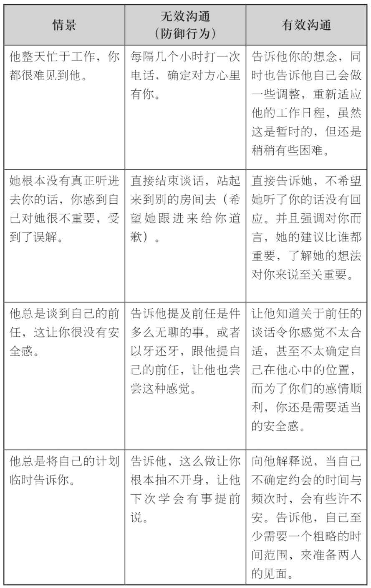
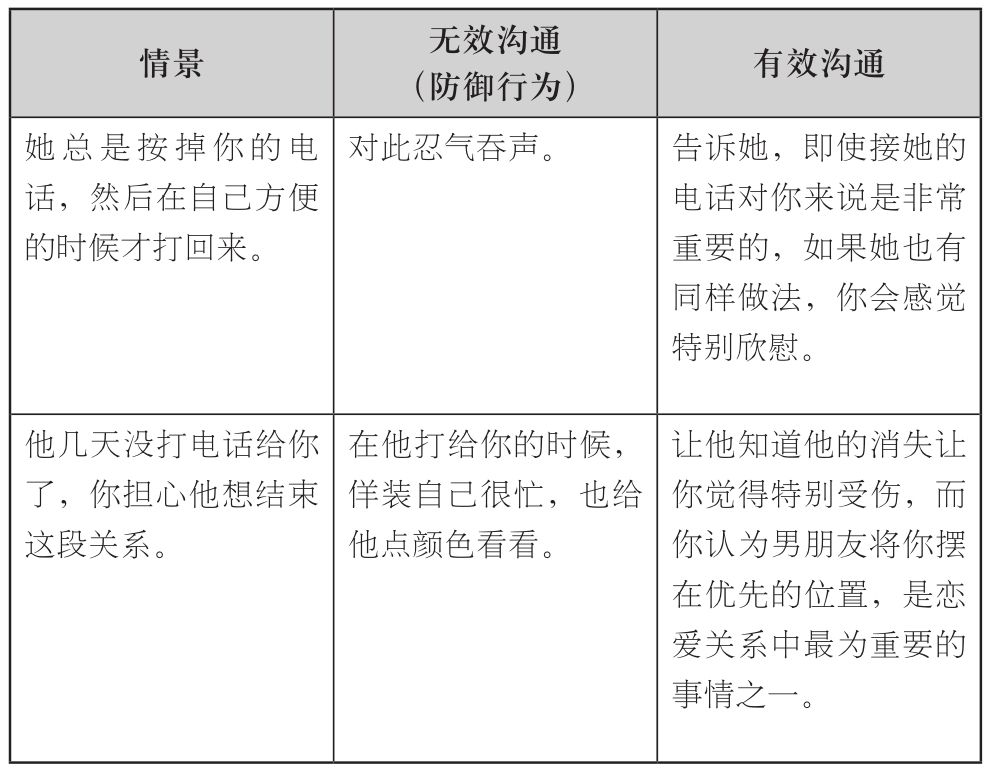

### 有效沟通的两个阶段

||初始阶段

当你还对有效沟通不怎么习惯的时候，建立一套你想传递的基础信息模板是非常有效的方法。你最好不要选择情绪不佳的时候做这件事，还有很重要的一点，就是你的朋友可能会给你一些曲线救国的建议，以此来满足情感需求，比如故意让伴侣妒忌，你必须得抛却这些建议。如果条件允许，你应该找到自己的安全角色榜样（详见第9章），或是安全型依恋风格的朋友，再或是非常熟悉有效沟通法则的人来帮助你组织这套信息模板。确定下基本的体量以后，试着用最适宜的语调叙述出来。将这些信息先写下来，能够在你退缩或者忘掉“底线”之时，帮助你克服恐惧和焦虑，同时也有助于带着自信来面对伴侣。当你对有效沟通熟能生巧，并且在实际生活中尝到甜头，有效沟通也就自然成了你的本能之举。

||实践阶段

回答下面的问题，定下有效沟通的基调。

我为什么会在这段关系中感觉到紧张与不安全（依恋机制的激活和抑制）？我的伴侣到底做了什么，才让我有这种感觉（这里可以参见第9章的依恋关系目录）？

1______________________

2______________________

3______________________

我伴侣做些什么，会令我感觉到安心与爱意？

1______________________

2______________________

3______________________

哪些行为是我最想体验或者展开讨论的？

1______________________

2______________________

3______________________

这最后一个问题的答案，就将指导你定下第一次有效沟通的基调。接下来，就将自己的有效沟通模板简短地写在下面，记得附上有效沟通的五条原则。

我的有效沟通脚本：

______________________

______________________

______________________

______________________

______________________

多看一下后面的例子，它们是在特定情况下，有着特定意义的有效沟通方法，注意体会有效沟通与无效沟通的不同之处。你就能明白，为什么伴侣在两种沟通方式之下的反应，有如此显著的差别了。

非常重要的一点在于，即使采用了有效沟通，有些事情也没法马上解决。事情的关键点在于对方的反应，这取决于他是否在意你的情绪，将你的快乐放在心上，并且愿意做点什么让你舒心。
