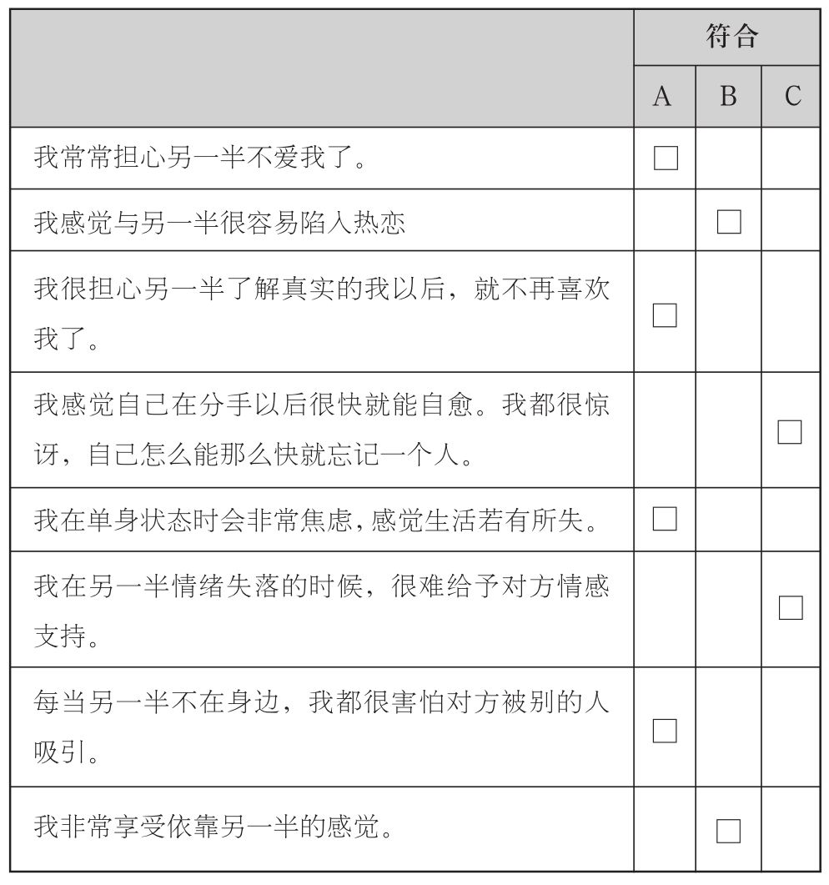
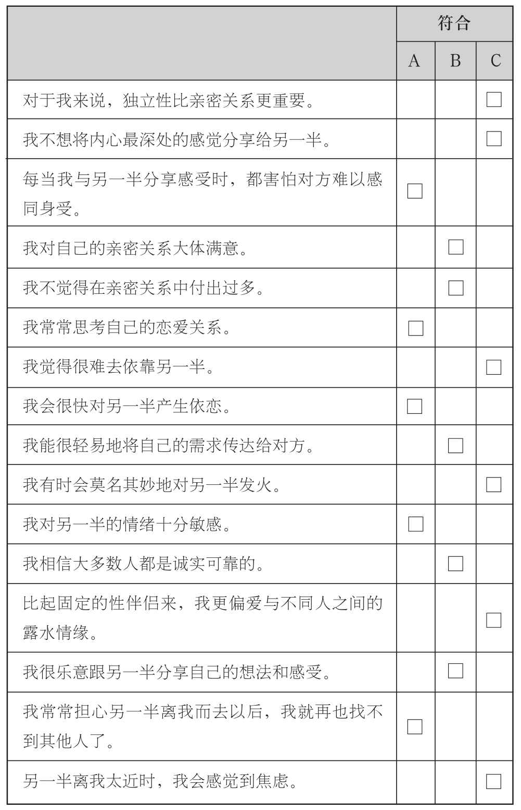
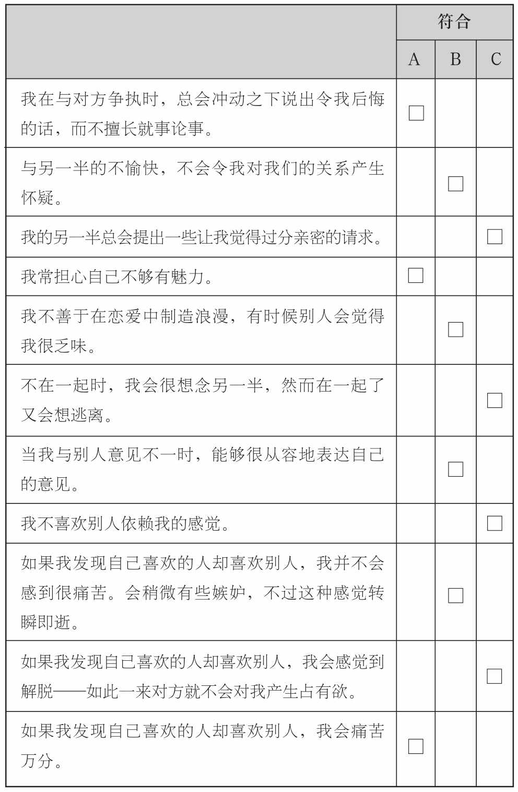
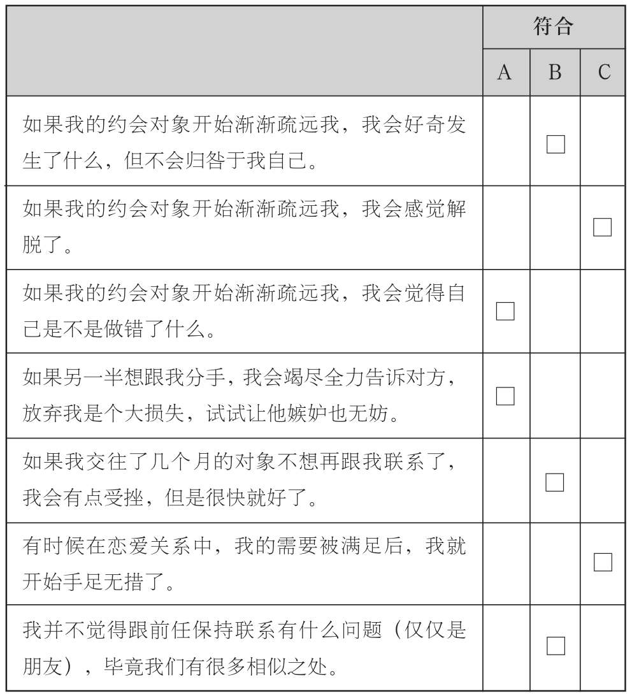

### 了解自己的依恋风格

下面是一份测量你依恋风格的问卷，其中的问题都是基于你在亲密关系中，与对方相处的方式而提出的。这个问卷是基于《亲密关系问卷》（Experiences in Close Relationships Inventory，简称ECR）而修订的。原始问卷由凯利·布伦南（Kelly Brennan）、凯瑟琳·克拉克（Katherine Clark）以及菲利普·谢弗于1998年公开发表。谢弗还同辛迪·哈赞一起发表了原版的《爱情测验》。《亲密关系问卷》包含一系列短小的问题，这些问题是基于两个主要依恋风格，即焦虑型与回避型而提出的。后来，来自伊利诺斯大学的克里斯·弗雷利（Chris Fraley）与尼尔斯·沃勒（Niels Waller）以及凯利·布伦南合作，对《亲密关系问卷》进行了修订，从而得到《亲密关系问卷》修订版。而我们在此对这份问卷进行了微调，以使问卷的内容更好地与日常生活相结合。

依恋风格是相对稳定，但同时又极具弹性的。对自己特有依恋风格的了解，会帮助你更好地认识自己，同时对你与他人的交往产生指导意义，进而在亲密关系中获得更多的幸福感。

请在下列的陈述中，选择符合你情况的语句，并在表格内的小方框里打钩。（如果你认为该句不符合你的情况，不必做任何标记。）

对你在A列方框的打钩数进行加总___________________对你在B列方框的打钩数进行加总___________________对你在C列方框的打钩数进行加总___________________

||测试结果？

你在一个类型下打钩越多，就意味着你更倾向于对应的依恋风格。A类代表焦虑型依恋风格，而B类和C类分别代表安全型和回避型。

焦虑型：你非常愿意与恋人粘在一起，也非常善于亲昵的行为。但是你常常感到害怕，你害怕恋人并不像你想象的那样，乐意与你靠近。你会将很多情感精力投入到亲密关系中。伴侣的行为和感受哪怕有一丝小小的波动，你都会非常敏感，你将伴侣的行为过于强加给自己，这就会导致在亲密关系中，你将产生很多消极体验，也会很容易情绪低沉。如此一来，你很可能一时冲动，产生一些事后会后悔的语言和行为。不过，如果对方给予你足够的安全感和抚慰，你就能消除很大一部分的忧心，也会获得更大的满足感。

安全型：在恋爱中表现得温暖又体贴，这是你的天性使然。你享受恋爱中的亲密举动，也并不会对此过于担忧。你可以镇定自若地处理恋爱中的突发事件，也并不会轻易感到沮丧。你会将自己的需求和感受，有效地传达给伴侣，同时也对伴侣的情绪暗示有着很强的解读与反馈能力。你会与伴侣分享成功的喜悦和失败的反思，同时也会在对方需要你的时候给予支撑。

回避型：对于你来说，保持独立性与自我价值感是最为重要的，因此你非常看重恋爱关系中的自主权。即使你是愿意与对方接近的，但是伴侣近在咫尺的感觉还是令你很不舒服。你绝不会在亲密关系或者遭到拒绝这类事情上，花太多时间和精力。你并不愿意对伴侣完全敞开心扉，因此他们会抱怨你太过疏离。在亲密关系中，你对于伴侣表现出的任何关于控制和约束的信号，都保持着高度的警惕。
