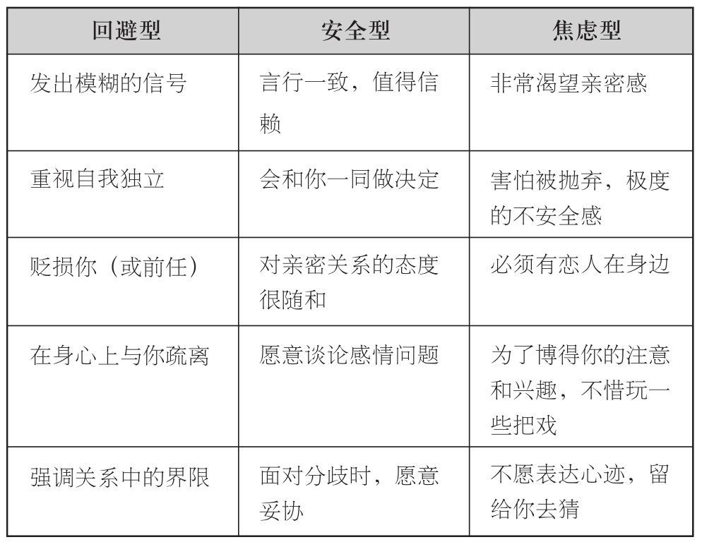
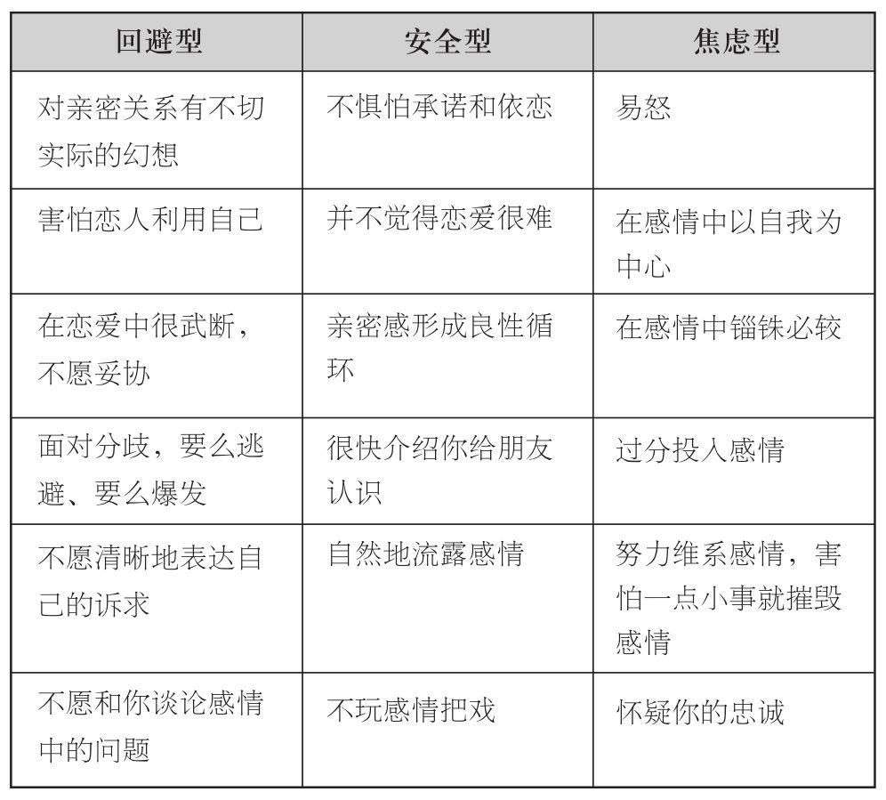

### 解读依恋风格的“黄金法则”

如果你还是不能完全确定，这里有五条“黄金法则”，它们可以帮助你更精准地确定伴侣的风格：

1.确认对方是否渴望亲密的行为。

这是对你的伴侣进行评估的首要问题。所有其他的依恋表征和行为，都是由这条非常核心的原则所衍生而来的。如果你的伴侣确实对亲密的行为非常渴望，那他要么是焦虑型，要么是安全型；反之他就肯定是回避型（详见第3章中，对于依恋关系的两个决定性维度的叙述。）在回答这个问题之前，我们要先避免一些先入之见。事实上，人们的依恋风格与性格特征并不一定完全相同。一个骄傲自满、自命不凡的人，也可能同时非常需要亲近。而反过来说，一个看上去非常软弱或者木讷的人，也可能非常抗拒亲密行为。这时你应该问问自己，对方的特定行为中，是否暗含着他对亲密感的态度？他是否通过一些行为（或避免一些行为）来企图减少亲密感呢？

假设你正在与一位离婚并带着孩子的人交往。或许她并不愿意把你介绍给孩子们，因为她顾及孩子们的感受，也并不希望过早地令孩子们知道，有一位新的男人进入了自己的生活，这一切都是完全合理的。而另一方面，这也可能是她为了保证自己的私人空间，而与你保持一定距离的方式。你必须从宏观的角度来看待这些行为到底意味着什么。随着时间的推移，以及你们感情的日益稳固，她是否依然理所当然地在你和孩子之间有所防备？这时候，恋爱初期这种行为所反映出的意义，到了恋爱两年之后就完全是另一重含义了，时机到了却还不把你介绍给孩子，前面所说的理由似乎就有些牵强了。那么这时你应该注意到，她会将你介绍给其他的亲朋好友吗？如果没有，她是否会考虑你的感受，对这种情况进行解释，允许你表达自己的看法呢？如果这一系列的回答都是否定的，那就可以确定并不光是孩子的问题，而是她实实在在想要与你保持距离。

2.确定他对于恋情的投入程度，以及对遭到抛弃的敏感程度。

他是否太容易因为你的随口直言而受伤？他是否对于你们的未来，以及你对他的忠心度有着过度的担忧？他是不是对于恋情中关于保持距离的细节非常敏感，比如说你做出了某个决定，却没把他考虑进去？如果这一系列问题都得到了肯定的回答，那么对方八成就是焦虑型依恋风格。

3.不要依靠某种“症状”就一概而论，要从各方面来进行判断。

仅仅关注某一种具体的行为、态度或者信念，都不足以确定伴侣的依恋风格。这也就是为什么决定一个人的依恋风格的，并非一种单一的特征，而是多种行为和态度的集合，才能形成某种风格的综合范式。只有全面地观察，才能最终发现事实。或许不把你介绍给自己的孩子，的确是件令人挫败的事。然是与此同时，对方又十分愿意跟你阐释原因，并且倾听你的挫败感，或者采用其他的方式将你纳入自己的生活中，那就不能将她定义为“缺失亲密的能力”。

4.与对方进行有效沟通，并且观察他的反应

不要惧怕将自己的需要、想法和感受与对方分享。（到第11章，会详细展开如何进行有效沟通）有效沟通是解密伴侣依恋风格的最有效途径之一。我们在恋爱中，总是以不同的方式在抑制自己的感受：比如我们不想表现得过于依恋对方，或者我们会觉得讨论某些话题为时过早。然而，你真实想法的表达，正是对对方到底有多大程度满足你需求的最佳试金石。与此同时，恋人对你诉求的反应，也比其他任何的话语，都更能揭露他们属于哪种风格。

- 安全型依恋风格：他会迅速理解，并努力满足你的需求。

- 焦虑型依恋风格：你的坦诚会成为他的榜样。他会因为你的坦诚而非常开心，同时变得与你一样开诚布公，而你们的关系也会更加亲密。表达情感所带来的感情升温，对他来说却是一种煎熬，他会通过下面的方式来回复你：

◎“你简直太敏感/多事/粘人了！”

◎“我不想谈这件事了！”

◎“别什么事情都上纲上线好吗！”

◎“我又没做错什么，你到底要我怎么样？”

◎“天哪，我不是跟你道过歉了？”

5.仔细观察那些对方不愿说的话，不愿做的事。

你的伴侣不愿意说什么、做什么，往往就暗示了他们倾向于如何言行。这时你应该相信自己的直觉，进一步推测他们的依恋风格。来看下面两个案例：

新年之夜，罗布（Rob）深情地亲吻了女友并对她说：“真的很幸运能和你在一起，这是我们在一起的第一个新年，希望今后还有很多个。”他女朋友回吻了他，但是没有做出回答。两个月后，他们就分手了。

在一场争执中，帕特（Pat）向男友吉姆（Jim）抱怨说，他从来不会提前做计划，这点让她大为光火。她觉得凡事提前通知，特别是列出计划才会更有安全感。吉姆没有正面回应，随即跳开了话题。往后，他还是在最后一刻才打电话给帕特。她屡次提到，而他却屡教不改。最后，帕特忍无可忍，提出了分手。

恋人依恋风格对照表

“黄金法则”

- 确认对方是否渴望亲密的行为。

- 确定他对于恋情的投入程度，以及对遭到抛弃的敏感程度。

- 不要依靠某种“症状”就一概而论，要从各方面来进行判断。

- 与对方进行有效沟通，并且观察他的反应。

- 仔细观察那些对方不愿说的话，不愿做的事。
