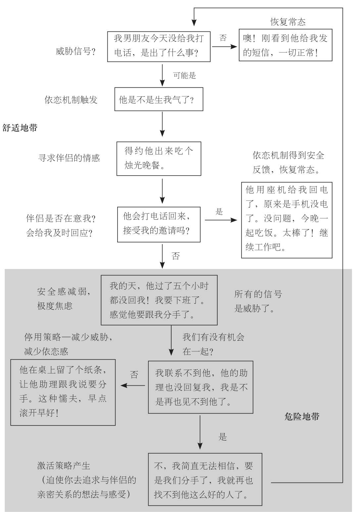

### 依恋机制的工作原理

对于那些迅速产生依恋，并具有极其敏感依恋机制的人来说，即使了解这种机制的运行原理也是于事无补的。诸多像艾米莉一样，呈现出焦虑型依恋风格的人，他们会在没有意识到的情况下，被一种长期处于激活状态的依恋机制所缠身。在下一页，我们将阐释这种依恋机制的工作原理。

依恋机制：寻找舒适地带

在艾米莉与大卫在一起时，就亲密关系来说，她将自己的生活置于一个“危险地带”。她感觉自己是个丧失防护网的走钢索者，焦虑地苦苦挣扎，试图在经历无限循环的激活状态时，能够保证情感上的平衡，在周而复始的循环之间，仅仅残存着罕见而短暂的安全感，能够算是喘息之机。她的一切想法、感受与行为都被一件事所左右，那就是大卫没空陪她。她对于亲密关系，几乎从未间断地存有威胁感。她总是尽力去消除这种威胁感，通过努力地接近他，来将威胁感最小化——花费诸多宝贵的时间，在网上乔装成其他人，抑或是不断地在接受分析，或者与朋友交谈时提及他。这样一来，她便能无时无刻不将他印在脑海里。所有这些看似古怪的想法和行径——也就是激活策略——都有着共同的目标：就是建立与大卫的亲密关系。若是大卫时刻陪伴着艾米莉，那么这些激活策略便会被扼杀在摇篮里，而并非不断地膨胀直到失控，艾米莉也永远不会脱离亲密关系之中的“舒适地带”。如今艾米莉已经结婚，也不再感觉自己受困于危险地带。她的丈夫忠诚、悉心，最重要的是有空陪她。然而她依旧深谙一点，那就是激活状态下的依恋机制会迸发出强大的强迫性。若是她进入另一段对方并不时刻有空的亲密关系，那么自己多半又会被打回成那个“痴缠的”自己。这种对旧事可能卷土重来的预感，往往令她感到脊背发凉。
