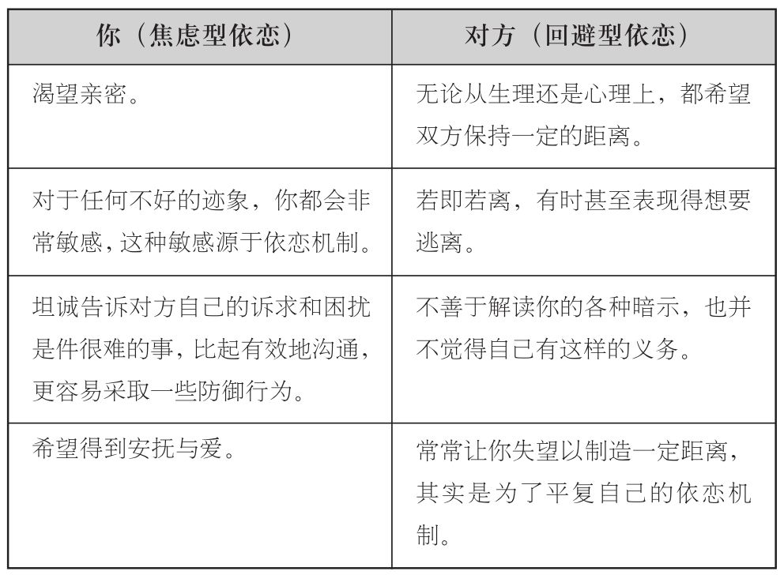
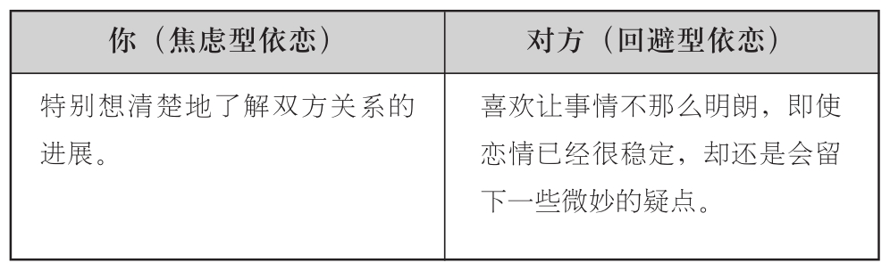

### 过山车般的情绪起伏

不过，一个焦虑型依恋风格的人爱上回避型，其实还有另外一个原因。在艾米莉那个例子中，大卫通过各种微妙线索表现出来的不确定性与不在场感，让她觉得非常没有安全感。这是焦虑型依恋风格的人在与回避型人群一开始交往就常常面临的问题。随着恋情的开始，若即若离的感觉也会应运而生。对方会打电话给你，但是时间却不一定；对方的确喜欢你，却让你感觉到他仍在游戏人生。而你，只能无尽地瞎猜下去。每当感觉到若即若离的不明确信号，焦虑型的人就会立马触发依恋机制，开始无限纠结于恋情。但这个时候，对方往往又会抛出一个浪漫的讯号，令人重新心潮澎湃，并且进行自我安慰，告诉自己对方是多在乎你，自己的心情也会恢复愉悦。然而，这种快乐往往非常短暂。很快，这种好消息又会变得模棱两可，令你难以捉摸，而你会再一次发现自己的心情堕入谷底，仿佛坐着过山车一样。而这时，你已经深陷在怀疑之中难以自持，眼巴巴期待着下一个小小的信号或手势到来，能够再一次将你安抚。一旦你陷入了这种情感，便会做出一些令人匪夷所思的事情了。你渐渐开始把焦虑、过激、心绪难平以及由此爆发的怒火，都等同于爱情的乐趣。而你的这一系列行为，本质上来说是将激活的依恋机制等同于恋爱中的激情。

而这种情况往往会一发不可收拾，你会不自觉地爱上那些令你痛苦的人。而你的依恋机制越演越烈，就意味着你与心目中完美的爱情渐行渐远。正如我们之前所见，鲍尔比和安斯沃思最为重要的发现就是，一个人想要健康地发展和成长，就需要一个“安全基地”，来给予自己力量和抚慰。而这一切的前提，就是拥有安全而稳定的依恋机制。

焦虑型依恋风格的人，不适合选择回避型作为伴侣，原因如下：

