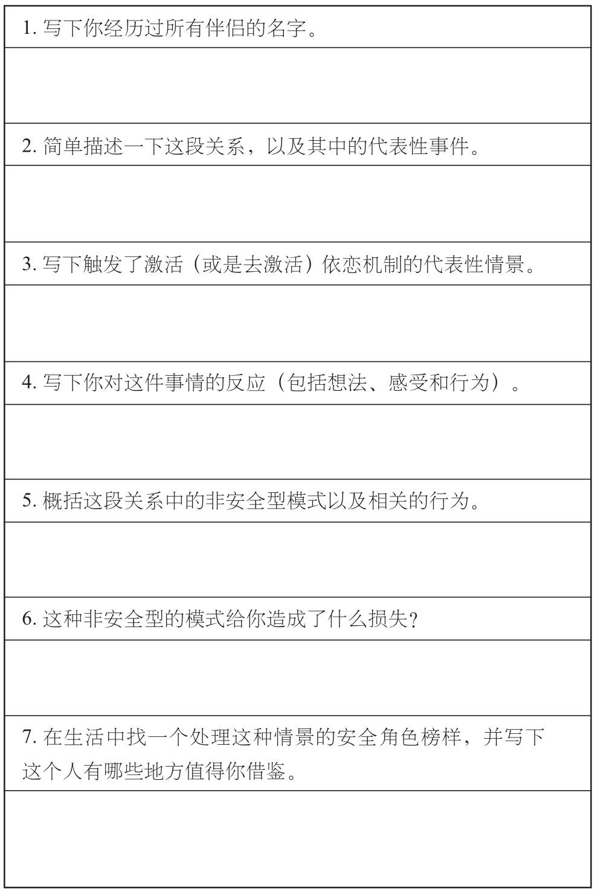
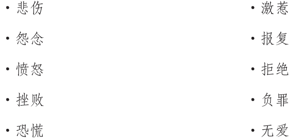
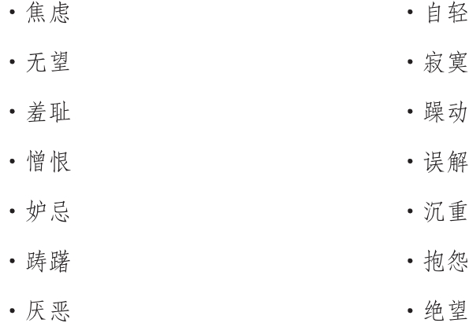
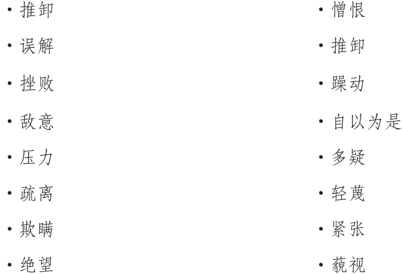

### 重构你的“工作模式”

在依恋风格的研究中，所谓“工作模式”，就是用来描述我们在亲密关系中的基本信念机制，也就是指导我们一切行为的基础。“工作模式”决定了我们想做什么、不想做什么，以及我们的态度与期待。简言之，其主导了你在亲密关系中所表现出的一切。而在一开始，充分了解自己的“工作机制”，正是逐步建立安全感的当务之急。充分了解以后，你才能进一步辨别出哪些思维、感受与行为范式，才是有助于安全感建立的。

||构建自己的亲密关系目录

综上所言，你首先要做的就是了解支配你在亲密关系中表现的“工作模式”。虽然你可能通过前面的阅读，已经有了一些对于依恋风格的不错见解。但是建立一个自己的亲密关系目录，依然可以帮助自己更清楚地了解自己的依恋风格，到底是如何影响日常亲密关系中的思维、感受和行为的。

这个亲密关系目录从依恋风格的角度出发，可以贯穿过去与现在经历的多段关系。一系列对于记忆和学习微观机制的研究都发现，无论是在什么时候，只要我们回忆起一个场景，或者令某一段记忆进入意识，我们都会对其进行重新建构组合。我们的记忆并不像是图书馆里的旧书一样，即使蒙上厚厚的灰尘也将亘古不变；我们的记忆更像是一个鲜活而有生命的个体。今天对于过去的回忆，事实上已经是一种多年以后我们提取特定记忆时，进行了编辑与重构的产物。换言之，我们现在的经历塑造了我们对于过去经历的看法。而通过建构自己的依恋风格目录，我们会从一个全新的视角，来重新审视自己对过去亲密关系的总结。透过依恋风格目录，我们可以反省并改变一些附着于特定记忆中的无效信念，从而建构起一个更加具有安全感的工作机制。

后文所附的表格，就是亲密关系目录的有关格式。对于目录的制作应该由自己独立完成。最好是预留出足够的时间，将其一次性填完。这样，你才更容易从依恋风格的视角出发，对自己有一个完善和精准的了解。在第一行，你需要将经历过的所有伴侣名字填下来，这一行的信息可以简要涵盖出你所有的约会对象。我们建议在表格的填写中，一行一行地完成目录，可以避免你的注意力被其他场景所分散，并且有助于在这些亲密关系中，建构出一个由很多个人结合而成的“安全角色榜样”，也有利于你收集更多有效的信息。在第二行，你要写出你对这段关系的记忆，包括对这段关系的一个描述，以及每当想起这段关系时的一个标志性事件。在你写下对于亲密关系的总体印象之后，第三行的内容则会让你对特定场景有一个更细致的视角，以此观察到自身依恋机制中的激活或去激活策略，是被哪些情景所触发的。而第四行则要求填写你对这些场景的反应方式：包括你当时的所做、所想以及所感。这个目录下的内容，就主要是帮助你回忆自己的各种反应方式。

第五行是接下来非常重要的一步，你要从依恋风格的角度来评估前面填下的这些经历，以此来触及影响你亲密关系的核心因素。到底是什么因素导致你如此反应？是防御行为？还是去激活策略？在这列清单上就将一目了然。到了第六行，你就要更多地考虑自己的反应方式，并将这些方式以成人依恋的相关原则转述出来，将这些伤害与阻碍你亲密关系的行为都罗列出来。最终到了第七行，则是让你寻找一个更加具有安全感的新方式，来应对这些情景，这就需要借鉴你所遇到的安全角色榜样，以及我们在书中所提到的一些安全型处事原则。（详见后文框内）

亲密关系目录

焦虑型人群的一贯反应

焦虑型思维

- “读心术”：嗯，我就知道他肯定是要离开我了。

- 我注定要孤独终老了。

- 美好的事物总是短暂的。

- “全或无”思维：我把一切都搞砸了，我拿这种情况无能为力了。

- 我再也不吃这一套了，我要让他好看！

- 好像事情不太对劲儿，哎，对我来说什么都不太对劲儿。

- 我待会儿得去看看他，跟他搭上两句话。

- 他一会最好来求我原谅他，否则我俩就玩儿完了！

- 要是我更引人瞩目一点儿、再性感一点儿，事情就不会像现在那么糟糕了。

- 他那么优秀，为什么会同意和我在一起？

- 一旦发生争吵，脑海里就全是对方的不是。

- 在争吵渐渐平复以后，又能回忆起伴侣的种种美好来。

焦虑型情绪

焦虑型行为

- 善于伪装

- 要跟对方做出清算

- 挑起冲突

- 期待对方先做出妥协

- 威胁对方要分手

- 表现出恨意——比如翻白眼，轻蔑地斜瞟

- 试图挑起对方的醋意

- 假装自己日理万机，无暇顾及对方

- 冷暴力——不和对方说话或拒绝身体接触

- 耍一些把戏

回避型人群的一贯反应

回避型思维

- “全或无”思维：我知道对方不适合我，肯定是这样的！

- 以偏概全：我根本不适合拥有亲密关系！

- 他一直在干预我的生活，我快控制不住了。

- 自从在一起后，什么都要迁就对方，代价实在太大了。

- 我想离开这里，我快窒息了。

- 如果他真的适合我，这些糟糕的事儿就不会发生。

- 我要是和XX（前任的名字）在一起，就不会发生这样的事。

- 恶意揣测：这太明显了，她就是在故意激怒我。

- 他只是想把我束缚住，这根本不是真爱！

- 幻想着和其他人产生恋情。

- 我自己一个人过可能会好些。

- 哎，他实在太粘人了，真是让人悲哀。

回避型情绪

回避型行为

- 善于伪装

- 产生冲突起身就走

- 贬损你的伴侣

- 表现出敌意，轻蔑的眼神

- 对伴侣吹毛求疵

- 身心上的撤退

- 感情上的分享极少

- 不愿聆听对方的心声，常常忽视对方

各个依恋风格可能采取的原则

焦虑型

- 采取防御性为

- 激活策略：为了重归于好而产生的一切想法、感受或行为

- 将伴侣供上神坛

- 在伴侣面前，感觉自己渺小而劣势

- 在争吵之后，只想起伴侣好的一面而忘却他对你的伤害

- 在爱情中，太过频繁地触发依恋机制

- 总是处于感情的“危险地带”

- 情绪起伏非常大，并且沉浸在喜怒无常之中

回避型

- 采取去激活策略

- 将万事不求人误认为独立

- 通过贬低对方，来获得自我重要性和自尊的满足

- 对伴侣吹毛求疵，而看不到优点

- 对伴侣的行为总是恶意揣测

- 感觉不到对方的情绪征兆

- 对前任有着非常的热望

- 想象着“理想型”的出现

- 压抑自己的情绪和感受

安全型原则的范例

- 有空陪伴对方

- 不过多干涉对方

- 给予对方支持和鼓励

- 有效沟通

- 不耍心机，不玩把戏

- 将伴侣的幸福作为己任

- 内心坦诚，在交往时积极而赤诚

- 就事论事

- 在产生冲突时，不会以偏概全

- 防患于未然——在对方的负面情绪爆发之前，就进行一些安抚

你可以让一位了解你依恋风格的人，比如说家人、密友或者你的心理治疗师，跟你一起来填写这份亲密关系目录。可以请他们作为你的依恋风格顾问。当你的判断被激活或去激活策略左右，或是依恋机制有些失控时，可以寻求顾问的帮助，或许能够产生看待问题的新视角。一位称职的依恋风格顾问，可以在你的不良依恋倾向产生时提醒你，并且帮助你在采取行动伤害这段关系之前，就将情绪转化为安全型，令双方进入舒适地带。

填完这份亲密关系目录，想必也能够了解自己在亲密关系中的行为模式，以及那些可能会干扰你的幸福生活以及工作效率的不当行为。或许你也更深入地了解了自己在（过往或现在）不成功的恋情之中，致使你与伴侣产生冲突的不良情感模式。接下来，就能够进行更深入的总结了。

||亲密关系目录汇总——我的行为模式

- 写下那些在亲密关系中，容易导致你依恋机制激活（针对焦虑型人群）或去激活（针对回避型人群）的特定情况。

___________________

- 列举出一些阻碍你获得安全感的无效行为模式。

___________________

- 列举出你亲密关系中，最常遇到的依恋问题。

___________________

现在，请再次回顾你的亲密关系目录，回想一下那一位或几位安全角色榜样，是否在亲密关系问题的处理上，给予了你一些启发？

- 在这些特定情况下，他们会怎么做？

- 他们会对此持什么样的观点？

- 如果他们知道你面临这些问题，会给你什么样的建议？

- 从他们处理问题的方式，你能获得哪些经验？

上述问题的答案，有助于你填写亲密关系目录的最后一行，也是至关重要的一行内容。而下面的两个例子，可以帮助你更好地利用这份目录，令它对你的亲密关系产生真正的帮助。
