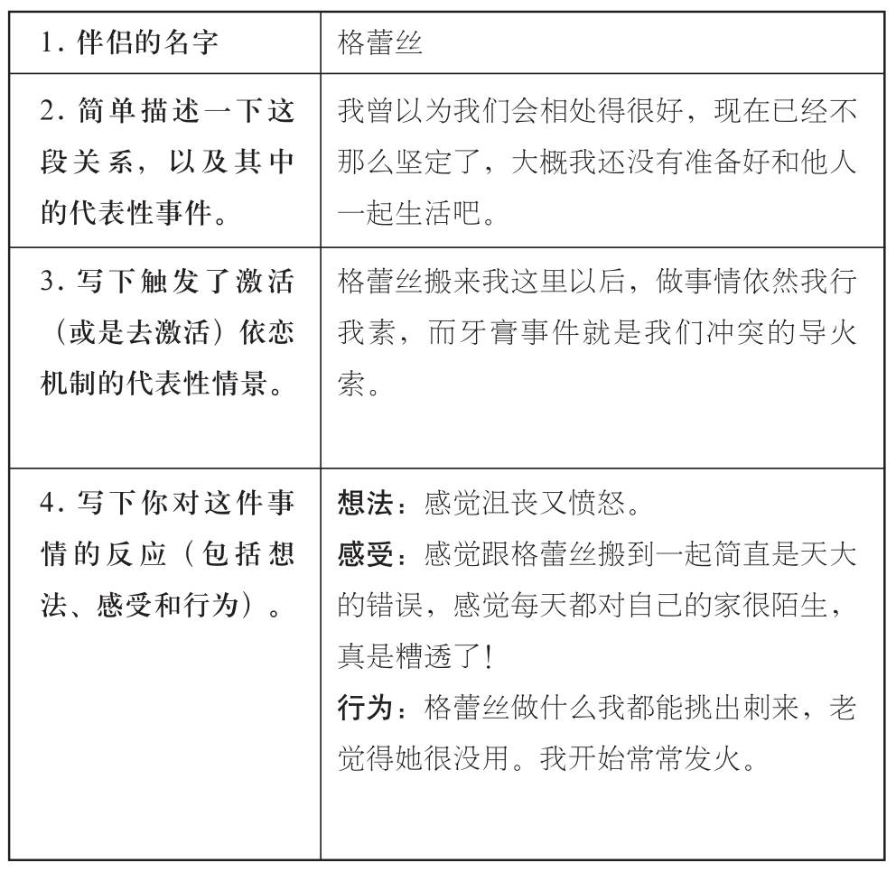
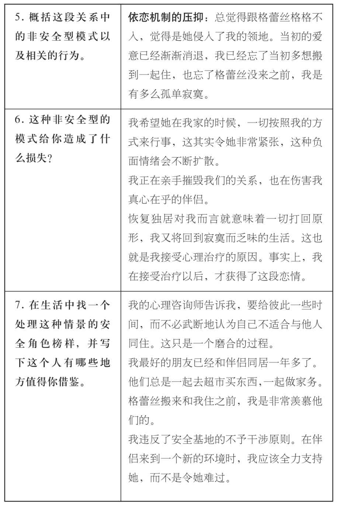
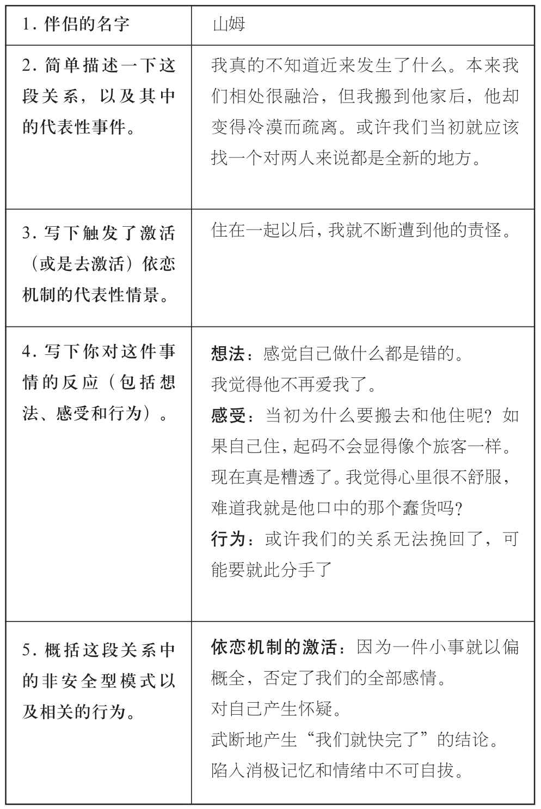
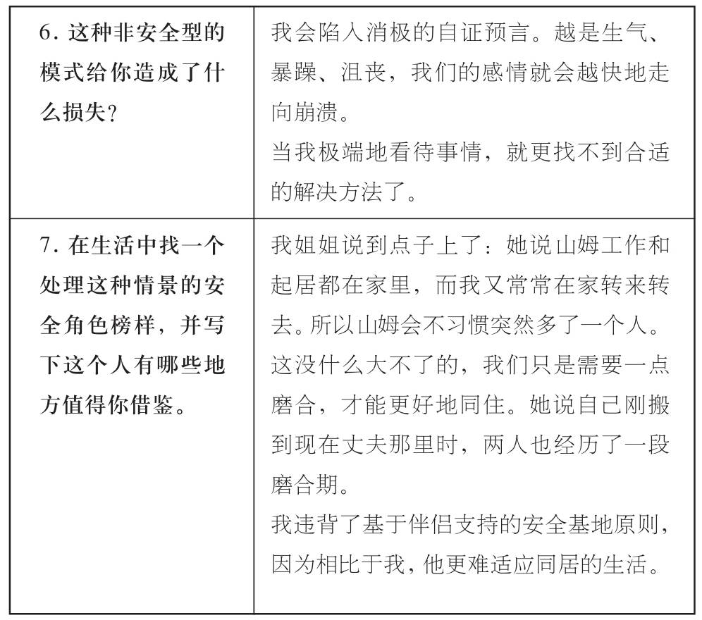

### 距离产生美

山姆（Sam）在格蕾丝（Grace）搬到纽约之后，就很想让她搬来和自己一起住。他们在一起两年多了，山姆强烈地感觉，是时候让两人的关系更近一层了。不仅如此，他们常常在对方住处一待就是一整天，住在一起就能省掉一笔房租了！但格蕾丝并不想和搬进山姆的小公寓，她想找一间更宽敞的房子，两人就能各占一间房。但山姆不想这样，一来他很喜欢自己的小房间，也找不到任何理由在已经有住处的情况下，增加自己的住房开支。一来他确信两人可以在小公寓里面和谐相处。不过，他还是有一点小顾虑。毕竟从没跟别人住在一起过，而每个人有自己的生活方式。多年以来，他都觉得自给自足的生活伴随着孤单，因此自己想要另一种生活。而格蕾丝搬进来以后，山姆感到了前所未有的压力甚至自己快要窒息。她的东西放得到处都是，仿佛令他失去了从前的避风港，他强烈地感觉到自己家被占领了。直到有一天，牙膏事件的发生，让他觉得自己真的失去了从前的港湾。格蕾丝总是习惯从中间挤牙膏，而山姆必须小心翼翼地从底部往上挤。当他看到牙膏管中段的不平整，他终于莫名发火，大声抱怨格蕾丝的粗枝大叶。此时的格蕾丝手足无措，她一直竭力控制自己的行为，在公寓内做什么都如履薄冰。而这次冲突触及了她的最后底线。

思忖片刻后，山姆做出了下面的亲密关系清单：

而与此同时，格蕾丝也填了下面这份目录：

在填写完亲密关系目录后，山姆意识到独居多年的经历，以及对自我依靠的坚定信念，是自己面临的最大挑战。他被这种挑战所击倒，现在需要重新建立对格蕾丝的理解和包容。而格雷丝也意识到，面对山姆与自己同住之初的无所适从，自己的确也手足无措了。而自己看待问题和反应的方式，也在深深伤害着这段感情。她很赞同姐姐关于建立缓冲区的建议。刚好，她有一个闺蜜要离开纽约六个月，格蕾丝提出暂时租用朋友的工作室，用于自己的艺术创作和其他业余活动的场地，这样一来就不怕打扰到山姆了。而山姆对此感到很惊喜，从未想过格蕾丝会为了他做出那么大的改变。现在格蕾丝有其他地方可以去，他感觉如释重负，再也不必受到她所带来的困扰。而六个月以后，格蕾丝其实已经很少住在短租的房子里了，而她也不再需要忙着找别的住处，因为两人已经可以很和谐地住在一块了。
