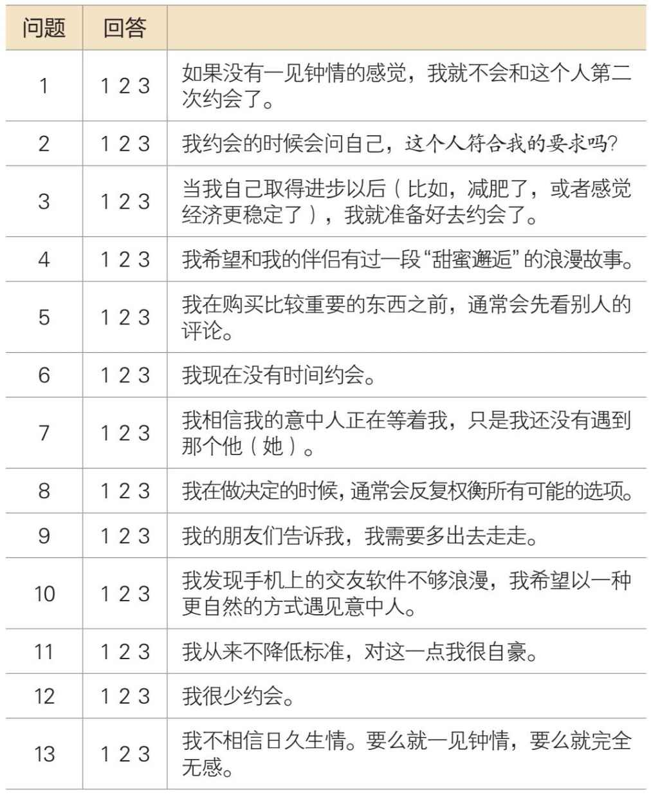
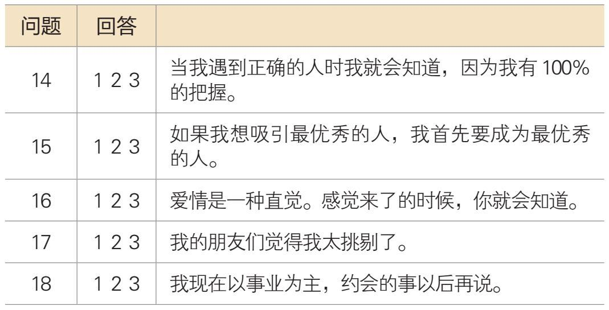

## 第二章

三种婚恋倾向

### 如何发现你的婚恋盲点

你是否曾经举目四顾，扪心自问：为什么除了我，每个人都找到了真爱？我喜欢我的工作，喜欢我的朋友，也喜欢我自己，可为什么我生活中的这个部分依旧没有走上正轨？

我几乎从所有的客户那里都听到过这类说法。我发现，他们中的许多人都有婚恋盲点，即某些阻碍他们找到真爱的行为模式，但他们自己却发现不了。

我把最常见的婚恋盲点分门别类成三种婚恋倾向。每一种倾向都在与不切实际的期望做斗争，这些都是对自己、对伴侣以及对亲密关系不切实际的期望。

下面这个测试将揭示你的婚恋倾向。它将帮助你认清是什么拖了你的后腿，这样你就可以改正坏的习惯，培养新的习惯。在建立亲密关系的每个阶段，你的婚恋倾向都会影响你的行为，所以，了解它们至关重要，这是你寻找爱情的第一步。

### 三种婚恋倾向的测试

#### 测试说明

认真阅读下面的每一项描述，判断它在多大程度上和你的情况相符。圈出你的回答对应的数字：

1.很不像我

2.有些像我

3.和我一样

#### 计分表

浪漫主义倾向：从第1题开始，每隔两道题，把得分相加（把第1、4、7、10、13、16题的分数相加）____完美主义倾向：从第2题开始，每隔两道题，把得分相加（把第2、5、8、11、14、17题的分数相加）____自我怀疑倾向：从第3题开始，每隔两道题，把得分相加（把第3、6、9、12、15、18题的分数相加）____你在哪种倾向中得分最高？它就是你的婚恋倾向。

#### 浪漫主义倾向

你要找的是灵魂伴侣，就像童话故事里说的那样——从此以后过上了幸福的生活。你钟爱的是爱情。你认为自己现在之所以单身，是因为还没有遇到对的人。你的座右铭是：该发生的注定会发生。

#### 完美主义倾向

你喜欢做研究，不肯放过任何选项，恨不得把每块石头都翻过来查个清楚，直到你确信找到了正确答案。你做决定的时候总是很谨慎，在做决定之前，你都要100%的确定。你的座右铭是：为什么要降低标准呢？

#### 自我怀疑倾向

你认为自己还没有为恋爱做好准备，因为你还没有成为理想中的自己。你对自己要求很高。在开始一项新计划之前，你总是希望自己完全准备好了，对恋爱也是如此。你的座右铭是：等到我成了他人眼中的理想对象时再说。

尽管这三种倾向看起来非常不同，但浪漫主义倾向、完美主义倾向以及自我怀疑倾向三者都有一个核心的共同点：不切实际的期望。

浪漫主义倾向对亲密关系抱有不切实际的期望。

完美主义倾向对伴侣抱有不切实际的期望。

自我怀疑倾向对自己抱有不切实际的期望。

如果你在不止一种倾向上得分最高，那么请你重新阅读这些描述，再选择最能体现你真实情况的倾向。如果你还是左右为难，可以把这三个选项发给你最信任的朋友。在验证这个测试准确性的过程中，我发现测试者的朋友们往往比测试者本人更能准确地发现他们的婚恋倾向。记住，这些都是你的盲点。朋友经常能看到我们自己看不到的行为模式。

我的倾向是（圈出一个来）：

浪漫主义倾向 完美主义倾向 自我怀疑倾向

在接下来的几章里，我会围绕这三种倾向做进一步的阐述，包括每种倾向的人群会遇到的挑战，以及如何克服它们。我建议接下来的这三章你都要认真阅读，因为这些内容对每个人都有帮助，而且还会帮助你理解和你有不同倾向的婚恋对象。

总结

1. 很多人忍受着婚恋盲点造成的痛苦。婚恋盲点是某些阻碍他们找到真爱的行为模式，但他们自己却发现不了。

2. 我把最常见的婚恋盲点分门别类成三种婚恋倾向。每一种倾向都在与不切实际的期望做斗争。

●浪漫主义倾向对亲密关系抱有不切实际的期望。他们希望找到灵魂伴侣，从此以后过上幸福的生活——这是彻头彻尾的童话。

●完美主义倾向对伴侣抱有不切实际的期望。他们喜欢对所有的选项反复研究，希望在有绝对的把握后，做出正确的决定。

●自我怀疑倾向对自己抱有不切实际的期望。他们觉得自己还没有准备好谈恋爱。

3. 认清你的婚恋倾向可以帮助你发现是什么在拖你的后腿，以及如何克服这些婚恋盲点。
