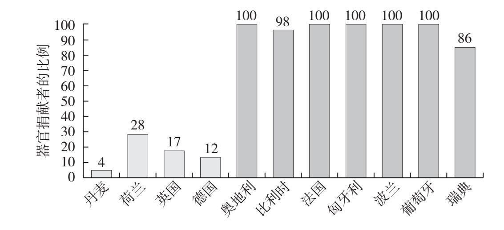

## 第十二章

开始第二次约会

### 如何决定要不要和对方再次见面

一段时间过去了，我的客户乔纳森逐渐改变了做法。他以前去约会感觉是在面试，现在不了。他放弃了咖啡馆，改去他家附近的一个鸡尾酒酒吧，那里的调酒师很棒，灯光也讨人喜欢。那个地方有点吵，正好让他有机会在约会对象的耳边低语。而且，他也不再幻想一见钟情了。

很快，早上7点咖啡馆的约会成了我们开玩笑的话题。乔纳森已经知道如何进行首次约会了，但他又开始纠结要不要和对方再次见面。

“老实说，”有一次在谈话中他告诉我，“我遇到了很多好女人。但约会以后，我发现自己老是在琢磨她们的缺点：无聊的工作、庸俗的幽默感、穿着随意。”

乔纳森总爱盯着负面的东西，但这不是他的错。我们的大脑就是进化来干这个的。

幸运的是，我们可以用一些办法克服这些冲动，这样我们就不会因为愚蠢而错过合适的伴侣了。我们可以训练自己寻找积极的一面，遵循婚恋中的金科玉律：不想被他人这么评判，就不要这么评判他人。

### 负面偏见

作为人类学家，海伦·费舍尔写过几本关于人际关系的畅销书。我采访她时，她解释说，我们的大脑已经发展出一种“负面偏见”，我们在本能上会反复思考哪里出现了问题。

如果你曾经收到过经理或者同事们对你的反馈意见，你记得更清楚的是哪类反馈？是赞扬还是批评？这就是负面偏见的作用。费舍尔说，我们的大脑已经进化到对负面体验过目不忘的地步，这样我们就能在未来避免它们。这种神经回路帮助我们感知和避免危险。如果你以前差点被剑齿虎吃掉，那么记住这种动物长什么样子、生活在哪里是很有帮助的。如今，我们身边的肉食性捕食者已经不多了，但我们的大脑保留了这一习性的现代版本：“如果你有5个前女友，其中一个恨你，”费舍尔说，“记住那个恨你的人是谁，对你很有帮助。”

这种思维方式对我们的祖先很有用，对现代人也有些价值；但它同时也给我们带来了麻烦——特别是在婚恋方面。这意味着在一次约会之后，我们更有可能对一个人的负面品质念念不忘（所以你总会记得上一次约会时那个口中散发着葱油饼味道的女孩，而不是那个对你的衣着赞不绝口的女孩）。

### 基本归因错误

除了负面偏见，我们还在无意中成为认知偏见的牺牲品。这种认知偏见造成我们对人的品质判断很不准确。其中一个偏见就是“基本归因错误”，也就是说，我们会认为，对方的行为往往反映出这个人的本质特征，而不是因为环境使然。当一个人犯了错误，我们往往把这个错误归因于这个人的本质特征：这个人本质上就是坏的。我们不会寻找外部原因来解释这个人的行为。

例如，如果有人约会迟到，我们会认为他们很自私，而不会假设他们遇到了交通堵塞。或者，当他们说要回短信却没有回的时候，他们一定是不拿别人当回事，而不是因为这周工作太忙。你我都知道，这样不分青红皂白就把人一棍子打死是不公平的。但在这些时候，我们的大脑会本能地做出这些判断。

### 寻找积极的一面

在负面偏见和基本归因错误的作用下，乔纳森的第一反应是拒绝和这些人第二次约会，这毫不奇怪。但如果他想找到一个长期伴侣，他就必须学会如何克服这些本能的冲动，寻找对方积极的一面。如果做不到这一点，他就会误判很多优秀的潜在伴侣。如果他不能和对方再次约会，他怎么能实现走进婚姻殿堂的目标呢？

看到生活中积极的一面是一种可以培养出来的技能。这就像肌肉训练一样，需要练习。心理学家肖恩·阿克尔通过研究感恩日记后发现，每天晚上写下三件新的、让你心存感激的事情，持续三周就会开始改变你的大脑感知世界的方式。通过这种练习，你会注意到以前忽视的事情，比如，赶在公共汽车开走时上了车是件多么美妙的事，或者和同事一起开怀大笑的滋味是多么美好。

在你约会时也可以做同样的事情。有意识地训练自己看到积极的一面。当和同一个人交谈时，看看别人可能会忽略的地方。正如哲学家兼作家阿兰·德波顿告诉我的那样：与其关注别人的缺点，不如运用你的“想象力”去“寻找他们的优点和可取之处”。

我曾经指导过一个客户，名叫格兰特。他非常消极，每句话都以“是啊，但是……”开头。他整天双臂交叉放在胸前，随时准备挑战哪怕是好消息。不出意料，他约会以后给我发的信息就像迷你版的《刁蛮女孩》（Mean Girls）毒蛇评语：“个子矬，不爱笑，工作烂，说话用词不正确。”

再次见面时，我让他坐下：“格兰特，你并不是个只有坏毛病和坏习惯的人，对吧？你并不是只有缺点没有优点。你是一个完整的人，有好品质也有坏毛病，你希望别人看到的和评价的是你的整体，而不仅仅是你需要改进的地方。如果不想被他人这么评判，就不要这么评判他人。”

每次约会后，我不许他对任何人列举约会对象的缺点，自己对自己说也不行。相反，他必须给我发信息告诉我关于约会对象的五个好的方面。就像阿兰·德波顿说的那样，他必须“运用自己的想象力”，透过表面，看到本质。

一开始，格兰特觉得这个练习很难。他告诉我的都是诸如“没有迟到”“没有用词不当”之类的评价。过了一段时间，他做得越来越好。以下是他发给我的一份清单：

1. 她很善良。我喜欢她对待餐厅服务员的方式；

2. 她很体贴。她问我工作中的一个重要会议的事情；

3. 她很重视家庭。她听到我介绍我奶奶的事情时，似乎很感兴趣；

4. 她非常聪明；

5. 接吻高手！!

尽管格兰特还没有找到终身伴侣，但和以前相比，他与约会对象再次约会的机会增加了很多。他学会了运用自己的想象力，而且更进一步，学会花时间去探索、理解和欣赏潜在的伴侣。

#### exercises

练习

寻找他人的优点

无论你是在交友软件上写评价，还是你们正面对面坐在餐厅里，你都要寻找对方的优点。你很容易发现别人的缺点——我们的大脑已经进化到保证能完成这个任务了。但是你要逼迫自己寻找积极的一面。在下次约会后，给朋友发短信，告诉他喜欢约会对象哪五个方面。好吧，好吧，如果我能帮上忙的话，你甚至可以给我发邮件（5goodthings@loganury.com）。

这样做会帮助你发现积极的一面。但是，如果你的约会对象犯了错，而你发现自己陷入基本归因错误之中怎么办？你可以为他们的行为想出另一个更富同情心的解释，以此来克服这种冲动。

情景：第一次约会就迟到了。

基本归因模式：他这人很自私。

同情模式：尽管他为了这次约会提前一个小时就出了家门，但火车还是晚点了。

情景：在最初发给他约会信息的时候，他回复得很慢。

基本归因模式：他这人很无礼。

同情模式：他这周工作太忙，但还是挤出时间来约会。

情景：她在吃晚饭的时候讲了一个糟糕的笑话。

基本归因模式：她这人的幽默感太俗气，我们合不来。

同情模式：她很紧张，试图逗我发笑。

下一次当你发现自己处于这些情景之中的时候，试着切换到同情模式，这样你就不会错误地拒绝一个潜在的合适的婚恋对象了。

### 利用默认选项的力量

我现在说的所有这些改变心态的方法都很困难。我们出于本能，会关注对方的负面品质，然后不再和这个人约会。但有一种方法可以让整件事情变得容易许多：利用默认选项的力量。

无数行为科学的实验证明，不需要任何行动的默认选项或者预设选项，会影响我们的行为方式。想象一下，你为一家汉堡店设计菜单，你需要决定默认套餐里都包含什么东西，也就是你的顾客随着汉堡自动得到的东西。是薯条吗？人们也可以换成沙拉；或者是沙拉，人们也可以换成薯条？只要你做出决定，它就成了默认选项；而大多数人都不会把默认的薯条换成沙拉，或者把默认的沙拉换成薯条。

看图4，你可以看到默认选项的威力：

##### 图4 欧洲各国器官捐献率

如图4所示，在欧洲，有的国家几乎每个人都签字同意捐献自己的器官；而另一些国家几乎没有人登记成为捐献者。虽然我们可以把这种差别归因为宗教观点或者文化传统，但事实并非如此。相似的国家（比如，丹麦和瑞典）器官捐献率就非常不同。

为什么会出现这种情况？这不是由于宗教或者文化的原因，而是由于默认选项。人们往往遵循默认选项行事，尤其是在面对一些艰难的、情绪化的决定时更是如此，譬如死后该如何处理自己的遗体，就是这样一种决定。在一些国家，比如，图4中用浅颜色显示的前四个国家，在调查表格上写着：“如果你愿意捐献遗体，请打钩。”很少有人打钩，因此很少有人登记成为捐献者。在另一些国家，这些表格上写着：“如果你不愿意捐献遗体，请打钩。”同样也很少有人打钩，因此大多数人就自动成为捐献者了。因此，图表中这些国家的器官捐献率就非常高。在这两种情况下，大多数人都坚持默认选项，没有打钩。这个由交管局的设计表格者造成的小小差别，却对器官捐献这样的重大问题产生了如此巨大的影响。

你可以在各种地方利用默认选项的力量。例如，我的一个朋友想减肥。他给自己设定了一个默认选项：不吃面包。只要有人给他面包，他就拒绝。他做这个决定时不需要费脑子，他按照默认选项做就是了。

现在想象一下这对你的约会意味着什么。你可以设计一个默认选项来帮助自己做出更好的决定。为什么不设置一个“你会进行第二次约会”的默认选项呢？这样做不仅能帮助你摆脱大脑关注负面事物的本能，还能推动你找出那种需要缓慢培养的爱情火焰，而不是一下子就能看出来的一见钟情。

当然，也会有例外。这里的假设是，你会和某人再次约会，除非发生了什么出格的事阻止你这样做（比如，这个人迟到了两个小时，身上带着臭鱼烂虾的味道，还吸毒）。

我的客户艾玛来找我之前几乎没有约会过。我们仔细修改了她的交友档案，改进了她和别人打招呼的方式，以及她的倾听技巧等。我们设定了一个目标，每周至少约会一次。作为一位追求卓越、以指标为导向的运营经理，她从鲜有约会很快就变成了一周多次约会。

一个月后，我意识到我很少两次听到相同的名字。“艾玛，你有没有和某个人第二次约会过？”再次交谈时，我这样问她。

她想了一会儿，说：“不，没有，都是首次约会。不过你瞧，我已经约会过很多次了！”

“非常好，”我说，“但不要忘记我们的最终目标——帮你找到一个人生伴侣。我希望你试着和别人约会第二次、第三次。”

她同意了，把第二次约会从例外选项变成默认选项。一周后，她给我发了一条信息：“我已经和昨天约会过的两个男士约好了第二次约会！”

这看上去也许有些流于表面，但这个简单的改变——关注第二次约会而不是首次约会——给她的恋爱方式带来了意义深刻的变化。又过了一个月，她和一个刚刚从痛苦的分手中恢复过来的男士进行了第二次、第三次……第十次约会，这个人和她非常谈得来。“他害怕受到伤害，但我们一直保持着联系。渐渐地，我们的感情越来越深，最后变得非常亲密。”他们现在仍然在约会，并考虑一起搬到奥斯汀去。

乔纳森最终依靠“默认的第二次约会”遇到了他现在的伴侣。乔纳森说，在找我咨询之前，他本来不会选择和这位女士约会，因为对方的身高低于乔纳森的最低身高标准。或者，即便约会了，乔纳森也不会再去第二次约会，因为他们的首次约会感觉只是“还不错”。幸运的是，他给了对方第二次机会。

“我们在一起很开心。她特别善于倾听和沟通。我们之间产生了不可思议的化学反应。她对我的需求超级上心。过去，我以为我想要的是那种气场强大的女性，但事实证明，那种人并不适合我。放弃那些错误的择偶清单，这成了决定性的改变——这使我更专注于我们在一起时的共同体验。”

你并不需要冒什么风险。首次约会的时候，你并不是在决定要不要选对方为人生伴侣，你只是在做决定，要不要和这个人再见面。仅此而已。与其一开始就因为各种认知偏见造成的第一印象就拒绝潜在的婚恋对象，不如推进一步，和对方进行第二次或者第三次约会，然后再判断他们合适不合适。

#### exercises

练习

把第二次约会设置为默认选项

“本人_____在此承诺，我会进行更多的第二次约会。”

签名：_____

日期：_____

### 可以容忍的小毛病

把第二次约会设置成默认选项，会给你更多机会和对方再次接触。那么，我的下一条建议就是：不要把生活中可以容忍的小毛病当成不能容忍、必须分手的理由。不能容忍、必须分手的理由是你们两个人的根本差异。有它在，你们潜在的亲密关系注定会失败。例如，如果你和你的约会对象信仰不同的宗教，而且你们都要求自己的孩子只能信仰自己的宗教，那这就是必须分手的理由。只要不是这类重大问题，其他都不过是有它更好、没有也正常的偏好。

几年前，我出席了一个餐厅的欢乐下午茶活动。一位35岁左右的女士找到我，说想和我谈谈她的恋爱生活。她的名字叫玛丽亚。

“我真的不挑人，和任何人约会都可以，”她说，“只要他不邋遢就行。”

在我们的谈话中，我发现玛丽亚之所以这么多年一直单身，其中一个原因就是，她的确把所有的男士分成两类：邋遢的和不邋遢的。

确实，邋遢很烦人。但同样烦人的还有：说话时嘴里塞满了东西，或者喜欢打断别人的谈话，或者把衣服扔得满地都是，直到看不见地板（这些我都干过）。但是从来没有科学研究表明，不邋遢就能带来长期的、成功的亲密关系。

你要把那些对长期亲密关系真正重要的东西放在第一位。不要让自己因为一些小事偏离轨道。你可能在拿这些小事作为防御机制——一种既能表现出愿意找对象的样子，又能保持单身，避免（不管出于什么原因）进入一段亲密关系的手段。

这就是发生在玛丽亚身上的事。她的错误在于把生活中可以容忍的小毛病当成不能容忍、必须分手的理由。让我们为这些名词明确下个定义：

无法忍受的小毛病：一件很小的事，在一些人眼里看来特别讨厌，比其他人的厌恶程度更甚。

可以容忍的小毛病：看上去像是无法忍受、必须分手的理由，但实际上只是一种生活中的小毛病。

不能容忍、必须分手的理由：不再和某人约会的真正理由。

想想你不能容忍、必须分手的理由都是什么。如果一个人有这些问题，你能想象与对方维持一段长期的亲密关系吗？如果可以，那就不是一个必须分手的理由。例如，假设你是一位女性，而你不能容忍的、必须分手的理由是：“他的身高低于1.8米。”现在，想象你遇到了一个风流倜傥、英俊潇洒的男士，他又善良，又善于倾听别人谈话，还有一群能逗你开怀大笑的朋友——但当他站起来的时候，你发现他只有1.75米。你还想继续和他约会吗？我几乎可以肯定你还想。所以，身高并不是不能容忍、必须分手的理由。

但假设你确定自己不想要孩子，而你们的首次约会进展顺利，在快结束的时候对方滔滔不绝地谈起她的侄女和侄子，谈到自己迫不及待地想要孩子。那么不管她多漂亮，不管你有多喜欢和她在一起，你们两个人对未来的计划都有着根本的不同。这就是一个必须分手的理由。

其他必须分手的理由还包括：一方认可一夫一妻制，而另一方不认可；你们中的一个人对亲密关系中的性别角色有很守旧的看法，而另一个人认为有不同的平衡方式；你吸烟却又不愿意戒烟，而另一个人有严重的哮喘。

逼着自己列两份清单：对你来说，什么是不能容忍、必须分手的理由？什么仅仅是你的偏好或者“有它更好”的东西？这个练习对乔纳森真的很有帮助。他从中了解到，他对身高的要求并没有他想象中那么重要，包括要求对方是企业高管也是如此。但是他知道他永远不会和没有幽默感的人约会。

#### exercises

练习

明确不能容忍、必须分手的真正理由

使用我们的新定义，写下对你来说真正重要的东西。

必须分手的理由：

1._____

2._____

3._____

可以容忍的小毛病：（我不会把它们和必须分手的理由混淆）

1._____

2._____

3._____

“有它更好”的偏好：（我不会把它们和必须分手的理由混淆）

1._____

2._____

3._____

### 我还得约会几次才能下结论

如果你同意把第二次约会作为你的默认选项，那么下一个问题就是：我应该和这个人约会几次？我应该把第三次约会设置成默认选项吗？

我没法告诉你需要两次还是三次约会就能判断一个人是不是一个好的长期伴侣。并没有科学数据表明这个数字是几。看看你们一起出去约会时你的心理感受吧：和这个人在一起的时候你觉得开心吗？对方让你感到快乐吗？你喜欢和对方在一起时自己的样子吗？你想亲吻对方吗？你对对方的兴趣是在增长、减弱，还是在艰难地向前跋涉？如果你的约会对象对你或者其他人不礼貌或者不尊重，就不要再见这个人了；同样地，如果你的约会对象让你感到不舒服、焦虑或者悲伤，也不要再见这个人了。

诚实地审视一下自己。你年龄多大？你已经约会多长时间了？你已经抱怨没有人让你一见钟情多长时间了？也许是时候换个方式，给某些人一些机会了。回顾一下我在第四章中说过的秘书问题，你很可能已经遇到过可以成为很好的长期伴侣的人了。

听着，我并不是让你马上出去找个人结婚。在第二次约会和结婚之间，你还有足够的时间考虑你们俩的亲密关系。我可没让你把结婚设置成默认选项！相反，你要把注意力放在眼前的事情上：你愿意再见到这个人吗？如果愿意，就让对方知道！

如何拒绝对方：千万不要玩消失！

你不可避免地会遇到这样一个时刻，你决定不再和某人继续交往了。你该怎么做？悄无声息地玩消失？不！当然不能这样做！这本书讲的就是如何目标明确地做出婚恋中的决定，其中就包括如何结束一段交往。

这是我对“玩消失”的定义：在交流中一方等待另一方的回应，却没有等到。比如，如果两个人约会，之后都没有给对方发信息，我把这叫作“双方退出”，而不是“玩消失”。但如果他们出去约会了，一个人给另一个人发信息说：“嘿，和你在一起很有意思。我们能再见面吗？”而另一个人一直没有回应。这就叫“玩消失”。

人们为什么会“玩消失”？我采访了很多人，问他们为什么总是不告而别。我经常听到的回答是：

“我不回信息是因为我不知道该如何解释我不想再见到对方的理由。”

“拒绝别人让我很不舒服，所以我就直接消失了。”

“我觉得直接拒绝一个人比消失不见更伤人。”

人们经常不告而别，因为他们认为自己是在避免尴尬局面，在保护对方的感情。

但事实真的不是这样。“玩消失”是恶劣的做法，而且很伤人，这会让对方处于进退两难的境地。除了一些显而易见的理由说明你不该不告而别以外，还有一个原因：玩消失会让玩消失的人自己感觉难受，还不如直接坦率地表达自己的感受。

我们可以用两种认知偏见解释这种情况：第一，我们不擅长情感预测。换句话说，我们不擅长预测某种情形在未来会带给我们的感觉。比如，我们把某个人晾在那里，自己不告而别，我们不知道此情此景在未来会带给我们什么感觉。其次，我们对自己的看法取决于自己的行为，并且会随时间改变。按照心理学家达里尔·贝姆关于“自我知觉理论”的看法，我们无法知道自己的内心思想和感觉，只能通过自己的行为来了解自己是什么人。正因为如此，有研究表明，志愿行为是提高我们幸福感最可靠的一种方式。志愿者的幸福和自尊程度总比非志愿者高。这是因为当志愿者完成志愿活动时，他们看着自己的所作所为，会想：我在花时间帮助别人。我一定是个非常慷慨的人！

人们“玩消失”是为了避免尴尬。然而，根据自我知觉理论，人们不告而别后，会看着自己的行为想：我做了一件不好的事。我大概是个浑蛋。这让他们的自我感觉更糟了。

我做了一个小实验，可以证明“玩消失”让人感觉更糟，而不是更好。我通过脸书和红迪网（Reddit）招募参与者。他们都是自称会“玩消失”的人，自称每个月都至少突然消失一次。在一项调查中，我问他们，在A：对某人玩消失或者B：直接给某人发一条信息说自己不感兴趣后，他们预计自己会感到多快乐？从1到5打分（从特别不快乐到非常快乐）。

不出所料，大多数“玩消失”的人都预计，他们在“玩消失”以后，会感觉“不好不坏”或者“快乐”；而在发送拒绝信息以后，会感觉“特别不快乐”或者“很不快乐”。

我要求其中的一半人在他们下次“玩消失”的时候，按照同样的1到5的顺序给他们的快乐程度打分；我要求另一半人不要“玩消失”。如果他们遇到了他们不想再见面的人，我让他们在约会后把这条信息发出去：“嘿，（此处插入姓名），和你一起谈论（此处插入谈话的话题）很开心。我不认为我们会成为浪漫的一对，但我很高兴认识你。”我让这些人将他们发送的内容以及收到的回复（如果有的话）截图发给我。

你认为会发生什么？大多数没有发送信息而选择“玩消失”的人表示，他们感觉自己的行为不好不坏，或者不怎么快乐。在跟踪采访中，他们说自己有负罪感。而当对方在首次约会后询问他们是否还想继续约会时，他们甚至都不想碰自己的手机。

那些直接发信息表示不感兴趣的人，有近2/3的人获得了对方的正面回应，剩下的就是根本没有回应。只有一个例外，对方回信要求提供更多的说明，说明哪儿出了问题，结果两个人吵了起来。

当人们“玩消失”的时候，他们认为自己走了一条轻松的道路，但他们错了。如果我们选择的是善良、坦率、礼貌的方式，我们往往会得到正面的回应。对方很可能回复并说这样的话：“谢谢你告诉我这些。祝你好运。”听到那个声音了吗？那是你松了一口气的声音。我们感觉更好了，因为对方刚刚肯定了我们是好人。

希望我已经说服你为什么不应该玩消失，不该不告而别。但有时候很难组织出合适的词汇，表达出“多谢，告辞”这个意思。找到方法，让自己能够更轻松地完成这项任务。打开你手机上的笔记应用，把我上面告诉你的这段分手答复文字存成模板。当你意识到自己对某人不感兴趣的时候，一定要马上把这段信息发出去。

拒绝他人时应该做/不该做的事

应该做的事：

应该有礼貌。

应该措辞明确。你可以使用一些组合，比如，“我觉得我们做不了恋人”或者“我觉得我们不合适”。

应该简短而亲切。你要写的是礼貌的告知，而不是关于现代婚恋危险性的宣言。（那是我的工作，不是你的！）

不该做的事：

如果你不想和对方做朋友，就别说还想和对方做朋友，有人可能会误解。如果你不实话实说，造成的伤害只会更大。

不应该评论对方，或者告诉对方应该怎么做。对方并没请你这么做，这不是你指手画脚的地方。

如果对方想了解更多的细节，你不必长篇大论地说明。把事情说清楚就好了，你并不欠对方一场冗长的对话。

让我们从现在开始学会拒绝。我们承诺，坦诚地表达自己的感受，不再“玩消失”，因为它只会伤害你自己。

总结

1. 负面偏见是我们的本能，我们会反复思考哪里出了问题。通过寻找约会对象的最佳品质，你可以克服这种倾向。记住婚恋中的金科玉律：如果不想被他人这么评判，就不要这么评判他人。

2. 我们常犯基本归因错误——我们总是认为，别人的行为反映了他们的品质，而不是受环境影响使然。例如，如果对方约会迟到，我们会认为对方自私。可以通过为对方的行为想出一个更富有同情心的理由来避免这种错误。也许对方刚要出发的时候，他们的老板突然来到他们的办公桌前，有急事要商量。

3. 我们评判一个人品质的本事，并没有自己想象的那么好。我们往往需要时间才能培养感情、彼此吸引。因此，我们应该建立一个默认选项：进行第二次约会。

4. 区分哪些是你可以容忍的小毛病，哪些是你不能容忍、必须分手的理由。不要因为一些没头没脑的小事而拒绝一些人，从长远看，这些小事并不重要。

5. 千万不要“玩消失”！
