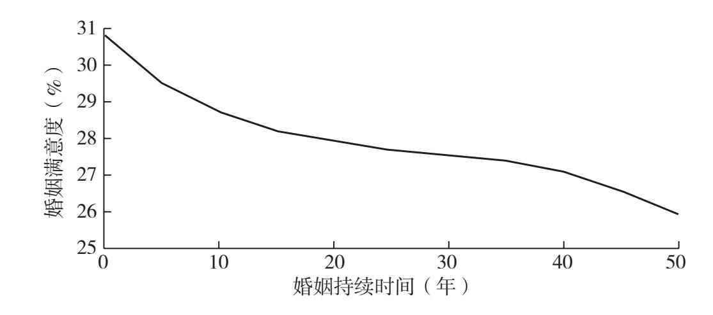
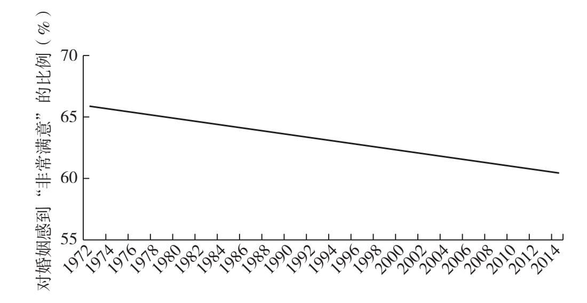

## 第十八章

目标明确的爱情

### 如何建立长久的亲密关系

还记得“从此以后过上了幸福的生活”谬误吗？这种错误观念认为，在亲密关系中，最难的一步就是找到合适的伴侣。但这其实只是你爱情生活的开端。如何让这段亲密关系长久地持续下去，同样很难。这一章就是要帮助你做到这一点。

我不想遮遮掩掩。图5和图6展示的就是许多夫妻在长期亲密关系中的样子：

##### 图5 婚姻满意度变化曲线

图5显示的是随着时间增长，婚姻满意度平均值的变化。事实证明，结婚时间越长，你就越不快乐。从此以后过上了幸福生活——才怪。

##### 图6 幸福婚姻下降趋势图

图6也很重要，它显示了从1972年到2014年，认为自己婚姻“非常幸福”的夫妻的比例。

正如你看到的那样，在过去40年里，对长期亲密关系满意的人越来越少。

但总是有希望的，没有人命中注定婚姻不幸。美满的亲密关系是营造出来的，不是碰运气碰来的。你可以通过自己的努力建立长久的亲密关系，把握机会，实现梦想。

### 营造一种与当事人共同成长的亲密关系

当人们问我，让一段感情历久弥新的关键是什么，我经常引用达尔文在自然选择上的发现来回答：“生存下来的不是最强壮的物种，也不是最聪明的物种，而是对变化适应最快的物种。”即使你们现在的感情很好，如果你不适应变化，你们的感情仍然可能失败。你的生活或者你伴侣的生活，都可能出现意料之外的变化。营造一种可以适应变化的亲密关系，这是它可以历久弥新的关键。

也许你认为，自己在未来不会有太大的改变，你已经成了那个长期以来你要成为的人。

#### exercises

练习

回答这两个问题

1.你觉得在过去的十年里你改变了多少？

_______

_______

2.你觉得在接下来的十年里你会改变多少？

_______

_______

哈佛大学心理学家丹尼尔·吉尔伯特和他的团队向一群参与实验的受试者提出了同样的问题。他们让一些人预测自己在未来十年里会发生多大的变化，而让另一些人回答他们在过去的十年里发生了多大变化。大多数人认为，他们在过去的十年里有了很大的变化，但并不认为在下一个十年里会有很大变化。他们错了。吉尔伯特把这种现象称为“历史终结的幻觉”。

吉尔伯特指出，我们对身体上的衰老往往心里有数——我们的头发会变白，我们的身体会变化——但我们每个人都认为，“总的来说，我的核心人格、我的身份、我的价值观、我的个性、我最深层次的偏好，从现在起就不会变了”。而事实上，我们从来没有停止过成长和改变。

正如我们每个人在一生中都会不断变化，我们的亲密关系也同样如此。有时，一方会陷入困境，另一方出面维持家庭运转；有时你们彼此深深相爱，有时你们彼此无法忍受；有时你发现沟通很容易，但有时又觉得彼此隔着一堵墙。

由于亲密关系这种不断变化的性质，我们应该把它视作有生命、能呼吸的东西来对待。然而，更常见的是，我们把与伴侣的亲密关系当成烤面包机，从盒子里拿出来，插上电源，希望它和原来一样好用。其实，烤面包机在你刚买的那天是最好用的，随着时间流逝，它越来越不好用。没有人认为烤面包机会适应变化或者自我改进。那婚姻呢？我们在婚礼当天向法律机构或者教会做出承诺，并且希望这份感情一成不变——直到死亡将我们分开。

好吧，那台烤面包机现在怎么样了？如果你看看离婚率和分居率就知道，50%的人已经把烤面包机退回去了。我们的亲密关系之所以失败，部分原因就在于，它在设计上没有——按照达尔文的说法——“适应变化”。

让我们扔掉烤面包机，拥抱目标明确的爱情哲学，把浪漫的感情带入21世纪吧。这本书讲的就是如何目标明确地走进一段亲密关系，若想长久地维持这段关系，你也需要同样的思维模式。

我们都希望自己的亲密关系天长地久，但没有几个人知道怎么做到。为了达到这个目的，我在行为科学的启发下，设计出一套工具，帮助你建立起长久的亲密关系。在过去的几年里，世界上成千上万对情侣使用过这套工具，希望能够营造出一种适应变化的、经得起摔打的，最重要的是能够天长地久的亲密关系。

### 亲密关系契约

对我们当中的许多人来说，只有在婚礼仪式上，我们才明确说出对婚姻的承诺。但随着人类的寿命越来越长，从我们说出誓言到“直到死亡把我们分开”这件事真实发生，中间可能隔着超过半个世纪的时间。在这半个世纪里，我们会成长、变化。我们需要一套现代系统，帮助我们的亲密关系适应这种成长和变化。这套现代系统就是亲密关系契约。

在本书第十五章中，我曾阐述过为分手制订一份书面计划很有用；我还说过，与被动同意相比，主动参与某件事，会让你更有可能去做成这件事。亲密关系契约遵循的是同样的逻辑。和前面的书面计划相比，这份契约更加生动、活泼，它会随着时间不断变化和发展。

这份契约针对的是已婚的或者处于长期的、彼此有承诺的亲密关系中的伴侣。让我们先说说它不是什么：“契约”这个词可能听起来有点吓人，但它绝对不是一份婚前协议。我们说的是一份不具法律约束力，但双方都同意的文件；它帮助伴侣们为他们的亲密关系设定一个共同的愿景。你们可以把它写在餐巾纸上，写在谷歌文档里，或者用冰箱贴把它拼出来。

这份契约应该促使夫妻间进行例行检查，弄清楚他们对这段亲密关系的期望是什么。他们要解决的是这类问题：我们希望多久回一次父母家？我们怎么分摊费用？性对我们重要吗？我们能对彼此忠诚吗？

心理学家杰西·欧文、盖里纳·罗迪斯和斯科特·斯坦利观察到，那些愿意花时间讨论重大决策的情侣比那些不愿意花时间讨论重大决策的情侣更幸福。我在全国各地举办过一些研讨班，带领数百对情侣编写亲密关系契约，帮助他们更多地和伴侣讨论重大决策。

当你编写这份亲密关系契约时，要诚实，要不设防，愿意妥协。这绝对不是抱怨对方缺点的时候，也不是提出要求的时候。这里的重点不是讨价还价——“你洗衣服我刷碗”——而是在价值观上取得一致：“我们承诺支持对方的梦想，并为实现这些梦想做出必要的牺牲。”

我一点也不意外，这些契约中条款的多样性令我感到惊讶。有些条款一本正经，比如一对伴侣描述他们将如何偿还学生贷款；还有一些则很搞笑，比如，一对伴侣承诺不再购买宜家的家具了。

在契约的第一页上，伴侣双方要商定一个具体日期，到那个日期再重新评估这份契约。到了那一天，他们会给对方反馈，看看他们做得怎么样。一些伴侣每年都会重新评估他们的契约，还有一些则在5年或者7年之后这么做。这次谈话人为地建立了一个决策点，双方在这时候都可以问：在我们目前的亲密关系中，还需要些什么？然后他们就可以修改契约，来反映他们个人的变化。这样一来，远在感情破裂之前，他们就可以对亲密关系持续进行调整。正如肯尼迪总统说的那样：“要在阳光灿烂的日子里修理屋顶。”他当然不是在说自己的婚姻，但这话的意思再明白不过。

选择主动决策，而不是任凭感情自然发展。在附录中，我加入了一个练习，帮助你分两步写出自己的亲密关系契约。这些文档是我和我的朋友兼合作者汉娜·休斯一起完成的。首先，你会看到一张自我反思表，你应该自己一个人把它填完。那张表格会问你一些问题，比如，你需要多少独处的时间；你们之间表达爱意的语言是什么；在亲密关系中，你钟爱的惯例活动有哪些，等等。然后你会看到一份空白的亲密关系契约，你要和你的伴侣一起把它写出来。

#### exercises

练习

亲密关系契约

找一个周末，确保你和你的伴侣都有空。如果这个周末可以一起出去度假，那就太好了！如果不能，那就策划一次浪漫的居家假日。首先，也是最重要的一点：关掉手机。整个周末，在美味菜肴和浓情蜜意的包围中，一起制订你们的亲密关系契约，谈论一下爱情和你们之间的联系吧。你们是真爱至上，不是合同至上。

### 例行检查

我喜欢心理治疗师埃丝特·佩雷尔的这句话：“人际关系的质量决定了你的生活质量。人际关系就是你的人生故事；请认真书写，经常修订。”

按照她的意思，要多久修订一次呢？我喜欢每周一次的“例行检查”：你和你的伴侣简单交谈一下，说说自己心里在想什么。亲密关系契约为你们的感情发展设定了方向，而例行检查则确保沿着正确的轨道一路向前。许多伴侣不敢坦白自己想要什么，无论是要孩子、要开放婚姻接纳第三者，还是要结束这段感情。所有的亲密关系都有自己的问题，而几乎所有人都觉得挑明了说太尴尬。亲密关系契约和例行检查就是专门设计来减少尴尬的工具。

每周日晚上，我和斯科特都会坐在我们的白色沙发上聊天。他总是坐在靠门的地方（对此我决定不去过度解读），而我则四仰八叉地躺在软凳上。他经常吃爆米花，而我吃完晚饭后一直觉得很饱。

我们会问彼此三个问题：你上周过得怎么样？你觉得得到了我的支持吗？下周你需要我怎么支持你？有时候这种谈话不超过五分钟。但当我们这周刚好休假时，例行检查就会变成绵长、亲密的谈话。当然，这些交谈可能是艰难的，但它们通常都很重要，而且有启发。当问题出现时，我们会设法处理。这是我们保持沟通、发现自己以及我们的亲密关系中出现了什么变化的方式。例行检查让我们有能力在为时过晚、积怨过深之前解决碰到的问题。

和检查同样重要的是“例行”本身。让这件事仪式化、始终如一，遵循了一个行为科学家经常使用的超级简单的原理：如果我们在日历上设定一件事，并把它设成默认选项，我们就非常有可能完成它。这些检查在我们的日程表上是一个重复发生的事件，所以我们不需要敦促彼此特意留出时间讨论这些事情。日程表真是帮了我们的忙。在我的客户中，很多采用了例行检查方法的伴侣都表示，他们觉得更幸福、更有激情，也更有耐性了。

问自己这个问题：如果我和我的伴侣定期坐下来，谈谈我身上正在发生的事情，我的生活会变成什么样子？我向你保证，这值得一试。你要选择的是目标明确的爱情。

#### exercises

练习

设计自己的例行检查

和你的伴侣一起坐下来回答下面的问题：

1.你们想什么时候开始每周一次的例行检查？

2.你们想在哪里谈话？想一个你们都觉得舒服的地方。沙发上吗？附近公园里最喜欢的长椅上？

3.你们每个星期都想问对方什么问题？

4.怎样才能让例行检查变得富有特色呢？例如，你们能一边谈话一边吃你们最喜欢的甜点吗？或者互相按摩足底？

5.如果你们不能待在一起，会怎样进行例行检查？

### 下一步：一个目标明确的爱的世界

牢固的亲密关系不会凭空出现。这需要你尽心尽力，需要你做出正确的选择。这需要目标明确的爱情。在这个目标明确的爱的世界里——其实是在这个目标明确的生机勃勃的世界里——当你回顾自己的生活时，你看到的是一系列经过深思熟虑、主动做出的决策，这才是你的希望所在。也许你更爱另一个人，也许有三段亲密关系对你而言都很重要，也许你现在还是单身，生活中充满了令人兴奋的事情。不管怎样，生活都是一次探索之旅，而不是一次意外事件。主动设计自己的生活，对自己负责，对自己诚实，知道自己是谁，想要什么，而且最重要的是，必要时勇于做出改变。你不必按照别人的想法生活，你要按照自己的想法生活。

在我为这本书进行调研的过程中，我有幸遇到了很多人，他们给了我很多启发：从他们身上，我看到了目标明确的爱情是什么样子。

举几个例子。有位男士出去约会，每次都坦承自己想要什么，通常情况下，他得到的回应都是欣赏和宽慰。

还有一位男士，他学会了向妻子开口，说出他在这个家里想要的东西——一个他可以自行装饰、完全属于自己的地方。

有些伴侣在外人眼里根本无法获得幸福，但他们的目标明确，所以他们的生活中同样充满了快乐和喜悦。其中一些伴侣经历过各种悲剧，从罕见的癌症到多次流产。但他们每天都投入大量精力维护这段感情，共同渡过难关。他们决心战胜困难，成为比例极小的幸福美满的神仙眷侣中的一对。

你也有这个机会。如何做到这件事并不是秘密。我希望这本书已经告诉你应该如何去做了。现在就行动起来，从此以后目标明确地生活下去。

总结

1. 过去四十年来，能找到长期美满的亲密关系的人越来越少。好消息是，美满的亲密关系是营造出来的，不是碰运气碰来的。你可以创造出你梦想中的亲密关系。

2. 建立一种适应变化、不断发展的亲密关系，这是它能够持久的关键。我们低估了自己在未来可能的成长和变化，我们应该寻找的是一种可以和我们的伴侣一起学习和成长的亲密关系。

3. 写一份亲密关系契约，为你们的感情发展设定方向，并随时修改你们的愿景。每周的例行检查可以帮助你们处理出现的问题。

4. 在一个目标明确的爱的世界里，设计自己的生活，对自己负责。你要对自己诚实，知道你是谁，你想要什么，最重要的是，必要时勇于做出改变。你不是按照别人的想法生活，而是按照自己的想法生活。现在就行动起来，从此以后目标明确地生活下去。
