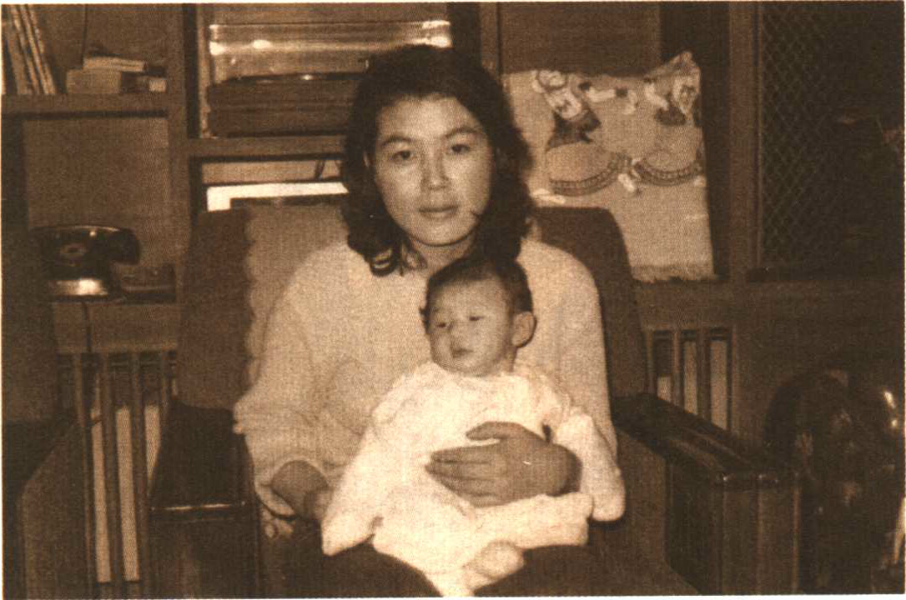
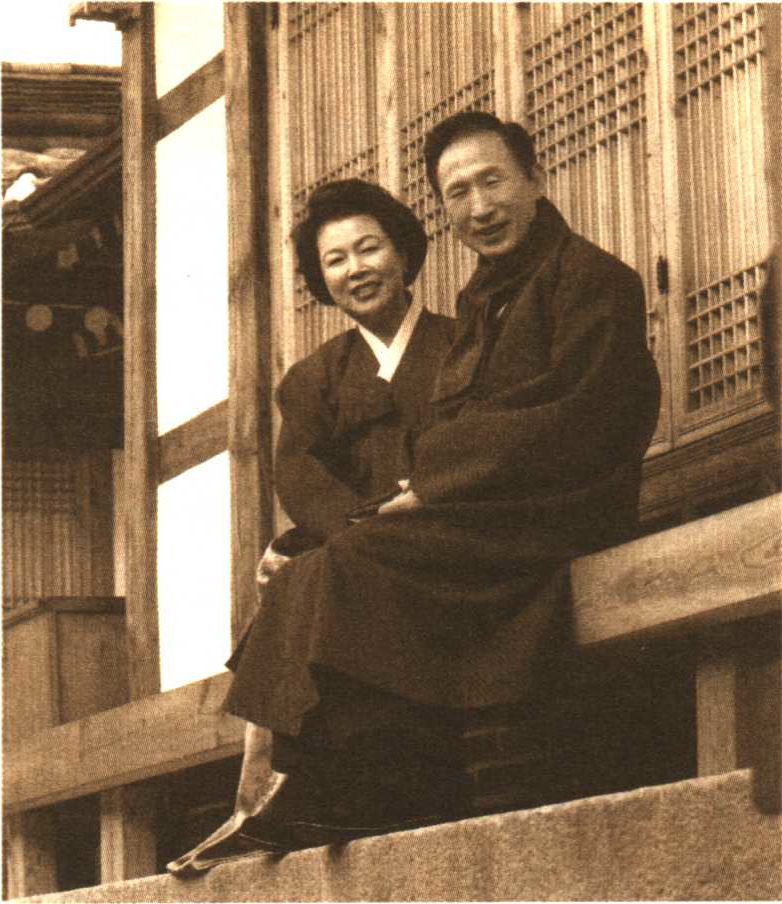
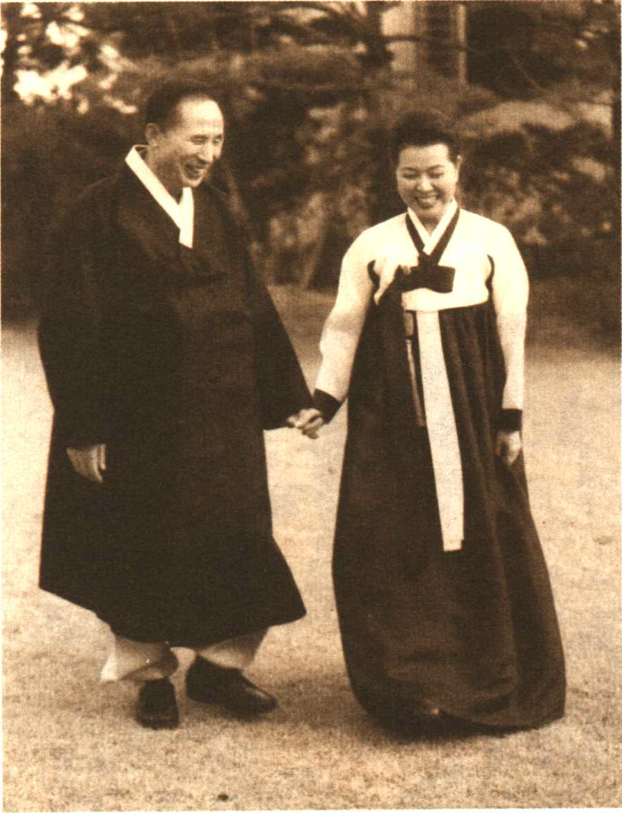
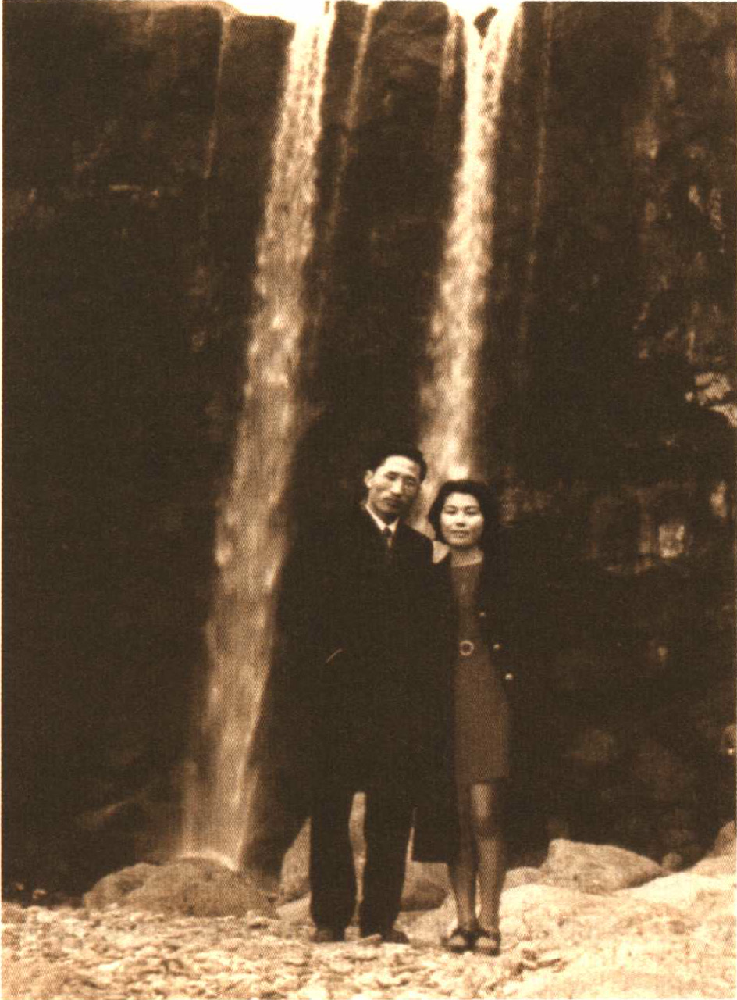

# 第三章 暴风骤雨间

## 密审

在我成为现代建设社长的1977年之后，国家政治局势可谓暴风骤雨。两年后发生了“10·26”事件；1980年开始了新军部的黑暗统治；接着，又经过了第五共和国、第六共和国执政时期。在这些年里，我作为一个企业代表，经常被推至与权力抗争的悬崖。

“10·26”事件后，所谓的“首尔之春”到来了；而事实上，这个春天毫无春意可言。

一天上午11点30分左右，两个陌生男子突然出现在我的办公室里。

“请跟我们走一趟。”

不容分说就要把我带出去。 “岂有此理！你们是什么人？要带我去哪里？”

“去了就知道了。只是在办公室外面谈一谈。”

下到一楼，他们两个突然架住我的胳膊，把我拖进了一辆黑色轿车。

我问他们要把我带去哪里，他们没有回答，我再三追问。

“先去钟路警察局吧。”

一到钟路警察局，他们就开始对我不客气了。没有一句说明，就把我关进一个单独房间，好像对待犯人一样。我简直莫名其妙，又没有办法跟公司取得联系。

两三个小时后，他们给了我一碗牛肉汤饭。有一位警察偷偷地对我说：

“他们还要带你去别的地方审问，快跟你们公司联系吧，把所有文件都收起来。”

趁他当班的时候，我跑到门外给公司打个了电话。

“我也不知道是哪个机关，也不知道是因为什么事，只是要暂时在这里接受调查。”

我到那时还以为是暂时调查。我又没犯什么罪，他们能拿我怎样呢？

1972年李明博为夫人和大女儿所拍合影照过了一会儿，我又被塞进那辆黑色轿车，朝着南山方向驶去。到中途，又换了另一辆在路边等候的轿车。押我到那儿的人和新接手的人还像办交接手续那样，在文件上签了字。我当时还想，这些人做事怎么那么没效率。

我被带到了南山中央情报局的地下室，到那儿才知道了事情的原委：他们接到情报说，现代集团的郑周永会长向“三金”（金泳三、金大中、金钟泌）提供了政治资金。押我来就是想让我提供一些他们不知道的情况。我的直觉告诉我，他们想抓捕“三金”。这就是“首尔之春”的异象。

“我从来没有见过‘三金’，为什么用这种方式找我调查？”

“经过我们的调查，你好像确实没有向谁提供过政治资金，但有情报说你们的郑会长提供了政治资金。我们又不能找他老人家来调查，但是，李社长你肯定知道郑会长给谁、提供了多少钱。怎么样，跟我们说说吧。不会有人知道你来过这里的。”

“我从来没有听说过郑会长给‘三金’提供政治资金的事，他也不会去做那种事。我想，应该是你们的情报有误。”我从容地说。

“你这家伙，不会不知道这是什么地方吧？如果不说出实情，你别想走出这个地下室！”

我还是坚决否认。反复再三，他们也有些犹豫了。

“既然这样，那我们就做些妥协吧。你说没有看到或听到郑会长提供政治资金，我们暂且相信你；但是，郑会长向那些人提供政治资金的可能性总是存在的吧，你承认这一点就可以。过去做过的事情，现在还是有可能这样做，这个道理小孩子都懂。要不然，‘三金’靠什么到处活动呢？你就承认这一点吧。如果连这个都不配合，那我们只能采取别的方法了。”

审查官向我暗示会用刑。难道他们还想逼供吗？这些人的逻辑实在了得，把一个可以发生在任何人身上的可能性套到一个大企业的会长身上，然后顺势抓捕三位政治人物。新军部的意图昭然若揭。

但我的答复只有一个。

“我不知道什么政治资金，我也不知道郑会长以前是怎么做的，反正现在，我绝对没有听过向‘三金’提供政治资金的事，现代集团的下属公司也没有做那样的事。”

“你这家伙，真是岂有此理。知道的你就说知道，不知道的说有可能不就行了吗？你把我们当什么了？是不是让你尝尝苦头你就知道该怎么说了？”

“如果确有其事，我不可能不知道。但据我所知，郑会长和下属公司绝对没有做那种事。”

反复的诱供、威胁从下午3点左右，一直持续到深夜。审查官暂时出去了一下，再进来时居然态度大变。之前的青面獠牙换成了满面春风。

“李社长，您看，郑会长是个老人，即使有点什么事情也没什么大关系，但是您就不同了。您要是在这儿出点什么事，谁也不会知道。本来嘛，这个世界上就没有一尘不染的人。你呢，既然到了这儿，最好就跟我们好好合作。我们也不是要给郑会长无端治罪、打压企业。我们只是想知道那些人的资金来源而已。也不是要你告密，或者背叛谁。你只要承认有那种可能性就行了。干吗那么固执，自讨苦吃呢？”

看来，他们是想试试怀柔政策。

“我再重复一次。现代集团没有向‘三金’提供政治资金，那种可能性也绝对没有。”

“你这家伙……”

李明博与夫人在一起

李明博与夫人在一起审查一直进行到第二天早晨。他们让我系好领带，把衣着整理一下，又押着我上了一辆轿车。这一回，我被带到了一个带会客室的大套间。一位看上去官职颇高的人在那里等着。

“昨晚辛苦了。不知道下边的人有没有失礼？”

声音冷若冰霜。我的预感告诉我，这是最后一关了。

“其他企业的人也到过这里。合作得很好。希望李社长也能一样。否则就很麻烦。现代集团的郑会长向政治人物提供活动资金是公开的秘密。找你问话，不过是走个形式。现在请讲吧。”

“没有那样的事。从集团角度来说，提供政治资金是不可想象的事情。郑会长个人也不会给在野党提供资金。”

“你怎么知道？”

“在我这个职位上还能不知道吗？”

“不知道的事，你就说不知道吧！难道还想否认我们的调查权？”

“我不知道你们有没有调查权，我只是实话实说而已。”

“你这人……”

这位高官也拿我没办法了。

“既然你这么坚持，那就到此为止吧。如果没别的话，就在这儿按个手印吧。”

我仔细看了看，是如实记录的文书，便用拇指蘸了印泥按了手印。

精疲力竭地回到公司，公司早已大乱，一整天都找不到社长行踪，岂有不乱之理。我没有向任何人谈起过那天发生的事情。对郑会长，也只是简单地提了一下：

“因为政治资金的问题，好像有点误会，所以找我到机关接受调查。我说了会长和下属公司没有向任何人提供政治资金就回来了。”

郑会长也没有再问。

在第五共和国初期，现代集团和新军部的关系十分紧张；但是到中期，双方表现得亲密友好；到末期，关系又再度恶化。这样的无常反复也在郑周永会长心中埋下了既对政治失望、亦对权力憧憬的矛盾的种子。

## 血泪

新军部筹划的“调整重、化工业投资”政策使现代集团陷入了危机。无所不为的“国保委时代”来临了。

一批从海外学成归来的经济学者，连同国内的一部分经济学家，纷纷参与到新军部经济政策的筹划活动中。他们把重、化学工业的重复投资视为韩国经济发展的障碍，主张积极改变这一经济模式。这一主张也暗合了那些试图改变国内经济格局的新军部领导人的想法。

现如今，很少有人会把多家汽车生产公司共存的局面视为重复投资、国力浪费的现象。经济有其竞争规则，竞争应以公平为基础。竞争公平规则受到保障的程度是衡量先进国家与落后国家的标准之一。

但在当时，一部分经济学家和官僚却坚持认为，只有把所有汽车制造厂融为一体同时发电设备厂也融为一体，才有利于国家经济的发展。具体说来，就是要把现代汽车、大宇汽车和亚细亚汽车合并为一家，再把电力设备领域的大宇玉浦造船厂、现代重工业，以及昌原的现代洋行（现斗山重工业）合并为一体。

对于现代集团来说，汽车与电力设备好比手心、手背，哪一个都无法割舍。现代集团对汽车产业的期望与热情是很高的，何况当时，现代汽车刚刚起步走向世界。电力设备领域也是一样。现代集团已经具备了制造原子能发电设备的能力。如果放弃这一领域，就等于放弃巨大的火力发电站与核发电站设备市场。

新军部的经济调整方案简直就像捕捉现代集团的一张阴沉的大网。但是，这一政策已经公开，留给我们的唯一选择就是作出取舍。

经过智囊团的反复研究商议，郑会长最终决定选择汽车产业，因为这个新兴产业具有无限的发展空间，虽然电力设备产业也大有可为，但其生产本身就不具有稳定性，况且即使放弃了设备生产，今后我们至少还可以参与核电厂或火力发电厂的建设工程。现在想来，郑会长的判断也依然是明智的。

内部意见统一之后，我便单枪匹马冲向了“国保委”。会谈的对象是陆军军校第17、18期出身的两位军官。他们直接让我作出选择。我说：

“在作选择之前，我想先问一下，为什么要作这种选择？虽然现在看来，重、化工业似乎存在投资过剩，但在不远的将来一定会出现供不应求。如果把具有竞争力的企业都合并起来，必然会违反市场经济的第一原则——竞争，进而导致经济衰退。考虑到韩国经济的未来，我们认为这种投资调整本身就是有问题的。”

“这个政策是经过充分论证、研究过的，我看就没有必要在这里讨论了。你们只需要从两个当中选择一个就行。”

第一天的谈判毫无实质进展，但我能感觉到一点：“国保委”已经和现代集团的竞争对手达成了某种共识，我们成了被孤立的一方。他们一定希望我们放弃汽车、选择电力设备。不，他们或许已经内定了让现代集团选择电力设备，然后把我们往这个方向诱导。

我第三次去“国保委”的时候，会谈的军官终于摊牌了。

“你们现代集团一直侧重于重工业发展，在这个领域也有过不少投资。既然建筑是你们的主力行业，选择电力设备也就顺理成章了。”

“‘现代’选择汽车产业。”我单刀直入。

他们一下子慌了。

接下来，他们开始强行要求我们选择电力设备。我毫不含糊地说：“现代集团从始至终不赞成合并，如果合并不可避免，那我们一定选择汽车产业。”

那些军官自然不甘心，又罗列了一大堆现代集团应该选择电力设备的理由，但我丝毫没有动摇，谈判进入了僵持阶段。这时候，他们竟然把矛头指向了我个人：

“你现在住在什么地方？”

“江南。”

“是公寓吗？”

“不是，独门独院，不小。”

“哼，你倒是住得宽敞。而我，就住在山顶一间连自来水都没有保障的40平米的公寓里。我们在为国家担忧的时候，你们却在一边享清福，还不肯跟政府合作，这像话吗？”

我再也坐不住了。

“两位花国家经费上军校的时候，我每天早上在梨泰院拉着平板车清理垃圾，靠勤工俭学完成了学业。你们父母送你们进高中的时候，我不但要自己赚学费，还要拼命干活养活自己。大学毕业进入公司后，还要在国外工地没日没夜地工作。1974年我们国家外汇储备几近耗尽、国家经济面临崩溃的时候，是靠我们这些海外建设者辛辛苦苦挣的美金才扛了过去。两位从军校毕业后经历过战争吗？而我，每天都要在和战争一样残酷的海外市场上打拼，每天工作18个小时，每天晚上只能睡三四个小时。”

这时，一位军官拦住我的话。

“我们也参加过战争。越南战争。”

我忍住苦笑，又接着说：

“谁说只有军人才是爱国者？我们这些企业人难道就不是爱国者吗？企业可以成为批评的对象，但无视企业作用的想法是绝对不可取的。你们住在山顶的公寓里，而我曾经在比那还要艰苦很多倍的地方生活过。作为一个大企业的社长，我住在一套大房子里有什么错吗？那套房子是公司为我方便接待外宾而盖的，如果这样也有错，难道一定要我降低自己的居住水平吗？难道这就是你们治国的目标吗？你们应该在最短的时间内，让你们这样的军人、公务员也达到和我一样的富裕水准，这才是可取的目标。怎么可以要求一个靠诚实劳动富裕起来的人降低生活水平呢？”

这一次的谈判在争论中结束了。我回到公司和郑会长商量，如果这样争论下去，我们必然会被推到选择的边缘，毕竟主动权不在我们手里。

一天晚上，一个在政府部门工作的朋友托人捎来口信，说是想约我见一面。这位朋友当时正在辅助政府运作“改革”事宜，一看到我便露出担忧的神情。

“李社长，现在是非常时期，很多问题不是固执己见就能解决的。依我看，你还是同意吧。时间对你们不利啊。明天就去表态吧，这关系到现代集团的命运。”

那天晚上，我一直在揣测他找我谈话的动机。是真心为我和现代集团担心，还是站在新军部立场上诱导我呢？我竟一时难以辨别。

第二天，我向郑会长转达了那位朋友的话。

郑会长看上去很疲惫。“10·26”事件后，现代集团完全是靠他的坚韧意志与斗志才经受住了各种考验。肩扛千斤担的压力可想而知。

“再努努力吧，如果实在不行，就同意吧。或许这就是大势所趋。”

郑会长把公司的印章递给我。

“会长，您这是做什么？”

“你不要有思想负担。”

“如果要盖章的话，还是请会长您亲自去吧。即使您不去，还有很多人能代表公司盖章啊。”

“这件事一直是你在处理，你就善始善终吧。”

我没再说什么，收起印章，去了“国保委”。

和往常一样，还是两条难以相交的平行线。我继续坚持我的“不可合并论”。

“如果把汽车企业捆成一个，竞争力就会降低，最终只能成为国家的负担。印度就是一个前车之鉴：他们只有一家国营汽车企业，技术开发不行，经营管理也不行，造出来的汽车款式陈旧，性能也不好，价格却贵得离谱。因为产量少，买一辆汽车要等上好几个月。没有合理竞争的弊端，局外人是很难了解的。我们国家现在看似重复投资，但事实上是经济不景气、产业化未能进入正轨所引起的。假以时日，就会体现出各个企业对出口所做的贡献。所以，还是请再考虑一下是否合并的问题。”

“李社长，你以为你是谁啊？这个政策是以海归学者所做的调查报告为依据制定的。你有什么资格在这里信口胡说？”

我暗暗对自己说，务必再坚持一下。

“我不知道那些人是以什么为根据主张合并的。那种废除合理竞争、培养垄断企业才有助于资本主义社会发展的理论，在任何一本经济学教科书上都找不到。垄断企业一开始运转可能还不错，但时间一长，就会出现无数的问题；而在健康的竞争环境中成长起来的企业，他们的前途将不可估量。如果你们现在非要无理合并，能不能解决眼前问题还是未知数，今后要想进入国际市场更是毫无希望。到时候再后悔可就晚了。”

“我们没时间听你在这儿讲课！要么同意合并，要么，请便。”

此时已是深夜。我意识到，再争论下去，也不会有什么转机。房间内的空气沉闷得让人透不过气来。

“既然我们别无选择，那就请按政府的决定盖章吧。”

我拿出郑会长的印章，放在桌上。我不能用我的手来盖这个章。

一位下属军官走上前，拿起了印章，就在落章前的一瞬间，那位高级军官一脚踹开桌子，站了起来。

“不要盖！”

他识破了我的意图。如果由他们盖章，由此产生的后果也将由他们承担。他气急败坏地看着我，又转头冲那位下属大发其火：

“你怎么搞的！”

那天半夜，我从“国保委”出来，回到了公司。整个公司大楼，只有郑会长的办公室还亮着灯。

郑会长盯着我的脸，呆呆地看了好一会儿。

“盖了吗？”

“没盖，章在这儿。”

“啊？怎么回事？”

“我明天再详细向您汇报吧。”

郑会长又看着我的脸。

“唉，你的眼睛出血了。”

“不会吧，我没觉得有什么异样啊。”

“是出血了，去照照镜子吧。”

在会长室入口的镜子前一照，果然我的眼睛里有红色的液体。沾在手帕上是乌紫色的。这就是所谓的“血泪”吧！以前还以为只是文学性的修辞，没想到从自己的眼睛里流下了血泪。

我的正面对抗使“国保委”的汽车产业合并计划无法顺利进行，进而促成了将问题移交工商部处理的契机，合并问题也随之成为公开的争论。在工商部主持的会议上，郑周永会长更是强烈阐述了产业合并的弊端。最终，汽车产业没有走向合并之路。

假如那时真的草草合并，韩国现在的汽车产业水平或许就和印度无异了。当时被合并的电力设备产业，结果后患无穷。

## 一次无可奈何的惨败

第五共和国初期，政府决定在西海岸平泽地区建设一个大规模的LNG储藏基地。先将气体LNG 在超低温下液化，然后储藏在特制的超低温设施内。这样的设施对安全性能的要求极高。在国内，还没有一家企业能够独自担当这样的项目，因此政府决定让国内的建设公司与国外企业合作竞标。

现代建设与在这一领域处于世界最高水平的法国泰克尼盖斯公司签订了技术转让合同。最有实力和“现代”竞争的国内企业是汉阳公司，他们的合作竞标伙伴是日本的丸红公司。竞标结果，“现代”第一，“汉阳”第二，因为他们和丸红公司的技术审定没有过关。

得悉结果后，泰克尼盖斯总裁缇鲁先生特地赶到首尔进行庆祝。谁知，他回国后没几天，泰克尼盖斯公司就发来急电，请我们到法国商议要事。我一到法国，缇鲁先生就问我，有没有注意到韩国政府的态度变化。

“此话怎讲？”

“如果我们不能和‘现代’合作……”

“开什么玩笑？如果真是那样，你们就得按合同上的违约协议办，补偿所有的损失。”

缇鲁先生表情僵硬地说：

“如果这不是我们的意愿，而是韩国政府的意思，我们也需要赔偿吗？”

我这才感觉到事态的严重性。

一回国我就直奔国家电力公司。

该公司毫不掩饰地说，“现代”的竞标书已被作无效处理，他们已经和汉阳公司签订了合同。

“明明是‘现代’以最低报价中了标，而且评定说‘汉阳’那边的技术方案有问题，怎么突然就和‘汉阳’签合同了呢？”“只要‘汉阳’和法国泰克尼盖斯公司合作，技术方面不就没问题了吗？”这样的回答简直不可思议！我明确表示不会就此罢休。

不久，青瓦台的首席经济官亲自找我谈话，但我依然没有退让。

“这不仅仅关平我们现代公司，更关乎国外企业对韩国政府的看法。

要不然，就取消上次的竞标结果，然后按照你们的意思，让“汉阳’和法国公司联合竞标，那样的话我就服从。”对方的回答匪夷所思：“现代建设还想不想在韩国生存下去了？再这么无理反抗，后果你们自己承担！你就如实向你们的郑会长汇报吧。”接到汇报后，郑会长也去见了那位首席经济官，但仍无结果。

泰克尼盖斯公司一方面向我们致歉，一方面也再三希望“现代”予以理解：站在国外企业的立场上，他们不能不顾及韩国政府的态度。

泰克尼盖斯公司确实没有什么过错，违约责任在于韩国政府的干预，因此我们也不能要求法国方面赔偿损失。

最终，还是我们无奈地让步了。

## 奏响凯歌

1970年12月在济州岛新婚旅游1987年12月，国家电力公司开始为灵光核电站三、四期工程建设实施招标。当时，国内拥有核电站建设经验的只有现代建设和东亚建设两家公司。

核电站分为核反应堆和电力生产装置两个部分。在之前古里核电站一、二期与月城核电站一、二期工程中，现代建设负责建造了第一部分核反应堆工程，第二部分由东亚建设公司负责建造。此后的灵光核电站一、二期工程则是由现代建设全权负责的。所以，现代建设是国内唯一一家具备建设完整的核电站经验与能力的企业。政府与现代建设就灵光核电站三、四期工程签订意向合同是最为理想的。

按照当时的情况，签订意向合同只是表示一种意向。《预算会计法》规定，大型工程不能和特定的公司签订承包合同，以防止给予特殊优惠待遇。事实上，政府不和现代建设签订核电站建设合同还有政治上的问题。由于此前政府无理介入现代集团的极东石油经营权问题，郑周永社长和第五共和国的权力层之间出现了裂痕。在这种情况下，政府自然不会让“现代”轻松过关。

就在这时，发生了一件让韩国当局进退两难的事情：美国三里岛核电站发生核物质泄漏，引起全世界对核电站安全问题的关注。没有经验的公司不能参与核电站工程建设成为一种国际共识。

韩国政府不愿把项目交给“现代”，但又不能不顾及舆论巨大的压力。于是，国家电力公司决定重新招标，并提出了新的竞标资格要求。

第一次公告的标书审查结果是，只有“现代”符合要求。国家电力公司发出第二次公告，结果还是“现代”胜出。根据法律，通过两次审定的公司，第三次就可以与之签订承包合同。

看到工程意向合同基本确定，我便去了新加坡处理公司其他事务。谁知几天后，我突然接到郑会长打来的国际长途电话。

“李社长，核电站的意向合同无效了。”

“怎么回事？”

“是副总理在刚刚召开的记者招待会上公布的。

你赶紧回来处理一下⋯⋯”当时，在大部分政府主持的工程中，建设公司向政府提供政治资金是一种惯例。

但这次的核电站工程受到国内外普遍关注，资金猫腻难有藏身之地，政府权力层因此感到不快。

在我离开的那几天，副总理、安全企划部长等政府高层竟然找出意向合同中的漏洞，随即召开记者招待会，宣布取消与“现代”的合同，并再次进行招标。

一回国，我便直奔郑寅用副总理办公室。

“政府怎么能不和合同当事人打招呼，就单方面取消合同呢？现代建设是经过一次、两次、三次竞标，堂堂正正地拿下了这个项目。

政府单方面撕毁合同，是要负法律责任的。

我们愿请政府取消这一决定，否则我们将不得不对政府提起诉讼。”从副总理办公室出来后，我又去找国家电力公司的朴正基社长。

“如果您按照总理的要求取消合同，那就等于承认之前和我们签订合同是错误的。

您只有强烈主张和我们签订的合同是合法的，并且按原计划进行，才能证明您之前的做法是正确的。

否则，单方面撕毁合同的所有责任都将由您来承担。”朴社长处境尴尬。

作为国家电力公司的社长，改变已经上报总统的决定几乎是不可能的。

下一步，我又去找动力资源部的蛋昌洛部长。

“法律规定，不能以政治方式取消合法工程合同。

这次单方面撕毁与我们的合同，政府究竟是什么意思？”准部长似乎欲言又止。

后来，国家电力公司的朴社长向我转达了崔部长的意思：这个问题不归副总理管辖，更不是总理应该出面处理的事情，虽然知道其中有不要之处，但对于上面已经决定了的事情，他也不方便对外发表意见。

明白了崔部长的意思之后，我再一次走进了他的办公室。

“部长您只要肯定我的看法就行。等到合适的时机，请您再表明自己的态度吧。”

我没有必要让崔部长为难。虽然现代建设的反抗不容忽视，但政府也不会轻易改变决定。

在听了我的陈述之后，国家电力公司的朴社长主张必须慎重考虑核电站建设的安全问题，并决定按照合同与现代建设合作。这自然引起了政府权力层的强烈不满，很快，他们便撤掉了朴社长的职务。接任的韩风洙社长对此问题毫无作为。无奈之下，现代建设只得请律师做好诉讼准备，并通告了政府。诉讼对象是国家电力公司社长和动力资源部部长。

终于，崔部长来找我了：

“请你们承认政府权威。即使道理在你们一边，政府也不可能取消已经作出的决定。希望你们和东亚建设一起，再进行一次竞标。”

虽然这个提议依然违背原则，但我们决定接受。我提出了一个条件：

“核电厂工程事关重大，招标不能以标书总额为准，必须以标书中的明细数据内容为准。”

明细数据内容涉及很多具体的技术指标。没有核电站建设经验的企业是不可能提供这些数据的。政府接受了我的条件。

竞标结果，灵光核电站三、四期工程项目，依然花落“现代”！这是一项工程两次被同一家公司赢得的珍贵纪录。事实上，也是第一次在政府主持的重大项目中，企业没有向政府提供政治资金。

在吸取了LNG 储藏基地项目的失败教训之后，在两次起落、奋力抗争之后，我们终于奏响了嘹亮的凯歌。
