在前面的章节中，我们详细讲解了 listpack、ziplist、dict、skiplist 等一系列关键的数据结构，本节我们来介绍 Redis 中最后一个关键数据结构 —— **Rax 树**。

Rax 树可以帮助我们实现**随机查找**的能力，也是 Redis Stream 依赖的底层数据结构。Stream 是 Redis 用来实现消息队列能力的结构，Stream 的核心实现我们将在“模块九：生产者-消费者模式”中展开介绍，本节还是着重解析 Rax 的核心原理。

## 初识 Rax

那什么是 Rax 呢？

**Rax 是前缀压缩树的一种**。具体来说就是，Rax 使用树型结构来存储字符串，对于有相同前缀的字符串，这相同前缀字符就会作为**公共父节点**进行存储。

下面举个例子，我们现在有 “foo”“foobar”“footer” 三个字符串，如果存储到前缀树中，结构就会如下图所示，每个节点存储一个字符，“f”“o”“o” 是三个字符串的公共前缀，在前缀树中是公共的前缀，其他非公共部分存储在树杈节点中。


那为什么说 Rax 是`前缀压缩树`呢？Rax 会将上面的压缩树中连续的、单字符的节点，压缩成了一个节点。上面的树型结构优化之后的结果如下：


从上图中我们还能看出，在前缀压缩树中，不仅是树的叶子节点能够表示我们存储的字符串，在非叶子节点中也是可以表示存储的字符串的，例如，`foo` 这个节点，这可以有效提高 Rax 树的负载。

**压缩虽然提高了空间利用率，但是复杂度也会有所增加**。例如，在写入新字符串时，会出现节点分裂的情况，当在上图这棵前缀压缩树中插入 “first” 字符串的时候，原本已经压缩好的 “foo” 节点会进行分裂，如下图所示：


虽然说前缀树里面的数据都是存储在树节点中，但是我更倾向于认为这些字符串是存储在树杈中，比如下图这种思想模型，这种模型更有利于我们理解 Redis 里面的 Rax 树的实现。

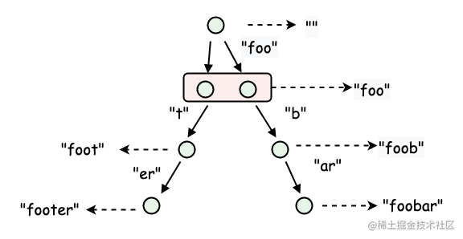

## Rax 核心结构体分析

了解了 Rax 树的基础知识之后，我们再来看 Redis 应用 Rax 树的一些典型场景。

**在 Redis 需要`有序数据结构`的时候，都使用到了 Rax 树**。比如，后面模块九中要展开介绍的 Stream，它是 Redis 用来实现消息队列特性的结构，其中的消息 ID 就会存储在 Rax 树中，这样就可以按照消息 ID 的顺序进行查找了；再比如，Redis 中会维护连接到自身的客户端列表，这个列表就是通过 Rax 树实现的，其中存储的是客户端的 ID，每个客户端 ID 关联的客户端指针也会记录到 Rax 节点中，这样我们就可以根据客户端 ID 查找到对应客户端了。

既然 Rax 树有如此多的应用，下面我们就来深入源码分析 Redis 对于 Rax 树的核心实现和原理。

首先是 **`raxNode 结构体`，它是对 Rax 树节点的抽象**，具体定义如下：

```c
typedef struct raxNode {
    uint32_t iskey:1;  // 标识当前节点是否包含一个key，占用1位
    uint32_t isnull:1; // 标识当前节点是否需要存储value-ptr指针，占1位
    uint32_t iscompr:1;// 当前节点是否为压缩节点，占1位
    uint32_t size:29;  // 占29位，如果当前节点是压缩节点，则表示压缩的字符
                       // 串长度；如果当前节点是非压缩节点，则为子节点个数  
    unsigned char data[]; // 具体存储数据的地方
} raxNode;
```

很明显，raxNode 结构体中的 isKey、isnull 等字段都是标识位，用于标识当前 raxNode 节点中存储了什么样的数据，而真正存储数据的是 data 这个数组字段。下面我们就展开介绍一下 raxNode 存储数据的格式。

**如果当前节点是非压缩节点**，size 字段存储的是子节点的个数，在 data 中会用 size 个字符来存储对应的节点信息，同时会存储 size 个 raxNode 节点指针，这些指针会指向子节点。例如，一个非压缩节点中存储了 a、b、c 三个子节点，那么其结构如下图所示：

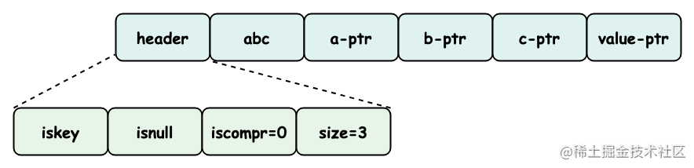

可以看到，在 size 字段之后，使用三个字节存储节点的数据，也就是 “a”“b”“c” 三个字符；之后是 a-ptr、b-ptr、c-ptr 三个 raxNode 指针，指向三个子节点；最后存储一个 value-ptr 指针，指向该节点表示 key 所对应的 value 值。上图展示的节点如果展开成树型结构，逻辑上就如下图所示，一个节点内的字符其实是树中的`兄弟关系`：

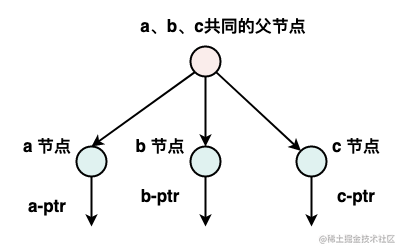

**如果当前节点是压缩节点**，当前节点只会有一个子节点，size 字段记录的是 data 中存储的字符串长度。例如，有 “x”“y”“z” 三个字符被压缩到了一个节点中，内存结构就如下图所示，其中 z-ptr 指针指向了下一个节点，value-ptr 指向该节点表示的 key 所对应的 value 值。

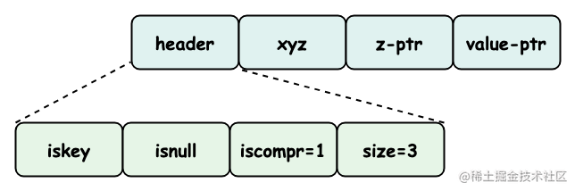

上图展示的节点如果展开成树型结构，逻辑上如下图所示，一个节点内的字符其实是树中的`父子关系`：

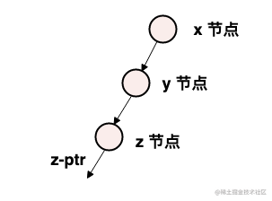

raxNode 节点组成的 Rax 树在 Redis 中使用 rax 结构体进行抽象，其具体定义如下：

```c
typedef struct rax {
    raxNode *head; // 指向Rax树的根节点
    uint64_t numele; // 记录Rax树中有多少元素
    uint64_t numnodes; // 记录Rax树中有多少节点
} rax;
```

## Rax 核心实现

在使用 Rax 树之前，我们需要先通过 `raxNew() 函数`创建一个 rax 示例，其中会先创建一个 **rax 实例**和一个**根节点 raxNode 实例**，然后将 rax->head 指向这个根节点。rax 实例的 numnodes 字段会初始化为 1，numele 字段会初始化为 0，根节点的各个字段初始化为 0。

新建的 Rax 树结构如下图所示：

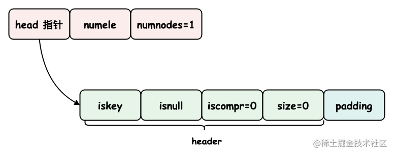

创建完 rax 实例之后，我们就可以开始关注如何使用 rax 这个实例了，在 Redis 源码中，我们可以在 rax.h 文件看到操作 rax 实例的方法，主要分为`插入新数据`、`查询数据`以及`删除数据`三类核心方法。这些方法的实现代码都相对复杂，在下面的介绍中我们不会 “沉迷” 于具体的实现细节，而是结合示例介绍插入、查询以及删除操作的原理。

### 一、查询操作

无论是在 Rax 树的插入还是删除操作里面，都会使用到 Rax 树的查询逻辑，所以我们先来介绍查询操作的核心实现。

从 Rax 树中查询数据的入口是 `raxFind() 函数`，它底层依赖的函数如下图所示，其中**先是通过 raxLowWalk() 函数遍历整个 Rax 树来查找目标节点，然后通过 raxGetData() 函数从目标节点中读取数据**。下面我们一个个来分析这两个函数的实现。

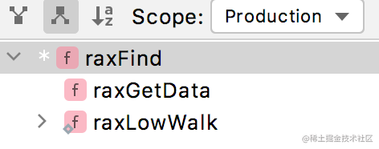

我们先来看 `raxLowWalk() 函数`，其返回值是**查找的目标字符串在 Rax 树中能匹配到多少个字符串**。

- 如果返回值等同于目标字符串长度（即参数 len），则表示在 Rax 树中存在目标字符串。注意，这只是说明 Rax 树中存在对应的 raxNode 节点，但是不一定是一个 Key。例如，该 raxNode 节点的 iskey 的值是 0，再或者目标字符串的最后一个字符串位于一个压缩节点的内部。举个例子，我们在下面这个 Rax 树里面查询 “foote” 这个字符串，很明显，这个 Rax 树里面只有“foo”“foob” 这些 Key，没有 “foote” 这个 Key。但是，raxLowWalk() 查找 “foote” 这个字符串的时候，返回值是 5，因为 “foote 字符串在 “er” 这个压缩节点里面能够完成匹配。

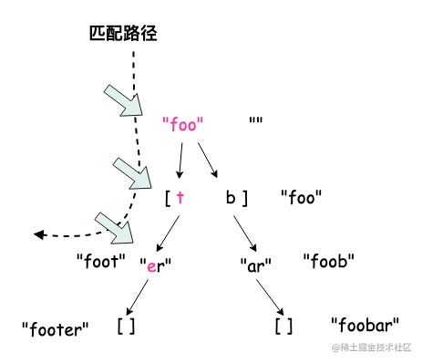

- 如果返回值不等于 len，则表示目标字符串未能在 Rax 树中匹配到全部字符，返回值就表示最多能匹配多少个字符。

明确了 raxLowWalk() 函数的返回值含义之后，我们再来介绍一下 raxLowWalk() 函数中各个参数的含义：

```c
static inline size_t raxLowWalk(rax *rax,  // 查询的rax实例
  unsigned char *s, size_t len, // s字符串和长度len构成了查询的目标字符串
  raxNode **stopnode,  // 查找到最后停留的节点，也就是能够匹配到的最后字符串
                       // 所在的节点
  raxNode ***plink,    // 这是一个三级指针，用于存储stopnode父节点中
                       // 指向stopnode节点的指针
  int *splitpos,  // 如果匹配到的最后一个字符位于压缩节点中，splitpos返回该
                  // 字符在压缩节点内部的索引位置
  raxStack *ts // 保存父节点的栈
)
```

下面我们通过一个示例来说明 raxLowWalk() 函数的核心逻辑，下图展示的 Rax 树是先后插入“ab”“abcd”“abABC” 三个 key 形成的，其中，ab、BC 节点都是压缩节点，cA、d 节点都是非压缩节点。

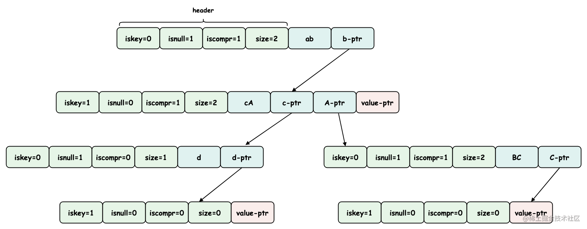

简化一下的话，就是下面下面这个树型结构：


#### 查询 “abAB”

这里我们以查找 “abAB” 这个 key 为例，介绍 rax 树的查找操作，核心流程如下。

首先，会创建一个 h 指针指向当前遍历的节点，同时会初始化 i、j 两个索引，分别指向目标字符串以及当前遍历的节点中的字符。

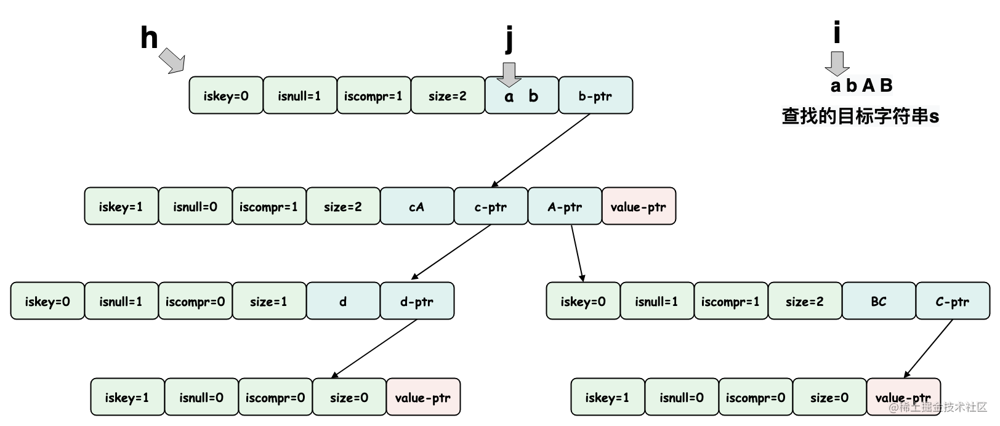

接下来，因为 h 当前指向压缩索引，其中的字符逻辑上是树中的`父子关系`，这里我们只需要比较 i 和 j 指向的字符是否相等，如果相等，会不断后移 i 和 j 这两个索引，表示相应的字符匹配成功。在这个示例中，h->data[0] 和 s[0] 相等（都为 a），i 和 j 都会后移变成 1；h->data[1] 和 s[1] 相等（都为 b），i 和 j 都会后移变成 2，此时当前压缩节点 h 中的字符全部迭代完毕。

在当前这个压缩节点 h 中的字符全部迭代完成之后，h 会沿着 b-ptr 指针指向下一个 Rax 树中的下一个节点，继续遍历。如下图所示，h 指针指向了 “cA” 这个非压缩节点，索引 j 被重置为 0，索引 i 不变。

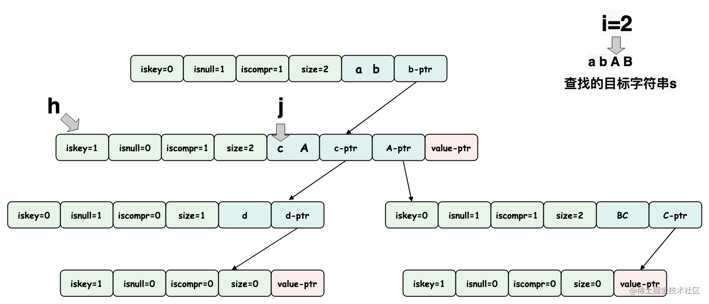

h 指针当前指向的是一个非压缩节点，其中的字符逻辑上是树中的`兄弟关系`，所以此时我们要在 h 节点中找到走哪个树杈。通过遍历 h->data 中的字符并逐个与 s[2] 比较会发现， h->data[1] 与 s[2] 相等，都是 A 这个字符。所以，h 指针会沿着 A-ptr 这个指针继续向下 Rax 树的子节点移动，如下图所示，同时还会将索引 i 后移，索引 j 重置为 0。

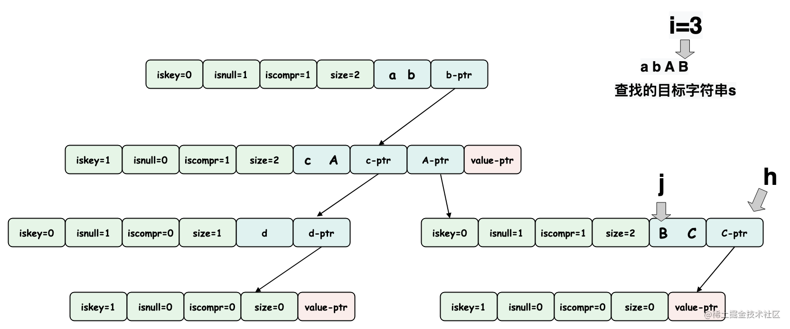

此时 h 节点又是一个压缩节点，继续将 h->data 并与字符串 s 进行逐个字符的比较。当 i = 4、j = 1 时，目标字符串 s 的查找就结束了，此时会将 stopnode 指针指向节点 h，splitpos 参数的值设置为 1，并返回 i 的值（也就是 4），表示目标字符串在 Rax 树中查找到了（但很明显，“abAB” 并不是一个 key）。

在上述 raxLowWalk() 函数查找目标字符串的过程中，plink 和 ts 参数的变化并没有提到，这里单独进行详细说明。

首先是 `ts 参数`，它是一个用来记录 RaxNode 节点的栈，在查找过程中会将遇到的 RaxNode 节点（也就是 h 指针）压栈。所以上述查找 “abAB” 字符串的过程中，ts 参数的变化如下图所示：

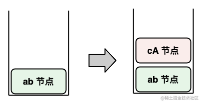

再来看 `plink 参数`，它指向的是 h 节点中指向子节点的指针，这是个三级指针，略微有点绕。下图展示了查找 “abAB” 字符串的过程中，plink 参数取值的变化过程。

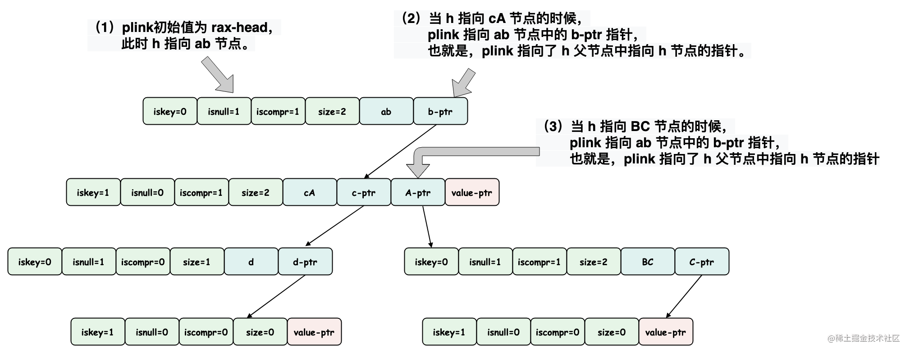

上述查找 “abAB” 字符串最终结束在了一个压缩节点的内部，这只是 raxLowWalk() 函数未查找到 key 的一个出口。

#### 查询 “abC”

我们再通过其他示例来简述一下另一个未查找到 key 的出口，下面是查找 “abC” 字符串的流程。

1. h 指针首先会指向 “ab” 这个压缩节点，j 和 i 都初始化为0，随后开始不断比较 i、j 指向的字符并在匹配成功之后后移 i、j 索引。很明显，“ab” 节点可以匹配 “abC”前面两个字符，此时 i 为 2，指向 “C” 这个字符，如下图 （a）所示。

2. “ab” 节点匹配完毕之后，h 指针下移，指向 “cA” 这个非压缩节点。j 会重置为 0 指向新节点的第一个字符，并不断后移查找与 “C” 匹配的字符。很明显，“cA” 节点中并不存在 “C” 字符，j 一直会增大到 2，整个查找过程结束，如下图 （b）所示。

3. 这里的 i 为 2（其实也就是 raxLowWalk() 函数的返回值），说明当前 Rax 树中的数据只能匹配 “a”“b” 这前两个字符，匹配不到第三个 “C” 字符。 raxLowWalk() 函数此时分别是：参数 stopnode 指向 “cA” 节点，参数 splitpos 为 2（即 j 最后的取值），参数 plink 指向了 “ab”节点中的 b-ptr 指针，ts 栈中只有 “ab” 节点。

上述查找 “abC” 字符串最终结束在了一个非压缩节点的结尾。

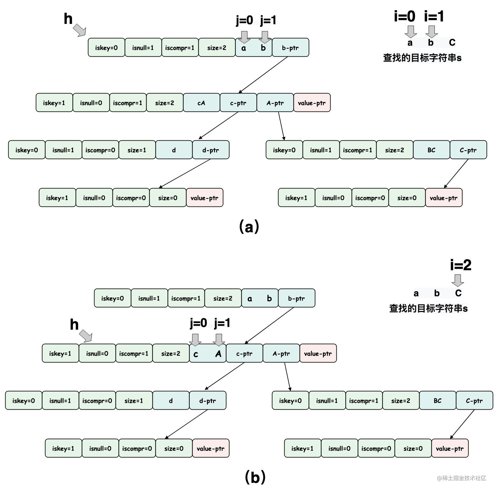

#### 查询 “ab”

上面的示例都是未查找到 key 的场景，下面来看查找到 key 场景。**如果成功查找到为 key 的目标字符串，则查找过程最终会停到压缩节点的结尾或是非压缩节点内部**。此时，h 还需要向下移动一个节点。例如，这里以查找 “ab” 的过程为例来介绍。

1. h 指针首先会指向 “ab” 这个压缩节点，j 和 i 都初始化为0，随后开始不断比较 i、j 指向的字符并在匹配成功之后后移 i、j 索引。很明显，“ab” 节点就可以匹配目标字符串 “ab”，匹配结束。

2. 此时 h 还是会下移指向 “cA” 节点，并将 j 重置为 0，然后才开始执行函数返回的相关逻辑，具体的返回值为 2，参数 stopnode 指向 “cA” 节点，参数 splitpos 为 0，参数 plink 指向了 “ab”节点中的 b-ptr 指针，ts 栈中只有 “ab” 节点。

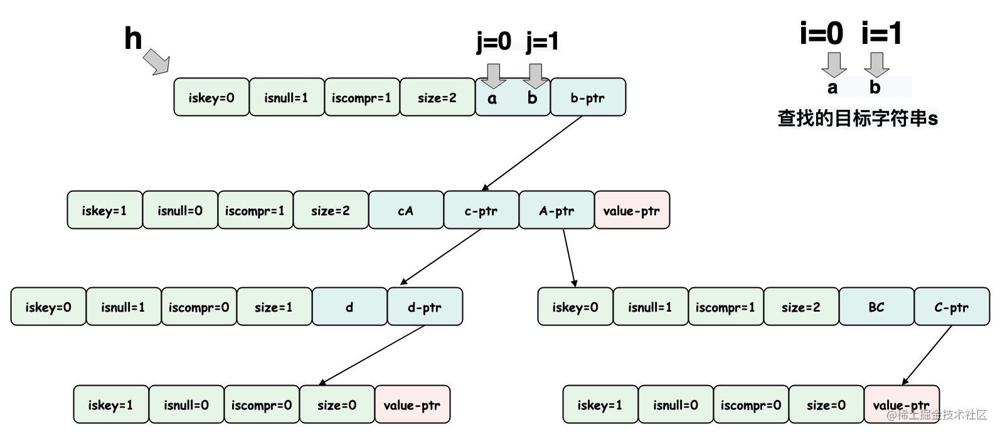

#### 查询 “abABC”

再来看另一个能够查找到目标字符串的示例：查找“abABC”字符串。经过上述这么多示例的分析，整个匹配 “abABC” 字符串的匹配过程就不再展开介绍了，这里我们关注的是：在匹配完最后的“C”字符之后，指针 h 依然会下移，如下图所示。此次查询返回值为 4，参数 stopnode 指向图中的 h 节点，参数 splitpos 为 0，参数 plink 指向了 “BC”节点中的 C-ptr 指针，ts 栈中从栈顶到栈底依次是 “ab”“cA”“BC” 三个节点。

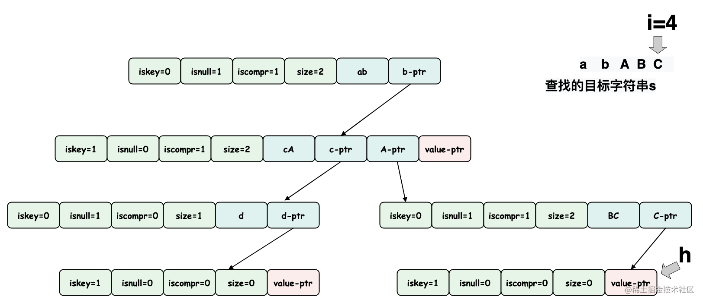

通过 raxLowWalk() 函数目标字符串的查找之后，raxFind() 函数会通过 raxGetData() 函数读取 h 指针指向的节点中的 value-ptr 指针并返回。当然，读取 value-ptr 指针的前提是，我们查找的目标字符串确实是个 key。如果目标字符串不是 key，自然也无法获取到 value-ptr，raxFind() 会直接返回一个空指针。

### 二、插入操作

说完了 Rax 树的查找逻辑之后，我们再来看 Rax 的插入逻辑。

在我们新建一个空 Rax 树之后，我们就可以通过 raxInsert() 或是 raxTryInsert() 函数插入元素了，如下图所示，这两个函数的核心底层逻辑都是依赖`raxGenericInsert() 函数`中实现的，所以我们重点来分析一下 raxGenericInsert() 函数的实现。

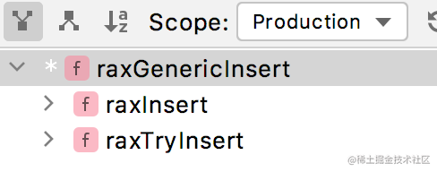

首先来关注一下 raxGenericInsert() 函数的参数含义：

```c
int raxGenericInsert(rax *rax,  // 操作的rax实例
  unsigned char *s, size_t len,  // s字符串和长度len构成了插入的key
  void *data,  // 插入的新key对应的value值
  void **old,  // 如果插入的key已存在，则通过old指针指向原value值，返回给调用方
  int overwrite // overwrite标识在插入已存在key时，是否要进行覆盖
) 
```

raxGenericInsert() 函数本身的实现非常复杂，我们不会逐行代码进行分析，而是通过从一棵空 Rax 树开始，逐步插入 “abcd”“abcdef”“ab”“abABC”“Aabc”一系列 key 的示例来说明 raxGenericInsert() 函数的核心插入流程。

#### 插入 “abcd”

首先来看插入 “abcd” 的核心流程，主要分为下面三步。

1. 在插入新字符串之前，需要先通过 raxLowWalk() 函数尽可能匹配新插入字符串的前缀，确认新字符串的插入位置。

```c
i = raxLowWalk(rax,s,len,&h,&parentlink,&j,NULL);
```

- raxLowWalk() 函数在刚初始化的空 Rax 树中查找 “abcd” 字符串得到结果是 h 这个输出参数，实际的结果是，h 指针会指向唯一的树根节点，parentlink 指针表示的 h 节点的父节点，那它会指向 rax->head 指针，i、j 都为 0，如下图所示：

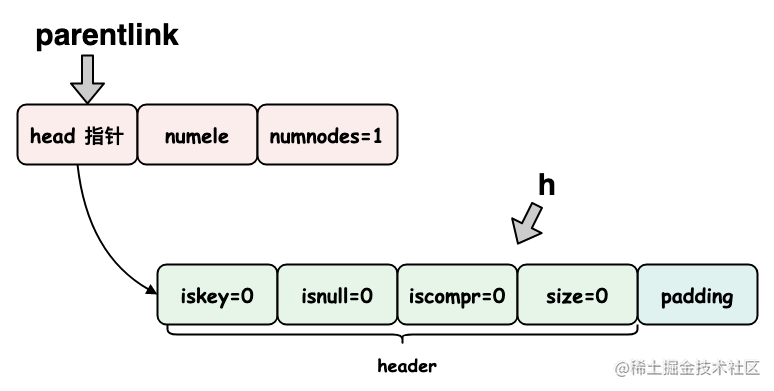

2. 因为“abcd”字符串没有匹配到任何前缀，我们可以直接通过 rawCompress() 函数为 “abcd” 字符串创建一个压缩节点，同时还会在其下创建一个空的子节点，如下图所示。在创建 “abcd” 压缩节点的时候， rax->head 指针指向的根节点地址可能就不可用了，此时我们会通过 parentlink 重新更新 rax-head 指针指向 “abcd” 压缩节点。

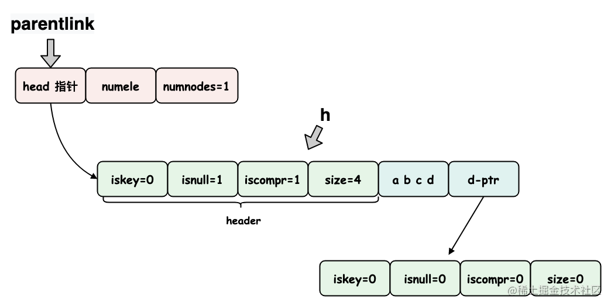

3. 最后将 parentlink 和 h 指针先后下移。将 “abcd” 这个 key 对应的 value 值存储到 h 节点中，同时将 h 节点的 iskey 标识设置为 1，整个 “abcd” 字符串以及对应 value 的插入就完成了。

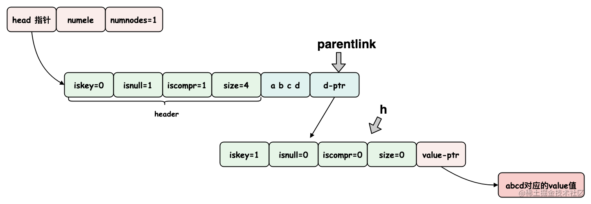

很明显，指向 “abcd” 对应的 value 指针实际是存储在 “abcd” 的子节点中。

#### 插入“abcdef”

在插入完 “abcd” 字符串之后，我们紧接着插入“abcdef” 字符串，插入流程与上述流程类似，这里会创建一个 “ef” 压缩节点作为 “abcd” 的子节点并在其中记录 ab-value，abcdef-value 则记录在 “ef” 的子节点中，最终插入结果如下图所示：

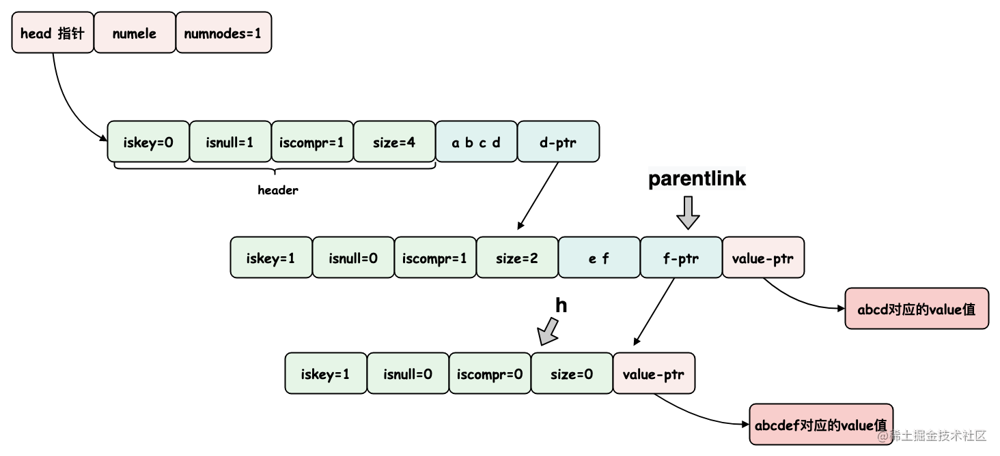

#### 插入“ab”

接下来我们插入“ab” 字符串，核心流程如下。

1. raxLowWalk() 函数查找 “ab” 字符串得到结果为 h 指针会指向树根节点，parentlink 指针则指向 rax->head 指针，i、j 都为 2，如下图所示：

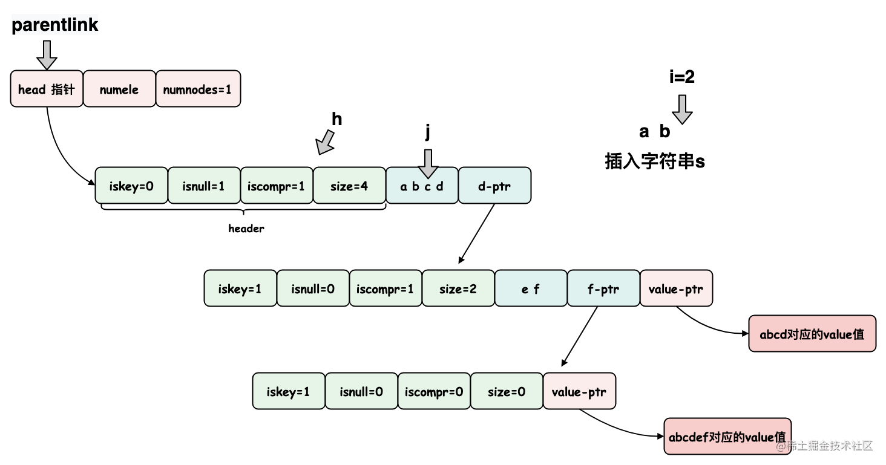

2. h 节点是个压缩节点，是多个连续的树杈节点压缩而成的。这里，h 节点会从 splitpos 指定的位置（即 j = 2 这个位置）开始分裂，分裂出 “cd” 压缩节点，成为 “ab” 的子节点，原来的 “ef” 节点成 “cd”的子节点，如下图所示。同时，parentlink 和 h 指针下移，ab 对应的 value 存储到 cd 节点中。

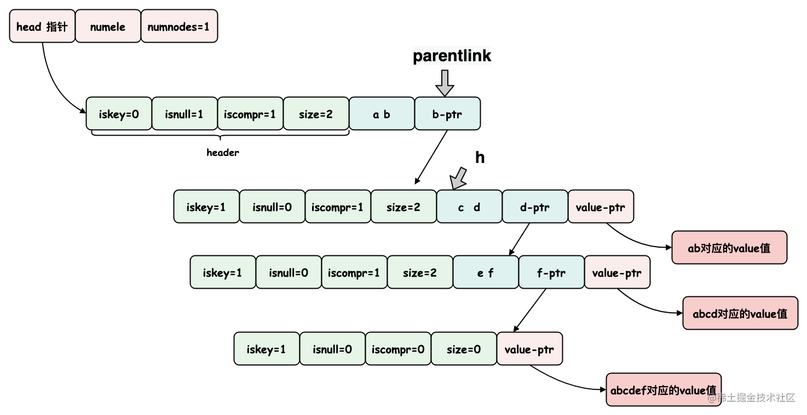

#### 插入“abABC”

完成 ab 的插入之后，我们再来向 Rax 树中插入 “abABC” 这个 key，核心流程如下。

1. raxLowWalk() 函数查找 abABC 字符串得到结果是 h 指针会指向 cd 节点，parentlink 指针则指向 ab 节点，i 为 2，j 都为 0，如下图所示：

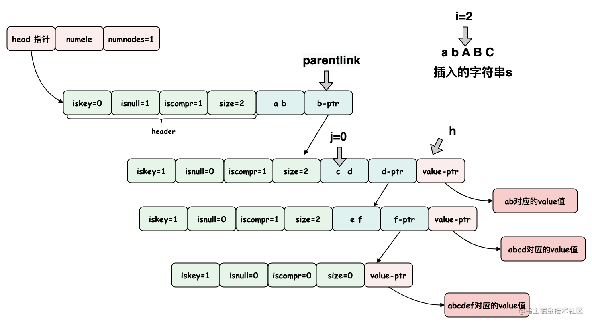

2. 这里会对 cd 这个压缩节点进行拆分，生成 cA 非压缩节点，d 节点作为 c 节点的子节点，挂到 c-ptr 下，ef 节点依旧作为 d 的子节点。BC 压缩节点作为 A 的子节点挂到 A-ptr 下，在 BC 节点下会创建一个空节点，存储 abABC 对应的 value 值。

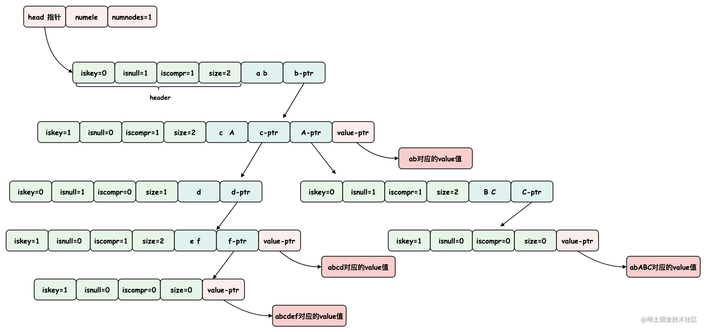

#### 插入 “Aabc”

最后我们向 Rax 树中插入 “Aabc” 这个 key，核心流程如下。

1. raxLowWalk() 函数查找 Aabc 字符串得到结果是 h 指针会指向 ab 节点，parentlink 指针则指向 rax->head 指针，i、j 都为 0，如下图所示：

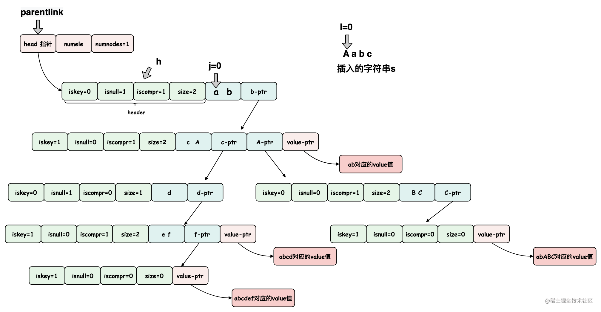

2. 该场景会将 ab 节点进行拆分，形成 aA 压缩节点，b 作为一个单独的非压缩节点挂到 a-ptr 下，cA 节点依旧是 b 的子节点，cA 以下的子节点没有变化。A-ptr 则指向了 abc 这个压缩节点，abc 下有一个空节点用来存储 Aabc 对应的 value。

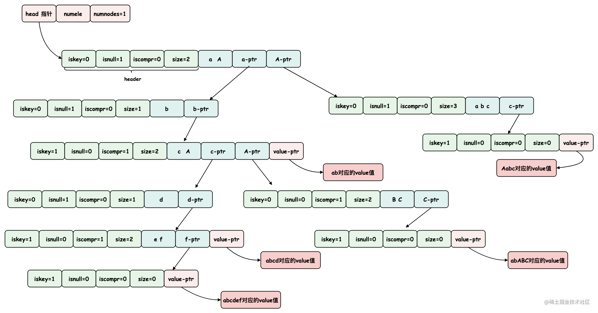

通过上述多个示例，相信你已经大概了解了 Rax 树插入的逻辑，这里简单总结一下。

- 如果插入点在`压缩节点`内部：

  - 插入 key 被完全匹配（即 i=len），我们需要将压缩节点进行拆分，并设置键值对接口，例如上面插入 ab 的场景。
  - 插入 key 未被完全匹配（即 i<len），我们需要先对压缩节点进行拆分，并创建一个非压缩节点，然后将拆分点的字符以及不匹配的字符串写入到非压缩节点，例如上面插入 abABC 的场景以及插入 Aabc 的场景。

<!---->

- 如果插入点在`非压缩节点`内部：

  - 插入 key 被完全匹配（即 i=len），只需要直接设置键值对即可。
  - 插入 key 未被完全匹配（即 i<len），我们需要将新 key 中未匹配的第一个字符串写入到非压缩节点中，然后创建一个子节点来存储新 key 中剩余的字符。如果非压缩节点本身就是一个空节点，可以将其转换为压缩节点来存储新 key 中未匹配的全部字符，例如上面插入 abcdef 的场景。

### 三、删除操作

介绍完 rax 树的插入和查询流程之后，我们再来看从 rax 树中删除 key 的核心逻辑。要删除一个 key，首先需要调用 raxLowWalk() 函数去查找 key 是否存在，如果目标 key 存在，才会执行下面的删除逻辑，下面依旧是以示例的形式描述复杂的删除逻辑。

#### 删除 “abABC”

我们基于前面插入示例中最后得到的 Rax 树为例来介绍，首先来看删除 “abABC” 这个 key。

1. rawLowWalk() 函数查找到 abABC 对应 value 存储在下图 h 指向的节点中，同时在 raxStack 栈（ts）记录了查找 h 节点的整个轨迹，如下图：

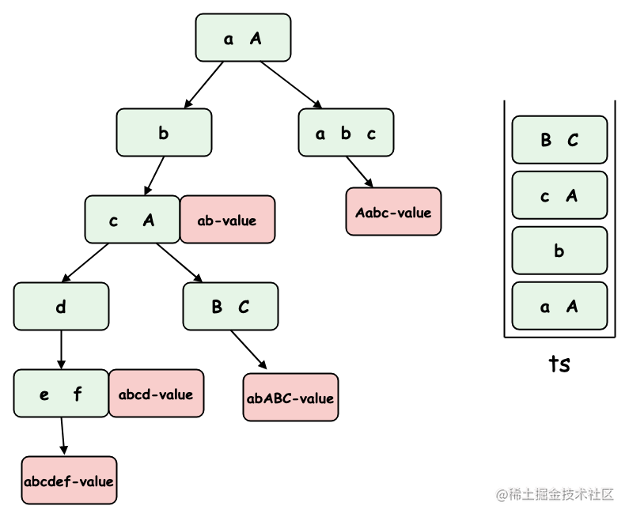

2. 接下来，`从树叶向树根`尝试删除节点，碰到没存储 value 的压缩节点直接删除的。例如，删除 abABC 这个 key，我们通过 raxLowWalk() 函数找到的节点是 abABC-value，然后就可以按照 ts 这个栈记录的轨迹开始删除，依次删除 abABC-value 节点、BC 节点。

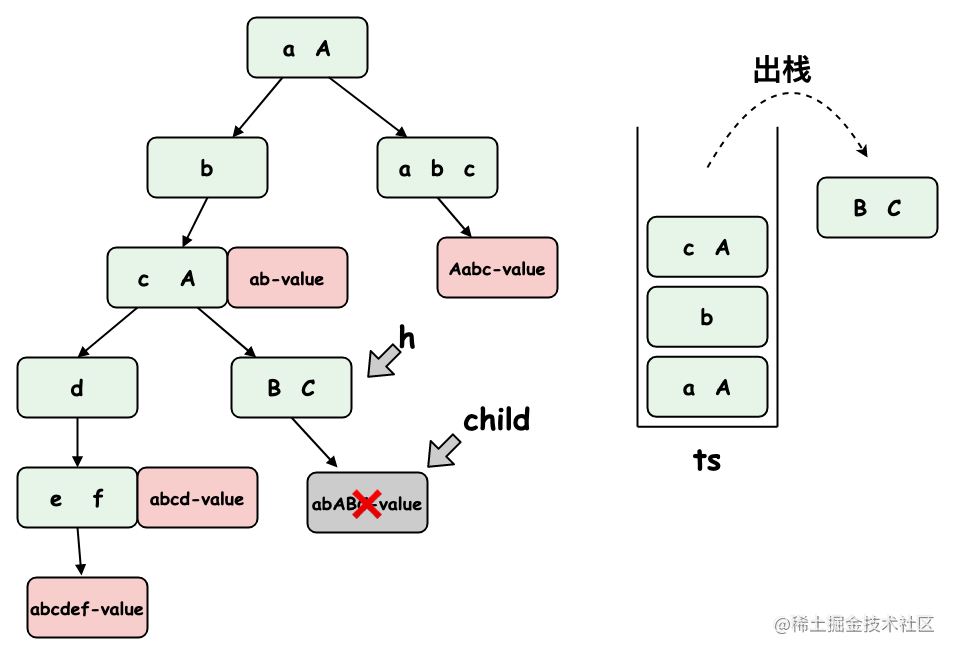

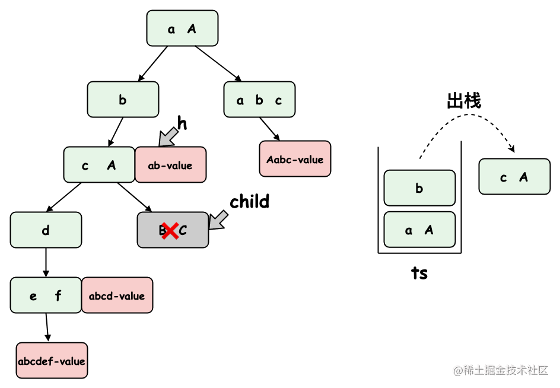

3. 向上删除遇到非压缩节点的时候，例如上图中的 cA 节点，就需要将其中能够删除的字符进行删除，也就是其中的 A 字符以及对应指向子节点的指针，最终删除 abABC 这个 key 的结果如下图所示：

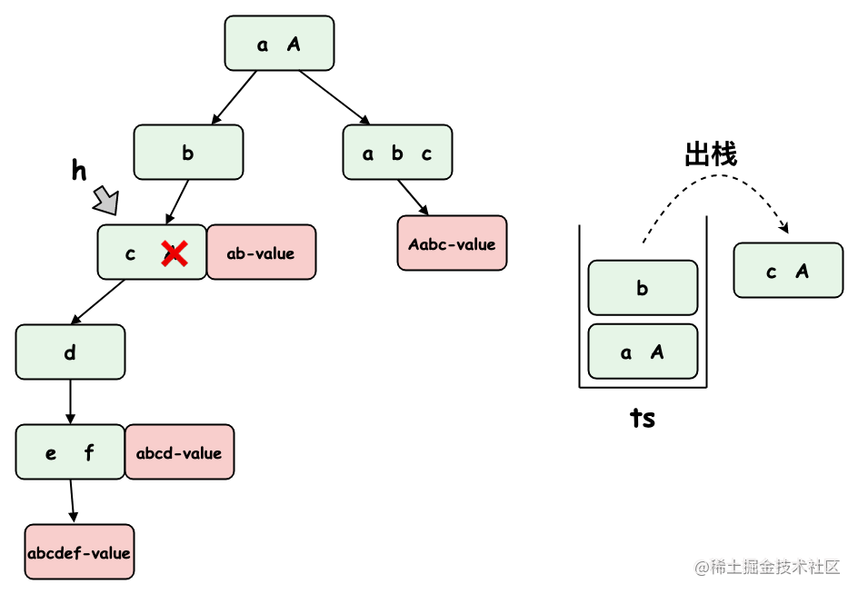

到此为止，删除 abABC 的核心逻辑就分析完了。

#### 删除 “ab”

再来看删除 “ab” 这个 key 的核心流程。

1. 经过 rawLowWalk() 函数查询之后得到的 h 指向 c 节点，raxStack 栈（ts）记录的查询轨迹为 aA、b 两个节点，如下图所示，这里首先会将 c 节点的 isKey 标识设置为 0，表示 ab 对应的 value 已被删除。

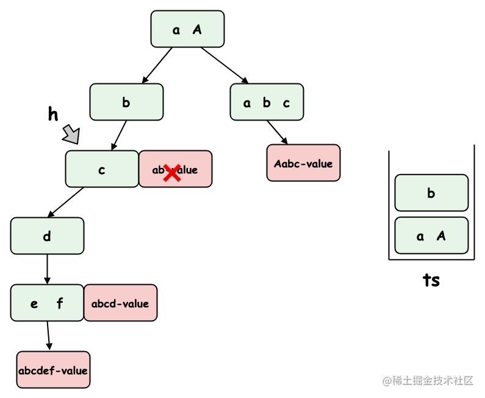

2. 此时，c 节点中只有一个字符，且不是 key，我们可以尝试将 c 节点与其父节点或是子节点进行压缩。在压缩开始之前，需要找到此次压缩操作的上界，如下图所示，h 指针和 parent 指针会沿着 raxStack 栈（ts）记录的查找轨迹向树根遍历，找到第一个不能参与压缩的节点，即 aA 这个非压缩节点。然后，start 指针指向参与压缩的第一个节点。

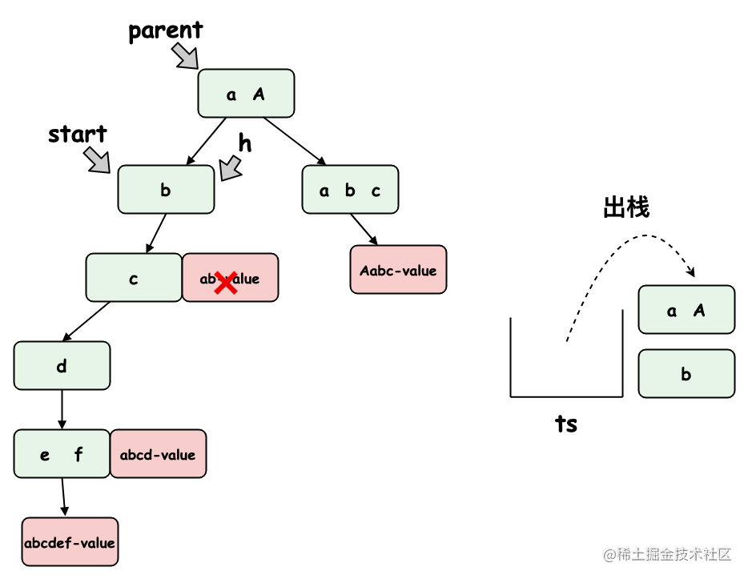

3. 接下来，查找此次压缩操作的下界，如下图所示，h 指针向叶子节点遍历，碰到第一个 key 节点或是第一个非压缩的多字符节点，即为压缩的下界。在查找下界的过程中，还会统计能够参与压缩的节点个数，该示例中有三个节点可以参与压缩。

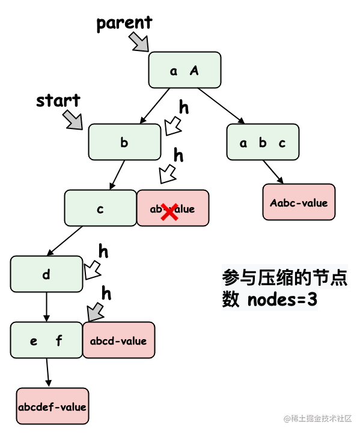

4. 明确了此次要压缩的上下界之后，我们就可以创建一个新压缩节点 new 来存储压缩结果，然后从 start 指针向下开始压缩，b、c、d 三个参与压缩的节点会逐个压缩到 new 节点中，如下图所示。节点压缩完成之后，还要设置指针的指向：一个是修改 parent 节点中 a 字符对应的指针，将其指向 new 节点（如果 Rax 树的根节点也参与压缩，修改的就是 rax->head 指针）；二是设置 new 节点中指向子节点的指针，将其指向 ef 节点。

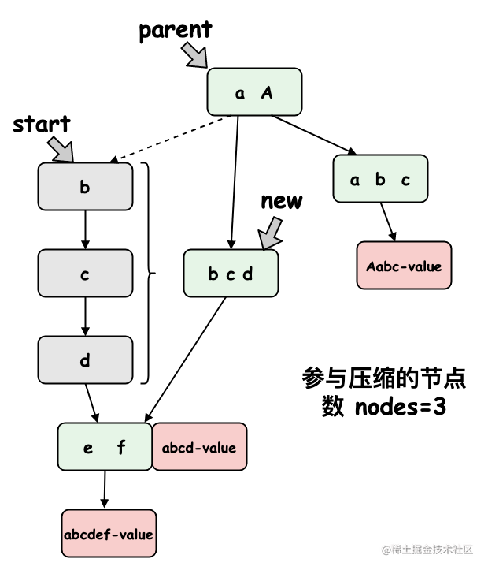

到此为止，删除 ab 的核心逻辑就分析完了。

#### 删除 “abcd”

我们再来看删除 abcd 这个 key，这里简述其核心流程：先通过 raxLowWalk() 函数查找存储 abcd 对应 value 的节点（也就是 ef 节点），然后将其 isKey 设置为 0。此时，ef 节点本身不能删除（因为还有 abcdef 这个 key 在，ef 还有子节点，h->size == 0 不成立），同时 ef 节点包含多个字符，也不会进行压缩，最终删除 abcd 之后结果如下图所示：

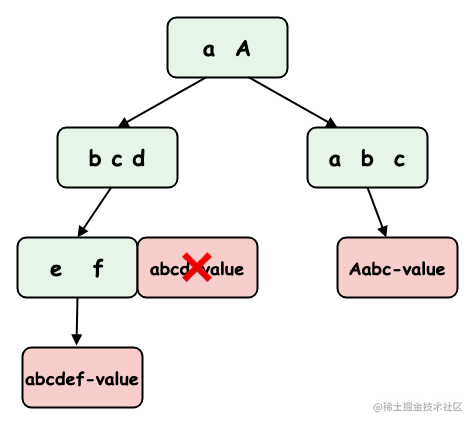

#### 删除 “abcdef”

最后我们来看删除 abcdef 的核心流程。

1. 首先找到 abcdef 对应 value 所在的节点，同时将查询轨迹记录在 rackStack 栈中，如下图所示：

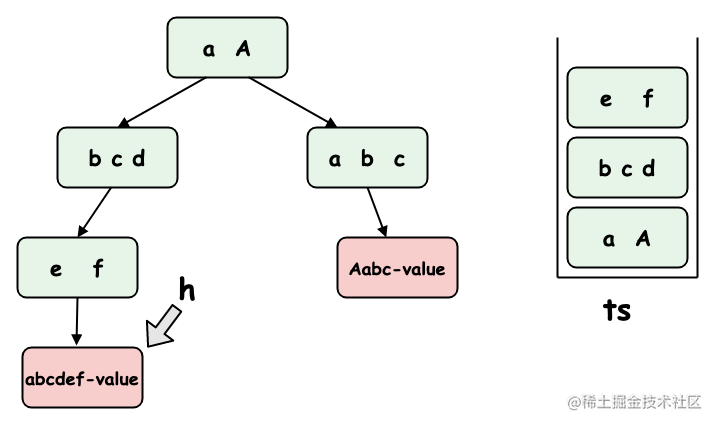

2. 根据查询轨迹从树叶向树根删除，正如前文介绍的那样，所有碰到的非 key 的压缩节点全部都会被删除，这里的 abcdef-value、ef、bcd 节点都会被删除，如下图所示：

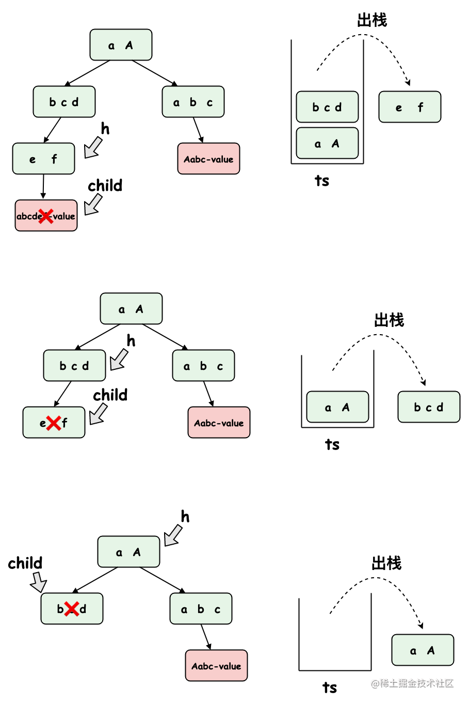

3. 向上删除遇到非压缩节点的时候，如上图中的 aA 节点，需要将其中能够删除的字符进行删除，也就是其中的 A 字符以及对应指向子节点的指针，删除结果如下图所示：

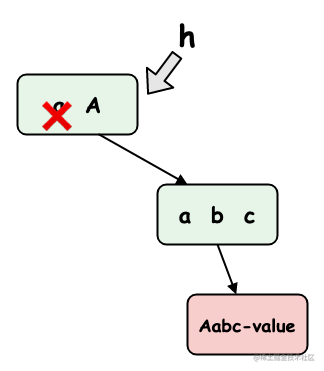

4. 此时，A 节点中只有一个字符，且不是 key，我们可以尝试将 A 节点与其父节点或是子节点进行压缩。参与压缩的节点有 A 和 abc 两个，如下图所示：

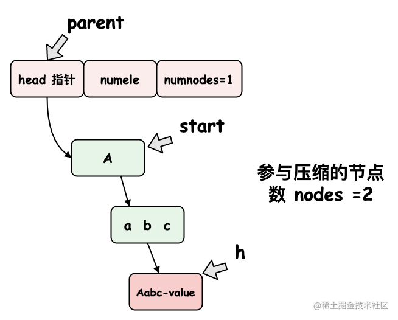

因为 Rax 树根节点参与了压缩，在压缩完成之后，我们需要设置 rax->head 指针，指向新生成的 Aabc 压缩节点，Aabc 压缩节点中的 c-ptr 指针也会设置为指向 Aabc-value 节点，如下图所示：

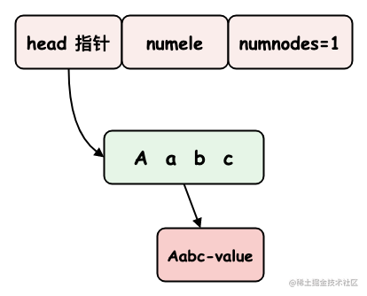

到此为止，删除 abcdef 的核心逻辑也就分析完了。

## 总结

在本节中，我们首先介绍了 Rax 树的基本概念，了解了 Rax 这种树型结构存储数据的基本思想。然后又重点讲解了 Redis 中抽象 Rax 树的两个核心结构体 —— raxNode 和 rax 结构体。接下来就是结合多组示例，详细地分析了 Redis 向 rax 树插入数据、查询数据以及删除数据等核心操作的流程，解释了 rax 核心操作的原理。

Rax 树的具体代码这里就不带领小伙伴们一行行分析了，感兴趣的小伙伴，可以分析感兴趣的函数实现。

最后，我再提供一个辅助你分析 rax 操作的函数 —— `raxShow() 函数`，该函数也是定义在 rax.h 文件中，它会将整棵 Rax 树的节点结构输出到控制台，帮助我们清晰地了解一棵 rax 树在进行某个操作前后的状态差异。
