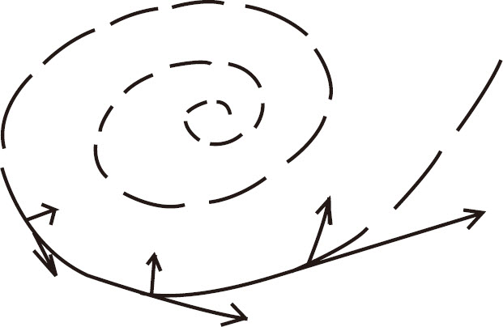

《万历十五年》和我的大历史观黄仁宇

《万历十五年》英文版书名为1587，A Year of No Significance，法文版为1587：Le Déclin de La Dynastie des Ming。此外，尚有德文版、日文版及中文繁体字版，均筹备已久，都可望于今年夏秋间成书。

此书初稿完成于1976年夏季，仍在“四人帮”执政时代，当然不能盼望在中国出版。即使是英文版，也经过无数挫折。美国出版界，对商业性和学术性的分野极为严格。商业性的出版，以电视及广告作开路先锋，以短期大量行销、迅速结束为原则，否则书籍堆积于库房，妨碍资金的流通，迟滞今后业务。学术界的出版，由各大学的出版社负责，对经济方面的顾虑比较达观，可是又要顾虑学校的信誉与地位。况且美国之研究汉学，也有他们独到的地方。一般风格，注重分析，不注重综合。各大学执教的，都是专家，因为他们分工详尽，所以培养了无数青年学者，都戴上了显微镜的目光，对望远镜的观点，倒很少人注意；而且对学术的名目及型式，非常尊重。《万历十五年》在各方面讲，都在两者之间。所以商业性质的书局说，你的文章提及宫廷生活、妃嫔间恩怨，虽有一定兴趣，但是又因海瑞，牵涉明朝财政；因为李贽，提到中国思想，应属学术著作。大学出版社则认为这书既不像断代史，也不像专题论文，又缺乏分析与解剖，实在是不伦不类，也不愿承印。所以兹后于1979年耶鲁大学出版社毅然排除成见答应出版，北京中华书局在四人帮虽倒而国内情况仍在青黄不接的期间接受中文版，都要有相当的识见与度量，值得作者钦仰。

现在《万历十五年》既有这样多的版本，英文本又在美国若干大学采用为教科书，已出三版，并且经过当代文坛巨子欧蒲台（John Updike）在著名杂志上作文推荐。中文本初版近三万册，也已售罄，并且准备再版，而且出精装本。这都是使作者感奋的事。

但是这本书仍只代表作者一部分意见，不是全部历史的观点。作者在中文版《自序》中提及：此书“说明十六世纪中国社会的传统的历史背景，也就是尚未与世界潮流冲突的侧面形态。有了这样一个历史的大失败，就可以保证冲突既开，恢复故态决无可能，因之而给中国留了一个翻天覆地、彻底创造历史的机缘”。很显然，《万历十五年》虽有这样积极的表示，书中所写仍以暴露中国传统的弱点为主。即欧蒲台的书评，也觉得指斥中国不好的地方，应和指斥西方和美国不好的地方相提并论。而且中文版的读者，还看不到的则是英法文版有富路特（Dr．L．Carrington Goodrich）先生作序。此公现年九十岁，其父母在中国传教，葬在通州。他自己曾在中国青年会工作，注重提倡儿童体育，又在第一次大战时，领导中国在法的劳工。后来又在纽约哥伦比亚大学任教多年。去年尚与其夫人打网球。其胸襟开阔，当代少有。他常常提醒我们，不要认为目前的偃蹇，忽视中国伟大的地方。《万历十五年》英文本富序有下面一段：

Historians may re-examine the mistakes of the past in the hope of providing warnings for the future，but at the same time caution their readers to preserve what is of value．Presumably，for China the experiences of both East and West must be drawn upon．It is essential that the historian lay everything on the table．法文则称：

Les historiens peuvent soumettre les erreurs du passé à un nouvel examen dans l'espoir d'y trouver des avertissements pour l'avenir，mais ils peuvent en même temps recommander à leurs lecteurs de conserver ce qui a de la valeur．La Chine a sans doute beaucoup à tirer des expériences de l'Orient comme de l'Occident. Il est essentiel que l'historien ne cache rien de ce qu'il sait.译为中文则为：历史学家检讨过去的错误，以作将来的警戒。但同时也要忠告读者，保全有价值的事物。据此猜想，今后中国极需采取东西两方的经验。因之作历史的人，务必将所有资料，全盘托出。

序内又说明：“检察中国的官僚制度，不是否认中国全部文化。”可见作者、序者、书评都表示谈论有不尽的地方，应留作日后交代。可是一本书，到底也有它的范围。况且《万历十五年》的初步立意，至今十年，世界局势已有相当变化。也就是我们在写作历史及欣赏历史的时候，身处其境的历史事物，也有了更动。十年以前尚不能全盘托出的资料，而今则能。有了这种机缘，作者才能不顾忌讳，更不拘形式地与编者及读者作漫谈。

**　*

《万历十五年》中文本作者姓名前，有一［美］字，表示我现在为美国公民。这在表彰事实之余，也很符合目前需要。因我之所谓“大历史”（macro-history）观，必须有国际性。我很希望以四海为家的精神，增进东方与西方的了解，化除成见。这不是一件简单的事，即使在海外，也仍是一个容易惹起是非的题目。

中国以道德代替法律，我已经批评得很透彻。但是现下仍有很多的西方人士，以为西方的法律，即是道德的根源。这种误解，也待指摘。比如西方所谓“自由”及“民主”，都是抽象的观念，务必透过每一个国家的地理及历史上的因素，才行得通。英国之民主，即不可能与日本之民主相同，而法国的自由也和美国的自由有差别。现在我虽作这种论调，仍是个人见解，不足代表美国时下的趋向。以这种见解看中国，更要胸襟开阔才能容纳。所以我一方面坚信美国立国精神有伟大的正义感，只待将两者之间的差别解释明白，很多误会即会冰释；另一方面在中国发表文章，尤其要强调道德非万能。大历史的观点，亦即是从“技术上的角度看历史”（technical interpretation of history）。至于将道德放在什么地方，这也是一个严重的问题。容我渐次论及。

**　*

首先要解释明白的则是大历史观不是单独在书本上可以看到的，尤其不仅是个人的聪明才智可以领悟获得的。我的经验，是几十年遍游各地，听到不同的解说，再因为生活的折磨和煎逼，才体现出来的。我小时候读书，很受太史公司马迁的影响，满头脑充满着传奇性的希望和想法。抗战第二年，即辍学从军。所从的乃是国民党办的成都军校，毕业后在驻云南边境的国军十四师当过排长。后来也去过驻印军，在郑洞国将军麾下当过参谋，曾随此公由缅甸前线去上海而入东北。也目击杜聿明将军指挥作战的情形。我自己没有卷入内战，实系侥幸，乃因在东北三个月即被送来美国入陆军参谋大学。以后在东京驻日代表团，随朱世明将军解职而退伍。可是在抗战初期国共合作时代又认识了当日很多左倾名流，如作国歌的田汉先生寿昌，在我则为田伯伯。他曾告诉我年轻无数吃苦奋斗的经过。他的长子田海男，在我则为海男弟，也同我去成都，也同在十四师服务，也同去过日军占领的越北作过斥候，也同在驻印军工作。我也和他有过一度的竞争，所争的不是党派问题，也不是名位，而是到步兵前线作观察员的机会。事载1944年6月12日重庆《大公报》。也真料不到，他抗战一结束，即自动加入人民解放军，对装甲兵及炮兵的训练作过实质上的贡献，又去过朝鲜前线。而当日同我们一同起居办报的廖沫沙兄，则为日后三家村硕果仅存的元老。在武汉时代范长江兄则是无党无派，任《大公报》记者。他原名希天，北伐时从军，部队被打散。他曾亲自告诉我，一时贫病交迫，跳水自杀，被救后改名长江。曾几何时，他又做了新华社和《人民日报》的负责人，以后在文革期间，在确山身故。这些事情，今日回顾有如梦寐。

因为我有了这些经验，开始立场就复杂，乃不能对一般人所作的近代史的观点雷同。况且二次来美后，囊空如洗，在餐店洗碗碟，在堆栈做小工。整日劳动后退居斗室，无人对谈，耳内嗡嗡有声。深感风卷云消后，我自己已入中年，自此学历史已有探询人生意义的趋向。这还不过是初步。以后更结识了诸多的名流，遍阅诸家著作，泛游各地。受过被裁失业、与家人一起感受经济危机和被人歧视的景况，才越来越把眼光放大，才知道个人能力有限，生命的真意义，要在历史上获得，而历史的规律性，有时在短时间尚不能看清，而须要在长时间内大开眼界，才看得出来。

**　*

中国的革命，好像一个长隧道，须要一百零一年才可以通过。我们的生命纵长也难过九十九岁。以短衡长，只是我们个人对历史的反应，不足为大历史。将历史的基点推后三五百年才能摄入大历史的轮廓。《万历十五年》已经初步采取这种作法。所以叙事不妨细致，但是结论却要看远不顾近，例如郑贵妃是否掩袖工谗，她到底是否国家妖孽，和今人的关系至微。明代人之所以要在这些地方做文章，可见他们道德的观念过于窄狭，技术无法开展。我的书也已给欧美学生作教本，那些教师，当然不会在考试时要求学生在试卷上说明明代衰亡乃因泰昌皇帝朱常洛并非郑妃所生，而系恭妃王氏所出。他们从大历史的眼光观察，应该在读我书时看出中国传统社会晚期的结构，有如今日美国的“潜水艇夹肉面包”（submarine sandwich），上面是一块长面包，大而无当，此乃文官集团；下面也是一块长面包，也没有有效的组织，此乃成千上万的农民。其中三个基本的组织原则，此即尊卑男女老幼，没有一个涉及经济及法治和人权，也没有一个可以改造利用。万历十五年公元为1587年，去鸦片战争尚有二百五十三年，但是中央集权，技术不能展开，财政无法核实，军备只能以效能最低的因素作标准，则前后相同。如我们今日读英人魏黎（Arthur Waley）所作《中国人眼里的鸦片战争》（The Opium War Through the Chinese Eye），可见1840年，其情形仍与1587年相去无几。而我自己所作的《1619年的辽东战役》也有小历史的情节。例如刘

，中国方面的资料说他战死；满洲档案说他被俘后处死；朝鲜方面的资料则说他点燃火药自爆身死。文载联邦德国《远东杂志》（Oriens Extremus）。从大历史的观点看，则方从哲、杨镐当年丧师折将，有其背后政治、经济、社会多方的原因，和1894——1895年的中日战争情形极相似。是以痛责琦善、耆英及道光帝，于事无补，即咒骂光绪帝、李鸿章、丁汝昌也只能与咒骂郑贵妃和福王常洵相同，都仍不出长隧道内的观感。

从大历史的观点看来，即这潜水艇夹肉面包的结构，也有其根源。由明朝可以向后倒推到其他各朝。主要原因还是受亚洲大陆天候地理关系的影响。在这方面，我曾和英国的汉学家李约瑟博士（Dr．Joseph Needham）作文阐述。现在我仍在做个别方面的研究工作。其主要重点，则系历史上有长期性的重要发展，牵涉很多事物的时候，很难是少数人的贤愚得失所能概括；必有其背面、侧面，即我们自己还没有看清楚的因素，此是后话。现在即从明朝末年，贯穿有清二百六十八年到民国初年，也可以从潜水艇夹肉面包的基点看到：

* 中国传统社会无法局部改造。过去政府与民间的联系着重于尊卑男女长幼，纯靠科举制度作主。1905年停止科举之后，上层机构（superstructure）与下层机构（infrastructure）更为脱节，满清之覆亡，更无可避免。

* 民国肇造后，军阀割据，也是当然趋势。新的力量还没有产生，过渡期间，只能由私人军事势力撑持。这私人军事势力，限于交通通信等条件的束缚，也只能在一两个省区里有效。省区外的竞争，更酿成混战局面。

* 国民党专政期间，创造了一个高层机构，总算结束了军阀混战，但是全靠城市经济维持。

* 共产党的土地革命，在农村中创造了一个新的低层机构。现在中国当前的任务，则是在高层机构和低层机构间敷设有制度性的联系（institutional links），才能从上至下，能够以经济及法治的方法管理，脱离官僚政治的垄断。

这不是说整个一个世纪所有的人物毫无贤愚得失，只是他们的贤愚得失不足以更改上述历史发展的程序。大历史的着眼注重群众运动对社会上的长期贡献。要不是有这些积极的因素，中国1980年间也仍会和1910年间一样，不可能生存至今。我这样解释历史，超过党派的分别，也超过国际的界限，即对重洋远隔的师长同学，以及在内战期间丧生的亡友灵前，才都讲得过去。

**　*

我们小时候读历史，常有中国不如别人之感，何以日本明治维新，几十年内就凡事做得头头是道，而中国似乎越做越糟。现在才看得明白，中国文化是亚洲大陆地理的产物，欧美和日本的物质文明，有他们海洋性国家的经验；况且每个国家发展，也有他们先后程序，而其中最大的差别，则是现代先进的国家以商业的法律作高层机构及低层机构的联系，落后的国家以旧式农村的习惯及结构作为行政的基础。

我们今日一提到这问题，首先还没有把问题掌握清楚，就先要被质问，作者是否站在资本主义的立场。可是最近根据法国历史学家鲍德尔（Fernand Braudel）考证，“资本主义”（capitalism）这一名词还是十九世纪后期的产物，而仅在二十世纪内广泛使用。马克思虽称“资本家”（capitalists）及“资本家的时代”（capitalist era），并未引用“资本主义”这一名词。今日我们公认为最先的资本主义思想家，实为史密斯（Adam Smith）。他自己也不知道资本主义为何物，他著的《原富》，在民国初年即在中国行销。而他在十八世纪著书时仅称商业的管制办法优胜于农业的管制办法。在研究大历史的立场，这种分析方法最能表现每个国家先后发展的程序，也才不会用抽象的道德观念，抹杀了实际上技术的作用及成效。今日中国主张实事求是，我觉得更应当收集未曾被滥用的资料，将历史的基点推后好几个世纪，以原始的眼光重新检讨很多国家由落后到先进的程序。

这样看来，以“资本主义”形态在欧洲作先锋者，实为意大利的自由城市，其中翘楚则为威尼斯，这城市在大陆所占有的农业地区经济力量有限，而市内碱水也不便制造，在教皇及神圣罗马帝国（其本身不在意大利而在德奥）争权、两不相让之间，取得独立地位。其最大的方便则是地方小，内部组织简单。十三世纪之后，其全部国家有如一个大都市，也如一个大公司，所有民法即全部为商法，所以也不顾天主教的教义，建设海军，竭力经商，为欧洲最先进的国家。

继威尼斯而兴起，则为荷兰，荷兰正式国名为“内德兰王国”（Koninkrijk der Nederlanden），历史上也称The Dutch Republic，或United Netherlands。荷兰（Holland）不过为联邦内七个省之一省（今则十一省）。但是这个国家十七世纪初独立时，荷兰人口占全国三分之二，又供应联邦经费四分之三。内德兰因抵抗西班牙政府及参加宗教革命才联合全体荷民成为独立国家。过去无统一国家及社会的经验，经济发展尤参差不齐。显然荷兰虽工商业先进，内德兰境内也有很多省份保持中世纪形态，为落后的农村机构，不能以同一的法律在全境施行，于是乃行联邦制，大事由联邦决定，其他各省自理，开现代国家双层政治的先河。初时荷兰还坚持它有独立外交的主权，联邦的海军也是由五个海军单位拼成。虽然全国皈依新教的卡尔文派（Calvinists），初独立时很多教徒对这派教义所谓“定命论”（Predestination）者作特殊的解释，以便支持他们各别的政治活动。但内德兰国终因对外经济的激烈竞争及本身高度经济的发展下，使其内部矛盾逐渐解除而成为世界富强国家之一。

在荷兰之后，商业资本高速发展的则为英国。英吉利及苏格兰称“联合王国”，大于荷兰五倍至六倍之间。我们今日看来面积小，在十八世纪之前的欧洲则为大国，也有坚强的农业基础。这国家商业组织没有展开之前，常为各先进国家掣肘。如银行业，即为意大利人垄断，以后保险业也为荷兰人操纵。意大利人在伦敦的市街称为仑巴德街（Lombard Street），他们也享有领事裁判权。英国输出以羊毛为主。意大利人即先垫款于畜牧的农村，将羊毛预先收买，又掌握其海外市场。

英国的整个十七世纪可称多难之秋。起先英皇与议会冲突，财政税收成为争执的焦点，又有宗教问题的扰攘，司法权也成问题，对外关系又发生疑忌，也有内战、弑君、革新为民国、政治独裁制、复辟、行第二次革命的大变化，又产生了暗杀、排斥异教徒、发传单及英皇受外国津贴的情节，而其人口又不过四百万至六百万，其与本世纪初中国之不能治理，情形也大同小异。当然这段历史可以产生很多不同的解释。不仅不同的历史家著书争执，有时同一的作者所著书也前后解释不同。

我极想向中国读者提及的，则是对中国的大历史而言，英国1689年的经验，深足借镜。这年代之前，英国为一个“不能在数目上管理的国家”（mathematically unmanageable），法律即有不同的见解，法庭也有三四种不同的种类。所谓普通法（common law）者，乃中世纪遗物，绝对地尊重成例，凡以前没有做的事都不能做；对地产注重使用权，对所有权倒弄不清楚；缺乏适当的辞章，足以解释动产的继承权；不动产的押当，也不符合社会需现款的情况，也没有将地租按时价调整的办法；农作物只能推销于本地，限于历史上有基础的市场。其他如组织公司、宣告破产等全未提及。简言之，这种法律以旧时代的习惯作倚衬，无意改革。一到十七世纪初期，大批白银由西半球输入，物价陡涨，英国内地也受国际贸易及国际战争的影响，整个社会动摇。地主则不能保持自己的产业，商人则不愿付额外之税，皇室则因军备增加而无法筹饷，一般贫民及小市民也为生活所逼，有时感情冲动。宗教上教义中抽象之处更给他们火上加油。其所谓君权、民权的争执，两方都有理由，其困难之处则是问题的范围已经超过成例。

1689年不流血的革命之后，即无此征象。以前的问题掀动了半个世纪，到此渐渐销声敛迹。宗教之派别的冲突也好像被遗忘了。其中最大关键，则是兵戈扰攘之后，农村组织已有变化。英国十七世纪，当然谈不上平均地权，所改革的是内部规律化。以前地主不知道自己产业在何处、种田的人不知道自己是赁户还是半个业主的糊涂情形也慢慢地被肃清。以前地界不明的情形至此渐渐规律化。而普通法的法庭能接受公平法（equity）也是一种进步的征象。公平法本身非法律，而不过是一种法律观念，等于习俗所说“照天理良心办事”。在英国初行时，只限于英皇所控制的若干法庭，有额外开恩之意。十七世纪中叶后，普通法的法庭出于时势的需要，对这种观念让步一二，也是逼于事实。结果是积少成多，妥协的办法也认为是成例。1689年革命后，普通法的法庭，更受首席法官的指示。以后与商人有关的案子，照商业习惯办理。这样一来，英国的内地及滨海、农村与工商业中心距离缩短，资金对流，实物经济变为金融经济，可以交换的条件（interchangeability）增多，分工较前繁复，所以整个国家可以以数目字管理。同时英国传统上又有司法独立及议会政治的沿革。这样一来，其高层机构及低层之间可以以最灵活的商业原则作联系。一时控制经济力量之雄厚及其效率之高大，世无其匹。大英帝国因之称霸世界到好几个世纪。

所以，商业资本作国家组织的基础，都是由小而大，从没有农业根底的国家逐渐传播到小有农业基础的国家，而更波及农业基础甚高的国家。由易至难都有历史上一定的法则。这程序今日不容易看清，因为美国及日本已经发生过两个例外的情形。

美国独立时，已距英国的1689年革命八十七年。所以一开始，法律上就没有农业社会和工商业社会的隔阂，又能够以新社会的组织在一个空旷地区上展开，其人口也随着领域扩大而增加。迟至1862年，国会通过“自耕农屋地法案”（homestead act），还能够让普通公民以最廉价购买耕地一百六十英亩，等于明卖暗送。这种情形实为特殊，但是还是因为南北社会组织不同，发生内战，经过四年之久。此外又因为银行、货币，联邦内之商业、工会组织，防制独霸市场（anti-trust）筹谋劳工福利及退休金等情事，发生很多争执。美国的好处是这些问题在国富继续增进的情形下容易用数目字的方式解决。这样一来，美国政治社会经济都有它的特色，不能以“资本主义”四个字轻率代表，更不能用它表彰的民主与自由当作是资本主义之所赐予。前面轻轻提及每一个国家所标榜的道德观念，都要透过它的历史地理才行得通，这在美国的情形为尤然。

传统日本好像很受中国儒家学说及佛教的影响，但是因为它国家地处重洋，对外安全，无须中央集权，与中国的结构相差至大。它在德川幕府的末期，国内组织已经商业化。例如各大名都有替他们在城市里贩卖农作物的“藏元”，所谓“回船”也等于定期航线，也有他们互相保险的办法。商会的组织则称“诸仲间”，批发商则称“问屋”。明治维新只要给它加一个新的高层机构，则所有商业管制的办法都行得通。所以表面上好像是短期突进，其实则是长时间的演变，最后出头露面而已。况且明治维新专注重工商业的发达，将农民的生活置诸脑后，一般学者都认为这是第二次大战以前日本政局受“军阀”及“财阀”互相垄断的主因。这农村问题还要等到战后，在麦克阿瑟的政令下解决。所以也不是没有付出严重的代价。

**　*

从以上情形观察，以中国历史一百年或两百年的立场作基点，不能和世界历史衔合。如果要坚持短期历史的观点，则不仅威斯俾及（Respighi）的音乐不能听，即孔子的仁民爱物也是反动。假使我们把中西历史都推后三五百年，才可以看到，因为世界工商业技术的进步，所有国家都要从以前闭关自守的形势，将社会生活方法作彻底的改造，以期适应新的世界金融经济，中外无可避免。西方的民主与自由，以“市民特权”（municipal franchise）为基点，和日本的大名政权，授权于藏元的情形类似，所以改造比较容易。中国立国向来以贫农及小自耕农的经济立场作基础，农村内部复杂的情形不可爬梳。所以要经过很多流血惨剧，才能造成可以在数目字上管理的形势。据我揣测，只能用这样的解释，才能渐渐促使当日曾受内战影响、今日处于台湾海峡两岸的两方同胞客观地接受。

今日中国所称“一国两制”，骤看起来好像是一种宣传工具，但是荷兰初成的联邦制也实际上是“一国两制”的表现。英国以两种完全不同的法律思想作司法的基础，利用司法制度不声不响地使社会融合，也是渐渐由“一国两制”造成一国一制。但是“一国两制”不是没有危险的，美国开国时以保障人权为前提，却又因为联邦制在南方姑息奴隶制度，终发生内战。日本在十九世纪尽量学西欧，对农民生活则不顾及，也可以算作一国两制，而引起滔天战祸的悲剧。一国两制的精神需要彼此将眼光看远，在长久的历史，找到合作的逻辑，而且今后也只有使两方更为接近，不致越来越远。

在技术方面讲，这一国两制的实行在今日中国必有很多困难，但是不是不可能的。六七十年前孙中山先生著三民主义就提到一方面既要限制私人资本，一方面又要扶植私人资本，骤看起来，也是自相矛盾，孙先生也被批评为不着实际，今日看来，实在是世界一般趋势。况且美国虽称资本主义国家，也并没有放弃限制私人资本的立场。而最令我们存信心的，则是世界上任何国家以任何“主义”解决问题都不可能是依样画葫芦，都是要处在绝境与“柳暗花明”之中突过难关，创造出一种新环境。英国实行民主，还保存一千年来一脉相承的皇室，日本的美浓部博士在第二次大战前作“天皇机关说”，大有离经叛道的意思，今日其学说即已为事实印证。中国过去在汉朝以儒家笼括法家、道家及阴阳家的思想，在隋唐时代又笼括了佛家的思想，都是在矛盾中得到统一。可见时势需要，即不可能亦成为可能。

**　*

这样解释历史，和很多人所说的“历史主义”（historicism）相近。粗看起来好像应该发生的事情都会发生，不应该发生的事情不能发生，伦理道德没有真实的意义，再强调说优胜劣败，“力量即是正义”（Might is right），但是这种社会天演论（social Darwinism），乃前世纪遗物，也不是我读书的经验。

《万历十五年》指出道德非万能，不能代替技术，尤不可代替法律，但是从没有说道德可以全部不要，只是说道德的观点应当远大。凡能先用法律及技术解决的问题，不要先就扯上了一个道德问题。道德是一切意义的根源，不能分割，也不便妥协，如果道德上的争执持久不能解决，双方的距离越来越远，则迟早必导致战争。今日全世界处于原子武器的威胁下，我们讲学不得不特别谨慎。

在这种情形下看来，一国两制不仅是上天给中国人的一种难题，也是给中国的一种测验。道德虽高于法律及技术，但是要提出作争论的根据时，则要在法律及技术之后提出，不能经常提出，也不能在细微末节内提出。我写《万历十五年》的时候和富路特先生作序的时候，还没有听到一国两制的说法，所以富先生还只说“极需要采取东西两方的经验”。而今日中国立即准备在十多年后收回香港，势必为大陆文化及海洋文化中的居间人。我在书中自序里说及“给中国留了一个翻天覆地彻底创造历史的机缘”，至此已经更现实化，其期待也更迫切。

我离开中国已经三十六年，于1974年入美国籍，在个人讲，能在有生之日看到中国能在国际场合中发扬传统的“继绝世，举废国，柔远人，来百工”的精神，并且我自己能够在文字之间，稍尽绵力，增进各方的了解，也是以前没有料到的好事。写《万历十五年》的目的，当然不是以让中国“丢丑”为目的，反对狭义的道德观念也是对中外一体而言，因为我自己生活的经验觉得中外两方不是没有正义感，但是正义感放在局部的场合下使用，可能与初心相违。人世间很多残酷的事都用道德的名义去施行，也是中外古今一律。这篇文章以发扬积极性的精神为主，也用不着再一一举例驳正。

**　*

我这几十年在海外得到的一个重要经验，则是西方文化有一个重要长处，即是在犹太教及基督教传统里面承认人类有经常做错事的根源，其称为original sin，也不能说它就是“性恶论”，和儒家的“性善说”相反。孔子说：“观过，斯知仁矣。”孟子说：“羞恶之心，人皆有之。”也都是不待外间逼迫，自己承认过失。有这种认错的精神，也就表示人类有向善的趋向。这中外共通之点，我觉得今日很可以做广义道德观念的基础，也可以做世界历史的中心思想。狭义的道德观念基于狭义的宇宙观，就是武断地说出世界的根源如是，它的结局也必如是。这往往明为真理，实际带有自私的见解，并且预先摆下了一个蛮不认错的想法，极容易走极端，可以以希特勒的人种学说窥见之。

我现在所说大历史的观点，一方面从小历史方面积结而来，一方面也受了德国思想家康德（Immanuel Kant）的影响，已经在1982年于上海出版的李约瑟博士八十寿辰论文集稍稍提及。如果用图解，则下面图中实线部分代表我们可以以经验证实的知识，即我自己所称大历史，虽包括中国商周到人民共和国已三千多年，在人类历史上讲，仍不过长弧线上的一个小段落。我们所认为的真理，也是在这小范围切身直觉而成。我们也还不能够知道宇宙结构的真原因和真目的，也很难预知今后的真结局与真趋势。用虚线表示这弧线的过去和未来，也仅仅是凭实线作根据，揣测而成。社会科学和自然科学一样，都只能假定自然法规（natural law）会要逐渐展开。下一代的人证实我们的发现，也可能检讨我们的错误，也就等于我们看到前一代的错误一样。

图上向外的箭头表示我们的道德观念，都有突出环境、创造新环境的征象。可是我们又无法脱离站住脚跟的基点。况且我们自己也有继续做错事的根性。这根性以向内的箭头表示之。所以我们所走的路线也只能在内外之间，亦即希望与现实之中的弧形路线，半出于我们的志愿，半由于其他条件推演而成。只是因为今日科技发展之故，旅行于弧线形的速率越来越快。我们只好把向外的箭头画长。这也是本文的宗旨，所以不惮再三解说，要把道德的范畴放得远大，历史观点代表人生哲学，不能受短时间的政策所掩蔽，尤其不能闭户造车，不顾外间情势的单独决定。

这一篇已经写得很长，我感谢编者及读者的耐性，知道我所谓大历史包涵一种大而化之的精神，作者无意自高自大，或是大而无当，或是尾大不掉。这文章今日能在中国发表，即是中国革命业已成功，全国已经能在数目字上管理。如果中国历史过去全靠自辟门径，今后则可以像太空的人造卫星一样，和其他人造卫星在空间联系，虽有所谓资本主义及社会主义的差别，也无妨大局。

我个人方面，不但希望中国与西方各国家有这样的联系，也仍希望把中国历史开诚布公地写好，可以促进与其他社会主义国家的了解。据中猜想，今日很多国家外间称之为独裁或极权，其实其内部都还有很多不能在数目字上管理的原因。历史学家虽不能解决他们的问题，从侧面分析，至少可以逐渐窥测这些问题的真貌。我因为有了这些宏愿，才胆敢自称为大历史观。“登高自卑”，《万历十五年》英文版书名中译则为《无关紧要的一五八七年》，也可以说是实行愚志的第一步。
