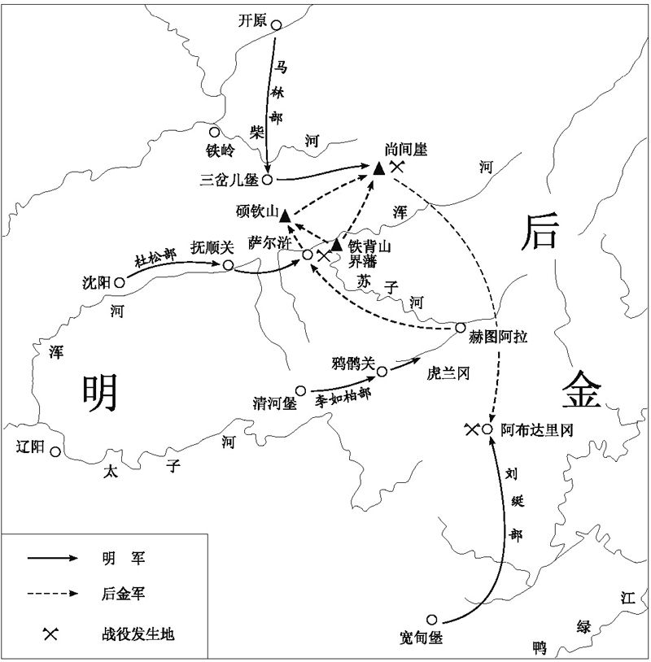

# 1619年的辽东战役

黄仁宇

公元1619年，即万历四十七年，萨尔浒等处的战役，结束了明帝国在辽东的军事优势。满民族因之抬头，其后成为明王朝之劲敌。这一战役，就其激烈程度，以及其决定性的作用而言，应该在中国军事史上占有显著地位。可是一直到今天，关于它的记载，既分散搁置，内容也互相矛盾。这篇文章着眼于将这些文献加以整理分析，使读者对它有清楚的认识。

这一战役的起因是很明显的：1618年建州民族的领袖努尔哈赤，亦即明人所称“虏酋”，攻陷抚顺城，并且屠杀明军。朝廷派张承荫去讨伐，又战败被杀。努尔哈赤至此要求补偿其“七大恨”，要求明廷在边界地区让步，而且以金银缎匹纳款。明廷拒绝接受，努尔哈赤遂继续攻掠辽东碉堡，于是战事开始。杨镐以兵部侍郎兼佥都御史经略辽东军务，时在1618年夏季。好几个高级明军将领，也被派往辽东。兵员马匹武器，则由各边镇以及腹里各省份（远至浙江、四川）抽调，抽调不足，又继之以招募。朝鲜以及满民族之叶赫部，也出兵相助“剿伐”。军费则出自田赋之加派；除贵州省外，全国派及。其收入并其他各项派款共达白银三百万两[[1]](./16-1619年的辽东战役.md)。1619年公历3月，各项准备停当，战役开始揭幕。

关于杨镐麾下的兵员数目，传说不一。有些文件以及满洲资料称为二十万，即辽东原有兵九万，各地增援兵十一万。但实际上辽东边镇多年来兵员都不足九万[[2]](./16-1619年的辽东战役.md)。经1618年战事兵力又减，加之现今边镇又有其他地区防守的责任，所能动员参加讨伐建酋的兵力，只能是其一部分。而各地招募抽派的兵员实数，也常远在官方宣布的数目之下。明军将领通常以少报多，以便获得更多的给养[[3]](./16-1619年的辽东战役.md)。满洲方面作为兹后的战胜者，当然希望对方的数目说得大。明军愈多，则他们打败的敌人愈多，因之战胜者的成功也愈高。据满文资料，杨镐兵分四路，其杜松一路，兵员六万[[4]](./16-1619年的辽东战役.md)。而奉命监督该路军的分巡道副使张铨则称其总数为“二万五千余员名”[[5]](./16-1619年的辽东战役.md)。如果二万五千号称为六万，以同一比例计算，杨镐之所谓二十万，当在八万三千左右。这数目虽不一定准确，但是应与实际数字相去不远，加上朝鲜及叶赫助战的兵数，杨镐麾下兵员，应在十万左右，可见有些文件称兵十万，并非出乎臆度[[6]](./16-1619年的辽东战役.md)。

努尔哈赤的兵力，也没有确实的报告。努自己常称“八固山（即八旗）的十万军兵”，只是笼统的说法，并非确切的统计[[7]](./16-1619年的辽东战役.md)。可供作借镜的，即是同年7月，努进攻开原，用兵四万[[8]](./16-1619年的辽东战役.md)。从这数目我们可以窥见满洲动员程度。在开原之役结束时他曾给赏于二百二十个“牛录”的领带[[9]](./16-1619年的辽东战役.md)。每个牛录编入壮丁三百名，则二百二十个牛录，共辖兵六万六千[[10]](./16-1619年的辽东战役.md)。在春季战事爆发的时候，建州军兵实在在作死生斗。尤其在4月14日萨尔浒之役，满洲骑兵来之则战，显见情势紧迫，动员程度应较开原战役时为高。所以从这些情形看来，在春季战役，努尔哈赤对抗杨镐的兵员总数，似应在五万人至六万人之间，其总数仍较明军为低[[11]](./16-1619年的辽东战役.md)。

杨镐的作战计划，无须多作考证。万历帝于4月4日收到有关作战计划的奏本，内容记入实录。其部署分作战兵力为四路：马林指挥北路，杜松指挥西路，李如柏指挥南路，刘

指挥东南路。作战目标似在夺取赫图阿拉城（新京），可是命令不甚明确。杨镐除了命令后方辽阳及广宁的防军，务必加紧警戒，并没有再指定战略预备队[[12]](./16-1619年的辽东战役.md)。

从现代军事眼光看来，这个作战计划大可非议。杨镐的部署，把兵力分派在一个二百公里的弧线上，没有指出进攻的重点。各路军队也没有初步的攻击目标。这命令一发出，经略杨镐就无法掌握各路军队，所以他只好坐在辽阳的司令部静候各路战况；此即总司令与作战部队分离。

其时批评杨镐者甚多。比如说，高汝栻称：“经略意亦苦兵，实不在战，虚张挞伐，冀取兵寨小捷。”[[13]](./16-1619年的辽东战役.md)兵科给事中吴亮嗣则称：“经略杨镐本无必胜之策，所以决计深入者，下苦于将士之请战，而上苦于明旨切责也。”[[14]](./16-1619年的辽东战役.md)也有人指出杨镐的计划，没有因时制宜。在昔日建州兵力低时数路追剿尚可成功，现在建州兵力强大，又有作战经验，抄袭故套，只能一败涂地[[15]](./16-1619年的辽东战役.md)。

但是在军事观点之外，杨镐用兵的心理战术成分也不可忽视。他的部署，可能是着重恫吓。满洲文件说经略出兵之前，曾派人传言与努尔哈赤，自称将于4月28日，月正圆时，发兵四十七万攻打。其故意将日期推后，则可以掩饰实际进兵日期[[16]](./16-1619年的辽东战役.md)。但是如果杨镐认为这种恫吓，可以先声夺人，使满洲首领惶恐，则势为幻梦，因为努尔哈赤深悉明军虚张声势的惯技。他曾对他的部下说，对明军行动不要步步认真。他们常常偶一出边，以后即大做文章，谎称战胜以邀功[[17]](./16-1619年的辽东战役.md)。

当然杨镐做此部署，还有其他一些原因。马林远去北方，刘

深往南方，为的是发动当地部队，包括叶赫及朝鲜助战军。这些部队很难在攻势开始之前，就远调其他地区，和他们补给的基地隔绝。另外，明代军队的传统，也必须考虑。中季之后文官可以派为总督经略，武官则无获实权作主帅的可能。大凡武官掌握数万人的部队，有如今日一军三师的兵力，即为登峰造极。指挥更大的兵团，则为制度所不容。上述四路之指挥官，都已达到此种最大限度。他们的声望地位，也相仿佛，不便形成上下隶属的关系。这一因素，对集中兵力有很大的妨碍。实际上，刘

——这四个指挥之一，在尚未到辽东之前就迳呈皇帝，提议分兵数路[[18]](./16-1619年的辽东战役.md)。更可以决定兵力部署的因素则为地形。赫图阿拉通向西方的路线不多。其北方被浑河堵截，东方则有高山作屏障[[19]](./16-1619年的辽东战役.md)。

杨镐宣布作战计划之后，于3月26日，在辽阳正式举行发兵仪式[[20]](./16-1619年的辽东战役.md)。四路部队将自4月5日开始，按去敌远近相次前进。这以后战事再无报导，直至4月14日杜松一路兵败，杜松本人战死。

满文资料指出，努尔哈赤到4月13日才知道杨镐确实进犯。当日中南方建州前哨和刘

部队接触，而在13日午夜至14日凌晨，杜松在火炬照明下进军，为建州人员目击。4月14日晨，努尔哈赤决定，先对杜军集中攻击。他当时认为刘

军意在佯攻，只是吸引满洲军队于南方战场。可是他仍派骑兵五百人，去防阻刘军[[21]](./16-1619年的辽东战役.md)。从这些资料推测，当夜努尔哈赤必曾在14日的战场，亦即萨尔浒附近不远的地方宿营[[22]](./16-1619年的辽东战役.md)，否则他不会如此迅速到达，而不失机宜地作以上的部署。

明方资料称，杜松当日被满洲伏军攻击二次。14日午前他渡过浑河，将战车、火药置于北岸，因之车营火器全未在战斗时使用。渡河之后，他连克二道栅，生擒满洲兵十四人，遂一意深入，以至中伏，与努尔哈赤的三万人混战一处。这时候他想占领一座高峰，以便居高临下作战，不意松林中满洲伏兵又起，日没之前他与两员部将战死，士卒无一生还[[23]](./16-1619年的辽东战役.md)。

杜松被山东巡按指斥为“贪功邀赏”，他的过失是：先期竞进，抛弃火器，刚愎自用，背水而战。最后，全军溃败之咎都归之杜松，万历皇帝也照准此议[[24]](./16-1619年的辽东战役.md)。

从历史眼光看，上述形势报告和对杜松的指责都没有多少价值。这个报告是在杜松进军时一个监察御史写的，他只是得到三个探军和一个实际参加战斗的士卒的口头叙述。后来山东巡按指斥杜松，没有再做进一步的核实，他显然是要为经略杨镐和自己开脱。没有材料表明，曾进行过官方调查[[25]](./16-1619年的辽东战役.md)。

指责杜松的奏本反复强调须持重行事，应在敌方前沿被摧毁后再向前推进，以便更有效地协同作战。但杨镐的命令并没有强调这一点，他自己的腔调就是紧迫仓促的，他的命令说：“如违日期者，明系逗留，主将以下领兵官皆斩。”[[26]](./16-1619年的辽东战役.md)杨镐被授以权柄，可惩处乃至处死部下。3月26日，他于众将前处死在前一战役中逃跑的抚顺指挥白云龙，以示儆戒[[27]](./16-1619年的辽东战役.md)。有此压力，四路兵马当然要争趋竞进。

指责杜松先期进军并无实证，规定他进攻的时间是4月14日，他发兵的时间是4月13／14日午夜；从技术上说，并非违抗命令。至于抛弃火器，那么，前一份报告也证实，杜松渡过浑河后，是车营参将决定这样做的。后者报称，浑河水势深急，过渡兵马冲去太多。见隔河南山一带有虏骑行走，他遂令扎营。其时，杜松已率数万士卒渡至南岸与敌军交手几个小时，该参将的做法很难说是合理的。最后，车营参将说：“车兵入水，空手犹难，车辆火药，尽不能渡。”杜松的确没有估计到此种困难，匆匆挺进；而该参将甚至不去寻找解决的办法，也没有上报扎营的决定。正是根据持重的原则，他在战斗激烈时抛弃了主帅[[28]](./16-1619年的辽东战役.md)。还有，杜松力图抢占浑河南岸高地，在战术上是必须的，会战时只有尽早控制山地，才能保证本方阵地的安全。

明朝文献进一步揭露了高级指挥的更多失误，虽然没有明确提到，但杨镐显然没有派使者搜集战事情报。他本人没有亲赴战场，也没有派遣使者在战场做必要的调整，特别是对关系全局的问题；他竟然不知道建州军队集中在萨尔浒附近杜松军队要经过的道路上，这对明军失败最为关键。

满文材料千篇一律，似乎都抄自清太祖朝老满文原档。后来这些材料转述成新档，在译成汉文时，始采用实录的形式，这些材料最糟糕之处在于过分夸张，例如，它们说，明军在战斗中损失十万兵马，而建州军被杀死的只有二百人[[29]](./16-1619年的辽东战役.md)。

满文档案比明朝档案更为深刻，包括许多技术问题，尽管有某些缺陷，它们对某些战役的叙述仍然最具权威性。满档前后一致的风格，用简朴和少量的词汇表述战术细节，更提高了它的准确性。作为战胜者，努尔哈赤没有必要比明廷更歪曲事实真相，他只是需要夸大自己的胜利，象我们估计的那样，以吸引更多的追随者。

满文档案资料表明，当明军向前推进时，一万五千名几乎没有武装的建州步兵正在萨尔浒西端修筑工事，另外只有四百名骑兵警戒。显然，努尔哈赤预见到这个地点的战略价值，所以，战事一开始，他的队伍就迅速在高地聚集。

4月14日之战进一步发展，成为一场会战，而不只是大规模伏击。大部分披带盔甲的满洲兵团来自南边离萨尔浒大约十英里的地方；在他们合击时，正在修筑工事的步兵已移到东端，占领了吉林峰，在那里，他们被杜松的部队，估计有二万人所包围。四百满洲骑兵在混战时，驰入萨尔浒谷地，突然出现在明军背后，使其大惊失色。他们给明军以杀伤后，就横渡界藩附近的苏子河，同高地上的步兵会合，得到步兵的支持，骑兵又向下冲击，杀死大约一百名明军。大概这些冲击延捱了明军的进攻，为努尔哈赤赢得宝贵时间。努尔哈赤正午赶到战场，萨尔浒山地还被杜松数量上占优势的军队占领。

建州贝勒会议建议先解吉林峰之围，派一千多骑兵杀开血路，突入重围，然后四旗满洲军队从正面攻击杜松主力，另四旗人马继续监视萨尔浒西端之敌。努尔哈赤派了一千人去吉林峰，但他推翻了以上计划，他的攻击集中在西翼，而不是东翼。为了兵力集中，他只从苏子河东岸派了一旗人马加强西翼，这样它就有了五旗兵力，留在东边的三个旗待萨尔浒的明军一出动就马上开拔，整个实力还不确定，因为各旗后来都从赫图阿拉方面得到一些补充[[30]](./16-1619年的辽东战役.md)。另外，努尔哈赤似乎在激战的任何一个方向上都占有数量上的优势。需要在西岸扫除明军，他的骑兵就势不可挡。一旦实现了这一意图，吉林峰的明军就再也得不到援助了，被围的杜松军，被浑河阻断退路，心理上被击败，全军崩溃是很自然的。

按照计划，攻击越来越猛烈，由于作战灵活，动作协调，攻击力强，结果取得成功。根据满档，面对满洲骑兵向山上的冲击，明军丢弃阵地而逃。开始时明军在纵深处布署火器，这不足为奇，尽管提到了炮，但可能根本没有车营参战，杜松军士卒只发射火铳，和他们在一起的可能还有朝鲜援兵。无论如何，防守是无效的，清太祖朝老满文原档说，骑兵跑到后即刻冲入射砍，敌兵少时皆被斩杀。

杜松运气不佳，甚至他的下落也没被提起，清太祖朝老满文原档只是说：他的军队被击溃后，残部撤至硕钦山，当夜被满军围住；建州士兵只需要肃清残敌，他们从容地斩杀企图夺路而逃的敌兵。

此后，满洲人似乎在正北方渡过了浑河，置完整无损的杜松火器营于不顾，14——15日夜间他们接近尚间崖附近的马林军。后者在夜间警戒时击鼓鸣枪，这样就把自己的位置暴露出来[[31]](./16-1619年的辽东战役.md)。

马林军距离杜松挨打的地方这样近，这真是一个讽刺。根据明朝文献，经略杨镐最初命令马林从三岔儿堡向前推进；但这位将领要求准许他驻扎靖安堡，它在行动区域之北大约三十英里，他的要求被批准。但在进攻的前夕，他推翻了自己的计划，再次要求返回三岔儿堡；这一次又批准了他[[32]](./16-1619年的辽东战役.md)。如果他实际上把进攻的正面扩展到北方，那么，这场激烈战斗的结果可能会完全不同。

马林军团的出现只是给满洲人提供了在第二天，即4月15日，继续进行屠杀的对象。杨镐从后方巡逻的士卒和一个突出包围圈的信使那里知道了第二场灾难，马林的整个兵团被数目不明的满洲军队包围；从一份随之而来的同样不甚了了的报告中还得知，该军监军潘宗颜中箭落马，当即死去，一万多明军骑兵夺路而逃[[33]](./16-1619年的辽东战役.md)。后来的官史把这场灾难归之于杜松兵败的消息在马林军中引起的恐慌：这个消息在前一夜已传到马林军中，早在4月15日晨，马林就决定撤退，他到达了安全地带；而断后的潘宗颜却没有这样的好运，他纠集几个官僚殿后，由辰至午历四个钟头，全部奋勇战死[[34]](./16-1619年的辽东战役.md)。

以上简述同其他叙述不甚一致，可能是作者为了赞美阵亡的文职同僚，有意丑化无人为之辩护的马林。三个月后，马林死于开原之战。象杜松一样，他也成了替罪羊。

无疑马林军的尾部一片混乱，但混乱应发生在这一天结束时，因为满文材料证明，四万秩序井然的明军与努尔哈赤军相遇，至少在开始是这样。

据清太祖朝老满文原档说，马林军在早上向前推进，只是在看到满洲军队正接近以后，他们才退回到昨夜宿营的地方，利用该处已挖好的壕沟，他们的队伍排成方阵，最外部是一排射手，他们后面为一排骑兵，再后面是持枪备炮的士卒。然后是三排壕沟，有些是匆匆挖好或加深的，所有的骑兵在壕沟后站立马下，准备步战[[35]](./16-1619年的辽东战役.md)。这些细节有可靠材料可资鉴别：当时的一些军事著作证明，十六世纪末和十七世纪初明军习惯使用方阵战术[[36]](./16-1619年的辽东战役.md)。

大贝勒——努尔哈赤的二子——正在聚集从南方到达的满洲军队。他发现另一支明军，估计有一万人，在其主力西边约一点三英里之处。显然，这就是潘宗颜指挥的后卫营。经略杨镐在其战地命令中详细规定，安插于各路军中任监军的文职官员负责后勤供应，以及训练和战俘等事宜[[37]](./16-1619年的辽东战役.md)。这样看来，潘掌握一万兵力是正常的和正当的，明军前后部由东到西相连，同以南北为轴的敌军形成丁字形，但这种离奇的局面并没有延续很久。

努尔哈赤立即得知明军后翼部队的存在，但他顾不上这一情况，因为他正关注着另一支向他推进的明军，估计也是一万人。这支队伍的准确位置还没有确定。从它运动情况看，应在明军南翼和满军西翼之间某处。一旦这个位置确定，努尔哈赤立即决定先消灭这支运动的敌军。

他有一千骑兵可投入这场战斗，他让五百人下马，迅速搬开明军战车和藤杖等障碍物，这是在敌军猛烈射击下完成的。障碍一扫除，仍骑在马背上的士卒随即出发。据满文档案，实际战斗过程极为简单，满洲骑兵的冲击十分有效，午后不久，这支明军就被消灭。

在努尔哈赤转向东翼时，马林的主力已最后完成了反击的准备。下马的骑兵从壕沟后出现，与前部的警戒部队一起列队。最初，努尔哈赤想占领附近的一座小山，从上向下冲击，但明军的推进使他没有时间这样做。于是，他命令他的骑兵下马，准备和明兵步战；如果这样打起来，这些人可能会被明军俘获。大贝勒看到这个存在的危险，在两旗军队径直冲向明军之前，大叫着向他父亲发出警报。从理论上讲，骑兵的攻击处在不利的地位，他们正面的敌人有栅墙可作掩护，又得到数量巨大的骑兵支持。据满档说，在这种情况下，满人的弓箭和骑术占了优势，而没有提到大贝勒的作用。另六旗军队受到鼓舞，向前推进，势如破竹，满人以不足一万之兵，而将四万明军击败，被驱散的士卒陷入沼泽，又被杀死许多[[38]](./16-1619年的辽东战役.md)。

明军在斐芬山组织了最后抵抗，一万士卒利用火铳和藤杖阻止满洲军队的猛攻。但午后不久（未时），这一万士卒都被杀死，其中也包括潘宗颜，满人在该地宿营[[39]](./16-1619年的辽东战役.md)。

两天的战斗完全摧毁了明军的北线，现在只剩下南线的李如柏军和刘

军。李如柏军离满洲都城最近，但由于没有特别训练和特别装备的山地作战部队，不能克服地形的困难，向它靠近；当满洲人发现了李军的运动后，只要派二百名骑兵逻卒在一段距离之外加以监视就成了[[40]](./16-1619年的辽东战役.md)。

接到萨尔浒、尚间崖和斐芬山战败的报告，杨镐无心恋战。他向皇帝报告，要召回南线的两支军队[[41]](./16-1619年的辽东战役.md)。李如柏及时得到情报撤回，他的余部没有再受损失，而他自己却被指控与建州首领私通，才得以不死，刘

好象一直没有收到脱离战斗的命令。

刘

军距赫图阿拉最近，他的进攻日期定在4月9日。据说，他指挥有三万人，明军约占三分之一。另有一万三千人组成的朝鲜军队，后者在4月5日渡过鸭绿江[[42]](./16-1619年的辽东战役.md)。联合兵团的任务是从宽甸和怀仁（今桓仁）之间直插满京。

根据记载，大概只有刘

在早期接触中曾派回使者报捷。4月14日杨镐收到一份捷报，称他的先头部队距赫图阿拉大约四十五英里；同时，镇江游击乔一琦报称：“忽有夷贼精兵五百余骑，直逼对山诱战，连诱连退。”[[43]](./16-1619年的辽东战役.md)这与朝鲜实录的记载一致，和清太祖朝老满文原档的记载也相合。后者说，建州首领指挥一支队伍，一旦发现刘

军在那个地区推进，马上去阻止他。

满档资料还承认，指挥五百人的三个牛录中，有两个在作战中被杀[[44]](./16-1619年的辽东战役.md)。但刘

的荣誉并没有维持很久，在他尚未觉察时，满洲军队已达到了目的，他们换得了所需要的时间，一旦北面的威胁除去，他们就可以单独来打击他。

满档中提到随后在阿布达哩山，或者说在牛毛砦附近进行的战斗，但很不清楚，明朝档案没有有关记载可做比较。朝鲜实录的记载在许多重要之点上与努尔哈赤的结论不同。

满洲人说，他们作战并没有很大压力，明军出现引起了某些惊慌，当北边打仗时，赫图阿拉的妇女们尤感惊慌。但是在浑河消灭敌军后，努尔哈赤平静下来，他派了蒙古人组成的两个兵团去南方山地，4月15日派去的兵团有一千人，4月16日派去的有两千人，然后，在界藩杀了八头牛祭天，祈祷胜利，到了4月16日他才动身南下，其后再也没有离开赫图阿拉。4月16——17日夜间决定，在李如柏军从鸦鹘关威胁都城的情况下，他将和四千人的队伍留在那里。与刘

的战斗是由大贝勒指挥的，同行的还有他的侄子阿敏台吉和洪台吉。

满档说，王公们是4月17日晨动身的，四天后，也就是4月20日与刘

军接触[[45]](./16-1619年的辽东战役.md)。和往常一样，明军以火器掩护采取守势，满洲军队几次进攻都没有打乱他们的队形，只是当大贝勒命令他的军队向西包抄并占据了那里的小山时，明军才发生混乱。然后，洪台吉冲击北翼，大贝勒从中央突破，蒙古军队切断后翼，明军终于失去平衡。刘

在奔逃中被俘，与所有其他档案的说法不同。满档承认，刘

是在俘获后被杀的[[46]](./16-1619年的辽东战役.md)。

再往南，还有一支明、朝联军继续抵抗。他们用竹木设置障碍，阻止满洲骑兵前进；他们的火器设置在纵深处，准备射击，不知道他们坚持了多长时间；但最后，老天帮了满人的忙，风猛烈地向防御者刮去，他们的火炮火铳都起不了作用，满洲军队抓住这个机会，除去了获取全胜的最后一个障碍。据说这支联军有两万人，被驱散后，朝鲜步兵占领了战场后的高地，但他们放弃抵抗，反而把明军的残败士卒交给满洲人。战斗结束了。

萨尔浒之战示意图。据孙文良、李治亭著《明清战争史略》页49改绘。后金军先西进击败杜松部，然后北上击败马林部，最后南下击败刘

部，李如柏部被迫撤退。

朝鲜实录证实，刘

的部队包括三个梯队。刘

直接指挥的明军在前，中部为两队朝鲜步兵，大部分射手集中于此，不少于三千人，其他朝鲜步兵在最后，由姜弘立掌握。它承认，前军失利后，姜弘立率大约四千人投降，并把明军士卒交给战胜者。朝鲜人认为，北风突起是决定战斗结局的因素，这与满档的记载一致。

但是，朝鲜实录不相信刘

曾经过苦战；前部联军是中了埋伏，而不是在对抗中被打败。它说，明军是在劫掠村庄时陷入满洲人圈套的。刘

既不是俘后被杀，也不是在战斗中被杀，而是自杀身亡。看到局势无法挽回，他和另一些人点着火药，把自己炸死[[47]](./16-1619年的辽东战役.md)。满、朝资料记载这场战斗的最大差异是日期不同。所有的朝鲜撰者都认为联军在4月17日而不是在20日毁灭。

从战场情况看，满人的说法较可信。仅举一事，努尔哈赤4月16日才肃清浑河北线之敌。他对南线局势尚不甚了了，重新布置三万骑兵（此数目为朝鲜实录的估计）也需要时间，要在17日对阵谈何容易。更不用说，在二十四小时内赶到一百五十英里之外开辟新的战线，利用不同的地形来打赢这场困难的战争，是根本不可能的。

我们来对朝鲜资料做一认真分析。4月17日的说法基于两部著作。《光海君日记》是朝鲜王朝编年史的一部分。它模仿明实录，在1623年光海王被废后编纂。该书称，4月25日，平安道监察官送来一份报告，用一句话概括作战日期和战败地点。再下有更详细的叙述，但不再引用同一报告，更多的是编纂者对事件转折点的讨论。在结尾处，他们重复了明人的观点：杜松过早向浑河南岸推进造成全线崩溃。必须注意，朝鲜人在1619年4月25日，连与他们有直接关系的战线，即东南一路的形势都不清楚，上述想法不会是他们自己的分析[[48]](./16-1619年的辽东战役.md)。

此外，李民的日记也认为刘

军在4月17日覆灭。李氏后来做到平安省总督，但在1619年战役时，他只是姜弘立的属员。他的著作，后来定名为《栅中日录》出版，从朝鲜人的观点叙述了远征的全部过程，逐日记录了渡江后的情况，详细描写了朝鲜军队的作战和投降，包括在赫图阿拉被囚禁的情况。作者断言战事在4月17日结束[[49]](./16-1619年的辽东战役.md)。

李民的叙述未必准确。有一种说法，他写书完全是为姜弘立和他自己辩解。书中说，他曾抗议朝鲜军队的投降，抗议无效，又企图自杀，但他的侄子和仆人拿走了长剑、短剑，使他无法下手[[50]](./16-1619年的辽东战役.md)。《光海君日记》的记载与此正好相反。它说，李民本来能够阻止投降企图，使朝鲜军队继续作战，但他公然拒绝这样做，并且促成了朝军的投降[[51]](./16-1619年的辽东战役.md)。

要了解这些矛盾的观点以及其他互相矛盾的观点，必须回顾一下当时的政治形势。值得注意的是，没有一个朝鲜大人物甘愿承认投降。作为中国的保护国，朝鲜已经背弃了它的宗主。事实上，四年以后废黜光海君，他的罪名就是指使姜弘立在1619年战争中坐观成败，背着明朝同努尔哈赤缔结密约[[52]](./16-1619年的辽东战役.md)。这些背叛行径不符合朝鲜民族的性格。

如此攻击被废之君显然是抱有偏见。其实，此战前后的中朝关系已谈不上亲近。朝鲜被迫参战，他们对明朝官僚的专横态度早有不满，光海君和他的亲信还预见到明朝的失败，在这种情况下，没有公然提出异议只是因为文化传统。明朝的要求通常要履行，尽管有时很不情愿。

杨镐要朝鲜国王提供一万人，加上帅府随员，后来增加到一万三千人。都元帅姜弘立直接受命于刘

，根据指令，万人中须有五千炮手[[53]](./16-1619年的辽东战役.md)。杨镐还要去一些临时炮手，大约有三四百人，随杜松军战于萨尔浒，无一生还[[54]](./16-1619年的辽东战役.md)。

刘

是一员老将，二十年前抗倭时即到朝鲜，但他不甚得朝鲜人心，他在朝鲜人前公开披露与经略杨镐不和。他说，杨镐宁愿看到他败殁，也不愿看到他成功。朝鲜人还说，明军人员奇缺，兵器不全。姜弘立向朝鲜国王报告，明军“器械龃龉，且无大炮、火器，专以我师为恃”。他渡过鸭绿江，还以母病乞免，当然，这一请乞未被批准[[55]](./16-1619年的辽东战役.md)。

供给是激怒朝鲜人的另一个原因。朝鲜军队从鸭绿江南岸取得粮饷，明朝一概不管，而这时朝鲜国王正向百姓索取物料，修筑宫殿[[56]](./16-1619年的辽东战役.md)。正如一些朝鲜人所指出，由于利益之争或故意的破坏，粮饷很少能及时供应；李民的日记也经常提到饥饿的士卒。朝鲜人还抱怨泥泞的道路，满洲人设置的路障，并说他们的步兵无法同明朝的骑兵并进。《栅中日记》还描述，感到不安的刘

如何催逼行动迟缓的朝鲜人[[57]](./16-1619年的辽东战役.md)。

这些原因加在一起，可以得到一个印象，如果刘

的推进得到更有力的支持，努尔哈赤将被迫两面受敌。这样可以说，战争的失败应当归之杜松的急躁，而不是明、朝联军的迟缓。李民之所以要篡改作战日期，原因在于：如果东南战线是在4月17日与努尔哈赤的骑兵交战，朝鲜人就可以说他们尽了自己最大努力，而如果像满洲人说的那样，战争在4月20日发生，那么追究失败的责任，就要复杂得多。李民是为此而提前作战日期吗？《光海君日记》的作者也被他的篡改所蒙骗吗？编造刘

自杀是为了减轻姜弘立的负罪心理吗？他控制着前线绝大多数朝鲜炮手，却并不试图为死去的明军将领报仇。

回答这些问题需要思索。由于没有充分的论据，根据逻辑推理，历史学家只能假定李民在说谎，如果不是姜弘立在说谎的话。否则很难解释满洲资料和朝鲜实录的记载何以不同。

明实录缺少这场战斗的详细报道，这也值得注意。一些朝鲜资料坚持，刘

只是中了奸计，而不是被击败。有一个传闻，当杜松军被消灭时，他的信使用作传递口信标记的特别箭支落到努尔哈赤手里，满洲人遂定计，让一个建州官员扮作信使，带去传递口信的箭支，急切要求刘

率部挺进。刘

被蒙骗，失去警觉，结果落入满洲人的陷阱[[58]](./16-1619年的辽东战役.md)。这段故事和古典小说不断出现的传奇如出一辙，它把刘

的行为说成是天真幼稚，这和他作为一个有经验的将领的声誉完全不相符。它既与战斗的实情不合，也同满档资料的叙述相悖。然而这个故事可以在明朝正式的历史记载中找到其出处，这证明刘

、杨镐间的关系确实不和谐，如果他们之间的通信更有效地维持，那么就不会编造出这样一个故事：杜松死了六天以后，离他不过一百二十英里的刘

却相信他还活着[[59]](./16-1619年的辽东战役.md)。这一漏洞形象地证明明军指挥的根本弱点。经略大人冒险进入战斗，却不知道，迅速传递信息是他成功的基本条件。

通过一系列致命打击，努尔哈赤在一周内不但摸清了明朝的进攻能力，还知道了它无力守卫辽东。三个月后，他兵围开原，马林毙命；七周以后，他胜利进入铁岭。最后，杨镐被逮论死，在1629年被杀；李如柏在他从前线撤回一年半以后被逮，他选择了自杀，而不愿忍受责难和处刑[[60]](./16-1619年的辽东战役.md)。

辽东败绩对明朝的影响远不止此。1619年，北京一得到辽东受挫的消息，粮价突然提高，因为居民害怕京师被围[[61]](./16-1619年的辽东战役.md)。十七世纪二十年代初，军队逃亡率大增；有时达数千人，大如团、营，一夜间不复存在[[62]](./16-1619年的辽东战役.md)。加征田赋，过去说只征一年，现在不得不继续加征。三个继杨镐担任经略的官员，一个在作战中被杀，另外两个根据皇帝的命令处死。其中之一是熊廷弼。他不但自己丧命，还成为明末党争的焦点之一。明朝官僚由争论他是否有罪发展成更尖锐的冲突，他们无疑对明朝的崩溃负有责任。

当时大多数人都认为，1619年之战实际上不可能取胜。杜松和刘

死后一年左右，多卷本的《筹辽硕划》刊行。它包括五百八十九条材料，差不多收集了所有有关官僚——御史、总督、南京官员、翰林学士及致仕官员——给万历皇帝的奏本。该书观点丰富，出版迅速，非一般书籍可比。许多奏章一针见血地指出，明军匆匆召集，缺乏指导，未经训练，供应不足，装备低劣，纪律松懈。撰者中以后来的内阁大学士徐光启最有辩才。他奏章中的下一段文字被广泛引用[[63]](./16-1619年的辽东战役.md)：

杜松矢集其首，潘宗颜矢中其背，是总镇监督，尚无精良之甲胄，况士卒乎？杜松、刘

、潘宗颜皆偏师独前，岂非无纪律乎？兵与敌众寡相等，而分为四路，彼常以四攻一，我常以一敌四，岂非不知分合乎？战车火器，我之长技，抚顺临河不济，开铁宽奠皆离隔不属，岂非无政教乎？出关四十里，遇水不能渡，遇险不能过，入伏不能知，岂非不识地利，哨探无法乎？

徐光启还说，朝鲜人告诉他，努尔哈赤要塞之北的军器制造厂里有许多技匠；来自辽东的人们则说，该地铁匠铺绵延数里。满洲人披戴优质头盔、脑甲、盾牌和臂铠，作战时敢于冲上前搬开守敌设置的鹿砦。相反，明军得到的防护用具只是一堆废铁，满洲射手一般瞄准他们的脸部和肋部，五步之内多毙命[[64]](./16-1619年的辽东战役.md)。

徐光启提出的问题本身似乎就是答案，然而，他指责有关官员玩忽职守，是为了回避制度问题。在他看来，失败是由于偶然的和个人的错误造成的。但因为没有对整个背景进行分析，就很难解释，为什么会一再重蹈覆辙，装备不足的问题为什么无法改变。我们还可以进一步问，明朝将领为什么总是暴露其侧翼，听任满洲军队冲击？为什么他们一再让小规模的部队被消灭，而主力军团闲置不用？为什么他们还没有找到遏制满洲骑兵攻击的有效战术就大举进攻？

关于上述问题，很难找到完全令人信服的答案。在我们看来，明朝军队人员和物资供应的程序太僵化了，这或许是一条有意义的线索。

直到十七世纪前期，明朝军饷的供给仍基本上遵从太祖之制。1388年定，应天府五千纳粮户供饷给金吾卫的五千士卒。官府不再征收前者赋税，军队也不再支给后者粮饷。民户直接供应军饷，避免了许多中间环节。这个方法打破了以往传统，经一年试行，开始在各卫所推广[[65]](./16-1619年的辽东战役.md)。我们知道，这个制度虽没有完全贯彻，但也从没有正式废除。在尽可能低的一级官府处理事务，成为后来普遍的原则。通常是一个县供应几个所；一个卫从几个县得到所需物资[[66]](./16-1619年的辽东战役.md)。纳锻代替实物税也没有带来根本的改变。使管理制度完整，需要实际提高财政效率，增加新的服务设施，扩大行政管理的职权，增加军费开支。明朝政府不能容忍这种转变，管理技术的简单和农业技术的简单是相协调的。

明朝制度本身就会产生漏洞，此时出于这个原因，彼时出于别的原因，总有一些卫所供给不足，而其他卫所既不需要，也不愿意去弥合这个漏洞。缺少这一供给系统所需要的职能上的机动性，到十六世纪末越来越明显。实际上，每项收入在得到以前就支出去了，因此要满足新的需要，只能求助于特定的策略。

军备不足是这种供给手段的必然结果，正如徐光启自己所说，现代化的枪炮可以遏制骑兵攻击。如果明军设法使火器现代化，而满洲军队又没有火炮的支持，就决不可能出现1619年那样的战争结局。

我们还可以用前此四十年的事例来证明这种制度的弱点。戚继光曾把火器引入他的常规战术。但他的供给，包括军械，都取之于地方。即使是火器，他也只能给府县官僚提供一个模型。这样，火器制造就停留在农村技术的水平上，而不可能是标准化的。戚继光抱怨说，枪弹炮弹不合口径，枪管经常爆炸，点火器不燃。士卒不敢举枪瞄准，子弹不知所向，重新装弹也要花很长时间[[67]](./16-1619年的辽东战役.md)。显然，四十年后这些问题并未解决。1618年，即辽东战役的前一年，火器在试用时爆炸，操练者死亡[[68]](./16-1619年的辽东战役.md)。辽东战役之后，徐光启和黄克缵从澳门和菲律宾招摹造炮工匠，这种情况才有所改变[[69]](./16-1619年的辽东战役.md)。

从清太祖朝老满文原档看，满洲人并不害怕明军火器。据说，有些满洲人多次被射中，却安然无恙。还有一则事例，一个士兵的头盔在缝合处被枪弹穿透，他的脑袋却没被伤着[[70]](./16-1619年的辽东战役.md)。

与此密切相关，我们还应考察一下朝鲜火器的效用。与明朝不同，朝鲜枪支的制造是标准化的，1615年曾设置机构统一监造，其质量令明人称羡不已[[71]](./16-1619年的辽东战役.md)。但它们显然也没有在作战中起到决定性作用。李民关于作战的记载给人们留下一个印象，刘

军中的朝鲜炮手不但坐观不前，而且溃不成军。明军被击败时，他们还不知道应占据的防御位置在哪里。“贼骑齐突，势如风雨，炮铳一放之后，未及再藏，贼骑已入阵中”，形成这种局面毫不足怪。李民并没有记载西北风这个突如其来的因素[[72]](./16-1619年的辽东战役.md)。

努尔哈赤并非忽视战争技术之人。但他在辽东战役前后根本不注意火器，既不注意有效地使用它，也不注意防备它。他最后就是饮弹而亡。他的态度并不说明他缺乏理智，而是反映了对手用之无效，他不屑于模仿。

此外，明军在辽东战役中是否有效地使用重炮，也缺少足够证据。它们搬运起来太吃力了。在1619年，汉语或满语的炮不一定指现代的炮，它通常指一个装满火药和碎石、点燃后掷向敌人的竹筒[[73]](./16-1619年的辽东战役.md)。这个装置在近战时可造成一定杀伤，但其效力更多是心理上的，而不是肉体上的，所以对持续的、训练有素的骑兵的进攻起不了什么作用。

明军的传统武器也未占优势，王朝末年，仍由地方上贡朝廷，可见是非标准化的。满档的有关材料说，可汗之矛、箭可深刺体内，如得天助[[74]](./16-1619年的辽东战役.md)，其工艺胜过明朝兵器是不言而喻的。这与徐光启的话相互为证，满洲的刀刃越锋利，就越显出明朝兵器的钝劣。

士兵和战马的质量亦如是。明朝士兵和战马也取之地方。不同地区和阶层的人户有其固定义务，征兵制对此也不能完全改变。不管谁来当兵，军饷都出自纳户。军费如何规划，不但决定物资的供应，而且决定士兵和战马的供给。十七世纪明朝的根本问题在于，当明初确定的税收摊派和征集不再适应人户的状况时，没有一个彻底的改革与之适应。劳役的管理和征集总带有某些强制性质，凑足数额已很麻烦，哪里还顾得上质量。用经略熊廷弼的话来说，此等士卒弱至不会放箭，不能驭马[[75]](./16-1619年的辽东战役.md)。

由于这些固有的弱点，不可能把全军训练成善战之师；明朝将领深知于此，便挑选精兵，别成一队，通常称为家丁。刘

赴辽东，随带家丁七百三十六人[[76]](./16-1619年的辽东战役.md)。所谓家丁，由将领自筹给养，调任时同行，作战时服从他个人的命令[[77]](./16-1619年的辽东战役.md)。论者称，这些队伍是明军中惟一有战斗力的成分，其他士卒则徒有其名。

火器用之方阵，是戚继光的发明。这一设计部分模仿城市设置，以防守为主，只有在敌军几经出击、力量耗尽时，才冲出方阵发起反击[[78]](./16-1619年的辽东战役.md)。这种战术反映了军队组织的消极性。明军从来没有建立起一支能发挥其特殊作用的骑兵。明后期的骑兵既无速度，又无冲击力，只不过是马背上的步兵，凡作决战，均需路障保护。另一方面，满洲人常以数千骑兵横扫战场，明朝骑兵无法与之抗衡，在1619年战役的全过程中，甚至未曾交手。由于缺少攻击力量，许多战术无法运用，防卫也难以成功。事实上，敌人很容易找到方阵的薄弱处发起攻击。

方阵的防守动作迟缓，无意配合，很难转入反攻。满档资料说，马林在尚尖峰本来能用栅墙和步兵困住数量上占优势的敌骑兵，但准备时间过长，终丧失良机，让大贝勒抢先动手。前边提到，明军一次又一次被击败，友军不去援助，后来也被消灭。可以说，这种情况是与明军士兵和物资的低质量分不开的。劣等的士卒和武器只能各自为战，而不可能卓有成效地组织协同作战。缺少将才姑且不论，没有充分的军事训练，而这是军队本身无法解决的。

从后一观点看，杨镐要取胜，只能靠努尔哈赤的错误。如果满洲军队分兵迎战，战争的结果可能有所不同；如果努尔哈赤在交战伊始就把大部队投入南线，则杜松和马林有机会向赫图阿拉推进一步。努尔哈赤没有犯这些错误，杨镐也就取胜无望了。当然，杨镐指挥的愚蠢，也加速了明军的崩溃，使失败更为惨重。

明朝廷在毫无取胜把握的情况下开战，主要是出于政治需要。杜松性情急躁，努尔哈赤称他为“狂夫”，但有些材料说，他曾提醒杨镐，同满洲人交战要做更多准备[[79]](./16-1619年的辽东战役.md)。朝鲜资料表明，刘

也抱怨杨镐过于急迫[[80]](./16-1619年的辽东战役.md)。而杨氏则受到阁臣方从哲的催逼[[81]](./16-1619年的辽东战役.md)。北京被迫采取行动，否则可能引起内地的起义和其他边界地区少数民族的骚乱。草率用兵是为了证明一个理想主义的理论，天朝由于其道德力量，能克服一切不利条件。此外，朝中官僚还知道，边界斗争拖得越长，战争花费就越大。即使继续加赋，财政负担也难以承受。

与此相关，还应提到，残酷地处罚杨镐和他的继任，不公正地处置李如柏，不但大大损害了早已低落的士气，还对明朝官僚造成严重的心理影响。在王朝制度下，很难把个人玩忽职守和制度的失败分开。个人应尽最大努力，用自己的才干和自我牺牲来掩盖制度上的弱点。身居显位的文武官僚如应对国家所受的巨大灾难负责，那就很难得到赦免，至于以什么内容指控，是没有多少意义的。

看来，1619年辽东战役在一周内，以奇怪的方式决定了以后几代中国人的命运，但实际上，这已酝酿了多年；可以说，它是明王朝的官僚制度及其日常运转所招致的不可避免的结果。

（原刊《明史研究论丛》第五辑）

#### 【注释】

[[1]](./16-1619年的辽东战役.md) 《明神宗实录》，页10945。

[[2]](./16-1619年的辽东战役.md) 张居正执政时，人数达83,340（1576年），但较94,693人的额数仍为短缺，见《大明会典》卷129，又见程开祐《筹辽硕划》卷14。

[[3]](./16-1619年的辽东战役.md) 参见《明神宗实录》页10978及黄仁宇《十六世纪明朝的军费》。

[[4]](./16-1619年的辽东战役.md) 王先谦《十二朝东华录·天命朝》，《大清太祖高皇帝实录》页6，《明史》卷239。

[[5]](./16-1619年的辽东战役.md) 《筹辽硕划》卷17。

[[6]](./16-1619年的辽东战役.md) 同上，卷19；《皇明经世文编》卷488。

[[7]](./16-1619年的辽东战役.md) 《清太祖朝老满文原档》第一册页82，第二册页49；《满文老档》（神田信夫译）第一册页93。

[[8]](./16-1619年的辽东战役.md) 《老满文原档》第二册页126。

[[9]](./16-1619年的辽东战役.md) 同上，第二册页137。

[[10]](./16-1619年的辽东战役.md) 同上，第二册页13；《八旗通志》卷1。

[[11]](./16-1619年的辽东战役.md) 参阅《筹辽硕划》卷11。

[[12]](./16-1619年的辽东战役.md) 《明神宗实录》页10962——10966。

[[13]](./16-1619年的辽东战役.md) 《国榷》页5133。

[[14]](./16-1619年的辽东战役.md) 《筹辽硕划》卷18。

[[15]](./16-1619年的辽东战役.md) 《国榷》页5134。

[[16]](./16-1619年的辽东战役.md) 《老满文原档》第二册页89。

[[17]](./16-1619年的辽东战役.md) 同上，第一册页86；第二册页59——60。

[[18]](./16-1619年的辽东战役.md) 参阅《筹辽硕划》卷9。

[[19]](./16-1619年的辽东战役.md) 箭内互《满洲历史地理》页459、601。

[[20]](./16-1619年的辽东战役.md) 《明神宗实录》页10962、10969；《筹辽硕划》卷16，谈迁误为3月24日。

[[21]](./16-1619年的辽东战役.md) 《老满文原档》第一册页110，第二册页89——90；《十二朝东华录·天命朝》卷1。

[[22]](./16-1619年的辽东战役.md) 《满洲历史地理》页605。

[[23]](./16-1619年的辽东战役.md) 《明神宗实录》页10970。

[[24]](./16-1619年的辽东战役.md) 《筹辽硕划》卷17；《明神宗实录》页10979。

[[25]](./16-1619年的辽东战役.md) 《筹辽硕划》卷17。

[[26]](./16-1619年的辽东战役.md) 《明神宗实录》页10965——10966。

[[27]](./16-1619年的辽东战役.md) 同上，页10966。

[[28]](./16-1619年的辽东战役.md) 《筹辽硕划》卷17。

[[29]](./16-1619年的辽东战役.md) 《老满文原档》第二册页111：《十二朝东华录·天命朝》卷1等。

[[30]](./16-1619年的辽东战役.md) 《老满文原档》第二册页93，据《十二朝东华录》和《大清太祖高皇帝实录》记载，左翼为六旗，右翼为二旗。

[[31]](./16-1619年的辽东战役.md) 《老满文原档》第一册页115，第二册页94；《满文老档》一册页123。

[[32]](./16-1619年的辽东战役.md) 《筹辽硕划》卷17。

[[33]](./16-1619年的辽东战役.md) 同上。

[[34]](./16-1619年的辽东战役.md) 《明神宗实录》页10971。

[[35]](./16-1619年的辽东战役.md) 《老满文原档》第一册页115——116，第二册页95。

[[36]](./16-1619年的辽东战役.md) 戚继光《练兵实纪》卷6；海瑞《海忠介公集》卷；茅元仪《武备志》卷67。

[[37]](./16-1619年的辽东战役.md) 《明神宗实录》页10964。

[[38]](./16-1619年的辽东战役.md) 《老满文原档》第二册页98。《十二朝东华录·天命朝》卷1；《大清太祖高皇帝实录》卷6。

[[39]](./16-1619年的辽东战役.md) 同上。

[[40]](./16-1619年的辽东战役.md) 《老满文原档》第一册页112；第二册页91。

[[41]](./16-1619年的辽东战役.md) 见《明神宗实录》页10979。

[[42]](./16-1619年的辽东战役.md) 《光海君日记》（鼎足山本）卷137；稻叶岩吉《光海君时代的满朝关系》页169。

[[43]](./16-1619年的辽东战役.md) 《明神宗实录》页10979；《老满文原档》第一册页90。

[[44]](./16-1619年的辽东战役.md) 《十二朝东华录·天命朝》卷1；《大清太祖高皇帝实录》卷6。朝鲜史料的记载有所不同，见《光海君日记》卷138。

[[45]](./16-1619年的辽东战役.md) 《老满文原档》第二册页102。

[[46]](./16-1619年的辽东战役.md) 同上，第二册页103——108。

[[47]](./16-1619年的辽东战役.md) 《光海君日记》卷138；《光海君时代的满朝关系》页178——179。

[[48]](./16-1619年的辽东战役.md) 朝鲜军队在4月16日并未与敌军交锋，见《光海君日记》卷138。

[[49]](./16-1619年的辽东战役.md) 转引自《光海君时代的满朝关系》。

[[50]](./16-1619年的辽东战役.md) 同上。

[[51]](./16-1619年的辽东战役.md) 《光海君日记》卷138；《光海君时代的满朝关系》182——183。

[[52]](./16-1619年的辽东战役.md) 《光海君时代的满朝关系》页186——191；《光海君日记》卷137、138。

[[53]](./16-1619年的辽东战役.md) 《光海君日记》卷137；《光海君时代的满朝关系》页169。

[[54]](./16-1619年的辽东战役.md) 《光海君日记》卷137、138。

[[55]](./16-1619年的辽东战役.md) 同上，卷137。

[[56]](./16-1619年的辽东战役.md) 同上，卷137、138。

[[57]](./16-1619年的辽东战役.md) 同上；《光海君时代的满朝关系》页173——177。

[[58]](./16-1619年的辽东战役.md) 《国榷》页5133；《皇明经世文编》卷502；《明神宗实录》页11041。

[[59]](./16-1619年的辽东战役.md) 《明神宗实录》页10980。

[[60]](./16-1619年的辽东战役.md) 关于李氏私通努尔哈赤的传言，见《明神宗实录》页11004——11005、页11032及《明史》卷238。

[[61]](./16-1619年的辽东战役.md) 《明神宗实录》页11021。

[[62]](./16-1619年的辽东战役.md) 《国榷》页5147。

[[63]](./16-1619年的辽东战役.md) 《筹辽硕划》页18；《皇明经世文编》卷488。

[[64]](./16-1619年的辽东战役.md) 《筹辽硕划》卷23；《皇明经世文编》卷488。

[[65]](./16-1619年的辽东战役.md) 《明太祖实录》页2871、2998。

[[66]](./16-1619年的辽东战役.md) 参见拙作《十六世纪明代中国的税收和政府财政》页175——182。

[[67]](./16-1619年的辽东战役.md) 《练兵实纪·杂集》卷2、4。

[[68]](./16-1619年的辽东战役.md) 《筹辽硕划》卷17。

[[69]](./16-1619年的辽东战役.md) 《明熹宗实录》页466——467。

[[70]](./16-1619年的辽东战役.md) 《老满文原档》第二册页114。

[[71]](./16-1619年的辽东战役.md) 《光海君时代的满朝关系》页168。

[[72]](./16-1619年的辽东战役.md) 同上，页178——179。

[[73]](./16-1619年的辽东战役.md) 见《满洲实录》（《辽海丛书本》）或宋应星《天工开物》。

[[74]](./16-1619年的辽东战役.md) 《老满文原档》第一册页58，第二册页23。

[[75]](./16-1619年的辽东战役.md) 《筹辽硕划》卷28。

[[76]](./16-1619年的辽东战役.md) 同上；《光海君日记》卷137记载，刘

告诉朝鲜人，他携数千家丁同行。

[[77]](./16-1619年的辽东战役.md) 《筹辽硕划》卷8、14、19；《皇明经世文编》卷488；《国榷》5118。

[[78]](./16-1619年的辽东战役.md) 《皇明经世文编》卷349。

[[79]](./16-1619年的辽东战役.md) 《国榷》页5132。

[[80]](./16-1619年的辽东战役.md) 《光海君日记》卷137。

[[81]](./16-1619年的辽东战役.md) 《国榷》页5131；《明史》卷259。
