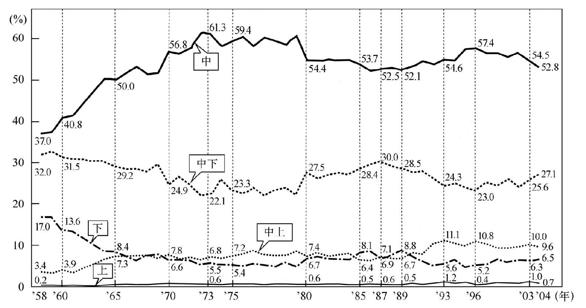

## 进行式中的年轻人群“下流化”

阶层分化问题研究的先驱者之一、东京大学研究生院副教授佐藤俊树曾将男性在职者的收入划分为4个梯级，将其阶层意识划分为“上”“中上”“中”“中下”“下”5个梯级，分别调查其对于自己的阶层归属感。1975年各个阶层在阶层意识上无甚差别，50%以上的被调查者都回答“中下”，但到了1995年却发生了戏剧性变化，收入最高、占全体20%的人群中有50%回答自己属于“中上”（参见佐藤俊树著《00年代的社会等级差别游戏》）。

由此，笔者以为完全可以做这样的假定，即今后全体日本人中的10%~20%——即使取中间值也有15%的人群——会认为自己不再属于中流，而属于中上流阶层。

图1-2　中流意识的变化

（注：1962年1月及1963年1月的调查中没有进行此项提问。1967年2月—1969年1月的历次调查中调查对象为家庭户主和从事家务劳动的人员）资料：内阁府《日本生活世论调查》

为了验证这一假定，让我们来看一看内阁府的“国民生活意识调查”（图1-2）。可以看出，近年来国民的中流意识的确发生了变化。关于阶层意识的访问题目是：“你的生活水平与社会上一般人相比处于什么水平？”对这一问题，回答“中”的人数比例1996年是57.4%，而2004年则减少至52.8%；反之，回答“中下”的人数比例则从1996年的23.0%增加至2004年的27.1%，回答“下”的人数也从5.2%微增至6.5%，“中”与“中下”两者合计从28.2%增加至33.6%。

无疑，“中下”和“下”的人数现今仍然在增加。上世纪80年代后期日本“泡沫经济”的时候，也曾出现过“中下”及“下”的人群显著增加的现象，不过当时“中”的人数却没有较多增加，“中上”的人数也几乎没有变化。例如1987年回答“中”的人数为52.5%，与此相对回答“中下”的人数增至30.0%，同时回答“下”的人数为7.1%，后两者相加合计有37.1%，比2004年的比例还要高，但当时回答“中上”的人数却只有6.9%。1987年至1996年期间，“中”由52.5%增加至57.4%，“中上”也由6.9%增加至10.8%，相反的“中下”则由30.0%减少至23.0%。换句话说，这十年间全体国民都具有较为强烈的上升意识。

到了1996年以后情况却发生了变化，“中”的人数减少，“中下”及“下”的人数增多，同时“中上”的人数大体维持在10%左右不变。这是自战后以来首次出现的倾向，它说明并非是全体国民普遍具有下降意识，而应该认为，它说明了只有“中上”以上的人群仍然维持在较高的水平。这也从国民意识的角度印证了阶层差别的逐步扩大。
