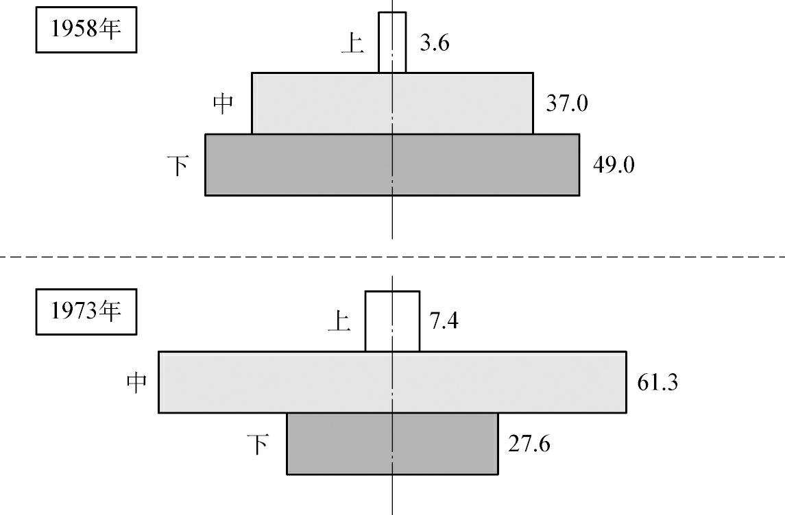

## “中流化”模式面临失效

如上所述，原先似乎坚不可摧的中流阶层呈现出了向“上”“下”两极分化的倾向。如果这种倾向是真实的话，那么收入差距一定也会对消费产生巨大的影响。在中流化的时代，众多日本国民为了确认自己的中流阶层身份而抑制了某些消费。从生产的角度来说，象征着中流身份的某些商品会发生滞销，事实上已经出现了滞销。

在中流化的时代，较之仅仅针对一小部分富裕阶层销售高档商品的欧洲模式，针对日益增多的新中间阶层以较低廉的价格销售优良商品的这部分销售额更为庞大，利润也更加高。

假设销售同样的商品，例如就以男性的西服为例，上流阶层（这里将“上”与“中上”合计为“上”）的经济实力可购买价格高达10万日元的西服，中流阶层的经济实力可购买大众化的价值7万日元的西服，而下流阶层（同样的，这里将“中下”与“下”合计为“下”）的经济实力则只能购买价值仅3万日元的西服。如果整个西服市场的规模为100万人，1958年“上”为3.6%，“中”为37.0%，“下”为49.0%（见图1-3），由于被调查者中含有未回答的无效样本，故合计不等于100。将数字略作调整使之合计正好为100，则“上”的比例为4%，“中”为41%，“下”为55%。于是有：

10万日元×4万人＝40亿日元

7万日元×41万人＝287亿日元

3万日元×55万人＝165亿日元

总销售额为492亿日元。

图1-3　中流意识的变化之一（1958—1973年）

资料出处：数据源自内阁府进行的“国民生活意识调查”，由Culture Studies研究所绘制1973年进入到中流化社会后，“上”所占的比例为8%，“中”为64%，“下”为29%，则有：

10万日元×8万人＝80亿日元

7万日元×64万人＝484亿日元

3万日元×29万人＝87亿日元

（注：小数点后采用四舍五入的方法，故合计不等于100）

总销售额为615亿日元。这主要是由于仅能够购买3万日元西服的下流阶层中有一大部分人上升为能购买7万日元西服的中流阶层，消费能力大大提高的缘故，因而总销售额增加了。

在这样的中流化社会发展趋势中，日本的家电行业、汽车行业、服饰行业以及其他所有行业的销售额都得到了惊人的增长。因此说，日本的企业擅长于生产制造面向中流阶层的商品，而却拙于生产制造面向上流阶层的商品。但由于整个社会的中流化结构已经发生了变化，故此针对中流阶层的中流化模式势必将不再是唯一和有效的了。
