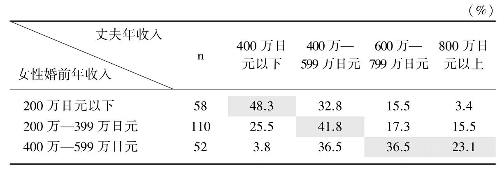

## 女性间的差别在不断扩大

以上五种女性类型，是根据其时尚特征、流行意识、杂志的阅读倾向，以及笔者平日的市场研究经验、市场调查、问卷分析等的结果归纳总结出来的，不单是反映了女性个人的性格和兴趣等，更反映了女性中正在不断扩大的阶层差别。

根据庆应大学樋口美雄教授的研究，通过对“家计经济研究所”实施的典型消费调查（1993年对当时24—34岁的女性1500人所做的长期跟踪调查）结果进行分析，发现在丈夫收入较高的家庭中，同样收入较高的在职妻子人数近年来有所增加，以前的“高收入丈夫与专职家庭主妇”的传统组合开始崩溃，而“高收入丈夫与高收入妻子”的新型组合呈现出增多的迹象。此外，如果仅观察女性的收入状况，则可以看到，基尼系数也呈上升趋势，尤其是在有收入的女性当中收入差距开始拉大（参见樋口美雄编《日本的收入差别与社会阶层》）。

女性之间收入差距的拉大，一方面是由于同男性一样从事企业管理和对外业务的女性人数增多，另一方面则是因为派遣雇员、兼职雇员、无固定工作的零工等雇佣形式的女性就业人数也在不断增多的缘故，而这些人是不会随着年龄增长而收入增加的。

另一方面，高收入丈夫与高收入妻子组合增多的原因无疑是因为“富婆型”女性的增多。“富婆型”女性总是与自己的收入及职业地位相适的男性结婚，同时不放弃职业，因而夫妇“双高”的组合便越来越多。如前所述，“富婆型”女性与男性接触的途径，无非是同一所大学的同学、同一家公司的同事、业务上的客户，或者是亲戚介绍等，通过这种途径认识的男性大多是高收入群的男性，所以，只要女性继续工作下去，必然就会诞生出夫妇“双高”的组合。

东京学艺大学的真锅伦子曾对日本劳动研究机构所做的“关于女性就业意识与就业行为的调查”的结果重新进行分析，发现了一个颇有意义的关系式：在妻子为企业正式雇员的前提下，丈夫的收入越高，妻子的收入也越高（参见真锅伦子“已婚女性的就业与家庭收入之间的差距及其前景”，收录在本田由纪编的《女性的就业与亲子关系》一书中）。

此外，大阪大学的大竹文雄也指出：“80年代，男性的收入越低其配偶的就业率就越高”“进入90年代，这一关系越来越不明显，至1997年，丈夫的收入与妻子的就业率之间的负相关关系几乎已经观察不到了”。反过来说则是，妻子的收入越高，丈夫的收入也越高，这种正相关率近年来越来越高。1987年，在丈夫年收入700万日元以上的家庭中，妻子年收入500万日元以上的比例仅为4%，而1997年则上升至8%（参见大竹文雄著《日本的不平等》）。

笔者与读卖广告社共同实施的“第二次女性阶层化调查”也得出了女性结婚前的收入越高，其结婚对象的收入也越高的结论。结婚前年收入400万至599万日元的女性，其配偶年收入超过600万日元的比例为59.6%，而结婚前年收入200万至399万日元的女性，其配偶年收入超过600万日元的比例为32.8%，结婚前年收入200万日元以下的女性，其配偶年收入超过600万日元的比例仅为18.9%（见表2-2）。

表2-2　从女性结婚前的年收入看其丈夫的年收入

资料出处：由Culture Studies研究所、读卖广告社共同实施的“第二次女性阶层化调查”
