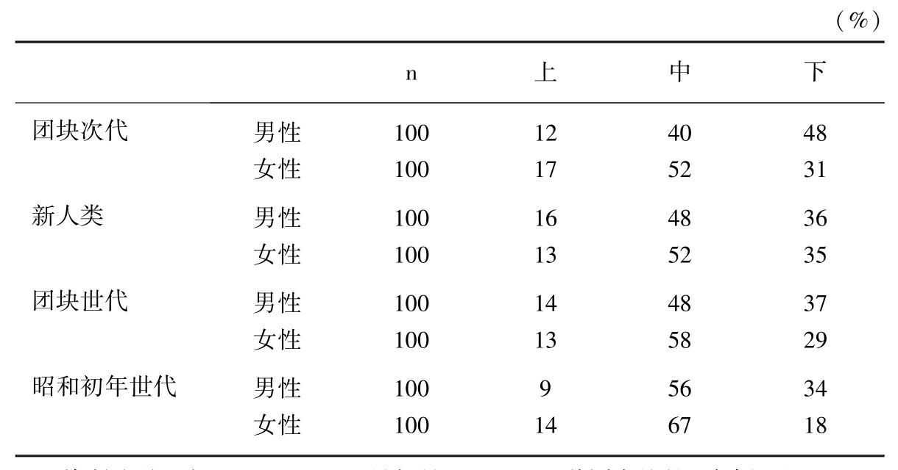
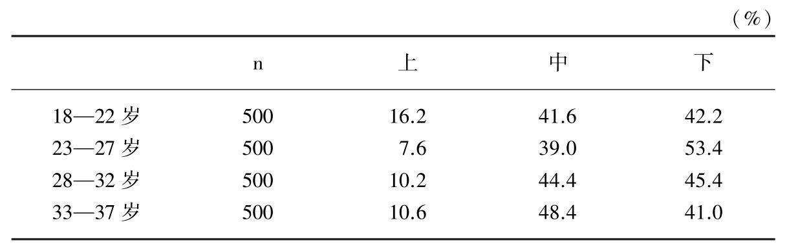
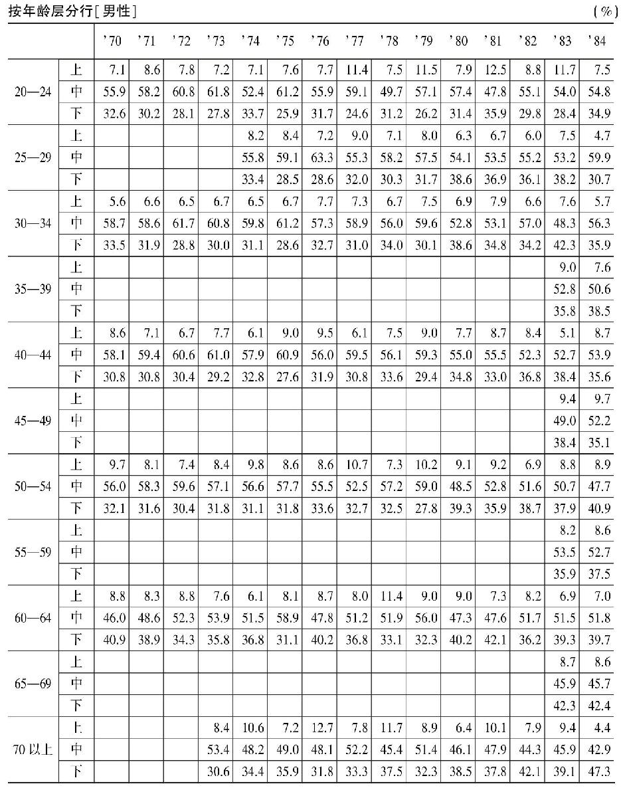
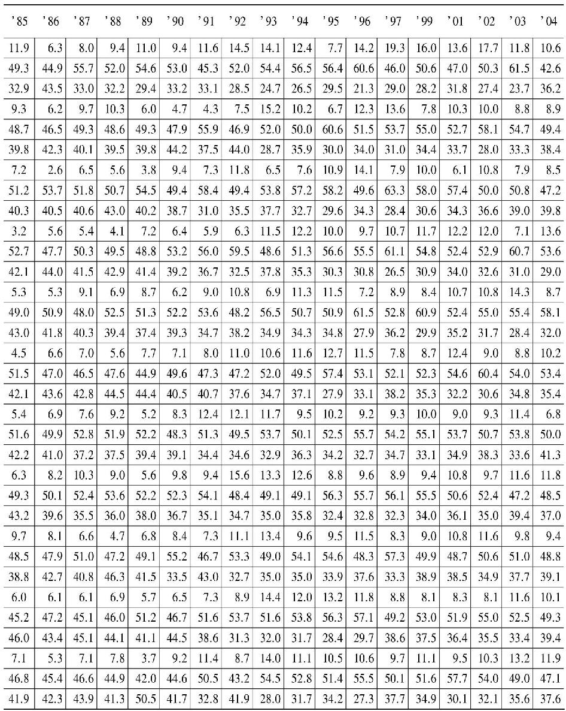
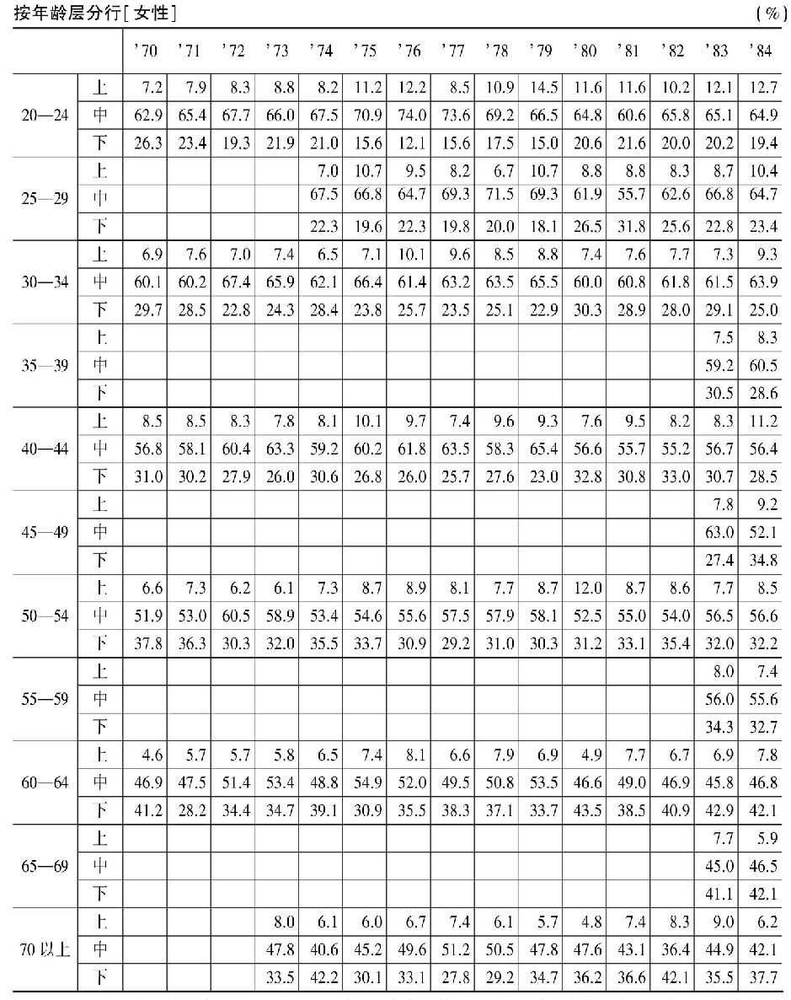
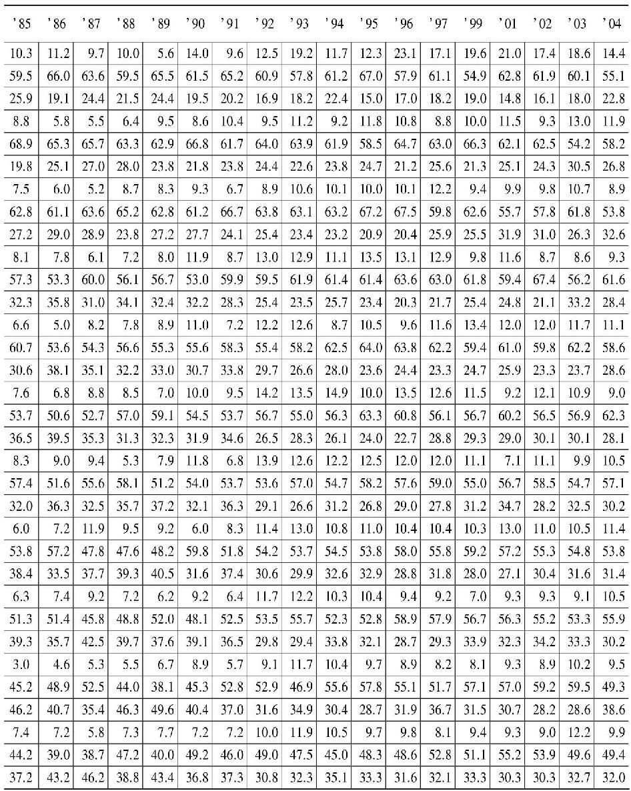

## 团块次代男性中48%是“下流”

笔者曾经做过一个“欲求调查”，从多个方面对昭和初年世代、团块世代、新人类世代以及团块次代四个不同世代进行了对比。本章将根据这一调查的数据，对这四个不同世代的男女阶层意识进行一番比较。

调查的样本数为居住在首都圈一都三县范围内的800人，其中各个世代的男女各100人。

关于阶层意识，具体的调查方法是询问被访问者：“你认为自己的生活水平在以下几个等级中属于哪一等？”请他们分别在“上”“中上”“中”“中下”和“下”五个备选答案中选择一个。

但是一般而言，几乎没有人会认为自己属于“上流”或是“下流”，在内阁府所做的相关调查中，回答“上”和“下”的也分别只有0.7%和6.5%。同样，在上述“欲求调查”中回答“上”的人也只有团块次代的男性、新人类世代的男性、团块世代的女性、昭和初年世代的女性各一名，所占比例仅为1%，而其他世代男性女性的回答数均为零。

回答“下”的人数分布情况如下：

团块次代男性　10%

团块次代女性　4%

新人类世代男性　8%

新人类世代女性　6%

团块世代男性　2%

团块世代女性　2%

昭和初年世代男性　5%

昭和初年世代女性　2%

在总共800名被访问者中共39名回答“下”，占比例约为5%，与内阁府的调查结果没有太大的差别。

然而，与团块世代以上人群中认为自己属于“下流”的被访问者只有极少数相对的是，新人类世代以下人群中这一比例却不小，男女合计共有7%，特别是在团块次代的男性中这一比例竟高达10%。由于这个调查是针对消费生活进行的详细调查，因而也有一种可能，即因为团块世代以上的人群对于消费已经变得极为消极，其中的低收入者对此没有给出回答。

其次，如果我们将“上”与“中上”合并计为“上”，将“中下”与“下”合并计为“下”来进行统计的话，则可以看到，团块次代的男性在各世代男女中的阶层意识最为低下，达到了48%（见表3-1）。这一结果与内阁府于1958年所做的调查结果相近。

表3-1　各世代男女的阶层意识

资料出处：由Culture Studies研究所、e-FALCON共同实施的“欲求调查”

与此相对，团块次代的女性其阶层意识略高于男性。此外，团块世代女性和新人类世代男性的阶层意识中，“上流”与“中流”之比大约为1:3，这与第一章中提到的201×年等级化社会的模式大体是一致的。根据这一点可以认为，在较年轻的世代中，阶层化即等级的两极分化显然已经开始了。

不过，在2005年进行的“第一次女性阶层化调查”中，在28—32岁的女性阶层意识中“上”约为10.2%，“下”约为45.4%；33—37岁的女性阶层意识中“上”约为10.6%，“下”约为41.0%，与“欲求调查”的结果相比，自认为属于“下流”的人群数更多（见表3-2）。从提问的内容来分析，应该是“第一次女性阶层化调查”中有更多低收入层的人参加了调查。换句话说，“欲求调查”中30—34岁女性的阶层意识存在一定的偏差，比实际有所提高了。

表3-2　各年龄层女性的阶层意识

资料出处：由Culture Studies研究所、读卖广告社共同实施的“第一次女性阶层化调查”

此外，由内阁府所做的“国民生活意识调查”中，30—34岁的男性中回答阶层意识“上”的约为8.5%，“中”约为47.2%，“下”约为39.8%，与“欲求调查”的结果无太大的差别。女性则“上”约为8.9%，“中”约为53.8%，“下”约为32.6%。两相比较，“第一次女性阶层化调查”中“下流”的比例更高。

这里需要指出的是，内阁府的调查样本数为2004年度的30—34岁男性246人、女性325人，“第一次女性阶层化调查”的样本数则要多出许多，故单从统计学上来讲，后者的可信性更加高。另外，“第一次女性阶层化调查”的对象是居住在首都圈一都三县的各年龄层的男性女性，而由此也会带来一定的偏差，即大都市圈内各阶层人群的收入差距很大，加上白领阶层相对较多，而且近年来又不断引入重视成果主义的工资制度，因此收入的差距在不断拉大。

表3-3　阶层意识的变化——各年龄层的男性

（注：20—29岁年龄层的1970—1973年、30岁以上年龄层的1970—1982年各栏因没有每5岁为一段的分段统计，故按照每10岁为一段，将其数值记入表中。）

资料出处：内阁府“国民生活意识调查”

表3-4　阶层意识的变化——各年龄层的女性

（注：20—29岁年龄层的1970—1973年、30岁以上年龄层的1970—1982年各栏因没有每5岁为一段的分段统计，故按照每10岁为一段，将其数值记入表中。）

资料出处：内阁府“国民生活意识调查”

最后一点，正如在本书后面还要阐述的，年过30岁而未婚的话会使人的阶层意识跌落，因此，在晚婚比较盛行的大都市圈，“下流”的人数理应增多得更加明显。
