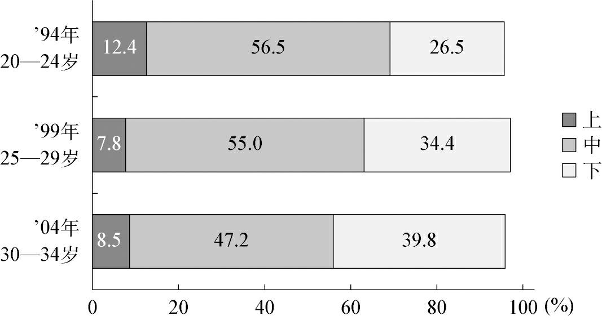
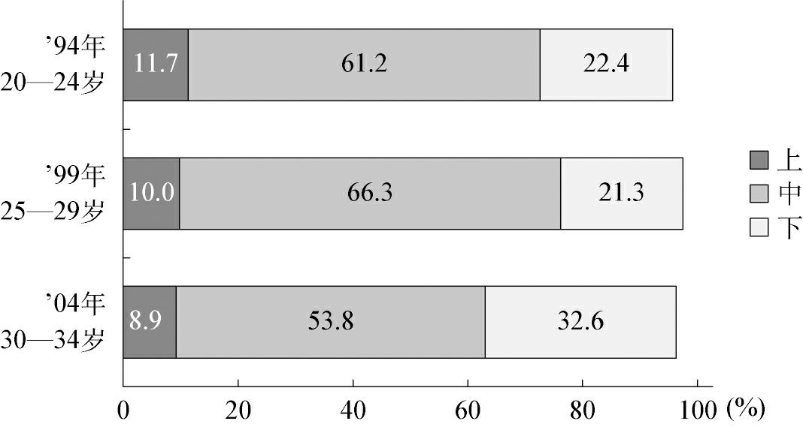

## 团块次代的阶层意识正在不断“下流化”

根据内阁府的调查数据，按照不同年龄层来看可以发现，越是年轻的世代，其阶层意识就越是低下。例如第二次生育高峰时出生的人群，即1994年时的20—24岁的男性自认属于“下流”的为26.5%，1999年这一人群25—29岁时其比例上升至34.4%，至2004年30—34岁时这一比例进一步上升至39.8%，十年间共上升了13.3个百分点（见图3-1）。

图3-1　阶层意识的演变（团块次代，男性）

资料出处：数据源自内阁府“国民生活意识调查”，由Culture Studies研究所绘制39.8%这个数字仅次于50—54岁的男性的41.3%，但是其十年间上升了13.3%的增幅，却是在其他各个世代中绝无仅有的。

同样地，1994年20—24岁的女性中认为自己的生活水平为“下流”的人数占22.4%，在1999年这一人群25—29岁时其比例为21.3%，几乎没有变化，但到了30—34岁（2004年）时这一比例却上升至32.6%，五年间上升了11.3个百分点（见图3-2）。

图3-2　阶层意识的演变（团块次代，女性）

资料出处：数据源自内阁府“国民生活意识调查”，由Culture Studies研究所绘制32.6%这个数字在女性中仅次于65—69岁年龄段的比例，其十年间上升了10.2%，这一增长趋势也是在女性的各个世代中增幅最大的。

综上所述，无论男性和女性，在最近十年间团块次代的阶层意识呈现出最显著的下降走势。
