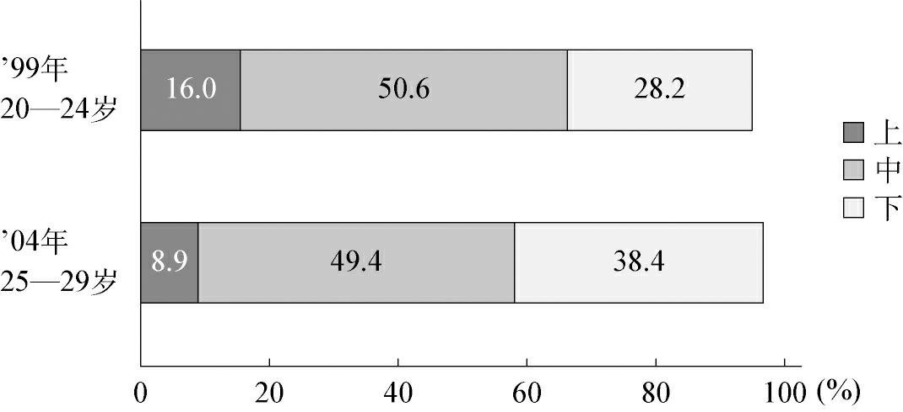
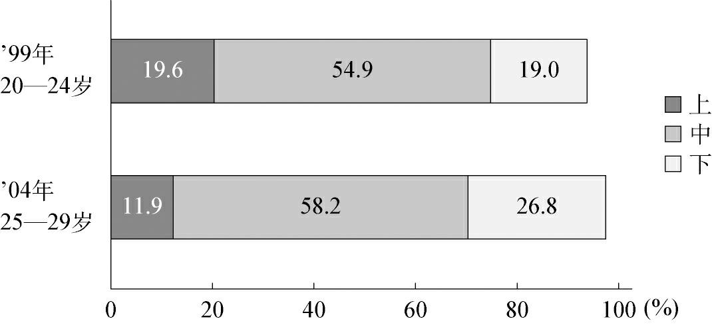
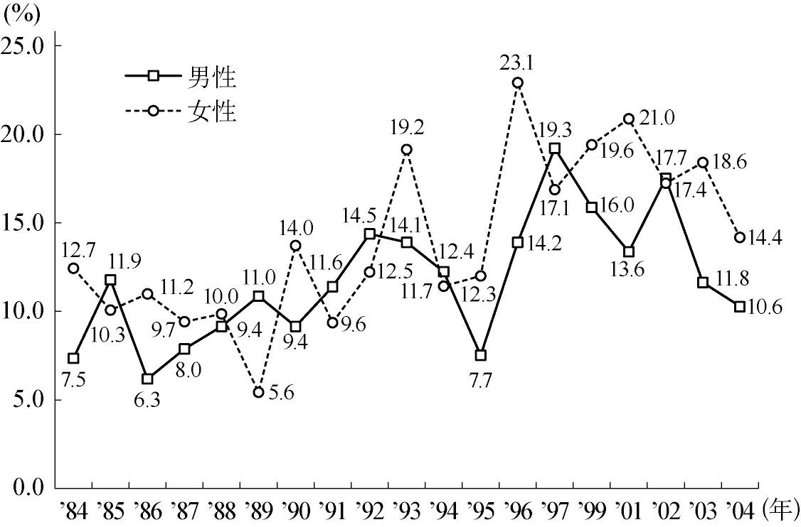

## 真性团块次代同样“下流”人数激增

比第二次生育高峰期出生的一代年轻约5岁的真性团块次代的情形又是怎样呢？

真性团块次代男性在1999年20—24岁时自认为属于“下流”的人群比例为28.2%，到了2004年25—29岁时这一比例上升至38.4%，也增加了10.2个百分点。与此同时，自认为属于“上流”的人群比例却由16.0%降低至8.9%，几乎减少了一半（见图3-3）。

图3-3　阶层意识的演变（真性团块次代，男性）

资料出处：数据源自内阁府“国民生活意识调查”，由Culture Studies研究所绘制女性的情形也相似，“下流”的比例由19.0%增加至26.8%，而“上流”的比例却由19.6%减少至11.9%（见图3-4）。

图3-4　阶层意识的演变（真性团块次代，女性）

资料出处：数据源自内阁府“国民生活意识调查”，由Culture Studies研究所绘制20—24岁以后男性女性的阶层意识不约而同地开始呈“下流化”的原因在于，从学生走向社会成为一名社会人，随之，结婚、生育等人生大事相伴而来，无论男性还是女性都经受了严峻的考验，生活现实显然导致了阶层意识的变化。从这个角度来考虑的话，那么阶层意识的“下流化”或许是各世代共通的普遍现象了。

加之真性团块次代恰好遭遇过剧烈的经济衰退，“上流”的减少和“下流”的增多便显得特别醒目了。其中男性的“下流”阶层意识短短五年时间便激增10.2个百分点，在各世代各年龄段中增幅都位列第一；而同一时期内女性的“下流”阶层意识增加了7.8个百分点，也仅次于团块次代的女性。

此外，20—24岁的男性中自认为属于“上流”的人群比例最高的是1997年，达19.3%，其次是从1996—2002年期间，基本上在15%前后。女性自认为属于“上流”的人群比例最高的是1996年，竟高达23.1%，其次是从1996—2003年期间，也始终维持在20%左右（见图3-5）。

图3-5　20—24岁男性和女性阶层意识中“上流”所占的比例资料出处：数据源自内阁府“国民生活意识调查”，由Culture Studies研究所绘制与此相对的则是，1984年的20—24岁即新人类世代的男性中的“上流”阶层意识者仅为7.5%，同一年的25—29岁即1955—1959年期间出生的一代（笔者也属于这一代）则更是只有4.7%。

由此可见，即使在被人激赞为高消费时代到来的20世纪80年代，对于年轻一代来说，依然不过是一个清贫的社会。
