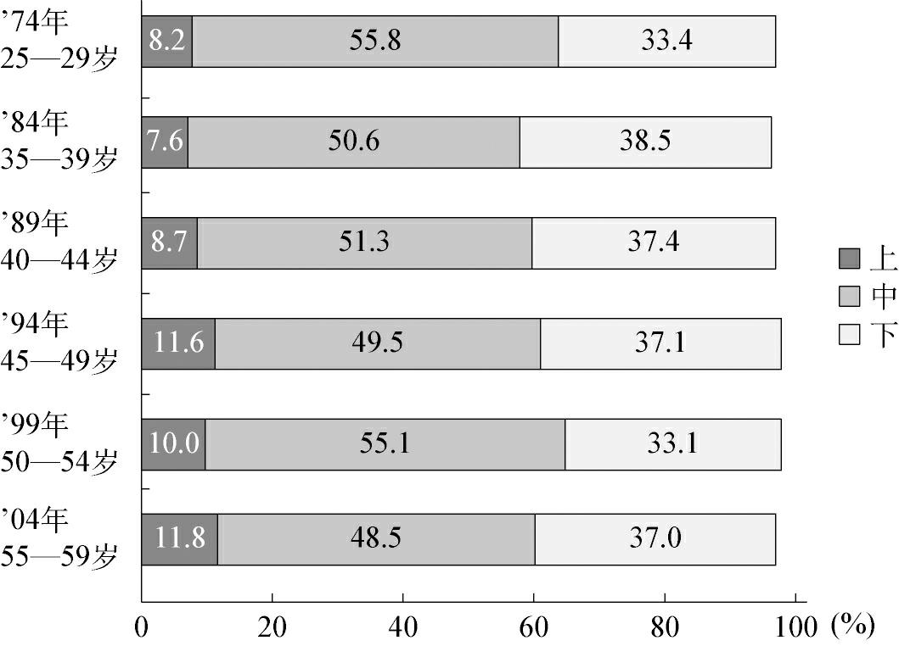
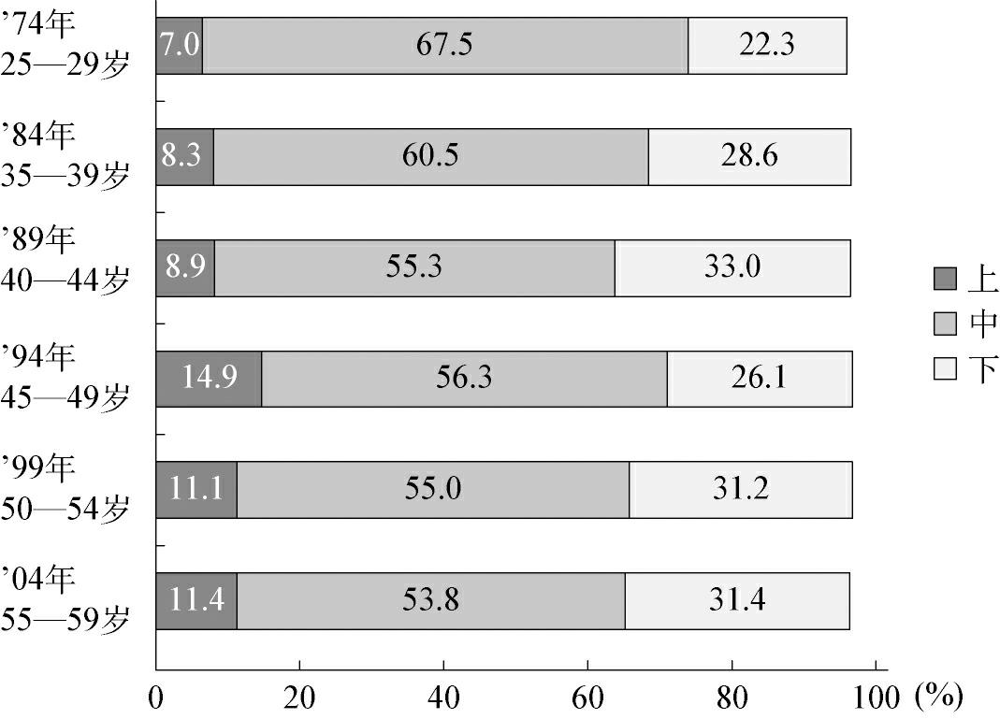
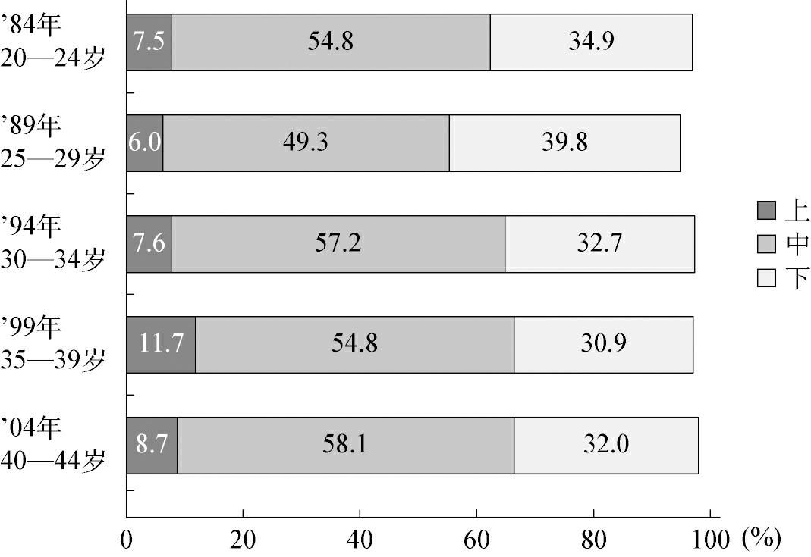
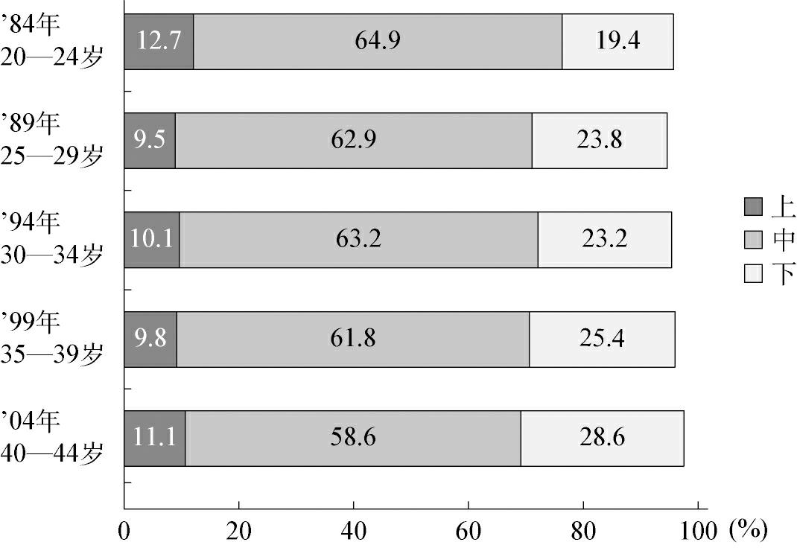

## 团块世代和新人类世代是稳定的中流

另一方面，团块世代中的男性在年届25—29岁仍然多数独身的1974年，自认为属于“中流”的人群比例为55.8%，而自认为属于“下流”的比例为33.4%，到了进入抚育下一代的35—39岁中年期的1984年，这两个比例分别是50.6%和38.5%，总体阶层意识略有下降，但下降幅度比起团块次代来要小许多（见图3-6）。

图3-6　阶层意识的演变（团块世代，男性）

资料出处：数据源自内阁府“国民生活意识调查”，由Culture Studies研究所绘制1984—1999年期间，“下流”的比例切切实实有所降低，可见团块世代的生活水准逐步在提高。然而至2004年，一方面是“下流”的比例有较大下降，另一方面却是“上流”的比例也略有上升，这说明“中流”的人群开始向“上流”和“下流”两极分化，极少部分人成功地登上企业的重要职位，而更多的人则被“重组”、被企业所抛弃，从同质人群被拉开至两极阶层。

与此形成对比的是，团块世代的女性则从1974—1989年期间“中流”的比例渐次下降、“下流”的比例相应逐步上升（见图3-7），但其后“下流”的比例一直保持在30%左右，“中流”的比例则基本在55%上下，不再有大的变化。不难看出，团块世代的女性拥有非常稳定的中流阶层意识。

图3-7　阶层意识的演变（团块世代，女性）

资料出处：数据源自内阁府“国民生活意识调查”，由Culture Studies研究所绘制比团块世代年轻约15岁的新人类世代情形又如何？

新人类世代的男性在1984—2004年期间阶层意识并无太大的变化（见图3-8），仅其中1989年受“泡沫经济”的影响“下流”的比例增加了五个百分点，而“中流”减少了五个百分点。我们可以大胆地推测，或许是因为当时他们正持币待购住房，由于地价、房价高腾，使得他们不得不打消了购房的打算。

图3-8　阶层意识的演变（新人类世代，男性）

资料出处：数据源自内阁府“国民生活意识调查”，由Culture Studies研究所绘制“泡沫经济”崩溃之后的1994年，日本社会的阶层意识基本回复到跟1984年差不多的水平，至1999年甚至还出现了“中流”和“下流”的比例略微减少，“上流”的比例略有增加的趋势，尽管这种趋势并不明显。但是到了2004年，又重新出现了“中流”和“下流”的比例有所增加，而“上流”的比例相应下降的情况，再度回到“泡沫经济”时期的水平。由此可以预测，今后随着成果主义的大行其道，收入差距势将继续拉大，导致“上流”和“下流”的人群数不断增加，而“中流”则不断减少的倾向继续强化。

在新人类世代的女性中则可以看到这样的趋势：“上流”的比例几乎没有太大变化，而“中流”的比例却日渐减少，“下流”的比例日渐增多。将2004年与1984年进行比较可以发现，二十年间“中流”的人数比例减少了六个百分点，“下流”的比例增加了九个百分点，整体而言，新人类世代女性的阶层意识略有下降（见图3-9）。

图3-9　阶层意识的演变（新人类世代，女性）

资料出处：数据源自内阁府“国民生活意识调查”，由Culture Studies研究所绘制新人类世代的女性在上世纪80年代曾经掀起一股女大学生、OL（“白领丽人”）的热潮，成为消费社会的生力军，但其后随着她们进入结婚、生育、育儿期，生活日趋严峻，加上经济不景气以及企业开始推行成果主义，她们的丈夫收入越来越拮据，这使得她们本人的阶层意识也相应地出现下滑，是这一人群阶层意识逐步低下的主要原因。然而在1999—2004年期间却出现过“上流”的比例略有回升的趋势，这或许就是中流阶层开始走向两极分化的征兆吧。

但是无论如何，比较而言，团块世代与新人类世代仍属于阶层意识较为稳定的社会人群，这一点是不言而喻的。
