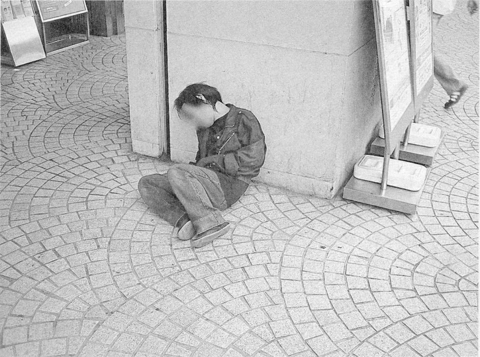

## 期望差歧

发表在日本亚马逊网（amazon.co.jp）上的关于东京学艺大学山田昌弘教授所著《期望差歧的社会》一书的书评中，有读者曾对该书作者的观点提出质疑，认为在日本经济高速增长期也存在着“期望差歧”。然而，笔者觉得这种质疑并没有命中目标。

毫无疑问，经济高速增长期也存在期望差歧，这应该是毋庸质疑的。但问题的关键不在于有没有期望差歧，而在于究竟是认为期望差歧在不断扩大的人群占了大多数，还是认为期望差歧在不断缩小的人群占了大多数，这些人群又分别是怎样的人群？

战后尤其是进入经济高速增长期以后，日本社会进入了这样一个社会：越是贫穷的人群越拥有更多的期望，而与此相对的则是，贵族、资本家、地主阶级等被剥夺了种种特权，甚至土地也被剥夺，因而对于他们来说，期望不断缩小。从前的佃农分得了田地，佃农的子女们也得以进入高中甚至大学深造，初中、高中毕业后即便是蓝领工人，但至少也有机会进入大企业工作，成为都市劳动阶级的一分子，只要付出相当的努力，照样可以被委以科长之类的管理职务。当然，成为都市劳动阶级的年轻人群也不是一夜之间便暴富起来的，但即使眼前收入尚低，他们却切切实实拥有一个期盼可以实现：只要每天认真工作，将来收入会增加，生活水平会提高。正因为如此，他们的劳动意欲十分昂扬。吉永小百合、滨田光夫的电影中描绘的就是这样的年轻人。

因此，除了极少数的个例以外，总体说来在经济高速增长期，人们的社会阶层越低，就越拥有更多的期望和可能性，而社会阶层越高却因为先前的权利被剥夺或被限制，反而期望值越低。

丧失希望的年轻人横卧街头

然而现在的情形却是，整个社会分化成了这样两大类人群：只有少数人对将来收入增多仍怀有期望，而大多数人却对将来收入增多毫无期望。曾经是大多数人都共同拥有的生活水平提高及社会阶层上升的期望，现在只为社会上的一小部分人所专有，并且一个人有无期望并不是由其本人的资质和能力等所决定，由其父母亲的社会阶层所决定的这样一种走势正在加强。

综上所述，山田昌弘教授的期望差歧论想表达的其实是这样一层意思：个人不论有无期望都是由其社会阶层决定的，换句话说，现在的社会分化成了两大阶层，即拥有希望的人群和不拥有希望的人群，并且这种阶层分化呈现出固定化的趋势，也就是丧失未来期望的人群将永远不再拥有期望。即使收入差距在不断扩大，但是只要未来还有希望将这个差距逐步缩小，则期望值的差距就不会扩大；反之，如果给人的感觉是收入差距已无法缩小，那么人们心目中的期望差歧也将不断扩大。
