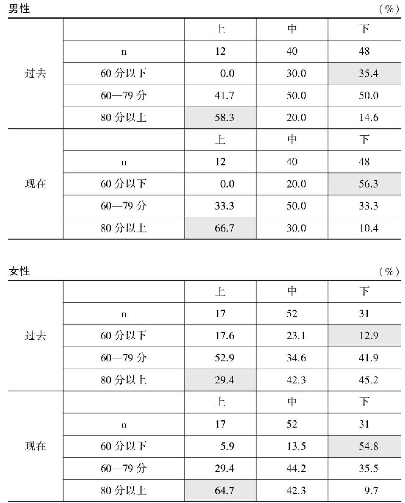

## 过去10年间“胜”“败”分明？

本章将结合“欲求调查”的结果，来考察一下团块次代各阶层意识的人群中，在收入、结婚、家庭以及职业等方面究竟有哪些不同。

“欲求调查”除了请调查对象就其生活水平状况按照“上”“中”“下”几个梯级来回答之外，还请他们对自己过去5—10年的生活水平以打分方式（满分为100分）进行了回答（见表4-1）。

表4-1　团块次代各阶层意识人群过去与现在的生活水平分值

资料出处：Culture Studies研究所、e-FALCON共同实施的“欲求调查”

从表中可以看出，对于男性来说，“上流”是那些自过去到现在分数提高的人，“下流”是那些自过去到现在分数降低的人，而“中流”则是那些自过去到现在分数无明显变化的人。换句话说，过去5—10年间的生活水平决定了一个人的阶层意识。

女性当中也存在着同样的倾向，只不过与男性相比，在“上流”的人群中对“现在”打分至80分以上的人远多于对“过去”打分至80分以上的，而在“下流”的人群中则是60分以下的人群呈现这一惊人增幅。换一个角度讲，即是在最近十年间，女性的胜负比男性更加明显，这种胜负影响到了她们现在的阶层意识，而这种影响则可以认为是通过收入增减、结婚与否等多方面因素来体现的。
