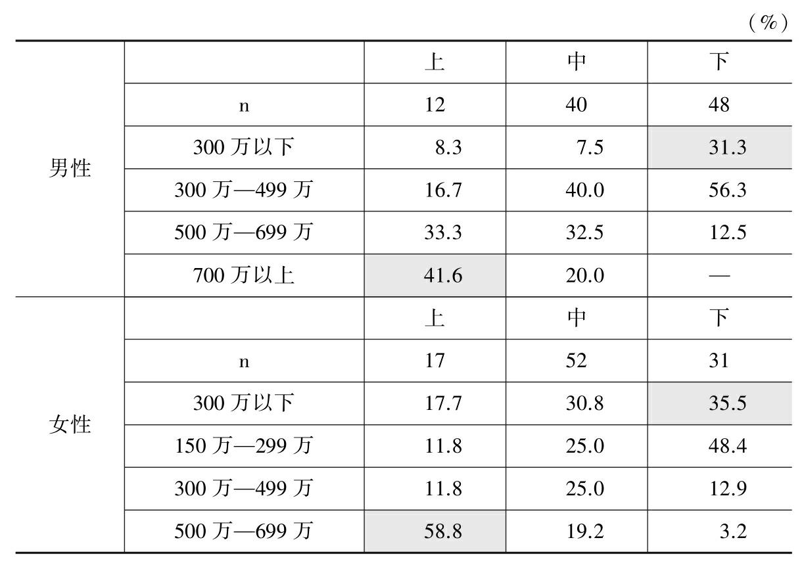
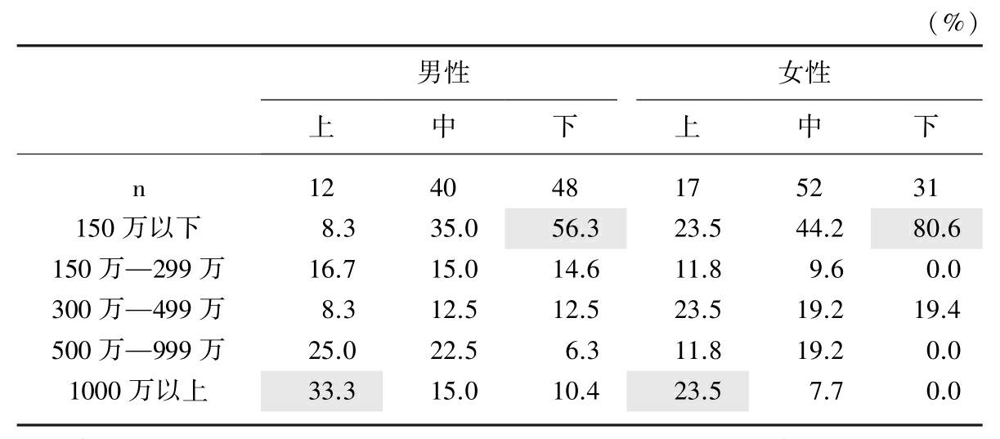

## 储蓄额分化为500万日元以上和150万日元以下两极

接下来看看各个阶层意识人群的年收入情况。理所当然地，阶层意识高的人群其年收入也较一般人群更高，尤其是女性，阶层意识为“上流”的人群中有58.8%的人年收入超过700万日元（见表4-2）。这种场合，由于年收入是指夫妇双方合计起来的收入，因而基本上可以认为其实是丈夫的年收入。换句话说，如果丈夫拥有较高的年收入，则有可能提升妻子的阶层意识。

表4-2　团块次代各阶层意识人群的收入情况（已婚者则计算夫妇二人的合计收入）

资料出处：Culture Studies研究所、e-FALCON共同实施的“欲求调查”

再看一看各个阶层意识人群的储蓄情况（同样，已婚者以夫妇双方的储蓄额合计）。男性“上流”人群中33.3%的人储蓄额在1000万日元以上，25%的人储蓄额在500万—1000万日元之间，合计共58.3%的人拥有500万日元以上的储蓄。女性中也有35.3%的人拥有500万日元以上的储蓄（见表4-3）。

表4-3　团块次代各阶层意识人群的储蓄情况

资料出处：Culture Studies研究所、e-FALCON共同实施的“欲求调查”

与此相对的则是，男性“下流”人群中有56.3%的人储蓄额不到150万日元，女性“下流”人群中也有高达80.6%的人储蓄额不超过150万日元，“中流”人群中男女合计共有约40%的人储蓄额低于150万日元。

从以上调查数据可以看出，储蓄情况反映出巨大的阶层意识差距，认为自己属于上流阶层的人群大多储蓄额超过500万日元，而认为自己属于中下流阶层的人群中则绝大多数储蓄额不足150万日元，两者之间呈现两极分化的态势。
