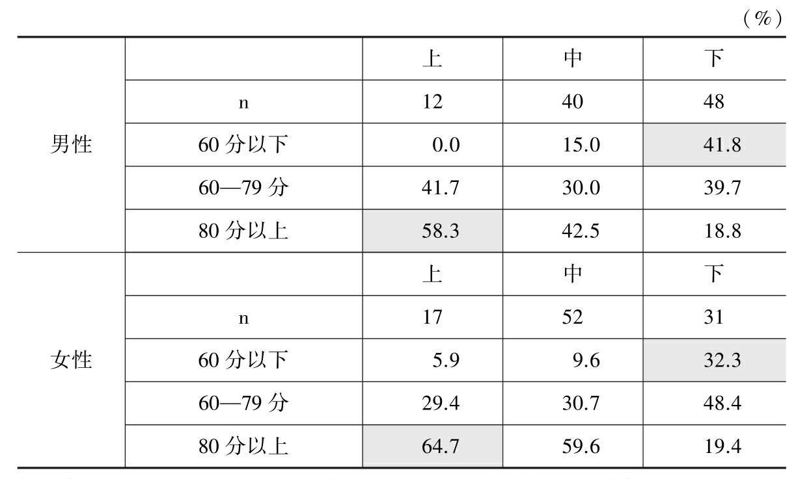

## 未婚者的生活满意度低下

“欲求调查”除了调查生活水平以外，还向他们了解其对个人生活的满意程度（见表4-4）。毫无悬念，阶层意识越高的人群其生活满意度也越高。不过与生活水平情况相比，阶层意识的高与低两者之间的差距不那么显著，这可能是因为有不少人即使生活水平很高但依然对生活不满，或者生活并不十分优裕却对此感到很满足的缘故。

表4-4　团块次代各阶层意识人群对生活的满意程度

资料出处：Culture Studies研究所、e-FALCON共同实施的“欲求调查”

两相比较，女性的阶层意识越高，其对生活的满意度也就越高，例如女性“上流”人群中有64.7%的人对生活的满意度超过80分，“中流”人群中对生活满意度超过80分的人也有59.6%。而男性中的比例就没有这么高，即使身处“上流”的人也会因为劳动时间过长、结婚难等苦恼而影响了其对生活的满意度。
