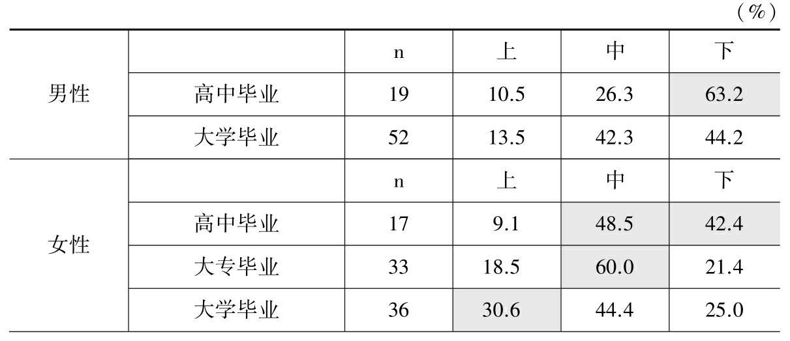
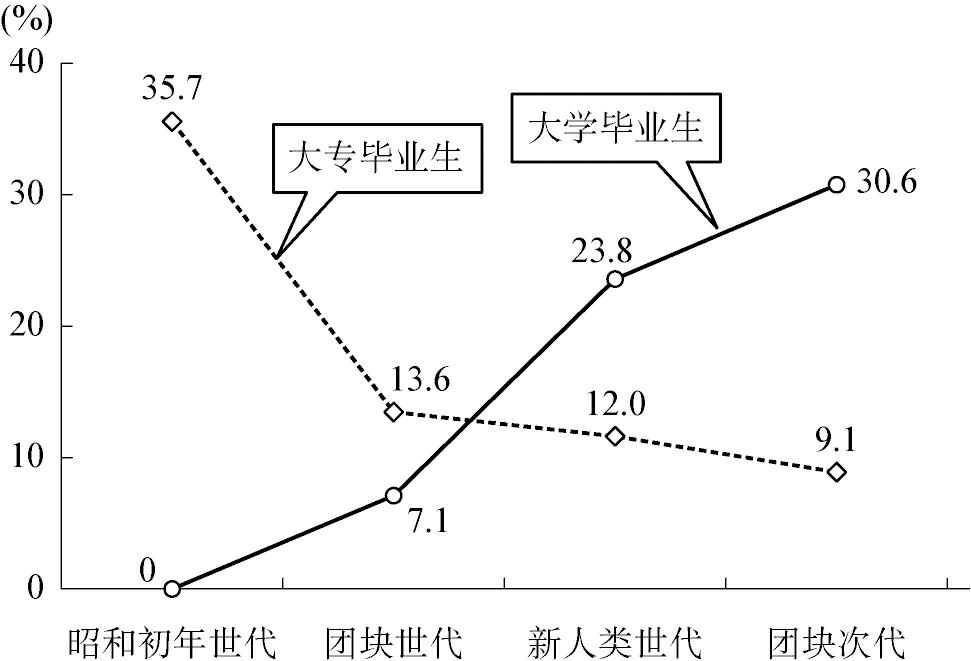

## 女性学历低就跨不进上流的门槛？

阶层意识与学历之间有什么样的关系呢？

以男性而言，高中毕业学历者中觉得自己属于下流阶层的占63.2%，似乎两者之间有着某种相关关系，不过大学毕业学历者中也有44.2%的人觉得自己属于下流阶层。反之，高中毕业学历者中也有10.5%的人自认属于“上流”，而在大学毕业学历者中这一比例也仅仅为13.5%，两者的差距并不明显。因此，虽然可以说大学毕业生的阶层意识更容易处于“中流”但谁也不能断言他们更容易挤入“上流”（见表4-5）。

表4-5　团块次代不同学历人群的阶层意识

资料出处：Culture Studies研究所、e-FALCON共同实施的“欲求调查”

反之，女性的学历与其阶层意识之间的相关性却相当高。我们换一个角度，从女性大学毕业生中“上流”阶层意识人数所占的比例来看，可以发现：越年轻的人群中这一比例越高。团块次代的女性大学毕业生中有30.6%阶层意识属于“上流”，新人类世代的女性大学毕业生中则有23.8%，而团块世代仅有7.1%，昭和初年世代中为——0（见图4-1）！

图4-1　女性大学及大专毕业生中“上流”阶层意识所占的比例

资料出处：Culture Studies研究所、e-FALCON共同实施的“欲求调查”

当大学教育越来越普及之后，年轻的大学毕业生们的阶层意识也越来越高扬。一见之下这似乎有点不可思议，因为在昭和初年，大学教育还只是一小部分人的特权，那时的女性大学毕业生理应阶层意识更加显著。为什么事实却正好相反呢？

这其实是由于以下原因造成的：近年来，随着高学历化的不断升级，高学历与高收入之间的相关性越来越突出，而大学毕业以下学历的人群，其高收入的人数比例日益减少，故此使得人们自然而然地将学历与阶层意识挂上钩，学历越高其阶层意识也越高。

另一方面，对于昭和初年世代的女子来说，阶层意识“上流”的人群中大专毕业生所占的比例非常高。在她们的时代，专科学校毕业即意味着未来的人生有所保障，她们无需进一步提高自己的学历，而是通过与高学历的男性结婚，便可跨入上流阶层。但是现代的女性更加注重依靠自己的实力来跻身上流阶层，此时学历便成为一种极为有效的资源。

要想成为一个富裕的专职家庭主妇也需要较高的学历。因为，说到与高收入的男性邂逅，当然是进入一流的大企业才可能有更多的机会，而近年来要想进入一流的大企业，即使从事一般的事务性工作，也需要四年制大学毕业才能如愿。所以说，不论是自己去挣更多的收入，还是嫁一个高收入的如意郎君，高学历的女性总是比较有利。
