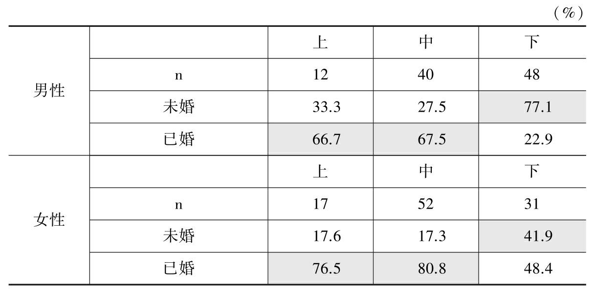
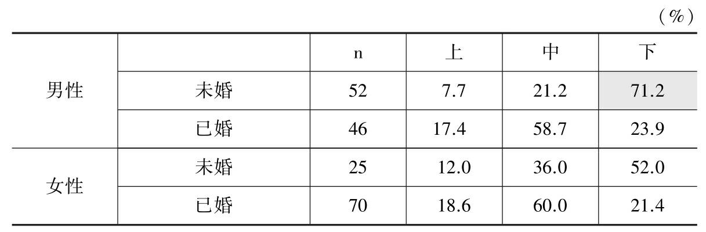

## 结婚是成为中流的先决条件吗？

再来看各阶层意识人群的婚姻状况。女性的场合，“上流”阶层意识人群中76.5%为已婚者，“中流”人群中有80.8%已婚。可见，“上流”“中流”阶层意识的人群中已婚率非常高（见表4-6）。在“上流”阶层意识人群中，未婚者仅3名，占被调查人数的17.6%，其中一人是无固定职业、与父母生活在一起的“啃老族”；一人是年收入在150万—300万日元之间的个体经营者，也与父母一起生活；还有一人则是普通的企业职员，年收入300万—500万日元，单身生活。就本次调查而言，还没有发现未婚、有固定职业、年收入超过500万日元，且阶层意识属于“上流”的典型的“富婆型”女性。换句话说，本次调查的结果正好印证了前面所说的，即高收入的男性与已婚女性其阶层意识都明显趋高。

表4-6　团块次代不同阶层意识人群的婚姻状况

资料出处：Culture Studies研究所、e-FALCON共同实施的“欲求调查”

反观不同婚姻状况人群的阶层意识，男性未婚者有71.2%的人其阶层意识属于“下流”。由此可见，女性若是盯住那些与父母居住在一起、30来岁的富裕未婚男性作为首选结婚对象的话，从男性角度来说，未必是一种合适的战略。因为未婚容易使男性的阶层意识低下，故此那些“钻石王老五”们很可能在30岁之前便已经结婚了（见表4-7）。

表4-7　团块次代不同婚姻状况人群的阶层意识

资料出处：Culture Studies研究所、e-FALCON共同实施的“欲求调查”

而女性的情形则有所不同，即使是未婚女性，其阶层意识为“下流”的有52%，阶层意识为“中流”的也有48%，两者比例几乎不相上下。这似乎从另一个侧面印证了消费市场中令人注目的“未婚女性市场”的存在，女性未婚状况与其阶层意识低下之间并无直接联系，她们只是消费市场中最活跃的一群人。
