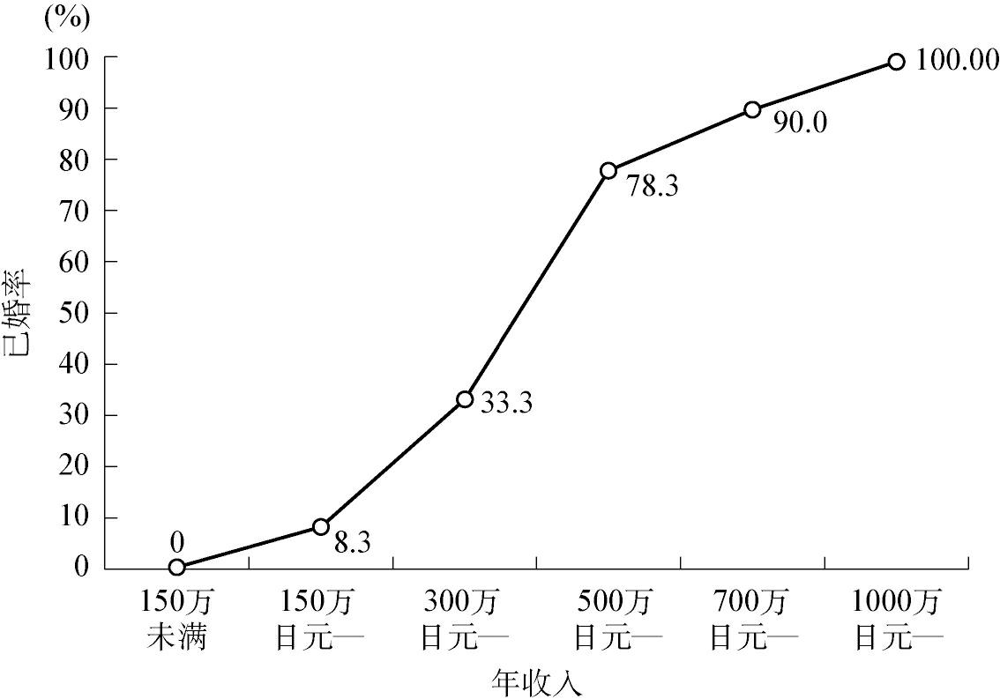
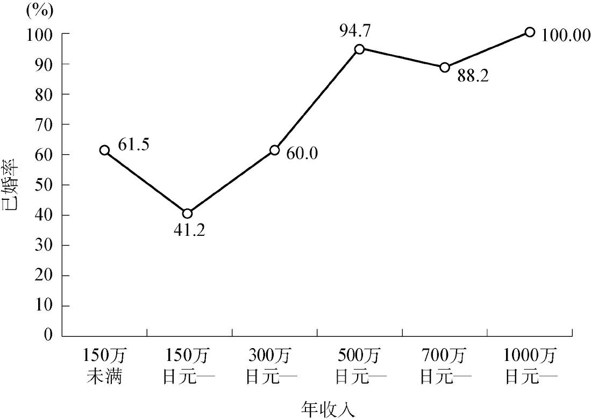
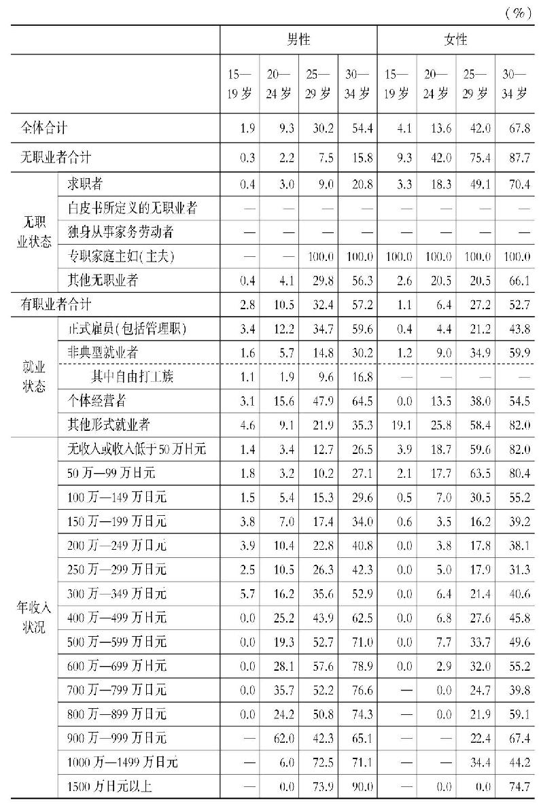

## 年入500万日元是结婚的一道门槛

分析男性的收入与婚姻状况之间的关系，可以明显地看到收入越高的男性已婚率也越高，用图来描绘的话，两者的相关关系状似一条S曲线（见图4-2）。

对于男性来说，年收入如果低于150万日元的话，结婚几乎毫无希望，即使超过150万日元但低于300万日元，其结婚的可能性仍然微乎其微。年收入超过300万日元，才勉强具备结婚娶妻的必需条件；年收入超过500万日元的男性结婚之途变得非常顺畅，而年收入超过700万日元，则90%的男性可以轻松结婚，超过1000万日元更是100%都能够步入婚姻殿堂。

图4-2　男性收入与已婚率的相关性（已婚者则计算夫妇合计收入）

资料出处：Culture Studies研究所、e-FALCON共同实施的“欲求调查”

如果夫妇双方都有工作收入的话，则上述的收入数字应该为夫妇双方的合计收入，而不仅仅是丈夫一方的收入。但即使这样，男性的收入高或低，与男性能否结婚仍然具有很高的相关性，这一点不会改变。换言之，不论是丈夫的收入也好，还是夫妇双方的合计收入也好，一个家庭的年收入至少要超过500万日元，这似乎已成为结婚不得不跨越的一道门槛。

如今的女性可以说变得越来越奢侈了。从前的女性会期待结婚后，夫妇二人共同奋斗去打造一个富裕的小家庭，可现在的女性不再这样想了，她们期望从结婚一开始就能过上无忧无虑的富裕生活。当然不止是女性如此期望，她们的父母亲也同样如此期望。

反过来从女性收入与其婚姻状况的关系来看，已婚女性90%以上其收入超过500万日元。当然，这里的收入也不仅仅是女性的个人收入，而绝大多数是丈夫的收入或是夫妇二人的收入。如前所述，女性对于结婚的期望是家庭的年收入至少超过500万日元（见图4-3），不过，从图中也可以看出有的家庭年收入不足150万日元，这部分家庭恐怕便是那些由不小心未婚先孕的年轻男女所组成的。

图4-3　女性收入与已婚率的相关性（已婚者则计算夫妇合计收入）

资料出处：Culture Studies研究所、e-FALCON共同实施的“欲求调查”

最近，又有新的研究报告进一步印证了笔者的调查结果。以专门研究自由就业问题而闻名的“劳动政策研究机构”的小杉礼子副研究员为总务省进行了一项“就业构造基本调查”，对其数据所作的分析清楚地表明，年收入低的男女其结婚率也相应低下（具体数据详见表4-8）。

表4-8　各年龄段不同就职状态、年收入人群的已婚率（在读学生除外，2002年调查）

资料出处：劳动政策研究所机构《年轻人群就业支援的现状与课题》，2005年度根据上表中的调查数据，年龄在25—29岁、年收入500万日元以上的男性50%~60%已婚，年收入1000万日元以上者70%以上已婚。而在30—34岁的男性中，年收入500万日元以上者的已婚率为70%~80%，年收入超过1000万日元者90%以上都已结婚。

此外，筑波大学副教授白波濑佐和子根据“社会阶层与社会迁徙调查”的数据分析，1995年年收入不足150万日元的男性未婚率高达90%以上，年收入150万—250万日元的男性未婚率约为60%，同样可以得出收入越低已婚率也越低的结论。同时，年收入低于450万日元的男性在1985—1995年间的未婚率居高不下，而年收入超过450万的男性在这期间的未婚率却基本保持稳定状态；而这期间内的低学历者（高中毕业）与高学历者（大学毕业及大学毕业以上）相比，无论男性女性其未婚率都明显高出数个百分点（参见《高龄少子化社会中看不见的社会差别》）。
