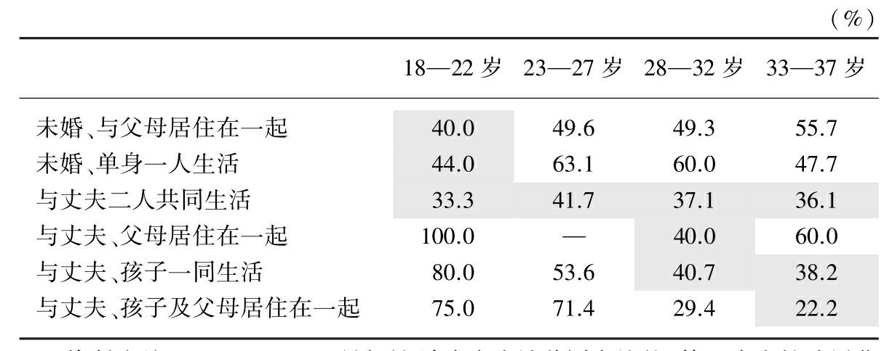

## 女性把握住幸福的模式

如果我们看一下2005年5月进行的“第一次女性阶层化调查”中婚姻状况及各种不同家庭形态下的阶层意识，可以发现：女性在18—22岁时或者是未婚、与父母居住在一起，或者是单身一人生活，或者是结婚后与丈夫二人共同生活，这样的人群阶层意识为“下流”的比例最少，大约在33%~44%之间（见表4-12）。

表4-12　女性婚姻状况及各种家庭形态下“下流”阶层意识的比例

资料出处：Culture Studies研究所、读卖广告社共同实施的“第一次女性阶层化调查”

而年届23—27岁时，与丈夫二人生活的女性阶层意识为“下流”的比例最少，仅有41.7%。当年龄层次进一步往上，达到28—32岁这个年龄段的时候，夫妇二人的家庭形态使得女性“下流”阶层意识的比例为37.1%，而与丈夫及父母同住在一起或者是与丈夫及孩子共同生活的女性，有约40%的人其阶层意识为“下流”；至33—37岁时，与丈夫二人生活或者与丈夫及孩子一同生活的女性这一比例为36%~38%，而与丈夫、孩子共同生活在父母身边的女性这一比例仅为22.2%。

从以上家庭形态与阶层意识之间微妙的比例关系中可以得出一个结论：女性年轻时与父母亲一同生活，婚后与丈夫共度二人世界，待怀孕生子后再与父母居住到一起，这是一种最最不易产生下流阶层意识的生活方式。虽说出乎意料地显得十分保守，但实际生活中这似乎正是女性把握住幸福的一种生活模式。

若是从这一点来思考，则可以说自从上世纪80年代以后，家庭的形态以及社会生活方式发生了剧烈的变化，日益显得多样化，可人们的意识及价值观却并不像生活方式那样丰富和多样化，或者可以反过来说，越来越多的人脱离了原来幸福的生活模式，结果生活质量反而日渐低下。
