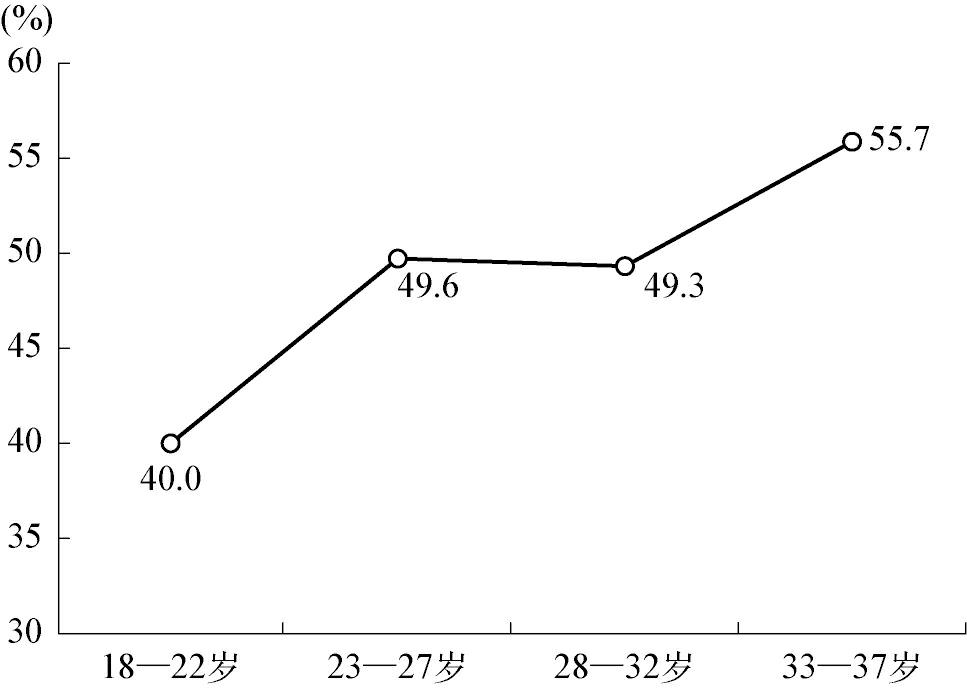

## “啃老”女性年龄愈大愈“下流”

调查中另一个让我们颇感兴趣的倾向是，未婚而同父母亲生活在一起的所谓“啃老族”女性，随着她们年龄的增大，其阶层意识呈“下流”的比例也愈见增多，18—22岁时为40.0%，23—32岁时上升至将近50%，33—37岁时更上升至55.7%（见图4-4）。

图4-4　“啃老族”女性中阶层意识为“下流”的人数比例

资料出处：Culture Studies研究所、读卖广告社共同实施的“第一次女性阶层化调查”

这一倾向可以通过以下三个假设来加以解释：

假设1：未婚这一事实本身使得女性产生不同程度的自卑感，因而随着年龄增大阶层意识愈加低下。

假设2：年轻时阶层意识为“下流”的女性较之其他人群其后结婚更加困难，而年轻时阶层意识为“上流”的女性其后结婚却较为容易，随着年龄增大，阶层意识为“上流”的女性渐次结婚成家，于是剩下的女性中阶层意识为“下流”的人数比例就自然增多。

假设3：根据“欲求调查”的结果，目前的阶层意识在很大程度上取决于过去五年间的生活水平是上升还是下降，同时前述的“家计经济研究所”长期跟踪调查显示，团块次代即日本“泡沫经济”崩溃之后开始踏上社会的一代人中企业正式雇员较少，而无固定职业的自由打工族却人数众多。根据以上调查结果，过去五年间生活水平低下的女性，或是因为忙于就职、工作流动，或是作为非正式雇员以及自由打工者故而收入微薄，于是没有机会遇见合适的结婚对象，耽误了终身大事，从而对生活产生悲观，对于阶层的归属自然回答是“下流”；而在过去五年间生活水平稳定提高的女性，作为企业的正式雇员持续工作，因而收入不断增加，同时也有更多的机会与高收入的男性邂逅，步入婚姻殿堂的可能性高得多，使她们对自己的生活状况较为满足，回答“上流”的比例也更高。

假设1的潜在意味在于提出警告，假如不结婚的话就将沦为下流阶层，也就是“败家之犬＝败组”的翻版性假设。

假设2则断定阶层意识“下流”的女性会遭遇结婚难，仅这一点就更加可怕。这个假设强调的是能否结婚由年轻时所属的阶层决定，而本人的阶层通常又是由父母亲的所属阶层所决定的，可见它十足是个令人恐惧的“阶层固定化假设”。

假设3则将阶层意识的低下以及结婚难等归因于“泡沫经济”的崩溃，称得上是“经济决定论假设”。

究竟以上的假设中哪一个更加接近事实，单凭一次调查还不能得出正确的结论，如果仅就个别案例来看，则每个假设都有其一定的道理和准确性。但无论怎样，超过33岁仍然持续过着“啃老”生活的单身女性，其阶层意识为“下流”的人居多数，却是一个不容否认的事实。
