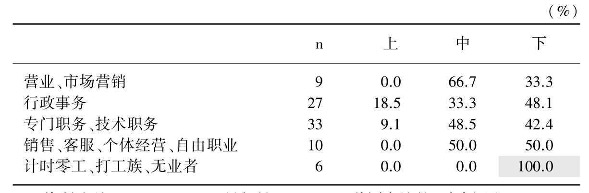
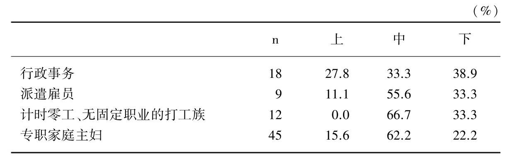
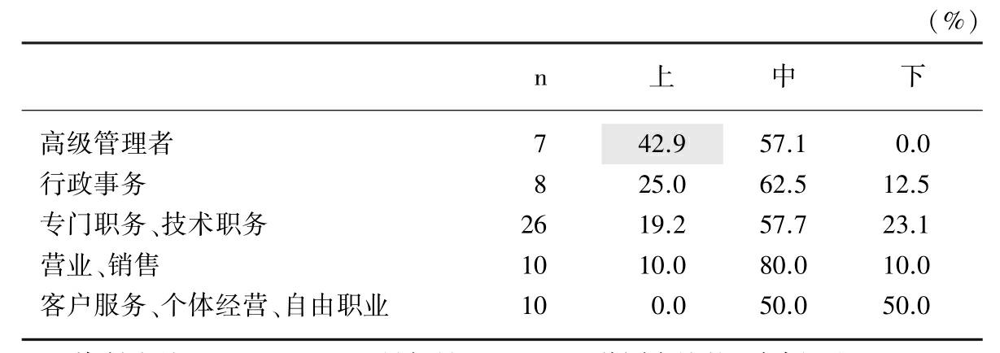

## 企业高管的妻子最幸福吗？

接下来从各种不同职业的角度来看看阶层意识的分布情况。男性的场合，从事行政事务工作的男性中有18.5%的人感觉自己属于上流阶层，但同时有48.1%的人觉得自己只能归于下流阶层，呈现出两极分化的分布形态，这说明在同样从事行政事务的男性中，也存在着“胜组”与“败组”两种人群。无固定职业的打工族及自由职业者尽管只有6名，但却全部认为自己属于下流阶层（见表4-15）。

表4-15　各种主要职业的阶层意识差异（男性）

资料出处：Culture Studies研究所、e-FALCON共同实施的“欲求调查”

女性的场合，即使做着同样的辅助性事务工作，但其阶层意识仍然分别为“上流”“中流”和“下流”，而且分布人数较平均，这应该同她们各自所在企业的规模以及具体职务内容等有关（见表4-16）。

表4-16　各种主要职业的阶层意识差异（女性）

资料出处：Culture Studies研究所、e-FALCON共同实施的“欲求调查”

专职家庭主妇中阶层意识为“中”者居多，此外自由打工族中也有66.7%的人自认为是“中”，派遣雇员也有55.6%的人自认为是“中”。

再从配偶的不同职业来看女性的阶层意识，不出预料，配偶担任企业高级管理者职务的女性中阶层意识为“上流”的人数最多，其次是从事行政事务的女性阶层意识为“上流”的也较多（见表4-17）。从中可以看出，丈夫担任企业高级管理者职务这一美国式的家庭幸福观念，自“1955年体制”确立以来，至今仍然具有强大的影响力。

表4-17　女性配偶的不同职业对其阶层意识的影响

资料出处：Culture Studies研究所、e-FALCON共同实施的“欲求调查”
