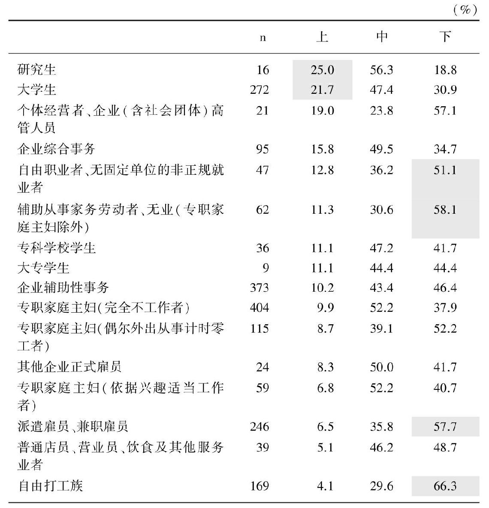
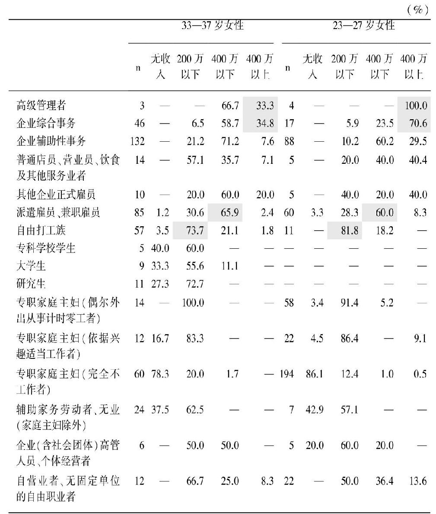

## 研究生造就“上流”，自由打工族造就“下流”

根据“第一次女性阶层化调查”的结果，大学生、研究生的阶层意识显著高于其他人群（见表4-18），尤其是研究生毕业的女性，其阶层意识为“上流”的占25%，而“下流”的仅有18.8%。

表4-18　各种不同职业女性的阶层意识（18—37岁）

资料出处：Culture Studies研究所、读卖广告社共同实施的“第一次女性阶层化调查”

在笔者这个年龄段的人眼中，说到研究生，给人的感觉就是囊中空空、靠做编外助教挣点生活费，成天疲倦不堪，而近年来的研究生特别是女研究生，却仿佛成了富裕家庭小姐闺秀们乐此不疲的一种兴趣爱好，似乎三十年前唯私立教会女校不读的上流阶层家庭的女性，如今都一窝蜂地进入研究生院去深造了。

从阶层意识多“上流”而少“下流”这个意义上讲，企业中的综合事务职位也与此相似，而这也完全是在预料中的。另一方面，自营业者、无固定单位的自由职业者、从事辅助家务劳动者、无业者（专职家庭主妇除外）、家庭主妇（偶尔做些计时零工）、派遣雇员、兼职雇员等女性中却有多达50%以上的人阶层意识为“下流”，尤其是无固定单位的自由职业者中这一比例更是高达66.3%。

这一结果与“欲求调查”的结果有所出入，考虑到样本数的多寡等因素，这个结果似乎应该更加接近现实。

从女性从事的不同职种的收入状况来分析，担任高级管理者、综合事务职务的女性，在23—27岁时年收入超过400万日元的有33%~35%，至33—37岁时，担任高级管理者的女性100%年收入超过了400万日元，担任综合事务职务的女性也有70.6%年收入超过了400万日元（见表4-19）。可见，以上职种的女性随着年龄增长其收入也实实在在有所增加。

表4-19　从事不同职种的女性个人收入状况

资料出处：Culture Studies研究所、读卖广告社共同实施的“第一次女性阶层化调查”

与此相对的是，23—27岁的自由打工族年收入在200万日元以下的人数众多，比例达73.7%，33—37岁时不满200万日元的人数比例更是增加至81.8%。

派遣雇员在23—27岁时有65.9%的人年收入在200万—400万日元之间，至33—37岁时这一比例略降至60.0%，年龄增长了十岁，但是收入却几乎毫无增加。这也很容易理解，因为她们一直作为派遣雇员或是自由打工族从事着各色各样的工作，其收入是很难提高的。
