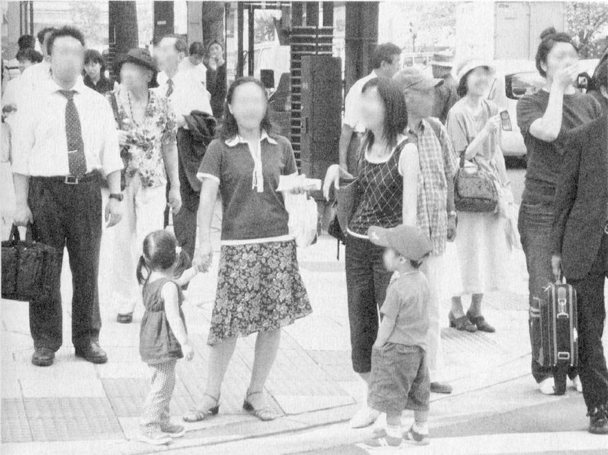

## 家庭形态多样化了幸福却未必多样化

通过如上从婚姻状况、家庭形态、职业等多个角度来考察人的阶层意识，我们可以大胆地得出一个结论：传统的理想化的结婚模式及家庭形态模式并没有弱化，更不能断言它已经过时。

的确，伴随着女性走出小家庭、踏上社会，积极参与到社会生活的方方面面中去，女性的生活方式变得更加多样化了，由此也带来了由夫妇二人所组成的核心小家庭的增多等家庭形态多样化，但是，家庭形态的多样化却未必同时带来幸福模式的多样化。

当然，这或许只不过是社会进入到一个过渡期时所产生的特殊问题。但是，至少目前的生活现状却明白无误地告诉人们：阶层意识最高、生活满意度最高的家庭是那些由高收入的丈夫与专职家庭主妇以及孩子所组成的物质上无忧无虑的家庭，其次是由夫妇二人组成的富裕的“丁克族”家庭。事实上，并没有出现有人曾经预计的那种所谓多样化的幸福模式，即无论未婚或是已婚，独身一人生活或是与父母生活在一起，当一名专职家庭主妇或是夫妇两人同时工作，而能够产生同等的阶层意识以及生活满意度。

还是专职家庭主妇最幸福？

花边外谈2：恋爱也会遇到阶层的壁障

恋爱结婚是“1955年体制”下的梦想

所谓恋爱结婚，可以说是在“1955年体制”下发展起来的婚姻形式。事实上，1955年日本的恋爱结婚率只有35%左右，而至1975年就猛增到了65%。

“1955年体制”是加速实现现代化的社会体制，在政治上推进民主，在经济上实行工业化。与之相适应，日本各地的都市化和大众消费社会化也日增月长，在就业方面，职业化、雇佣化也日渐成熟，众多的人由农民、自营手工业者变成了雇佣劳动者，家庭的形态则由几代同堂的大家庭逐渐演变为夫妇二人加孩子组成的核心小家庭，教育呈现高学历化，文化领域则是个人主义的不断进化……恋爱结婚便是植根于由“1955年体制”带来的这一系列社会变化潮流中的。

说起来，没有民主化也不可能有恋爱结婚，一个缺少个人自由的社会是很难产生出恋爱结婚这种婚姻形式的，因为存在着阶层以及个人身份差异的壁障，恋爱结婚势必会受到阻碍。从这个意义上讲，恋爱结婚是最适合中流化时代的一种婚姻形式。

记得上世纪70年代以前，出身阶层悬殊的青年男女为了爱情不惜私奔，以反抗家庭干涉，勇敢地去追求自己的幸福的电视连续剧曾经泛滥于荧屏，那是因为人们都坚信只有冲破阶层和门第的束缚，才是真正的恋爱结婚和浪漫的爱情。笔者就曾经访问过这样一位年轻人，其父母亲都是团块世代，母亲出身于著名政治家之家，却不肯按部就班地进入淑女名媛扎堆的私立女子大学，而是不顾一切选择了早稻田大学，并与出身“下只角”的父亲相识并结婚（参见三浦展著《失去工作就是迷失自我》）。

晚婚化的理由在于阶层化

但是，像这样的自由恋爱在上世纪70年代达到了其辉煌的巅峰，80年代以后，日本社会逐渐呈现阶层分化，于是自由恋爱结婚重新变得困难起来。

80年代以后晚婚盛行，这其中的理由除了女性日渐进入到社会生活中之外，还有各种各样的原因。但最最主要的原因却是，自80年代开始日本社会的阶层分化导致自由恋爱结婚变得困难重重，而这一点除了小仓千加子和山田昌弘等人之外，似乎谁也不愿意承认。

事实上，结婚是最能够连结相同阶层的人的行为，什么个人权利啦、恋爱自由啦，等等，不同阶层的人之间邂逅的机会本来就很少，即使邂逅，一般也较难发展成为恋爱和结婚的对象。一流大型企业的白领精英是不会娶一个在娱乐场所工作的女孩为妻的，身价数千万的富婆也不可能看上替自己公司打扫办公室的小伙子，因为两人之间的职业、收入、学历、品位等，各方面完全都不在同一个档次。阶层不同连交流都会很困难。即使对方是再优秀的人，但一旦到了结婚的关节，种种现实的问题都会摆到面前来，不由人不细加考虑。筑波大学的白波濑佐和子副教授在其所著《高龄少子化社会中看不见的社会差距》一书中曾指出，90年代后期人们的结婚行为背后，确实存在着学历、出身阶层、个人收入差距等阶层性因素的影响。

宫台真司先生为何结婚？

这里且举一桩真实的事情为例。专门鼓吹、宣扬女子高中生从事不道德的援助交际活动的社会学家宫台真司先生，不知道是不是因为厌倦了同“拖油瓶”女记者的同居生活，突然心血来潮与东京大学某名誉教授的女儿、毕业于日本女子大学的纯情女子“四目相对，一阵激颤袭遍全身”，产生了爱情。如今的时代，纯情女子简直像活化石一般珍稀，况且对方比他小了足足20岁。据说女方的父亲曾经给他一声当头棒喝：“我们是基督教家庭，一旦结婚就绝不可以离婚的！”但尽管如此，这位宫台真司先生还是与那位女子携手步入了婚姻殿堂（见《新潮周刊》2005年3月17日报道）。

宫台真司先生为何会感觉到“一阵激颤袭遍全身”？难道不是因为那位女子和他同属一个阶层的缘故吗？一个家族都是东京大学毕业生，祖父不仅是东京大学教授、著名的生物学家，还曾担任过昭和天皇御前侍讲。这样一位出身望族世家的女性与他正好门当户对，因此宫台真司先生才会对她产生倾慕之情，难道不是这样吗？尽管宫台真司先生本人热衷于抨击现存体制、主张将卖春合法化，但是一旦涉及到自身的婚姻大事，他仍然无法去打破阶层的壁障。这就是一个恋爱结婚受制约于阶层的再有力不过的证据。

假如上野千鹤子女士嫁给一个英俊潇洒的医生，安安分分当一名专职家庭主妇，一定会遭到世间的嘲笑。然而，竭力鼓吹少女援助交际的宫台真司先生的结婚尽管同样如此保守，却没有人发出任何异议，究竟是为什么？其实无他，还是那句话：在阶层化的时代恋爱结婚势必遭遇阶层这一无法轻易逾越的壁障。

本书由“[ePUBw.COM](http://epubw.com)”整理，[ePUBw.COM](http://epubw.com) 提供最新最全的优质电子书下载！！！
