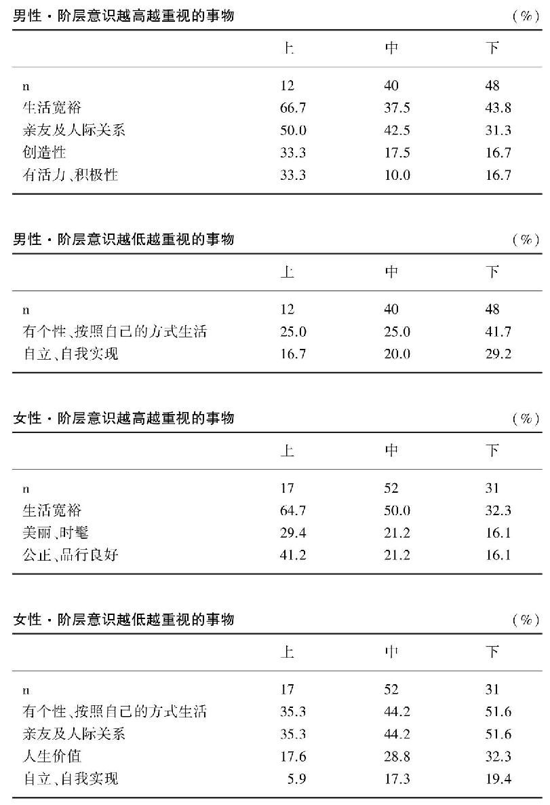

## 越是“下流阶层”越追求自己的个性

根据“欲求调查”的结果，在团块次代的男性当中，举出“生活中所重视的事”是“有个性”的，在阶层意识为“上流”的人群中占25%，在“下流”人群中则占到41.7%。同样，认为“生活中所重视的事”是“自立、自我实现”的，在阶层意识为“上流”的人群中占16.7%，而在“下流”人群中则占29.2%。

团块次代的女性当中，尽管上流阶层希望“有个性”的占到了35.3%，但下流阶层中有此愿望的人数比例更是高达51.6%；有“自立、自我实现”愿望的，上流阶层仅占5.9%，而下流阶层则占19.4%（见表5-1）。

为什么会这样呢？追求“有个性”和“自我实现”的人，在职场上也是按自己的方式我行我素。但正因为如此，想要得到高收入是困难的，所以他们往往成为低收入者，生活水平也较为低下。据推测，这样的恶性循环将会继续下去。

表5-1　不同阶层意识的团块次代人群最重视的事物（主要选项）

资料出处：Culture Studies研究所、e-FALCON共同实施的“欲求调查”
