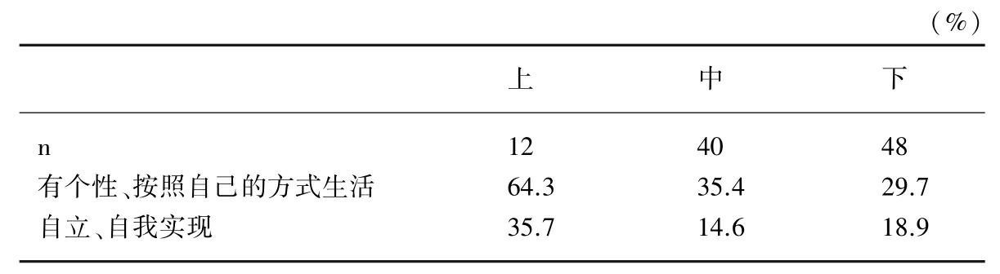

## 团块世代与团块次代的差异

然而，团块世代和团块次代呈现的倾向却相反，特别是阶层意识为“上流”的团块世代男性，其追求个性以及自我实现的愿望非常强烈。“有个性、按照自己的方式生活”的愿望，在阶层意识为“下流”的人群中只占29.7%，但在“上流”人群中却占到了64.3%。有“自立、自我实现”愿望的人在“下流”阶层意识人群中占18.9%，但在“上流”阶层意识人群中却达35.7%之多（见表5-2）。

表5-2　不同阶层意识的团块世代男性最重视的事物

资料出处：Culture Studies研究所、e-FALCON共同实施的“欲求调查”

这是什么原因造成的呢？

团块世代在其年轻的时候，追求“按照自己的方式生活”的愿望也是下流阶层比上流阶层来得强烈，但后来有“按照自己的方式生活”愿望的人渐次因事业成功故而自我意识跻身“上流”。相反，“按照自己的方式生活”愿望薄弱的人，则过着平凡的上班族生活，最终在经济不景气的大环境中被裁员而成为下流阶层。这样的解释或许是比较符合现实情况的。

不过，另外还有一种非常自然的解释，那就是团块世代的上流阶层从年轻时就不断抒发“最好做自己喜欢的事情”的胸襟，并在过去三十年中逐渐形成为一种社会风潮。随着社会富裕程度的逐渐提高，这股风潮也同步渗透到了年轻世代的下流阶层中。

但是，如果仅此而已的话，那么团块次代中的上流阶层其追求“有个性”“自我实现”的愿望应该是最强烈的，完全没有理由如此之低。

这样看来，“上流”价值观向年轻世代渗透的结果，使得原本就只想做自己喜欢的事情，而不愿意做自己不喜欢的事情的年轻人愈加“下流化”，助长了年轻人中低收入人群的不断增多，使其“下流”的比例有增无减。

用具有象征性的话来表述，那就是年轻人读了村上龙的《13岁的Hello Work》，就信以为真地觉得确实应该去发现自己真正喜欢的事情，然后以此作为自己的终身工作，于是开始寻找自我，结果始终不愿进入企业正规就业，即使到了30岁依旧满足于自由打工族的低收入生活，故此造成低收入阶层逐渐固定化的危险性日益增加。
