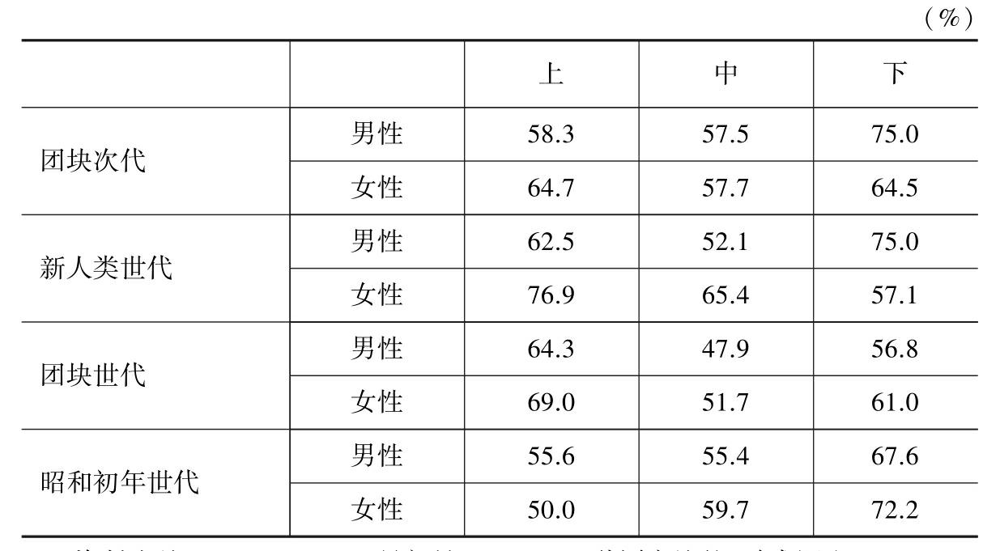

## “以自己的方式自由生活”是一道人生咒语

当被问及“关于你对人生的看法，下列选项中哪一项最接近”时，团块次代男性中选择“以自己的方式自由生活”的，阶层意识为“上流”的占58.3%，“中流”占57.5%，“下流”则占到了75%（见表5-3）。同样地，新人类世代、昭和初年世代中选择此项的也是“下流”居多。与此相反的情况则出现在团块世代男性中，他们的情况是：阶层意识为“上流”的占64.3%，“中流”占47.9%，“下流”占56.8%，阶层意识越往“上流”选择这一选项的人越多。

表5-3　各世代不同阶层意识的人群中选择“以自己的方式自由生活”作为自己人生观的人数比例

资料出处：Culture Studies研究所、e-FALCON共同实施的“欲求调查”

在女性方面，团块次代的女性没有因为阶层意识的差异而产生选择差异，昭和初年世代选择此项的以下流阶层居多，而在新人类世代和团块世代中则是阶层越往“上流”选择的人数越多。

总而言之，团块世代不论男女，都是阶层越往“上流”，支持所谓“以自己的方式自由生活”这一人生观的人数就越多。
