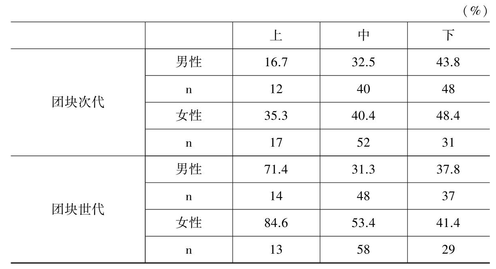

## “尊重个性的家庭”也是下流阶层居多

颇为耐人寻味的是，在回答何为理想的家庭的时候，选择“尊重个性的家庭”“各自独立的家庭”的人数，在团块世代中不论男女，都是上流阶层中所占比例较高（见表5-4）。

表5-4　不同阶层意识人群选择“尊重个性”为理想家庭者的比例

资料出处：Culture Studies研究所、e-FALCON共同实施的“欲求调查”

然而，在团块次代当中，认为这样的家庭才是理想家庭的人却是“下流”者居多。看来，所谓像朋友一般的亲子关系，已经作为一种生活样式，从团块世代的上流阶层蔓延到团块次代的下流阶层了。

的确，所谓“有个性”或“我行我素”这样的说法，是在团块世代的青年期开始出现的，此后逐渐扩大到整个社会。例如，1967年开始销售的面向团块世代男性的资生堂化妆品“MG5”，将男性的个性表现作为广告的诉求重点，1970年左右日产汽车公司“蓝鸟”轿车的广告语则是“优秀的个性集团”。除此之外，在笔者的印象当中，上世纪70年代的广告里经常使用像“个性”这样的词汇。

总之，作为消费社会主力军的团块世代，在上世纪60年代以后可以说是把“有个性”当成了一件好事，特别是那些左右社会舆论的阶层，几乎把追求个性的志向当成咒语一般拼命念个不停。

在过去三十年中，日本社会逐渐发展成为以团块世代为中心的社会，重视个性与自我主张的思想也随之渐渐蔓延，社会也更加富庶了，在此过程中，日本社会终于成为这样一个社会：即使是下流阶层的年轻人，也开始拼命注重起个性和所谓的“自我主张”来。
