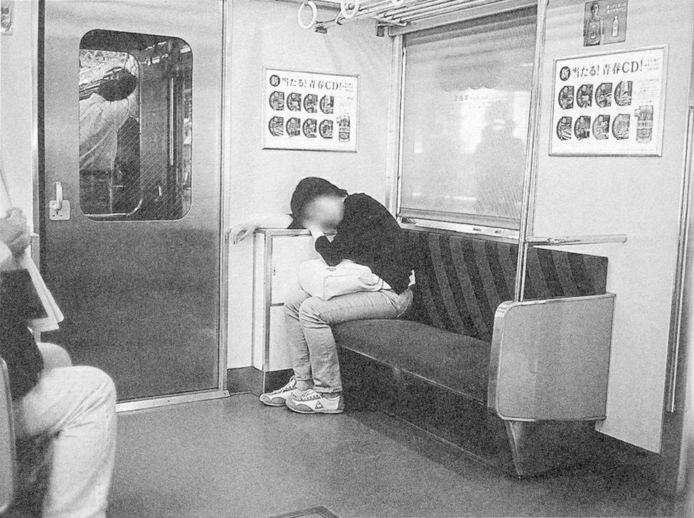

## 越是低阶层的年轻人自我感觉越强

不过，自我主张泛滥整个社会却造成了一个逆反现象：年轻一代越是“下流”阶层其追求个性的志向越强烈，而越是“上流”阶层其追求个性的愿望反而显得薄弱，这种状况实在有点难以理解。

但是，这样的状况一般被认为与教育社会学家、东京大学研究生院教授苅谷刚彦的观点是遥相呼应的，他指出父母阶层较低的高中生往往有较多的人自认为在学习之外能力较强。

根据苅谷教授的说法，在1979年实施的调查当中，回答“自己有优于他人的地方”（也就是有自我能力感）的高中生，父母学历越高人数越多。但是在1997年的调查中，同样的问题却没有显示出父母学历高低的影响，不论父母的学历是高还是低，高中生都认为自己有优于他人之处。

单就这一点来看，似乎是一件好事。

但是，根据苅谷教授的调查，在1979年越有自我能力感的学生，在课外所花的学习时间越长。相比之下，至1997年，有自我能力感和校外学习时间长短的相关性已经逐渐消失，不仅如此，有自我能力感的学生，甚至还有缩短课外学习时间的倾向。

此外在1979年，越是有自我能力感的学生，越是追求更高的学历。但是在1997年，有自我能力感的学生已经变得不那么追求高学历了。

在老弱病残专座上睡觉的年轻人

除此之外，从出身阶层较低的学生身上可以看出这样一种特有的倾向，即有着强烈的“现在志向”，也就是觉得“与其考虑将来的事情，不如快快乐乐过好现在的生活”的人，其自我能力感也较强。同时，对所谓的“成功神话”持否定态度，也就是觉得“即使努力学习，然后进入好学校或好公司，将来生活也不会有多大差异”的人，其自我能力感往往也较强。

总之，出身阶层越低的高中生，在学校、学习以外的地方，越是感觉自我优越。如果我们换个角度，将自我能力感理解成一种自我主张或自我实现，或许正好可以说明：所处阶层越是“下流”的人，其追求个性、追求自我主张的志向就越强烈。
