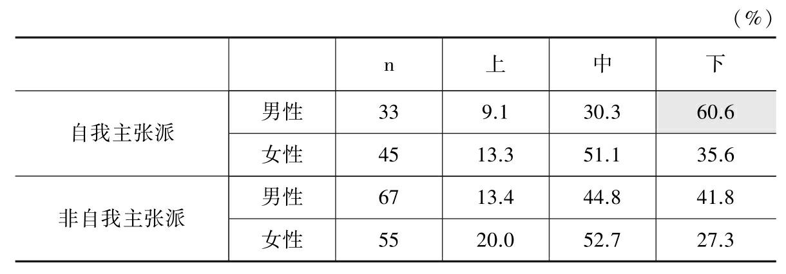
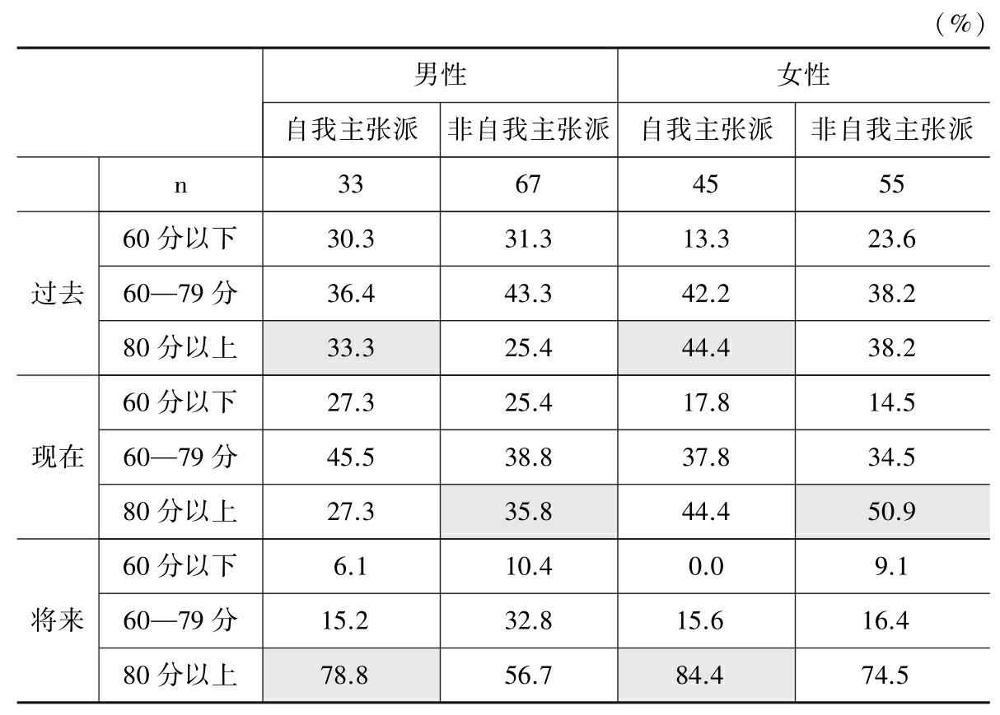

## 自我主张派的阶层意识和生活满意度双双低下

自我主张志向强烈并不意味着一定能够实现自我主张。虽然以追求自我主张为志向，却无法真正实现愿望的人，不仅对生活的满意度无法提高，而且低收入也使得他们的阶层意识日渐低下。

事实上，回答在生活当中重视自我主张的人（自我主张派）和没有作出如此回答的人（非自我主张派），如果比较两者的阶层意识，则自我主张派的人“下流”者居多（见表5-5）。此外，如果给生活满意度打分的话，自我主张派的人也很少有80分以上的（见表5-6）。

表5-5　团块次代中自我主张派与非自我主张派的阶层意识

资料出处：Culture Studies研究所，e-FALCON共同实施的“欲求调查”

表5-6　团块次代中不同自我主张志向人群的生活满意度（过去、现在、将来）

资料出处：Culture Studies研究所，e-FALCON共同实施的“欲求调查”

以追求自我主张为志向原本是一件好事，但如果过度地追求自我主张，会使得自己的阶层意识和生活满意度双双下降。

然而非常有趣的是，如果注意一下团块次代不同自我主张人群对于过去和将来的生活满意度，结果恰好相反。自我主张派的年轻人不论男女，很多都打80分以上。也就是说，在年轻的时候，靠自我主张来生活可以感到满足，可一旦过了30岁就不是那么回事了。不过他们一般都期望将来的生活满意度或许会再度提升。

这种期望会成为现实吗？还是就像梦一般地结束？这对于整个社会来说，是一个不容小觑的问题。
