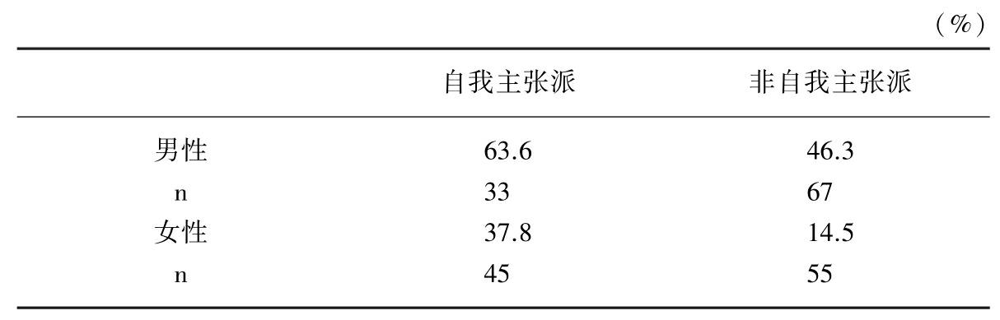
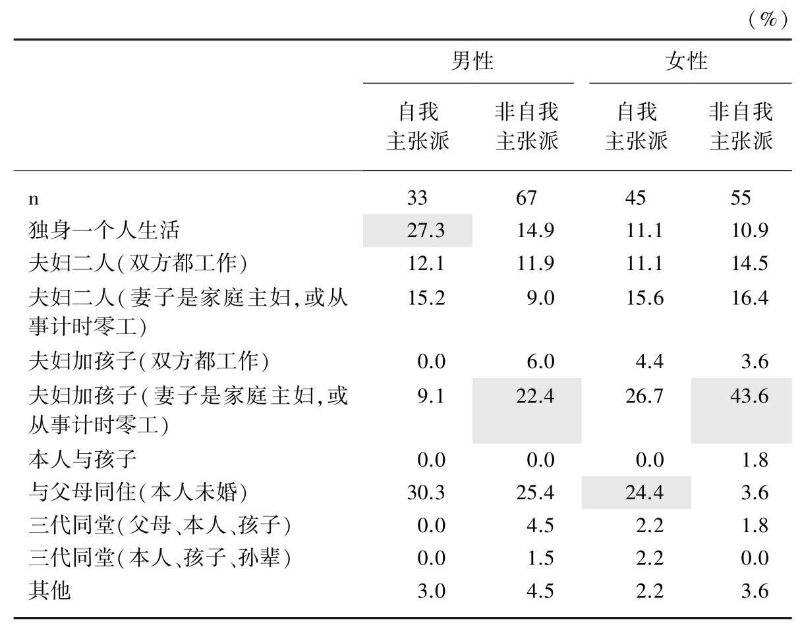
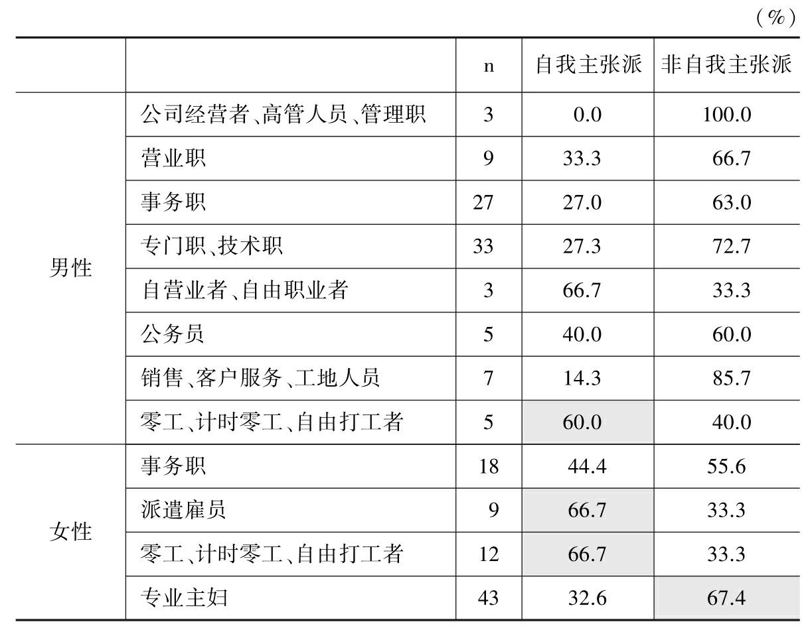

## 自我主张派大多未婚、无小孩、非正规就业

再从未婚率来看，男性方面自我主张派的未婚率为63.6%，非自我主张派的则为46.3%，前者明显高出一段。女性方面则是自我主张派的未婚率为37.8%，非自我主张派的仅为14.5%。显而易见，自我主张派的人不结婚者更多（见表5-7）。

表5-7　团块次代中不同自我主张志向人群的未婚率

资料出处：Culture Studies研究所，e-FALCON共同实施的“欲求调查”

从家庭形态来看，自我主张派的男性大多独身一个人生活，或者与父母住在一起，由夫妇二人组成的家庭（妻子是专职家庭主妇或兼职做计时零工）也比较多，但是夫妇二人加孩子组成的家庭很少（见表5-8）。

自我主张派的女性当中，也是与父母住在一起的居多，夫妇二人加孩子所组成的家庭较少。

表5-8　团块次代中不同自我主张志向人群的家庭形态

资料出处：Culture Studies研究所，e-FALCON共同实施的“欲求调查”

从以上结果可以看出，因为自我主张显得如此重要，所以这一类型人群偏好一个人生活、与父母同住，或是只有夫妇二人的生活。也就是说，自我主张派的人一般无法接受像结婚生子这样普普通通的人生。

再者，从职业的角度来看，自我主张派的男性大多为自由打工者，而自我主张派的女性则以做零工、计时零工、派遣雇员和自由打工者居多，在家当专职家庭主妇的较少（见表5-9）。

表5-9　不同职业团块次代人群的自我主张志向（主要选项）

资料出处：Culture Studies研究所，e-FALCON共同实施的“欲求调查”

从上表中可以清楚地看出，重视个性和自我主张的“自我主张派”，未婚、无小孩、非正规就业的人数比例明显多于“非自我主张派”。因而也可以说，过度追求自我主张是造成晚婚化、少子化的原因之一。

这样说或许对于自我主张派的人是个打击。当然，还有其他经济层面的因素，也就是所谓因雇佣环境恶化和产业结构变化，而造成非正式就业的人数增多，从而使得低收入人群大为增加，进而产生未婚者激增和少子化等问题。

但是，如果在经济层面的因素上再加入“追求自我主张”这个价值观因素，那么不可否认的是，这将进一步加剧未婚率上升、少子化等现象，给这一业已全社会化了的问题雪上加霜。

如同一部分人所说的，自由打工族等非正式就业的人群，在某种程度上是为了能以自己喜欢的方式来工作而选择了这条路，但这个选择恰恰也是使收入下降，结婚机会减少，进而使生活满意度下降的原因。

今后该如何来看待所谓的“自我主张”——这个在过去三十多年间已经成为社会主流价值观、宛如“青鸟”般的观念呢？又该如何应对已经被“青鸟”所俘虏的继团块次代之后的年轻人？这是我们目前所面临的一大问题。
