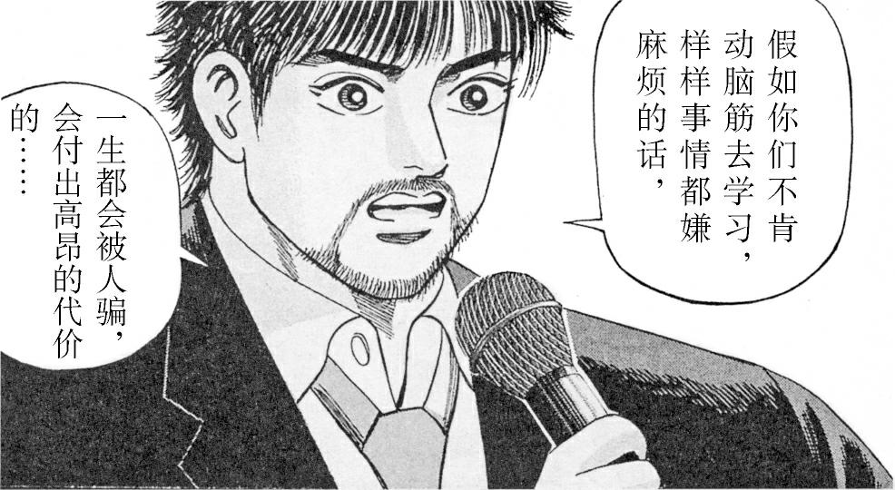
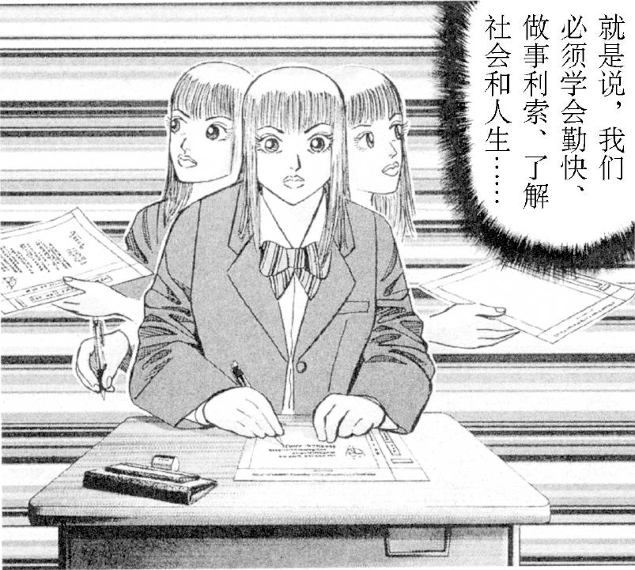

## 过于追求自我主张带来的问题

如同到目前为止所看到的，现在的年轻人中阶层意识低下的人群，自我主张志向却十分强烈。此外，他们往往喜欢一个人独处，关于这种现象我们还将在下一章详加论述。

相对而言，拘泥于自我主张、性格内向的人往往朋友不多，找工作也不太顺利，容易沦为非正规就业者，因而一般收入较少，阶层意识也变得低下。

事实上，“第一次女性阶层化调查”的结果显示，正式雇员和包括自由打工族在内的非正式雇员，其价值观大不相同。例如，选择“想快快活活过好每一天”“想过不受他人或社会干扰的生活”“喜欢有创造性的生活方式”“向往有趣的人生”等自我主张选项的人，很明显是非正式雇员居多。另一方面，非正式雇员中很少有人选择“想要有目标、有理想地生活”。

此外，作为能表现自我主张的词语，正式雇员大多列举“勤快”“品行良好”“举止高雅”“外向、善于社交”等，而非正式雇员列举的则是“喜欢一个人独处”“神定气闲”“执著”等，却很少有人列举像“开朗”“勤快”这样的词语。

在阶层意识方面，正式雇员当中属于“上流”的占11.1%，“中流”占44.8%，“下流”占44%。相反，非正式雇员则是“上流”占5.5%，“中流”占33.3%，“下流”占61.2%。可以明显地看出，非正式雇员的阶层意识普遍较低。

精神科医生斋藤环是专门研究“自我封闭”问题的权威，他很早就指出：沟通能力的高低，对于年轻人的成功与失败意识有着很深远的影响。沟通能力强的人，比较容易找到工作，比较容易获得高收入，也更容易拥有美好的婚姻，其结果就是进入较高阶层的可能性相对来说比较大。相反的，过于拘泥于自我主张、逃避与他人沟通、拒绝适应社会的年轻人，最终沦为低阶层的可能性更高。

花边外谈3　“龙樱疗法”能够阻止“下流化”？

由于现今社会正处于阶层化、两极分化、下流化的潮流中，故此描写逆流而上、强调积极进取的题材的作品就格外令人感觉充满了新鲜感。被改编成电视剧的热门漫画《龙樱》就是一个极好的例子。

《龙樱》的大致内容是：律师樱木建二为了让经营不善的三流私立高中重整旗鼓，一心想要将这所高中变成具有超级升学率的高中。他首先选拔出有学习积极性的男女学生各一名，以考入东京大学为目标，对他们“开小灶”进行特别授课，两人果然不负所望，学习成绩日渐提高……

除了这种特别授课方式受到数位现任东京大学教授以及堀江贵文、《想读出声的日语》的作者·明治大学教授斋藤孝、杉并区立和田中学校长藤原和博等人的交口称誉外，漫画主人公樱木所发表的关于人生的训诫，可说更是向当今混乱不堪的教育体制乃至整个社会的陈腐价值观发出了挑战，令人颇有振聋发聩之感。

例如，作者通过樱木之口说出如下的话语：

“所谓的社会规则，全部是由那些头脑聪明的家伙为了保护自己而制定的，而对自己不利的地方都被他们遮遮掩掩地糊弄过去了。也就是说，假如你们不肯动脑筋去学习，样样事情都嫌麻烦的话，一生都会被人骗。你们如果不想被骗，不想失去自己的利益，成为社会的失败者，就得好好读书。”

“你们对社会一无所知，与其说是一无所知，还不如说是大人根本没有教过你们。相反，他们向你们灌输的都是毫无根据、不负责任的妄想。假如你们信以为真地认为只要发挥自己的个性，就可以过上和别人不一样的生活，那就大错特错了！只有考进东大，才能从毫无梦想的黑暗中逃脱出来。”

“没有了你们所谓的‘世俗框架’你们还能做什么呢？如果觉得真的可以白纸绘蓝图、完全靠自己独创闯出一片天地来，那就大错特错了！说什么不要用世俗的框架来束缚，这只不过是你们这些胸无大志的懒惰虫的借口而已！”

“你们以为没有必要非得争第一（Number One），只要证明自己是唯一的（Only One）就行了吗？别开玩笑了。所谓的Only One就是那个领域的Number One。”

上流阶层的孩子所接受的教育，从一开始就与下流阶层不同。生活态度、谈吐、学习方法等各种因素相互作用，才将他们塑造成了上流的样子。但是，“中流”和“下流”的年轻人在学校或家庭当中，每个人都接受着平等无二的教育。他们经过初中、高中、大学，进而走上社会参加工作，才逐渐认识到原来这个社会是士分三流、人分九等的，经过各种各样的磨砺和打击，弄不好就会渐渐跟社会脱节。

《龙樱》最成功之处在于主张将社会上的种种不平等，借助所谓的“自由”“个性”“唯一”等充斥着大人们欺瞒的措辞而将它揭露出来，告诉孩子什么是社会的现实，并且正因为存在这样的现实所以更不应该放弃努力。此外，《龙樱》的作者三田纪房还主张能否被录取进入东京大学，不应该取决于先天能力的差别，更为重要的是考察其最最基本的生活态度，像见面打招呼、进屋后将脱掉的鞋子摆放整齐等天经地义的细小事情，以及能否思路清晰地独立解决问题的能力。从这一点上说，《龙樱》堪称是向社会下流化重拳出击的一部杰作。

顺便说一下，因“百格计算”而闻名的阴山英男，并不是只靠“百格计算”来提升学习能力的。在他的教育实践中起决定因素的到底是什么呢？说起来令人难以置信，那就是从小养成“早睡、早起、吃早餐”的习惯。如果不从这样的生活基础进行教育的话，已经“下流化”的现代的父母们可能会在晚上10点以后，还带着孩子上小酒馆屋、唱卡拉OK，这样一来即使对教育抓得再严，孩子的学习能力下降也是理所当然的。

本书由“[ePUBw.COM](http://epubw.com)”整理，[ePUBw.COM](http://epubw.com) 提供最新最全的优质电子书下载！！！
