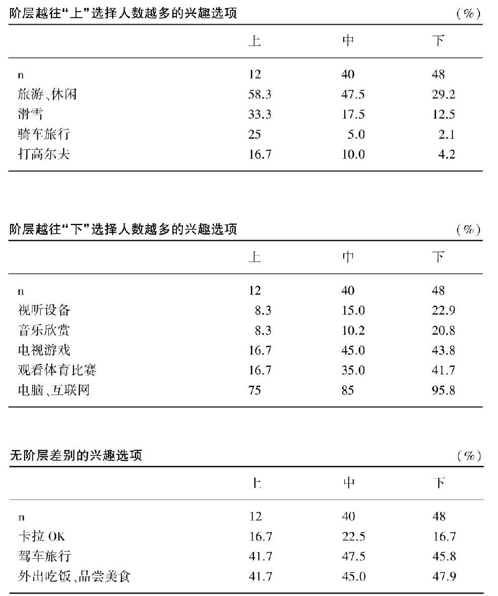

## “下流”男性的三种神器：3P

这一章所要探讨的是团块次代中不同阶层意识人群的兴趣和消费倾向。

首先，针对“你的兴趣爱好是什么”这个问题，根据被调查者从多个备选答案中做出的选项，分别对不同阶层意识人群的男女进行一番比较。

在“上流”男性当中，选择电脑、互联网的占75%，选择旅行、休闲和音乐欣赏的各占58.3%，选择阅读和在家看碟片的也各占41.7%。

“中流”男性中选择最多的是电脑及互联网，占被调查人数的85%，选择在家看碟片的占57.5%，选择阅读的占55%，另有47.5%的人则分别选择了旅游、休闲和驾车旅行。

而“下流”男性选择电脑、互联网的比例竟高达95.8%，选择音乐欣赏和阅读的分别为60.4%和56.3%，选择外出吃饭·品尝美食的占47.9%，此外还有45.8%的人选择了驾车旅行、旅游。

从以上的统计数据不难看出，无论哪一个阶层，选择电脑、互联网的人所占比例都是最高的。

然而从不同阶层的差异来看，阶层越往“上”的人，对户外活动的兴趣越大，比如旅游、休闲、滑雪、骑车旅行等，还有少数人喜欢打高尔夫球（见表6-1）。

表6-1　团块次代不同阶层意识男性的兴趣差别（主要选项）

资料出处：Culture Studies研究所、e-FALCON共同实施“欲求调查”

另一方面，大部分属于下流阶层的人明显偏爱电脑、互联网、视听设备以及电视游戏等，不喜欢与别人接触，而稍显内向、自我封闭的倾向十分明显。即便偶尔外出，一般也是去听音乐会或观看体育比赛，想必是那种摇滚一类的音乐会或是职业足球联赛。

在早些时候，电脑曾是区分阶层的一种标志物，只有富人才拥有电脑，没钱的人根本买不起电脑，因此收入成为一个人是否使用电脑的关键，并进而产生信息、情报量的差距。但现在，只要付点上网费，通过电脑什么信息都可以轻易获得，电脑已经成为最廉价的娱乐方式，因而深得低阶层男性的青睐。

当然，“下流”男性或许不会使用Excel制作图表，也不会使用Powerpoint制作电子贺卡。尽管眼下是否拥有电脑硬件设备已经不再是区分阶层的标志物了，但毫无疑问，在能否自如地运用各种软件方面，还是可以在一定程度上区分阶层高下的。

无论如何，在拥有电脑且能够从中获得乐趣这一点上，不存在阶层的差别，而阶层越往“下”，对电脑、互联网感兴趣的人越多，这也是不争的事实。

根据这种情况，笔者想以“3P”来作为解读团块次代下流阶层的关键词。所谓“3P”，即个人电脑（Personal Computer）、手机（Pager）和掌上游戏机（Play Station），这三样东西称得上是团块次代下流阶层的神器。也可以再加上两个“P”：瓶装饮料（PET Bottle）和薯片（Potato Chips），凑成“5P”也蛮不错。

坐在电脑前，喝着塑料瓶装的饮料，一边吃着薯片，一边上上网打打游戏，或是用手机发发短信，团块次代下流阶层的模样立刻生动地浮现在了我们眼前。
