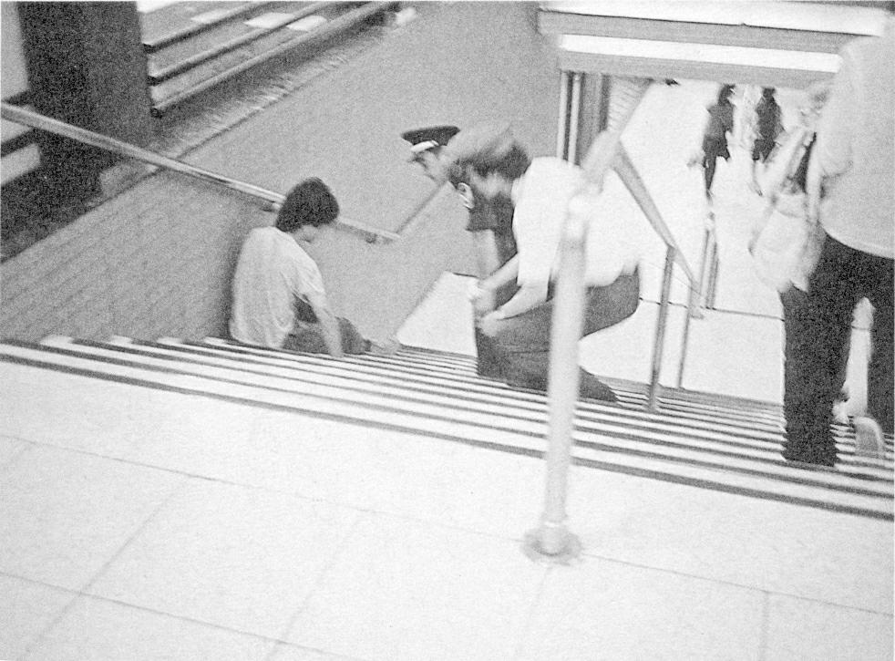

## “嘉年华会式”的现代社会

社会学家铃木谦介在谈到今后日本社会产生的两极分化时指出，大众一方面沉浸于因瞬间的激动而产生的内在幸福状态（“嘉年华会式”的狂欢），另一方面在客观上又存在着“被榨取、最后被抛弃”的危险性，将又唱又跳当成展现自我来享受的下流阶层，可以说正是这种“嘉年华会式”社会的象征（参见铃木谦介著《“嘉年华会式”的社会》）。

不过笔者并不赞同铃木先生这种不成熟的二元论。

笔者认为，不能说“内在的幸福”和“客观上被榨取”的说法是错的，但即便如此，我们也不能不承认它总比内在和客观上都不幸的状态要稍好一筹。我们当然可以说，只要存在客观上被榨取、被抛弃的事实，就不可能得到真正的内在幸福，人们首先应该对个人被社会榨取这一事实有所觉悟，等等。但是这种宗教教旨主义式的天真的说法，最终历史将证明其注定会不攻自破。

在现实生活中，即使被榨取的情况不太严重，但人们并没有意识到，或者即使不被榨取却并不对此满足，因而仍然有可能感受到内在的不幸。倘若这样的话，强调彻底消除客观存在的榨取真的会有意义吗？

倒坐在车站台阶上的年轻人

其实有很多人对客观上被榨取这一事实有所觉悟，但因为无可奈何，而造成了某种程度上的不幸。不过话说回来，像这种程度的不幸，借助瞬间的激动或是其他什么方法适当地排遣一下也不失一个办法，正好体现出人在生活面前的坚强性。

令人感到不安的是，正如铃木先生所指出的那样，就连这种瞬间的激动也被以媒体为中心的社会工具过度操纵着，而被包装成如世界杯足球大赛之类的娱乐活动。总之，内在不幸的人自己没有消除不幸的能力，只能依赖于各种大型娱乐活动，使自己越来越陷入被动状态。
