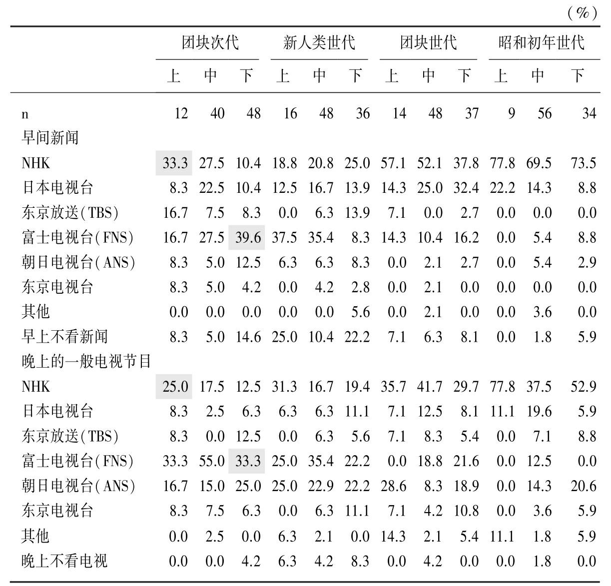
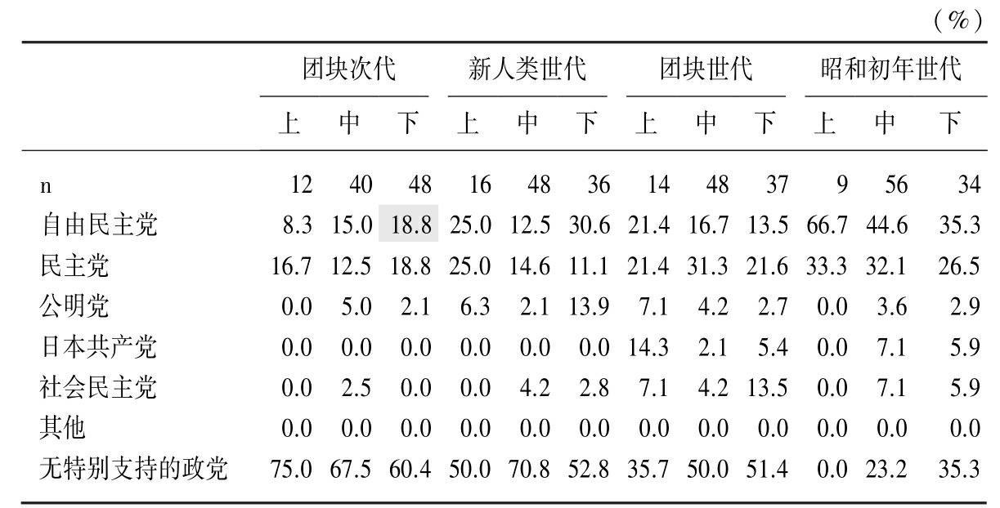

## “下流”阶层偏好自民党和富士电视台

实际上，从“欲求调查”可以看出，前面所提到的团块次代的男性，阶层越往“下”越喜欢看体育比赛，而且经常看富士电视台的节目。具体而言，在被问及“早晨收看哪个电视台的新闻”时，上流阶层中有33.3%的人回答说看NHK（日本广播协会），所占比例最高；相反，下流阶层中却有39.6%的人选择收看富士电视台（见表6-3）。

表6-3　不同世代男性经常收看的电视台

资料出处：Culture Studies研究所、e-FALCON共同实施的“欲求调查”

当被问及“晚上大多看哪个台的电视节目”时，上流阶层中有33.3%的人选择富士电视台，选择NHK的人占25%，但在中流阶层当中选择富士电视台的占到了55%，“下流”人群则占33%。

顺便提一下，昭和初年世代的人无论阶层意识如何、性别如何，大多数人早晨和晚上都看NHK。相比之下，由于团块次代中阶层意识不高的人群不看NHK的节目，所以该台收视率下降也是理所当然的。

接着来看支持的政党方面，在团块次代中阶层意识属于“下流”的男性支持自民党的占18.8%，支持民主党的也占18.8%，表明他们支持政党的倾向比较强烈。

相反，在上流阶层中支持自民党的占8.3%，支持民主党的占16.7%，不支持任何政党的则占75%，这一比例比中流阶层或下流阶层都要来得高（见表6-4）。

表6-4　不同世代男性所支持的政党

资料出处：Culture Studies研究所、e-FALCON共同实施的“欲求调查”

如上所述，从此次调查的结果可以看出，团块次代中的下流阶层男性，其政治意识较强，喜欢收看富士电视台的节目以及体育赛事。

在某种程度上，此现象或许正好反映了现代社会的情形，也正好跟香山里香所描绘的“小型国家主义”不谋而合。
