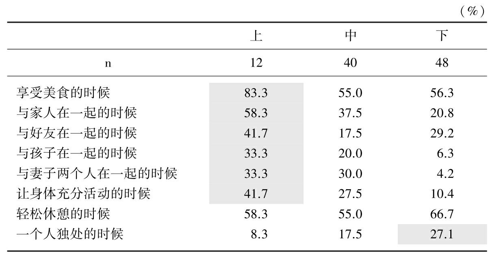
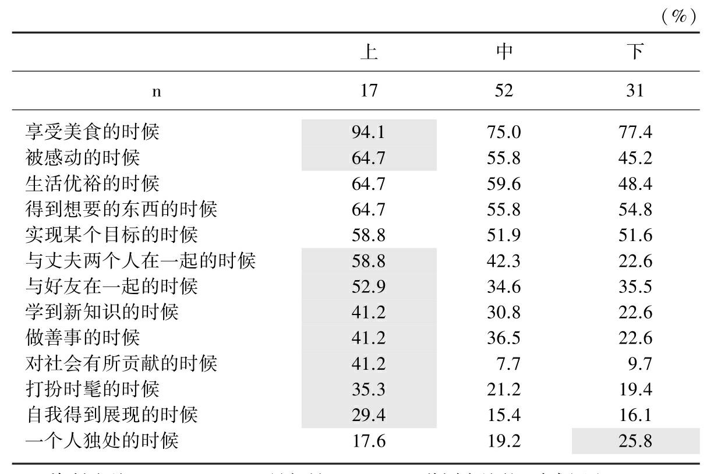

## 感到幸福的时刻

在被问及“你感到幸福的时刻”是什么时刻时，团块次代中阶层意识属于“上流”的男性大多选择享受美食的时候、全家在一起的时候以及与好友在一起的时候等；而“下流”人群则大多选择一个人独处的时候、轻松休憩的时候，选择让身体充分活动的人较少，由此可见不喜欢与别人接触正是这一人群的主要特征（见表6-5）。

再来看团块次代中上流阶层的女性，除了享受美食以外，学到新知识的时候、对社会有所贡献的时候以及自我得到展现的时候等，都能使她们感觉到幸福（见表6-6）。根据笔者的调查研究经验，这可以说是团块次代女性特有的倾向。

表6-5　不同阶层意识的团块次代男性感到幸福的时刻

资料出处：Culture Studies研究所、e-FALCON共同实施的“欲求调查”

表6-6　不同阶层意识的团块次代女性感到幸福的时刻

资料出处：Culture Studies研究所、e-FALCON共同实施的“欲求调查”

可以看出，团块次代中阶层意识属于“下流”的女性与男性一样，选择一个人独处的时候感觉最幸福的也为数不少。
