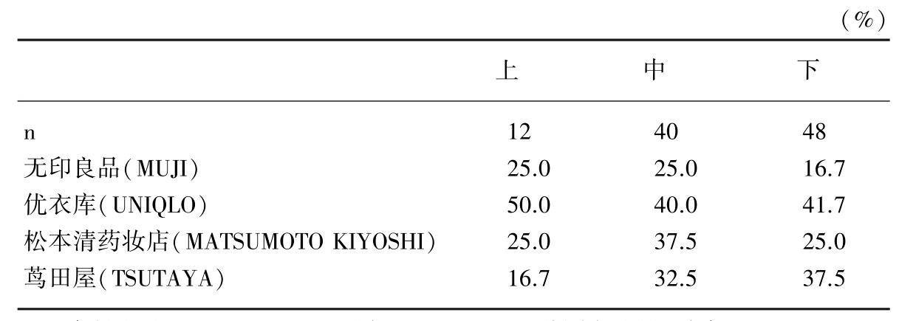
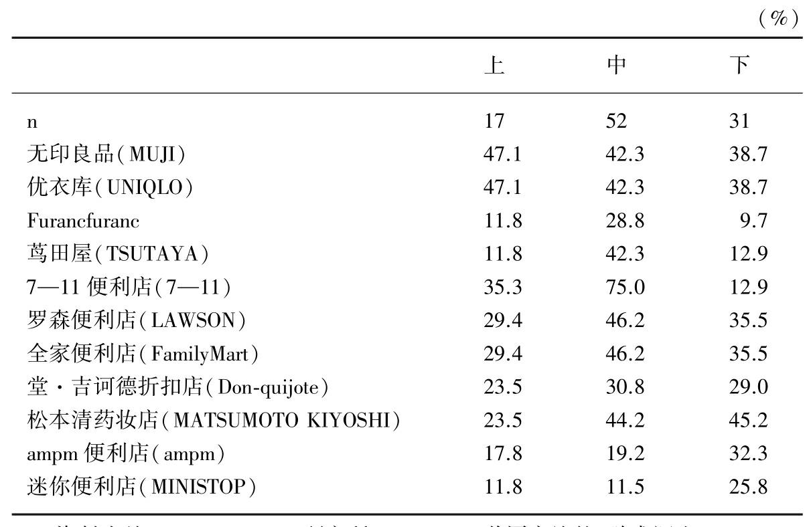

## 团块次代的上流阶层也喜欢廉价服饰

下面我们来看看团块次代不同阶层意识的人群对品牌服装店等商家的支持程度。

男性经常去购物的服装店就如饮食店一样，没有太大的阶层意识差别。虽然在统计学上没有显著的差别，但有意思的是，“上流”人群中选择“优衣库”的也不少，可见高收入的上流阶层也喜欢“优衣库”之类的廉价服装（见表6-7）。

表6-7　团块次代男性经常光顾的商店（主要选项）

资料出处：Culture Studies研究所、e-FALCON共同实施的“欲求调查”

相比之下，女性在这方面仍然有着阶层意识上的差异。不少上流阶层的女性首选的服装品牌也有“无印良品”（见表6-8）。诚然，无印良品并非高级时装，价格不高，品质也平平，但给人的整体感觉还不错。由此也可以一窥团块次代女性的消费倾向。

表6-8　团块次代女性经常光顾的商店（主要选项）

资料出处：Culture Studies研究所、e-FALCON共同实施的“欲求调查”

团块次代的女性特别是阶层意识处于“上流”的人群，正如我们在后面将要看到的，是一群理性又比较喜欢高级商品的女性。也许正因为如此，与那些有着花里胡哨的装饰性的时髦名牌相比，她们更喜欢“无印良品”那种自然而不矫揉造作的设计。
