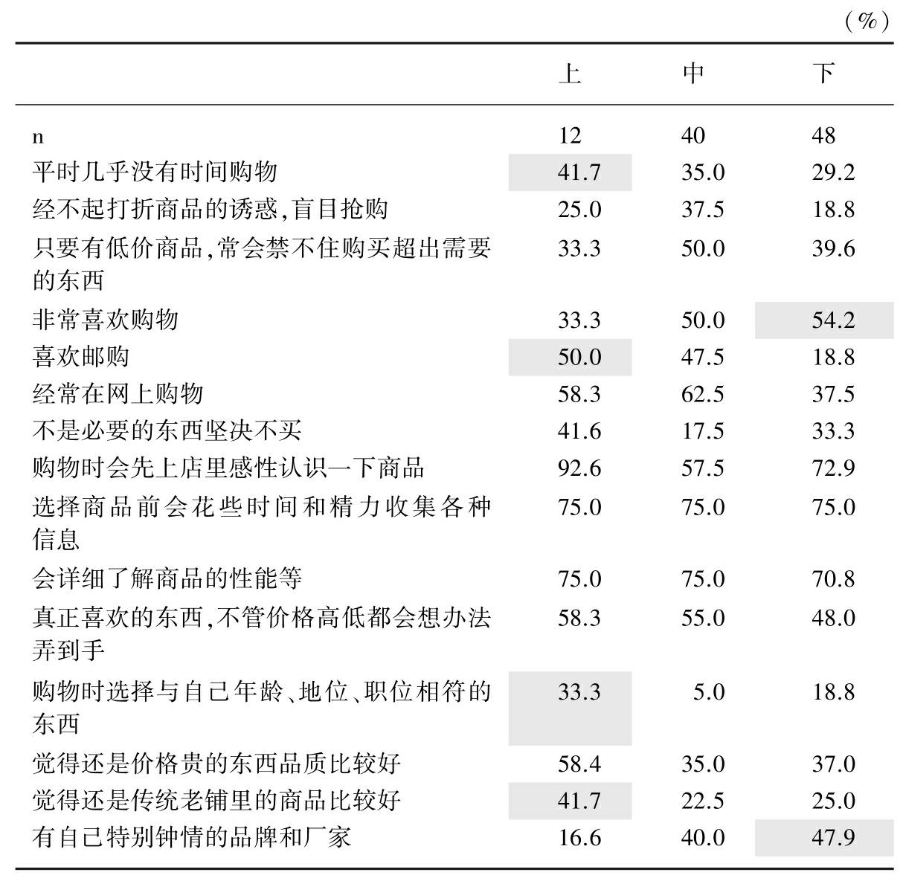
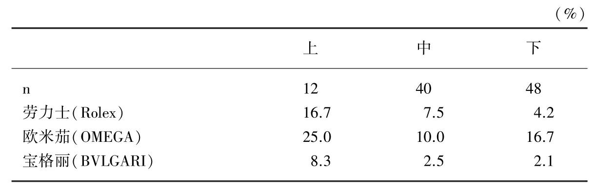
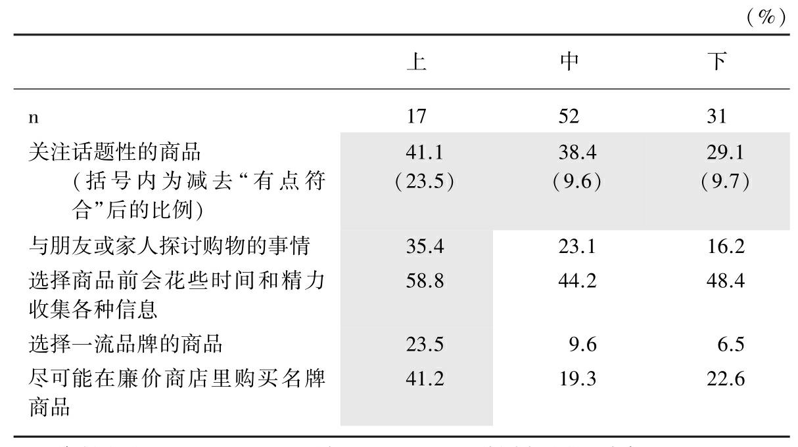
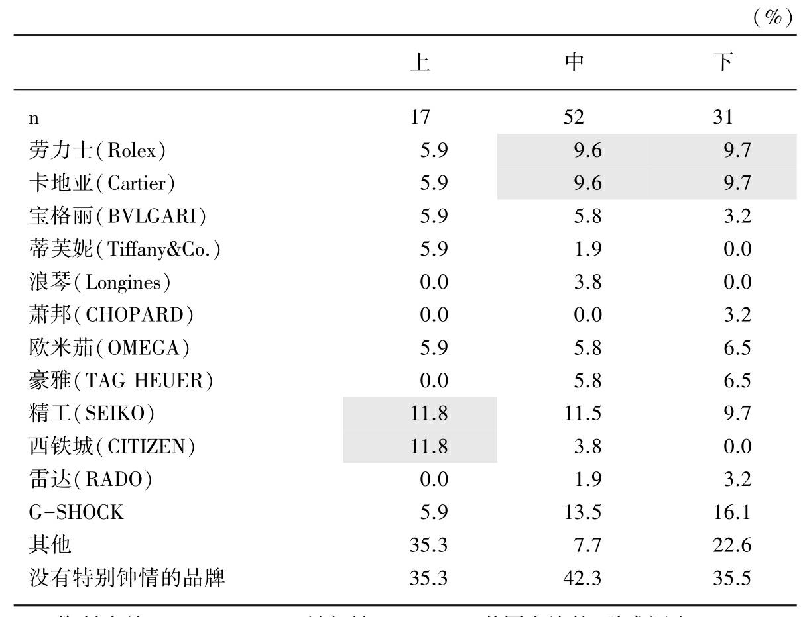
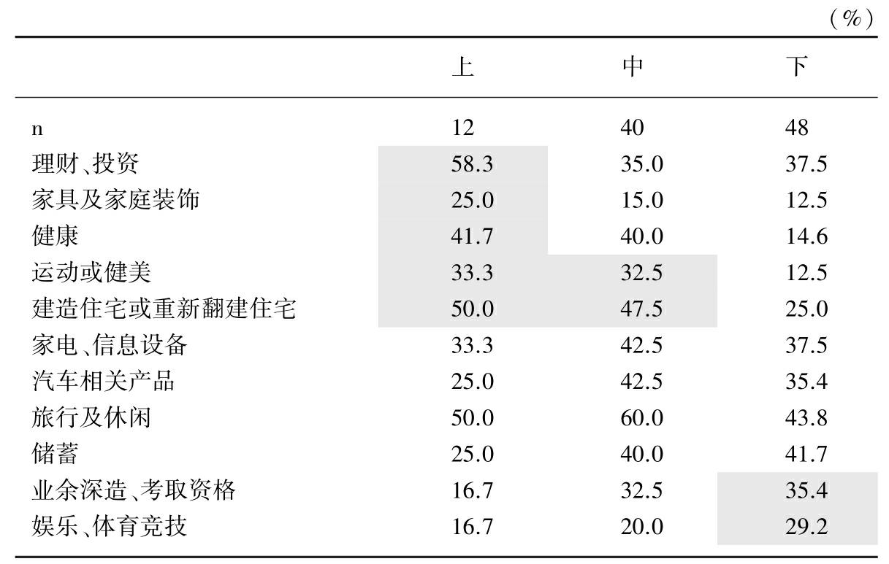
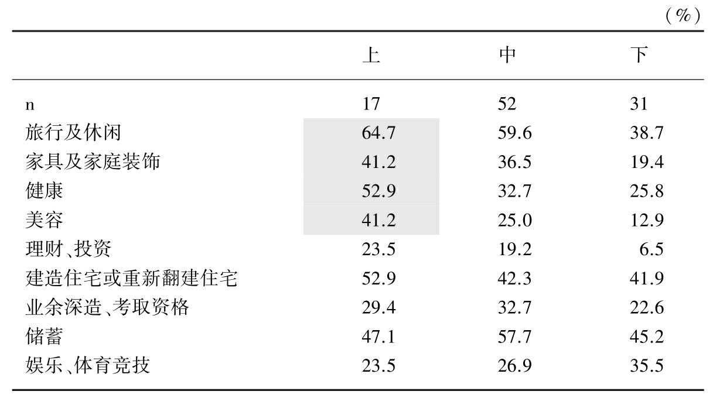

## 喜欢购物的“下流”与无暇购物的“上流”

就“平时的购物方式或购物理念”这一问题，为团块次代的被调查者提供了“符合”“基本上符合”“哪种情况都不是”“不太符合”“不符合”这五个选项。

调查结果显示，团块次代的上流阶层男性喜欢购物者较少，不容易被打折商品或低价商品所吸引，他们尽管觉得购物时应该先上店里感性认识一下商品，但实际上却没有太多的时间可以花在购物上，所以他们喜欢邮购和网上购物。购物前收集各种信息、了解商品性能、真正想要的东西不管价格高低都会买，等等，在这些方面不存在什么阶层的差异，但上流阶层的人喜欢与自己的地位、职位、年龄相符的东西，还有高价的东西和老铺里卖的东西，不过他们不限于特定的品牌和厂家（见表6-9）。

表6-9　团块次代男性平时的购物方式或购物理念

资料出处：Culture Studies研究所、e-FALCON共同实施的“欲求调查”

或许是因为上流阶层的男性工作繁忙，没有时间去寻找新的品牌，所以他们一般会选择传统的业已形成良好口碑的品牌。因此在这些人群中，拥有“劳力士”“欧米茄”等传统名表的比例较高（见表6-10）。

表6-10　团块次代男性喜欢拥有的手表品牌（主要选项）

资料出处：Culture Studies研究所、e-FALCON共同实施的“欲求调查”

反观自我主张志向强烈的下流阶层中，喜欢购物的人也占到了54.2%，还有47.9%的人拥有自己特别钟情的品牌或厂家。这一点与以往所持的只有年收入较高的人士才会拥有固定的自己特别钟情的品牌或厂家的观念并不吻合。当然，团块次代中的下流阶层所喜爱的品牌，很可能只是原宿后街那些流行小店里的品牌。

在此不想展开详细的描述，但有一点需要说明的是，较低阶层的人群对“奔驰”“宝马”“劳力士”“欧米茄”等名牌也颇为倾心，看来他们所钟情的品牌，并非局限于原宿后街那些流行小店的原创品牌。

选择商品前会花些时间和精力收集各种信息，详细了解商品的性能等，真正喜欢的东西则不管价钱多少，都会想方设法弄到手，在这些方面阶层的差异毫无体现。即使是低收入的人群也因为他们有充裕的时间，所以能慢慢地挑选商品，一旦有中意的东西便不管价钱多少也要买。

此外，在喜欢的轿车和威士忌品牌方面，也没有什么阶层差异。可以说尽管团块次代中高阶层且高收入的人群数量可观，但从企业的角度来说却并没有依据其特有的价值观和消费理念进行有针对性的产品开发设计，激发其消费欲望，倡导新的消费和生活方式。

另一方面，团块次代女性中的上流阶层，对话题性的商品较为关注，她们会与朋友或家人探讨购物的事情，并将时间花在收集信息上。作为消费者，她们对流行很敏感，从而成为流行时尚的信息源（见表6-11）。虽然向往一流的品牌，但实际上她们更倾向于在廉价商店里购物，可以说其消费行为非常理性。

表6-11　团块次代女性平时的购物方式或购物理念

资料出处：Culture Studies研究所、e-FALCON共同实施的“欲求调查”

至于手表，喜爱“劳力士”“卡地亚”等名表的，反而是“中流”和“下流”人群居多。此外，单就团块次代的“上流”女性来看，多数人喜爱“西铁城”这个品牌，可见她们也对商品具有一定的忠诚度。上流阶层女性钟情的品牌或许应当更加宽泛，更加丰富多彩，但从调查结果来看，我们却意外地发现，其品牌志向似乎颇为朴素、忠诚度也高（见表6-12）。

表6-12　团块次代女性喜欢拥有的手表品牌（主要选项）

资料出处：Culture Studies研究所、e-FALCON共同实施的“欲求调查”

男性在被问及“今后想花钱或时间去做的事情”时，上流阶层人群大多选择理财或投资、家具及家庭装饰等，健康、运动或健美得到了从中流阶层到上流阶层的普遍支持。相反，娱乐及体育竞技则广受下流阶层人群的支持（见表6-13），这与前述的不同阶层的兴趣爱好呈现出一致倾向。

女性的消费更倾向于旅行和美容

表6-13　团块次代男性今后想花钱或时间去做的事情（主要选项）

资料出处：Culture Studies研究所、e-FALCON共同实施的“欲求调查”

女性在被问及“今后想花钱或时间去做的事情”时，上流阶层的大部分人选择了旅行或休闲、家具及家庭装饰、健康、美容、理财和投资等（见表6-14）。上流阶层的一大特征是：不论男女，选择家具及家庭装饰以及理财和投资的人相对其他阶层较多。

表6-14　团块次代女性今后想花钱或时间去做的事情（主要选项）

资料出处：Culture Studies研究所、e-FALCON共同实施的“欲求调查”
