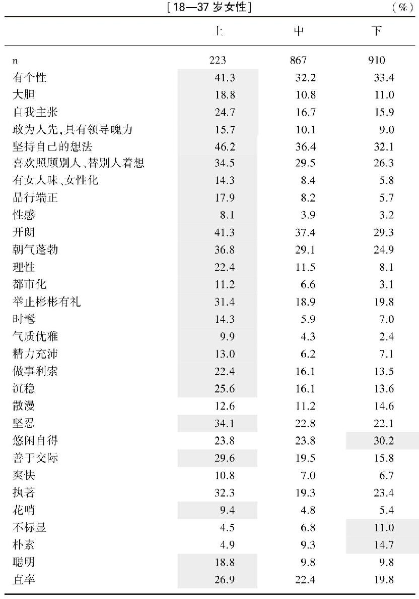

## “上流”善交际，“下流”不标显

从“第一次女性阶层化调查”的结果可以得知，性格在一定程度上也体现了阶层的差异。

当被问及用什么词句可以表现“自我风采”时，回答“善于交际”的18—37岁的女性当中，属于上流阶层的占29.6%，属于中流阶层和下流阶层的各占19.5%和15.8%。同样，回答“性格开朗”的该年龄层女性中，“上流”“中流”以及“下流”所占的比例分别是41.3%、37.4%和29.3%。此外，选择“朝气蓬勃”“自己有明确的想法”“主张自我”“大胆”“敢为人先、具有领导魄力”“喜欢照顾别人、体贴”“坚忍”等具有领导者色彩的性格的，也是上流阶层的女性居多（见表7-2）。

表7-2　不同的阶层表现“自我风采”的词汇（主要选项）

资料出处：Culture Studies研究所、读卖广告社共同实施的“第一次女性阶层化调查”

但同时，在一直以来为女性所追求的价值观方面，诸如“有女人味、女性化”“品行端正”“性感”“理性”“举止彬彬有礼”“气质优雅”等选项，也是上流阶层的女性选择更多。

此外，选择“都市化”“时髦”“做事利索”“精力充沛”“沉稳”“聪明”等词汇的同样也是上流阶层的女性居多，而这些选项给人的印象则是在工作方面很能干。

与此相对的则是，下流阶层女性所选的大多是“悠闲自得”“不标显”“朴素”，只有少部分人选择“敢为人先、具有领导魄力”“有女人味、女性化”“品行端正”“性感”“理性”“都市化”“气质优雅”“沉稳”“做事利索”“善于交际”等。
