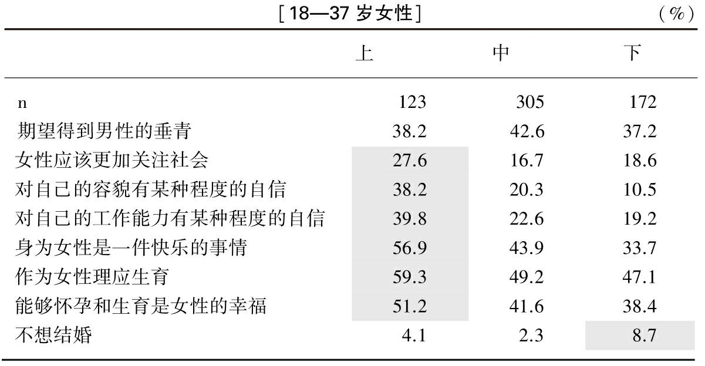

## 吊儿郎当的话，恋爱都谈不成

近年来，由于实力派职业女性不断增加，由女性撰写的实用商务类书籍也日渐增多，个人完成营业额在不列颠百科全书出版公司名列全球第二位的和田裕美就是其中之一，她的最新著作《受人欢迎的说话技巧》销量已达12万册。该书在报纸上刊出的宣传广告是这么写的：

“由于被爱，人生因此而改变！这是高明地、自然地将你的心情传达给对方的说话方式！引起共鸣的柔和用语、语尾训练、以微笑作武器……本书将教会你受用一生的七大说话秘诀！”

虽然这是一本写给企业营销人员看的书，但仅从它登在报纸上的广告语来看，简直就像是一本教人如何交男友的书。反过来说，事业成功的人，或许恋爱也相对容易成功。因为无论是工作还是恋爱，最重要的一点就是沟通，而沟通就是要积极地表现自己，唯一不同的只是推销自己和推销产品而已。

这样一来，善于运用沟通能力的女性，就有可能在工作、恋爱和婚姻方面都如愿以偿。能够很好地推销自己的女性（当然也包括男性），无论就职还是恋爱都所向披靡。

当今时代，女性已经不像从前那样，只能默默地等待男性来追求，也不是安安静静地在办公室里倒着茶端着咖啡，就会有男上司自说自话地找上门来谈婚论嫁。理想的对象要自己去寻找，不主动出击是不行的。因为现在是“恋爱我做主”的时代，不积极进取、萎靡不振的话，就很有可能在恋爱婚姻的争夺战中出局。

对女性来说，在具备女性应有的性格的同时，也能具备有利于工作、充满领导魄力的新时代的性格，那才是最具有“上流”意识的。相反，如果两者都不具备，那她就可以说是最具“下流”意识的。而这不正是现代女性之间差距加大的表现吗？

旧时有句嘲笑男人的谚语：美男子总是无钱又无权。而如今上流社会的女性则是同时兼具女人味（姿色）、金钱和权力，又有着理性、聪明、社交性等多种优秀特质（参见三浦展著《“自然派女性”的时代》）。

从“第二次女性阶层化调查”的结果也可以看出，尽管想得到男性垂青的心理不存在阶层的差别，但女性的阶层越是往“上”，对自己的容貌或工作能力就越抱有自信，同时对自己身为女性以及怀孕、生育等越是持肯定的态度（见表7-3）。

表7-3　不同阶层女性的意识差距（主要选项）

资料出处：Culture Studies研究所、读卖广告社共同实施的“第二次女性阶层化调查”
