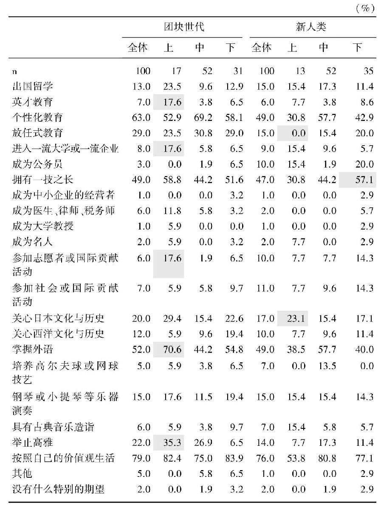
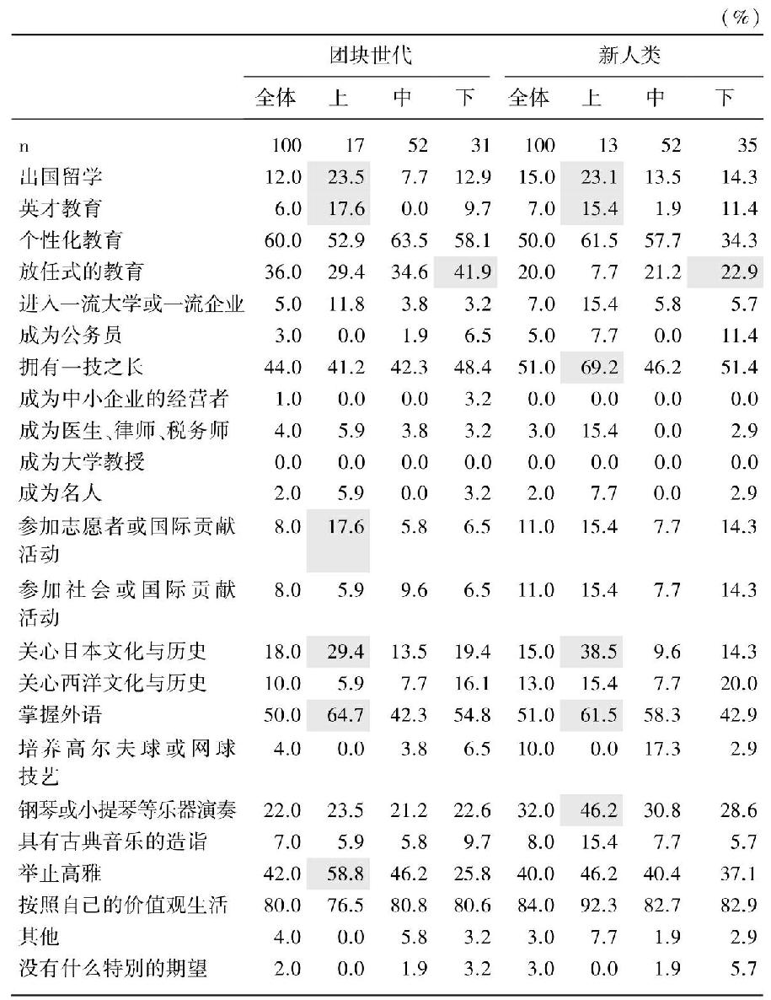

## 阶层化社会取决于团块次代女性的下一代

最后再来看看有关孩子教育的问题。如果日本从现在开始，社会的阶层差距愈加扩大，并且固定化，那么可以认为，决定这一社会趋势的将是团块次代，特别是团块次代女性的孩子们。

团块次代的女性一生下来就恰逢联合国妇女大会成立、发展的时代，她们是在女性权利不断扩大的浪潮中长大成人的。1986年日本实施《男女雇佣机会均等法》的时候，她们正值中学时代，她们拥有强烈的男女平等意识，她们这一代进入四年制大学的人数也超过了短期大学的入学人数。

然而，正因为如此，团块次代的女性并没有因为相同的性别而处于同一战线。在这个世代当中，既有年收入1000万日元的女性，也有低收入的自由打工者，阶层差距相当大。她们如果生儿育女的话，这种差距也有可能会进一步被拉大。高收入的夫妇，也许会早早地便将孩子送到国外留学，而低收入的夫妇，却只能让孩子接受普通的教育。这样一来，这些孩子之间的阶层差距究竟会发生怎样的变化呢？

让我们来看一下，在“欲求调查”中被问及“对于自己孩子将来的期望是什么”时团块次代与新人类世代的女性有何不同的回答（见表7-4、表7-5）。

表7-4　团块次代女性、新人类女性对孩子教育的期望（对男孩）

资料出处：Culture Studies研究所、e-FALCON共同实施的“欲求调查”

表7-5　团块次代女性、新人类女性对孩子教育的期望（对女孩）

资料出处：Culture Studies研究所、e-FALCON共同实施的“欲求调查”

考虑到已婚或未婚、是否育有孩子等因素可能会对回答上述问题产生影响，故另外根据已婚未婚、有无孩子分别进行了统计和分析，但统计结果无甚差别，因而最终仍旧不加区别而以整体来进行统计和分析。

此外，就男性而言，他们对孩子的期望值没有女性那么高，阶层意识也相对较薄弱，因而没有将之纳入分析的对象。
